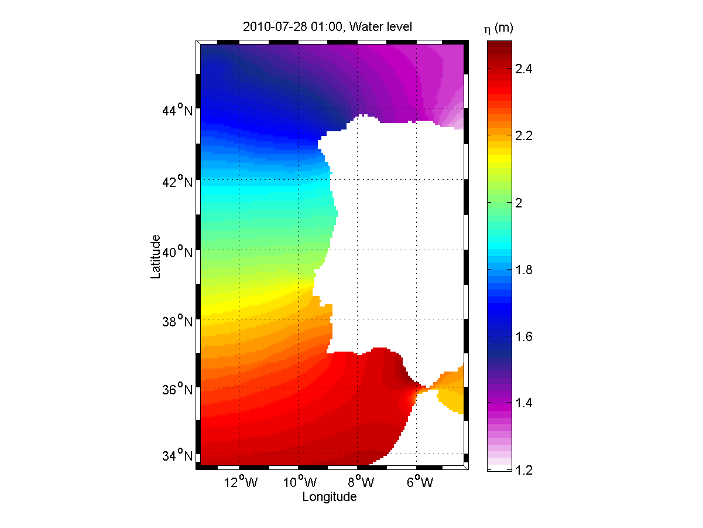
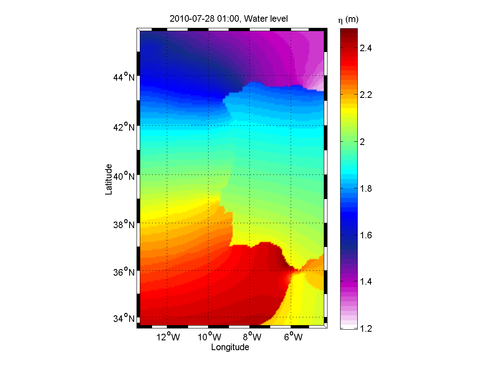
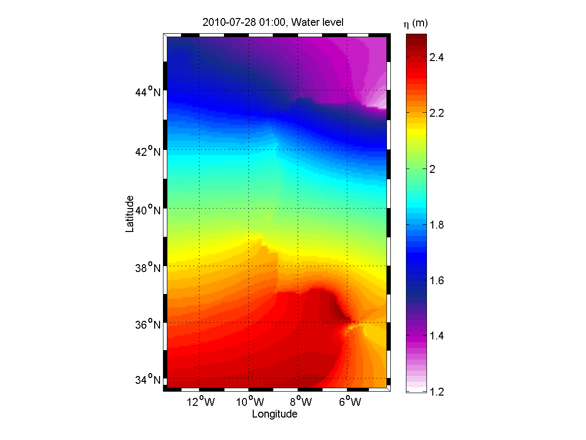
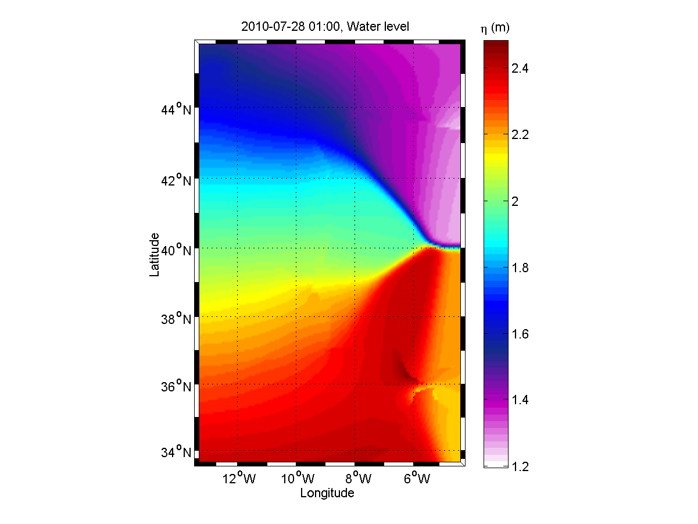

# Gallery

> **Archived page.** This content is kept for historical reference only. It may be out of date, incomplete or unrelated to the current MOHID documentation, and it is not maintained.

Below is an example gallery. Edit the source code to see how to implement in other articles of this wiki.

- Extrapolation methods
- 

    No extrapolation

- 

    Geometric extrapolation, $w_{ki} = \frac{1}{d\left(X_i,\;Y_k\right)}$

- 

    Squared extrapolation, $w_{ki} = \frac{1}{d^2\left(X_i,\;Y_k\right)}$

- 

    Gaussian extrapolation with $\sigma=5\%$ of the domain characteristic length (average of the width and height), **w\_{ki} = \\e{\\left(-\\frac{ d^2\\left(X\_i,\\;Y\_k\\right)}{\\sigma^2}\\right)}**

## See also

- [webimage](../building/README.md#webimage#webimage)
- [Extrapolation](../reference/extrapolation.md)
