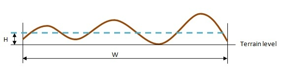

# Dual 64

This is the user's guide and log book of the dual\_64 machine. The logs are sorted chronologically descending from the last log entry to the first log entry.

## User's guide

THE DUAL\_64 USAGE IS AT BETA STAGE. Important parameters such as IP and hostname are likely to change!

### Briefing

The proposed methodology for using the fedora machine for personal use is:

1. Create or [copy](../../tools/copymohidproject.md) a model with [Mohid GUI](../../tools/gui/mohid-gui.md) at one's desktop.
2. Transfer the model with [winscp](winscp.md) to the fedora machine in the *Aplica* folder. *Soon there'll be a [batch](winscp.md) file created for that.*
3. Open a [putty](http://en.wikipedia.org/wiki/PuTTY) session to host *192.168.23.151*, login *fedora*, pass *fedora*.
4. [Purge](dual-64.md) the *.dat* files so they are path/linux/windows independent.
5. [Copy](dual-64.md) an executable version to the *exe* path. For example:
6. Launch *./MohidWater*, sitback and enjoy the ride.

```
>./MohidWater
```

Here are some specific guidelines:

1. [MOHID](../../overview/mohid.md) applications are to be inserted in */home/fedora/Aplica*. Careful not to overwrite any already existing application. In the future people will have a login and will use the */home/user/Aplica* folder.
2. The path where the mohid bins will lie is */usr/bin/mohid*. What lies in there are MOHID related libraries and executables.
3. The path where the Mohid source lies is */home/fedora/Projects/mohid\_v4*. You can get the latest version from SourceOffSite with *make nix.sos* and then build a *MohidWater* binary with *make nix*.
4. Here's the list of already existing binaries:

```
[fedora@dual_64 ~]$ ls -l /usr/bin/mohid/
-rw-r--r-- 1 root root 2452422 Jul 26 10:40 x64_doubleMohid_Base_1.lib
-rw-r--r-- 1 root root 2071128 Jul 26 10:40 x64_doubleMohid_Base_2.lib
-rwxr-xr-x 1 root root 7786218 Jul 26 10:40 x64_doubleMohidWater
-rw-r--r-- 1 root root 2436738 Jul 26 10:19 x64_singleMohid_Base_1.lib
-rw-r--r-- 1 root root 2065860 Jul 26 10:19 x64_singleMohid_Base_2.lib
-rwxr-xr-x 1 root root 7749376 Jul 26 10:19 x64_singleMohidWater
```

The naming philosophy is to add a prefix indicating the architecture (*x64* or *x32*), the floating point unit precision (*single* or *double*), the symbolic information for debugging (*g*) and the symbolic information for [profiling](profiling.md) (*g\_p*). They are for generic use. However the administrator may freely update them with the latest version of MOHID. It is VERY recommended to choose and copy one of them to the *exe* directory of the application for consistency.

### Begin a new session

1. Open a [putty](http://en.wikipedia.org/wiki/PuTTY) terminal and connect to *Dual\_64* or *192.168.20.160*.
    -   username: *fedora*
    -   password: *fedora*

### Purge the model *.dat* files

To purge the model files, a bash script was written called [mohidpurge](sed.md) and made accessible from PATH. To correctly use it, you need to go to the model's directory (in linux), then to call *mohidpurge* followed by the model's path in the windows systems. Here's an example. *MyModel* copied to linux from `E:\Aplica\MyModel`:

```
>cd MyModel
>mohidpurge E:\/Aplica\/MyModel
```

Since the *.dat* files from Mohid GUI don't work on other platforms unless some changes are operated, what the *MohidPurge* script does is:

1. all paths are [changed](sed.md) into relative paths (beginning with '../..').
2. all backslashes are [changed](sed.md) for slashes ('\\' for '/').
3. Every file named *Nomfich* are [renamed](sed.md) *nomfich* as linux is [case-sensitive](http://en.wikipedia.org/wiki/Case_sensitive).

### Run MohidWater

From your model root path (*/home/fedora/Aplica/YourModel*) in the putty session type:

```
>mohidinstall ThisSimulation
>cd ThisSimulation/exe
>./MohidWater
```

#### Run process in background

or if you need to run the model in a background process (so you can close your current shell without killing the MohidWater process) type instead

```
>exec ./MohidWater &> MohidWater.log &
```

Remember the ampersand (the symbol at the end)!! In that case, the MohidWater console output is redirected to MohidWater.log. If you want to rerun the model you can skip the copy part (first line). It is advised for consistency that you keep the same executable for all the runs in your application.

## Log

### 20090721

- installed & configured mailx and [msmtp](msmtp.md)
- Created and scheduled a scripts that builds the mohid makefile then sends an email if an error or a warning rises.

```
0 23 * * * $HOME/Projects/scripts/mohidnightlybuild.sh >/dev/null 2>&1
```

### 20090714

#### Installing svn

- downloaded the svn source from subversion.tigris.org
- downloaded svn dependency apr and apr-util
- built apr

```
> ./configure
> make
> sudo make install
```

- built apr-util

```
> ./configure --with-apr=../apr-1.3.6
> make
> sudo make install
```

- downloaded the sqlite

```
> mkdir subversion-1.3.6/directory
> cp sqlite3.c subversion-1.3.6/directory/sqlite3.c
```

- built svn

```
> ./configure --with-apr=../apr-1.3.6 -with-apr-util=../apr-util-1.3.8
> make
> sudo make install
```

### 20080129

- Installed in the PATH 

$$
\ncdump
$$

 and [ncgen.

### 20070725

Here are the 3 steps to create a fresh directory of the preop-model:

1. Create the directory tree,
2. Copy the GeneralData files,
3. Copy the configuration files of each submodel;

```
> cd /home/Aplica/PreOp-Model
> for i in `find . -type d`; do mkdir /home/Aplica/PreOp-Model-V2/$i; done;
> cd /home/Aplica/PreOp-Model/GeneralData
> for i in `find . -type f`; do cp $i /home/Aplica/PreOp-Model-V2/GeneralData/$i; done;
> cd /home/Aplica/PreOp-Model
> for i in `find . | grep '_root\.dat'`;do cp $i /home/Aplica/PreOp-Model-V2/$i; done;
```

I still need to change the bathymetries and the hdf5 input files accordingly. As for the mslp Vs atmospheric pressure; I still need to test the mohidwater with mslp in my own machine. Only by friday will I get fresh results.

### 20070716

#### Bad blocks

Here's what I did when trying to diagnose and recover a failure from the hard-drives:

```
> su
```

```
> df
Filesystem           1K-blocks      Used Available Use% Mounted on
/dev/sda3            241023808  95102800 145921008  40% /
/dev/sda1                69972     13050     53309  20% /boot
/dev/sdb1            976529360 284465684 692063676  30% /home
tmpfs                  4061936         0   4061936   0% /dev/shm
```

```
> debugreiserfs /dev/sda3
debugreiserfs 3.6.19 (2003 www.namesys.com)
Filesystem state: consistency is not checked after last mounting
Reiserfs super block in block 16 on 0x803 of format 3.6 with standard journal
Count of blocks on the device: 60257792
Number of bitmaps: 1839
Blocksize: 4096
Free blocks (count of blocks - used [journal, bitmaps, data, reserved] blocks): 36480251
Root block: 8323803
Filesystem is NOT clean
Tree height: 5
Hash function used to sort names: "r5"
Objectid map size 172, max 972
Journal parameters:
        Device [0x0]
        Magic [0x3435a9d1]
        Size 8193 blocks (including 1 for journal header) (first block 18)
        Max transaction length 1024 blocks
        Max batch size 900 blocks
        Max commit age 30
Blocks reserved by journal: 0
Fs state field: 0x0:
sb_version: 2
inode generation number: 333260
UUID: a6b186c9-fc9a-44ac-a82a-0545dd759994
LABEL:
Set flags in SB:
         ATTRIBUTES CLEAN
```

```
> debugreiserfs /dev/sda1
reiserfs_open: the reiserfs superblock cannot be found on /dev/sda1.
debugreiserfs: can not open reiserfs on "/dev/sda1": no filesystem found
```

```
> debugreiserfs /dev/sdb1
debugreiserfs 3.6.19 (2003 www.namesys.com)
The problem has occurred looks like a hardware problem. If you have
bad blocks, we advise you to get a new hard drive, because once you
get one bad block  that the disk  drive internals  cannot hide from
your sight,the chances of getting more are generally said to become
much higher  (precise statistics are unknown to us), and  this disk
drive is probably not expensive enough  for you to you to risk your
time and  data on it.  If you don't want to follow that follow that
advice then  if you have just a few bad blocks,  try writing to the
bad blocks  and see if the drive remaps  the bad blocks (that means
it takes a block  it has  in reserve  and allocates  it for use for
of that block number).  If it cannot remap the block,  use badblock
option (-B) with  reiserfs utils to handle this block correctly.

bread: Cannot read the block (2): (Input/output error).

Aborted
```

### 20061124

- Added perl module Date::Calc with

```
> perl -MCPAN -e shell
cpan> install Date::Calc
```

- Implemented in Aplica/PreOpModel the downloading automated process

### 20061021

The [Nx nomachine](nx-nomachine.md) was installed. It allows to easily connect remotely to the workstation. The [rdesktop](README.md#linux-rdesktop#linux-rdesktop) was installed. It allows to connect remotely to windows systems with remote-desktoping enabled:

```
> rdesktop -u Administrator -d MARETEC Einstein
```

To access to fedora@dual\_64 type.

```
$ vncviewer dual_64.maretec.ist.utl.pt:0
```

This log explains how to re-install GNOME using yum. Apparently, the X11 libraries were corrupted thus the graphical environmente wouldn't start. Bomer! Here's the answer: By the way, if something goes wrong while downloading with yum, then try to purge yum cache before and update the yum:

```
> sudo yum clean all
> sudo yum update
> sudo yum -y groupremove "GNOME Desktop Environment" (this line wasn't actually performed)
> sudo yum -y groupremove "X Window System"
> sudo yum -y groupinstall "X Window System"
> sudo yum -y groupinstall "GNOME Desktop Environment"
> sudo yum install samba
> system
```

Note: the samba daemon needs to be reinstalled too. Also a firewall was mounted by gnome. To disable it see the [Linux network](linux-network.md) article.

If everything went well, the gnome X environment should start with the following command:

```
> startx
```

### 20061021

This log explains how to recover the RAID1 logical drive:

#### RAID controller BIOS configuration

At boot 

$$
Ctrl-M
$$

 to enter the RAID controller BIOS setup:

\-->Clear configuration
\-->New configuration
\-->Initialize Logical drive (will loose all info on drive!)
\-->Save and reboot

Be careful now, don't initialize the system disk unless you want to reinstall the OS!

#### Creating and formatting a partition in /dev/sdb

To see available drives and devices:

```
> fdisk -l
```

To see drives with correct filesystems:

```
> df -T
```

Creating a DOS table to Dual\_64 RAID 1 logical drive and one primary partition:

```
> fdisk /dev/sdb
#m> n
#m> p
#m> 1
#m> t 1
#m> 83
#m> w
```

Creating an extended filesystem partitioon to the whole RAID 1 drive:

```
> mkfs -t ext3 /dev/sdb1
> e2label /dev/sdb1 /mnt/RAID1
> vim /etc/fstab
#vim> LABEL=/mnt/RAID1   /mnt/RAID1   ext3    default   1 2
```

#### Moving `/home` to the RAID1 partition

Moving the `/home` directory to the `/dev/sdb1`:

```
> init 1
> cd /home
> cp -ax * /mnt/RAID1
> mv /home /home.old
> mkdir /home
> mount /mnt/RAID1 /home
> vim /etc/fstab
#vim> LABEL=/mnt/RAID1   /home    ext3    default   1 2
```

### 20060828

If one needs to mount the dvd-drive then type

```
>mount /dev/dvd /mnt/dvd
```

### 20060801

- [MPICH](../../building/linux/mpi.md) successfully installed.
- PedroG started running *Alqueva* model using some experimental openmp implementations in *ThomasZ* algorithm.
- Troubleshooting, installing MPICH in linux. Edited the */etc/hosts* file:

```
vim /etc/hosts
```

127.0.0.1 localhost.localdomain.com localhost
#added this line
192.168.20.160 dual\_64.maretec.ist.utl.pt dual\_64

Now *mpdcheck -s* / *mpdcheck -c* works!

### 20060728

#### The Mohid standard benchmark results:

**All processors using OpenMP:**

```
-------------------------- MOHID -------------------------

Program Mohid Water succefully terminated

Total Elapsed Time     :        86.0820

Total CPU time         :       322.9962

CPU usage (%)          :       375.2192

Workcycle Elapsed Time :        78.3990

Workcycle CPU time     :       313.3636

Workcycle CPU usage (%):       399.7036

----------------------------------------------------------
```

**Single processor:**

```
-------------------------- MOHID -------------------------

Program Mohid Water succefully terminated

Total Elapsed Time     :        91.3430

Total CPU time         :        91.3417

CPU usage (%)          :        99.9986

Workcycle Elapsed Time :        83.2600

Workcycle CPU time     :        83.2612

Workcycle CPU usage (%):       100.0014

----------------------------------------------------------
```

#### A single core characteristic:

```
>cat /proc/cpuinfo
processor       : 0
vendor_id       : AuthenticAMD
cpu family      : 15
model           : 33
model name      : Dual Core AMD Opteron(tm) Processor 270
stepping        : 2
cpu MHz         : 1991.609
cache size      : 1024 KB
physical id     : 0
siblings        : 2
core id         : 0
cpu cores       : 2
fpu             : yes
fpu_exception   : yes
cpuid level     : 1
wp              : yes
flags           : fpu vme de pse tsc msr pae mce cx8 apic sep mtrr pge mca cmov pat pse36 clflush  mmx fxsr sse sse2 ht syscall nx mmxext fxsr_opt lm 3dnowext 3dnow pni lahf_lm cmp_legacy
bogomips        : 3987.91
TLB size        : 1024 4K pages
clflush size    : 64
cache_alignment : 64
address sizes   : 40 bits physical, 48 bits virtual
power management: ts fid vid ttp
```

#### The results on Luis PC

```
Pentium4 3.2 GHz 2 GB RAM
```

```
Total Elapsed Time     :        83.4550

Total CPU time         :        82.8906

CPU usage            :        99.3237

Workcycle Elapsed Time :        76.5790

Workcycle CPU time     :        76.0781

Workcycle CPU usage  :        99.3459
```

The first conclusions aren't too encouraging. Yet it still wasn't optimized.

### 20060726

#### Testing x32/x64 architecture X single/double precision

Throughout these tests the same MohidWater baroclinic 3D model was run.

**x64\_single\_openmp:**

```
-------------------------- MOHID -------------------------

Program Mohid Water succefully terminated

Total Elapsed Time     :      1465.4191

Total CPU time         :      5857.4219

CPU usage (%)          :       399.7097

Workcycle Elapsed Time :      1463.8910

Workcycle CPU time     :      5855.1538

Workcycle CPU usage (%):       399.9720

----------------------------------------------------------
```

#### Testing the CPU workload distribution by processes

- Running 5 simultaneous [MohidWater](../../reference/mohidwater.md) models by different users. Note how the workload is distributed among CPUS:

```
>ps au
```

```
USER       PID %CPU %MEM    VSZ   RSS TTY      STAT START   TIME COMMAND
fedora    1160 65.2  0.6  37968 24564 pts/3    R+   09:57   0:54 ./MohidWater
fedora    1162 99.1  0.6  38500 25004 pts/5    R+   09:57   1:04 ./MohidWater
fedora    1163 98.2  0.6  38508 25008 pts/1    R+   09:57   0:59 ./MohidWater
fedora    1164 99.5  0.6  38508 25012 pts/2    R+   09:57   0:57 ./MohidWater
fedora    1165 51.2  0.6  37960 24560 pts/4    R+   09:58   0:28 ./MohidWater
fedora    1170  0.1  0.0  59864  1664 pts/6    Ss   09:58   0:00 -bash
```

- Running 4 simultaneous [MohidWater](../../reference/mohidwater.md) models by different users. Note how the workload is well balanced between CPUS (each with 100% of usage):

```
>ps au
```

```
USER       PID %CPU %MEM    VSZ   RSS TTY      STAT START   TIME COMMAND
fedora   29734 99.9  0.7  46488 30408 pts/2    R+   20:49  18:23 ./MohidWater
fedora   29735 99.9  0.7  46068 30144 pts/3    R+   20:49  18:22 ./MohidWater
fedora   29736 99.8  0.7  46060 30136 pts/1    R+   20:49  18:19 ./MohidWater
fedora   29737 99.8  0.7  46068 30144 pts/4    R+   20:49  18:18 ./MohidWater
fedora   29742  0.0  0.0  59868  1688 pts/5    Ss   20:49   0:00 -bash
```

**Conclusion**: The linux OS natively handles well the different processes between CPUS. 4 single-threaded models may run using 100% of each processor. 5 single-threaded models will imply that a CPU will share 50%-50% the workload of two of them. This is interesting as 4 modelers who don't use the MPI option may share the same machine without loss of CPU power.

### 20060721

- Battery tests idealized with [profiling](profiling.md): A) run the standard benchmark, B) run a 3D application for:
    1.  x64\_single precision
    2.  x64\_double precision
    3.  x32\_single precision
    4.  x32\_double precision
- The [makefile methodology](../../building/linux/makefile.md) was implemented and the MOHID files are easily retrievable from the [SourceOffSite](sos.md). MOHID now compiles in the dual\_64 machine.

### 20060717

- The intel fortran compiler, the hdf5 and netcdf libraries were successfully installed. Users are fedora:fedora and root:... . The useradd command doesn't work? The machine current ip is 192.168.20.160 and is ssh ip-accessible within the intranet. Name resolution is still a problem. Samba is yet to be properly configured.
- As the intel fortran is distributed in rpms, the Fedora Core seemed appropriate and straightforward for installation. A boot DVD was made and installed. Thus a stripped version of Fedora Core 5 x86\_64 is the current dual\_64 OS. During installation, a custom installation was chosen, and all the compatibility and legacy packages available were installed (glibc, libstdc++, and libgcc among others).
- During the installation of glibc (legacy lib) things went wrong. Lost all control over the machine. Solution: reinstallation of the entire OS.
- The intel fortran wouldn't install as some legacy libraries required were missing.
- As of this date, the machine was delivered last week with the Gentoo Vannilla distribution.


