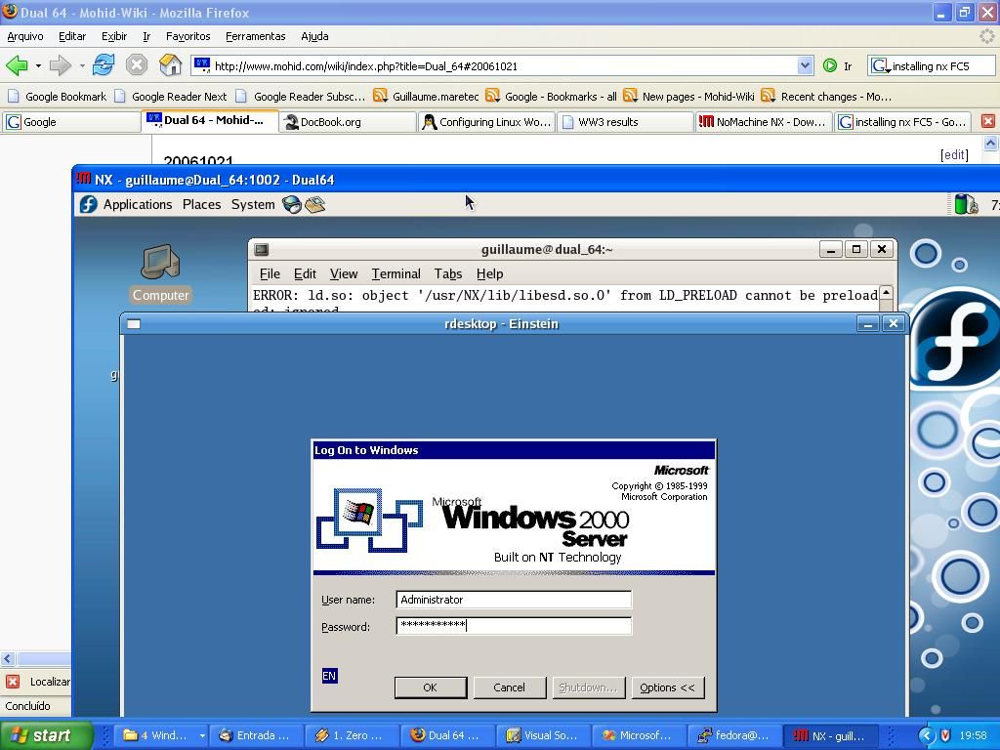
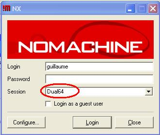
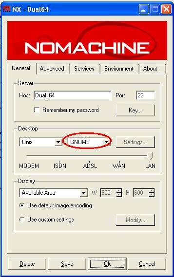

# Freenx



Accessing Einstein via remote desktop from a Nomachine remote session to the Dual\_64 workstation. And all this from a windows computer within MARETEC domain.

**Freenx** allows remote desktop services. It is ultra-fast. The comercial version is [Nx nomachine](nx-nomachine.md).

## Installation on linux

Basically follow [this](http://fedoranews.org/contributors/rick_stout/freenx/) tutorial.

```
> yum install freenx
```

Then copy the client key from */etc/nxserver* to the client computer (with scp). Then while configuring the nx client, remember to import the client key.

## Installation on Windows

Run this windows installer:

1. Install the [nx windows client](http://64.34.161.181/download/2.1.0/Windows/nxclient-2.1.0-6.exe),

## Accessing Dual\_64

From the windows start panel:

```
Start->NX client for windows->NX client for windows
```

Type Dual\_64 on session and type your login for the Dual\_64 workstation. If you don't have a login then you need to create one for you. Call the Dual\_64 workstation administrator for that.



Then click on *Configure* and choose the GNOME desktop. Save the configuration, login and you're on!



**NOTE: IF ERROR OCCURS, THEN REPLACE HOSTNAME *DUAL\_64* WITH *192.168.23.151.***

**NOTE: The free version of the nx server only allows 2 users and 2 concurrent connections! Currently the 2 users are *fedora* and *guillaume*.**

## Accessing data.mohid.com

From the windows start panel:

```
Start->NX client for windows->NX client for windows
```

Type data.mohid.com on session and type your login for the data.mohid.com workstation. If you don't have a login then you need to create one for you. Call the data.mohid.com workstation administrator for that. Then click on *Configure*, import the key and choose the GNOME desktop. Finally on advanced, select the SSL secure connection. Save the configuration, login and you're on!

**NOTE: IF ERROR OCCURS, THEN REPLACE HOSTNAME *data.mohid.com* WITH *192.168.20.222.***

## External references

- [http://www.nomachine.com/](http://www.nomachine.com/)
- [http://fedoranews.org/contributors/rick\_stout/freenx/](http://fedoranews.org/contributors/rick_stout/freenx/)
