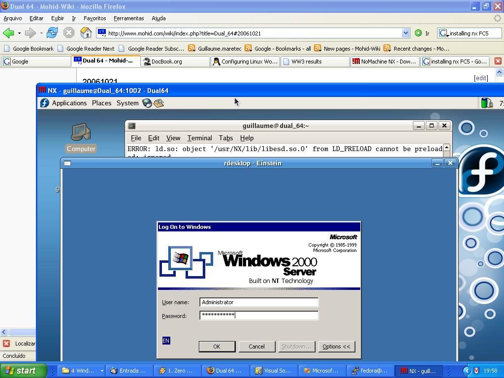
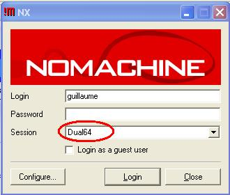
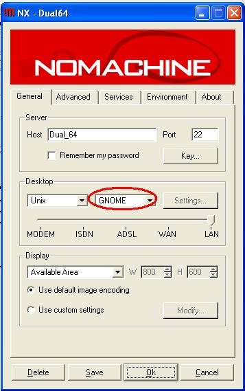

# Nx nomachine



Accessing Einstein via remote desktop from a Nomachine remote session to the Dual\_64 workstation. And all this from a windows computer within MARETEC domain.

Nx allows remote desktop services. It is ultra-fast. The opensource version is [freenx](freenx.md).

## Installation on linux

Install these rpm packages following the sequence:

1. Install the [nx linux client](http://64.34.161.181/download/2.1.0/Linux/nxclient-2.1.0-6.i386.rpm),
2. Install the [nx node client](http://64.34.161.181/download/2.1.0/Linux/nxnode-2.1.0-7.i386.rpm),
3. Install the [nx linux server](http://64.34.161.181/download/2.1.0/Linux/FE/nxserver-2.1.0-9.i386.rpm).

## Installation on Windows

Run this windows installer:

1. Install the [nx windows client](http://64.34.161.181/download/2.1.0/Windows/nxclient-2.1.0-6.exe),

## Accessing Dual\_64

From the windows start panel:

```
Start->NX client for windows->NX client for windows
```

Type Dual\_64 on session and type your login for the Dual\_64 workstation. If you don't have a login then you need to create one for you. Call the Dual\_64 workstation administrator for that.



Then click on *Configure* and choose the GNOME desktop. Save the configuration, login and you're on!



**NOTE: IF ERROR OCCURS, THEN REPLACE HOSTNAME *DUAL\_64* WITH *192.168.23.151.***

**NOTE: The free version of the nx server only allows 2 users and 2 concurrent connections! Currently the 2 users are *fedora* and *guillaume*.**

## External references

- [http://www.nomachine.com/](http://www.nomachine.com/)
