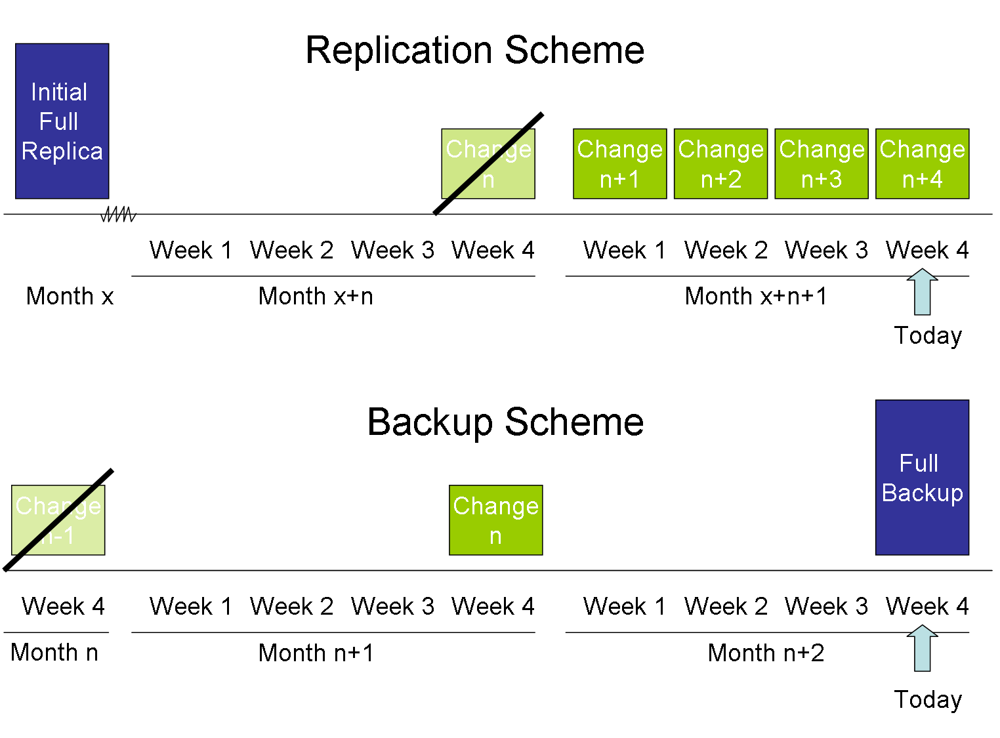

# Vmware

> **Archived page.** This content is kept for historical reference only. It may be out of date, incomplete or unrelated to the current MOHID documentation, and it is not maintained.

[VMware server](http://www.vmware.com/products/server/) is a virtual machine server that allows to launch guest OS from within a host OS. Its utility for testing new software, and new network configurations is huge!

[VMware player](http://www.vmware.com/products/player/) allows to play images of virtual machines (not required if you already have the [VMware server](http://www.vmware.com/products/server/)). An image of a virtual machine is called an [appliance](http://www.vmware.com/vmtn/appliances/directory/).

[VMware converter](http://www.vmware.com/products/converter/) allows to transform any physical computer into a virtual machine. This can be useful when you want to port a given computer configuration to other machines.

## Installation under linux

- Download the vmware server for linux.
- Register and ask for a few license keys.
- Install the kernel-devel rpm package for kernel source code recompilation.
- Install the inetd and xinetd.
- Install the vmware server for linux.
- from the shell type:

```
> vmware-config.pl
```

and follow the installer instructions. By the end, you should have the vmware daemon up and running successfully and ready to install guest OSes.

## Installing new virtual machines

- From Applications-->System Tools-->VMware server console.

## Toggling between Full-screen and windowed modes

The magic key stroke is:

```
ctrl-alt-enter
```

## Expanding the size of a disk

There is an command line utility that can resize your VMachine disk:

```
 C:\Program Files\VMware\VMware Server>vmware-vdiskmanager -x 20GB
 "D:\VMmachines\Fedora Core 4 Workstation\Other Linux 2.6.x kernel.vmdk"
```

Then, you need to adjust the partition to this new size. WARNING: this is a bit dangerous if you don't follow the next commands exactly as written!

- enter as root or su and type:

```
 fdisk /dev/sda
```

- list the partitions:

```
 p
```

- delete the system partiton(partition 2, probably):

```
 d
```

- create a new one:

```
 n
```

- p for primary and when it asks the new size, put in the new size(20GB for the example above)
- write the new partition to the disk:

```
 w
```

- reboot.. and it should(...) be fine.

## External References

- [VMware homepage](http://www.vmware.com)
- [Appliances marketplace](http://www.vmware.com/vmtn/appliances/directory/)

## Merged from "VMWare"

> **Archived page.** This content is kept for historical reference only. It may be out of date, incomplete or unrelated to the current MOHID documentation, and it is not maintained.

VMWare was the second step of virtualization infraestructure in Maretec (after Xen).

## Physical Machines

## Installation Phase

### Migrating Existing VM in Xen

Existing VM in Xen server were duplicated in VMWare environment in RAID machine (the future backup machine). Before installation in definite place (CISCO server, ESXi1) the original ones should be replaced by the news to ensure the system works.

#### Creating a new FTPServer

A VM was added to vShere and installed Windows Server 2008 and configured as the existing Xen FTPServer. See [Creating a FTPServer in VMWare](../creating-a-ftpserver-in-vmware.md) for details.

#### Creating a new WebServer

A VM was added to vShere and installed Windows Server 2008 R2 and configured (Web sites that were inside FTPServer). See [Creating a WebServer in VMWare](../web/creating-a-webserver-in-vmware.md) for details.

#### Creating a new OpenDAPServer

A VM was added to vShere and installed Fedora and configured as the existing Xen OpenDAPServer.

See [Creating an OpenDAPServer in VMWare](../creating-an-opendapserver-in-vmware.md) for the first attempt with LVM defaults from Fedora. After PVextend machine crashed.

See [Creating an OpenDAPServer in VMWare2](../creating-an-opendapserver-in-vmware2.md) for the second attempt with user defined LVM and till now the best creation.

### Creating a new VM Domain Controller

A VM DC, VM-DC2, was added to CISCO server, ESXi1, and installed Windows Server 2008 R2. See [Creating a Domain Controller in VMWare](../creating-a-domain-controller-in-vmware.md) for details.

### Creating a new Physical Domain Controller

A physical DC, DC1, was installed with Windows Server 2008 R2. It was similar install as the VM-DC2 but drivers for LAN, sound, video, etc had to be installed.

### Creating a VM Backup Server

[Creating a BackupServer in VMWare](../creating-a-backupserver-in-vmware.md)

### Creating a Database Server

[Creating a DatabaseServer in VMWare](../creating-a-databaseserver-in-vmware.md)

## Production Phase

### Changing the bridging between the LAN and the DMZ

#### Opendap

eth0 - LAN

eth1 - DMZ

The steps are for changing from DMZ to LAN and (from LAN to DMZ)

- Need to add in vSphere the new interface to the VM (by default the DMZ machines should not have the two interfaces on because that would create a security issue since anyone that had control to the machines could connect the LAN and access it) - see the steps in the creation of the machines.
- Enter the VM through console access as **user**

- Just use network icon in rigt up corner, disconnect eth1(eth0) and connect eth0(eth1)

- It is done if change is temporary! Do not forget to remove the LAN adapter in vSphere after not needed because it creates a security issue.

- However if connection is to maintain after reboots it is better to take eth0(eth1) down definitely in network restart

```
Other--> Network Connections
Select to not connect eth1(eth0) automatically but connect automatically eth0(eth1)    'or eth1(eth0) it would give fail in network restart after taking it down below)
Save.

> ifconfig ethx down                 'x is 1 in case of wanting to go LAN at restart, is 0 otherwise
> service network status
> su
> service network restart
> ifconfig
```

- Do not forget to remove the LAN adapter in vSphere after not needed because it creates a security issue.

#### Windows VM's

- Need to add in vSphere the new interface to the VM (by default the DMZ machines should not have the two interfaces on because that would create a security issue since anyone that had control to the machines could connect the LAN and access it) - see the steps in the creation of the machines.

- Enter the VM in console and just go to connections and disable one and enable the other.

- Do not forget to remove the LAN adapter in vSphere after not needed because it creates a security issue.

### Extend disk size / Add new disk

#### Opendap

From VMWare communities

```
Two ways exist to extend a volume when LVM is in use. But first answer this question:
    Are you comfortable with your backup?

Then:

1) In vSphere change the size of the VMDK to be greater
2) In vSphere add a new VMDK/RDM/vRDM to the VM <=== Recommended over the other if this is the boot volume

Now from within the Linux VM:

1) create LVM partitions on the volumes for all the free space of the virtual disks
2) Use your favorite LVM tool to add the newly created partitions to your LVM volumes.
```

- First, ensure the backup of the VM!

- Power off the virtual machine.

- Edit the virtual machine settings and add/extend the virtual disk size.

```
IMPORTANT: if only have the boot volume do not add size to the existing virtual disk.
Add one new disk. Adding a disk is not diferent from extending a disk since you need the LVM to acknowledge its presence (new disk or new disk space).
```

- Power on the virtual machine.

- Identify the device name, which is by default /dev/sda, and confirm the new size by running the command:

```
>fdisk -l
```

- Or check the name of the new disk in the VMachine Disk Utility (Accesories). It was /dev/sdb

- Create a new partition of appropriate size using fdisk

```
>fdisk /dev/sdb
>n             (create new partition, select start and end cylinders (default), all free space is selected by default)
>w             (save partition table and exit)
>fdisk -l      (check the new partition, /dev/sdb1 was created ~10G in size)
```

- Create an ext3 filesystem in the partition (this step is optional, just a quick test that all is well)

```
>mkfs.ext4 /dev/sdb1
```

- Initialise the partition for use as a physical volume in lvm and add it to vg\_opendap2

```
>pvcreate /dev/sdb1
>vgextend vg_opendap2 /dev/sdb1
```

- Extend LogVol00 (use 'df /' to check that / is mounted on LogVol00) as required (by 10G here)

```
>lvextend -L +10G /dev/vg_opendap2/lv_opendap
```

- If you receive errors about not enough physical extents, then reduce the size of the extension a little until it fits.

- Finally, resize the filesystem (this part normally would require unmounting /, but for ext4 it works while the partition is mounted)

```
>resize2fs /dev/vg_opendap2/opendap
```

- Type 'df -h /', to check it worked, there should be an extra 10G available

(you can use vgdisplay, pvdisplay and lvdisplay (as root) to see detailed info, pvscan for a summary)

#### Windows VM's

Follow the instructions in Resizing a Virtual Disk for Windows Guests with Step by Step Instructions [http://communities.vmware.com/thread/92619](http://communities.vmware.com/thread/92619) (forum) or directly [http://communities.vmware.com/servlet/JiveServlet/download/690626-1871/Resizing%20a%20Virtual%20Disk%20for%20Windows%20Guests.pdf](http://communities.vmware.com/servlet/JiveServlet/download/690626-1871/Resizing%20a%20Virtual%20Disk%20for%20Windows%20Guests.pdf) (pdf step by step).

Adding a disk is fast, just add it in vSphere and start it in disk management.

Extending a disk takes more steps since the Windows OS, as Linux LVM, needs to aknowledge the disk space difference and third party tools are used.

### Backup VM

The backup strategy was implemented in the virtual machine VM-BackupServer created in the ESXi backup server:

1. One Replication for each VM from production ESXi host to ESXi disaster and recovery host (FTPServer and WebServer in disk 1 and OpenDAPServer, DC2 in disk 2 (4 restore points done weekly (saturday morning)).
2. One reverse incremental backup of all initial VM to backup server Davinci and one backup of all machines (above VM's + BackupServer) (2 restore points done every two months (last sunday in the morning); the picture is dated since it shows monthly backup).



Virtual Machines Backup and Replication Scheme

The Backup And Replication strategy allows to go back minimum two months and maximum 4 months with backup (takes more time to recover from backup since files are compressed) and 3 to 4 weeks with replication (machines are ready to enter in service in replication server).

### Restore VM

From Veeam Manual

In case of software or hardware malfunction, you can quickly recover a corrupted VM by failing over to its replica. When you perform failover, a replicated VM takes over the role of the original VM. You can fail over to the latest state of a replica or to any of its good known restore points. In Veeam Backup & Replication, failover is a temporary intermediate step that should be further finalized. Veeam Backup & Replication offers the following options for different disaster recovery scenarios:

• You can perform permanent failover to leave the workload on the target host and let the replica VM act as the original VM. Permanent failover is suitable if the source and target hosts are nearly equal in terms of resources and are located on the same HA-site.

• You can perform failback to recover the original VM on the source host or in a new location. Failback is used in case you failed over to a DR site that is not intended for continuous operations, and would like to move the operations back to the production site when the consequences of a disaster are eliminated.

#### Failover

In Veeam Backup & Replication, the actual failover is considered a temporary stage that should be further finalized. That is, after you test the VM replica and make sure the VM runs stable, you should take another step to perform permanent failover. However, while the replica is still in the Failover state, you also have an option to undo failover or perform failback.

```
Go to Veeam Backup & Replication in VM-BackupServer and:
Tools->Backup->Restore From Replica (Failover to Replica)
```

**Permanent Failover**

To confirm failover and finalize recovery of a VM replica on the target host, you need to perform permanent failover. As a result of permanent failover, the VM replica ceases to exist as a replica and takes on the role of the original VM.

```
The Permanent failover process should be avoid because it changes the original vm place and needs a further copy to the original host.
The original host should be recovered and return operation to it (failback).
```

**Undo Failover**

To switch back to the original VM, revert replication operations and discard changes made to the working VM replica, you can undo failover.

During failover, the state of the original VM on the source host is not affected in any way. Basically, if you need to test the replica and its restore points for recoverability, you can perform actual failover as a background process while the original VM is running. After all necessary tests, you can undo failover and go back to the normal mode of operation.

#### Failback

Veeam Backup & Replication streamlines and automates disaster recovery by providing replica failback capabilities. Failback is the process of switching from the VM replica to the production VM. During failback, Veeam Backup & Replication uses the working replica to recover the original VM and switch back to it.

```
Go to Veeam Backup & Replication in VM-BackupServer and:
Tools->Backup->Restore From Replica (Failback)
```

If you managed to restore operation of the source host, you can switch back to the original VM on the source host. However, if the source host is not available, you can restore the original VM to a new location and switch back to it. Veeam Backup & Replication offers three failback options:

• Fail back to a VM in the original location on the source host

• Fail back to a VM that has been restored up-front from a backup in a new location

• Fail back to an entirely new location by transferring all replica files to the selected destination

The first two options help you decrease recovery time and use of the network traffic, as Veeam Backup & Replication will transfer only differences between the two VMs. The third option is used in cases when there is no way to use the original VM or restore the VM before performing failback.

```
The normal process should be the first, recovering it to the same host.
Maretec infrastructure is prepared to have to ESXi hosts (production site and Disaster and Recovery site).
However in the future if current Xen server is converted to ESXi server than the rwo latter options may be considered.
```

In Veeam Backup & Replication, failback is considered a temporary stage that should be further finalized. That is, after you test the recovered original VM and make sure it is running correctly, you should take another step to commit failback. However, while the replica is still in the failback state, you also have an option to undo failback and return the replica back to the failover state.

**Commit Failback**

To confirm failback and finalize recovery of the original VM, you need to commit failback. As a result of failback commit, Veeam Backup & Replication removes the protective snapshots and unlocks replica disk files. The state of the replica is changed from Failback to Normal.

**Undo Failback**

If the VM to which you failed back from a replica is non-operational or corrupted, you can undo failback and switch the replica back to the failover state.

#### VM Copy

With Veeam Backup & Replication, you can run a VM copy job to create an independent fully-functioning copy of a virtual machine on a selected storage.

### TroubleShooting

#### Can't connect to microsoft.com (can´t connect Messenger)

**First Symptons:** Messenger can't connect; cant access microsoft sites.

**Cause:** This occured because microsoft.com was not accepting our connections and all the services downstream would fail. DNS server PTR record (that translates ips to hosts, or reverse DNS) was corrupted and so microsoft.com was not accepting connections. this could have happened also with e-mail not being accepted by e-mail providers.

**Check if this is the case:** To see if this may be happening in cmd do **nslookup microsoft.com** and if message says "DNS Request Timed Out" or doing **tracert microsoft.com** and the response at the end is "Destination net unreachable." than this is the case. See [http://support.microsoft.com/kb/242906](http://support.microsoft.com/kb/242906) where "When Nslookup starts, it attempts to resolve the IP address of its host's DNS server to its fully qualified domain name (FQDN). If the DNS server does not respond or if the DNS server's reverse lookup zones do not contain a PTR record for the DNS server's IP address, the error message is displayed."

**Solution:** go to DNS server (vm-dc2) and do in cmd:

```
> ipconfig /registerdns
```

The register should reload the PTR and remove the problem

Note: also in this case there was IP problems in DHCP server (also vm-dc2) leases and the problematic ip's were removed.

#### Can't connect to a VM or web services are down

Remind that FTPserver runs the ftp.mohid.com, WebServer has 2 sites (datacenter.mohid.com (this root does not show a webpage, is used for WW3 wave model repository) and forecast.maretec.org) and Opendap has opendap files and site opendap.mohid.com:8080/thredds/catalog.html

If some service is down in FTPServer, WebServer or OpenDAP do this:

1. . try to remote desktop or open folders for the VM that some service in not responding. If that works than you need to remote desktop to see if some service (e.g. in IIS in FTPServer or WebServer) is down.
2. . if previous fails, ping inside the network for names of the servers (FTPServer, WebServer or OpenDAP). If that works try to use thightVNC for instance and check services.
3. . if previous fails try with the ip's (could be DNS problem). If that works try to use thightVNC for instance and check services.
4. . if previous fails open vSphere (the software that opens virtual machine manager) and select the ip or name (ESXi1) of the cisco machine that has all the VM (enter user and pass). If that works than have to check if VM that is failing is ON, if not start it.
5. . if previous fails make sure that the cisco server is ON (in the ventialted room). If not, turn it on and do the previous steps again from the beggining.
6. . if the previous fails and seems that you do not have connection with cisco server for a while is time to go to disater & recovery site (see **Restore VM** chapter and then under **Failover**).

## Links

[Go Back to Virtualization](../../reference/virtualization.md)

[Xen](xen.md)
