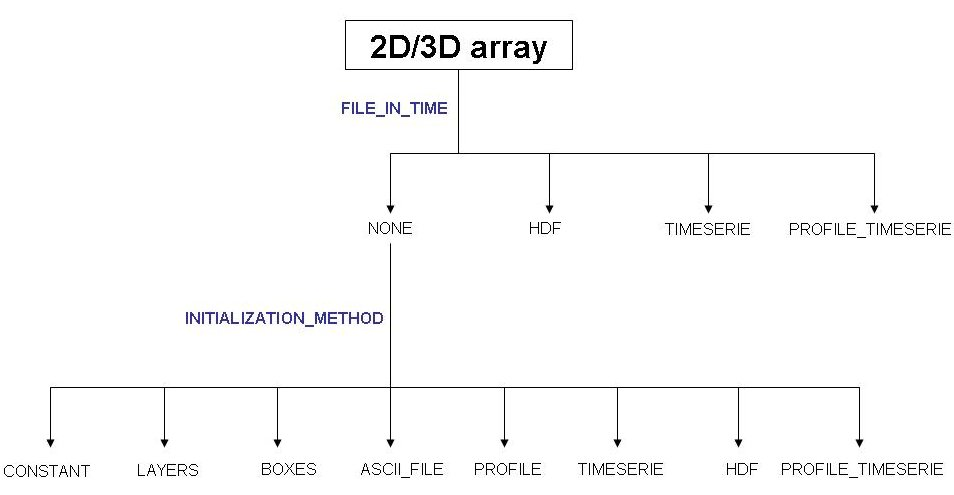

# Module FillMatrix

## Overview

Throughout all MOHID modules, two-dimensional (e.g. water elevation, wave height, wind velocity, bottom roughness length, etc.) and three-dimensional (e.g. temperature, salinity, nitrate concentrations, etc) variables need to be initialized. Also in some simulations these variables have an imposed solution which needs to be read from a file. In order to reduce input data errors, increase programming efficiency and normalize input data files format a generic input data module (ModuleFillMatrix) was designed.

This module has a quite vast set of options to initialize and read 2D and 3D arrays, being these options defined in MOHID input data files. The idea is quite simple, and is based on the fact that each 2D or 3D array to used/computed in MOHID is defined in the input data files in the form of a block.

ModuleFillMatrix works based on a client/server philosophy, where the client module (e.g. ModuleWaterProperties is responsible for property temperature) requests the server module (ModuleFillMatrix) to handle the initialization (or modification) of the array. Thus, the client module sends information to ModuleFillMatrix about the input data file, namely the identification number (ID) of the file and the ID of the [block](../io/keywords/blocks.md) in the file where the options for property *X* are defined.



**ModuleFillMatrix input data scheme**

## Reading solution from a file

The first operation ModuleFillMatrix does is to check whether the array is only to be initialized or if it is to be modified during the simulation from information stored in a file.

This option is given by keyword FILE\_IN\_TIME.

### Time series file

Uses a [Time Series](../io/formats/time-series.md) file to initialize the property.

```
FILE_IN_TIME          : TIMESERIE
FILENAME              : ..\..\GeneralData\myTimeSeriesFile.dat
DATA_COLUMN           : 2
DEFAULTVALUE          : 0
```

### HDF file

Reads the solution from an [HDF file](../io/formats/hdf-file.md).

```
FILE_IN_TIME          : HDF
FILENAME              : ..\..\GeneralData\myHDFfile.dat
VGROUP_PATH           : /Results
MULTIPLYING_FACTOR    : 1
HDF_FIELD_NAME        : temperature
DEFAULTVALUE          : 15
```

### Time series profile file

```
FILE_IN_TIME          : PROFILE_TIMESERIE
FILENAME              : ..\..\GeneralData\myProfileTimeSeriesFile.dat
DEFAULTVALUE          : 5
```

## Initialization methods

This option is given by keyword INITIALIZATION\_METHOD.

### Constant

Assumes a constant value to initialize the property.

```
FILE_IN_TIME          : NONE
INITIALIZATION_METHOD : CONSTANT
DEFAULTVALUE          : 20
```

### ASCII Grid Data file

Uses a [Grid Data](../io/formats/grid-data.md) file to initialize the property.

```
FILE_IN_TIME          : NONE
INITIALIZATION_METHOD : ASCII_FILE
FILENAME              : ..\..\GeneralData\myGridDataFile.dat
DEFAULTVALUE          : 0
```

### Boxes

Uses a [Boxes](../io/formats/boxes.md) file to initialize the property. The default value is given to every grid point which is not inside any of the defined boxes.

```
FILE_IN_TIME          : NONE
INITIALIZATION_METHOD : BOXES
FILENAME              : ..\..\GeneralData\myBoxesFile.dat
BOXES_VALUES          : 12.3  15.2  12.7  13.4  14.1
DEFAULTVALUE          : 0
```

### Layers

```
FILE_IN_TIME          : NONE
INITIALIZATION_METHOD : LAYERS
LAYERS_VALUES         : 35.4  35.2 36.1
DEFAULTVALUE          : 35.5
```

### Profile file

Uses a [Profile](../io/formats/profile.md) file to initialize the property.

```
FILE_IN_TIME          : NONE
INITIALIZATION_METHOD : PROFILE
FILENAME              : ..\..\GeneralData\myProfileFile.dat
DEFAULTVALUE          : 15
```

### Analytical profile

An analytical profile can be given with a linear or a exponential format.

```
FILE_IN_TIME          : NONE
INITIALIZATION_METHOD : ANALYTIC_PROFILE
DEFAULTVALUE          : 20
```

For a linear profile ($Value = DefaultValue + CoefA * \frac{CellDepth} {CoefB}$) define:

```
PROFILE_TYPE          : LINEAR
```

For a exponential profile ($Value = DefaultValue - CoefA^{- \frac{CellDepth} {CoefB}}$) define:

```
PROFILE_TYPE          : EXPONENTIAL
```

The coefficients can be given by the following keywords:

```
CoefA                 : 0.1
CoefB                 : 4500
```

### HDF file

```
FILE_IN_TIME          : NONE
INITIALIZATION_METHOD : HDF
VGROUP_PATH           : /Results
MULTIPLYING_FACTOR    : 1
HDF_FIELD_NAME        : temperature
DEFAULTVALUE          : 15
```

### Time series file

Uses a [Time Series](../io/formats/time-series.md) file to initialize the property.

```
FILE_IN_TIME          : NONE
INITIALIZATION_METHOD : TIMESERIE
FILENAME              : ..\..\GeneralData\myTimeSeriesFile.dat
DATA_COLUMN           : 2
DEFAULTVALUE          : 0
```

### Time series profile file

```
FILE_IN_TIME          : NONE
INITIALIZATION_METHOD : PROFILE_TIMESERIE
FILENAME              : ..\..\GeneralData\myProfileTimeSeriesFile.dat
DEFAULTVALUE          : 10
```

### Sponge

Creates a matrix of numbers with the size of the domain, constant inside the domain, and varying exponentially near the open-boundary with a width defined by SPONGE\_CELLS. Default value of **SPONGE\_OUT** is 1e5 s ~1 day. This value assumes that usually the reference solution has one instant per day. **This value should be equal to frequency of the external solution**. The default value of SPONGE\_CELLS is 10.

```
FILE_IN_TIME          : NONE
INITIALIZATION_METHOD : SPONGE
DEFAULTVALUE          : 1e9
SPONGE_OUT            : 1e5
SPONGE_CELLS          : 10
```

If **a** and **b** are respectively the SPONGE\_OUT and the DEFAULTVALUE values then, if **N** and **i** are respectively the SPONGE\_CELLS and the distance from the open boundary in unit cells, the sponge algorithm will compute the coefficient **C(i)** according to the following formula:

$C(i) = a^{\frac{N-i}{N-1}}b^{\frac{i-1}{N-1}}\quad$ if $1 \leq i \leq N$

$C(i) = b$ else.

In particular, for i = 1 and for i = N or higher, $C(1) = a$ and $C(N^+) = b$.

## Important notes

Keyword DEFAULTVALUE has **always** to be present. This insures that the user must be aware of the initialization option.

Keyword REMAIN\_CONSTANT defines whether the property will remain unaltered during the simulation. By default this boolean keyword is FALSE, which means that the model will dynamically compute the property values (e.g. current velocities) or it will read them from a file (e.g. wind speed and direction). If it's TRUE this means that the property values will remain constant throughout the simulation (e.g. constant wind speed and direction in a scenario simulation).

## List of properties which are handled by Module FillMatrix

### ModuleAtmosphere

All properties of this module are 2D arrays:

- wind modulos
- wind angle
- wind velocity X
- wind velocity Y
- air temperature
- relative humidity
- sun hours
- cloud cover
- irrigation
- precipitation
- solar radiation
- atmospheric pressure
- mean sea level pressure
- Other properties\* (like concentrations on precipitation and irrigation)

### ModuleAssimilation

All 2D/3D fields which can be used for any type of relaxation scheme or reference solution. This includes the reference fields and the decayment coefficients.

### ModuleConsolidation

- porosity (3D)
- stationary porosity (3D)
- rosion critical shear stress( 3D)

### ModuleHydrodynamic

- water level(2D)
- velocity U (3D)
- velocity V (3D)
- drag coefficient (3D) - used in when parameterizing obstacles

### ModuleInterfaceWaterAir

- latent heat
- sensible heat
- net long wave radiation
- upward long wave radiation
- downward long wave radiation
- evaporation
- “non-solar” flux
- wind shear stress X
- wind shear stress Y
- Surface radiation
- Turbulent kinetic energy
- wind shear velocity
- carbon dioxide flux
- oxygen flux

### ModuleInterfaceSedimentWater

- manning coefficient (2D)
- rugosity coefficient (2D)
- “wave” rugosity coefficient (2D)
- Erosion critical shear stress (2D)
- Deposition critical shear stress (2D)
- Erosion reference rate (2D)
- Diffusion coefficient (2D)
- Consolidation rate (2D)
- Other properties\* (2D)

### ModuleSand

- D35
- D50
- D90
- bed rock
- sand classes diameter
- sand classes percentage

### ModuleSedimentProperties

- Other properties\*
- Partition fraction
- Partition rate
- Sediment dry density
- Turbulent horizontal diffusion coefficient
- Turbulent vertical diffusion coefficient

### ModuleTurbulence

- horizontal viscosity
- vertical viscosity

### ModuleWaterProperties

- sigma-T (density)
- specific heat
- filtration rate
- other properties\*

### ModuleWaves

- wave height
- wave period
- wave direction
- radiation stress X
- radiation stress Y

### ModuleBasin

All properties of this module are 2D arrays:

- reference evapotranspiration

### ModuleVegetation

All properties of this module are 2D arrays:

- leaf area index
- potential leaf area index
- crop coefficient
- root depth
- specific leaf storage

## Links

Read the FillMatrix Module [manual](http://maretec.mohid.com/PublicData/products/Manuals/FillMatrix.pdf)
