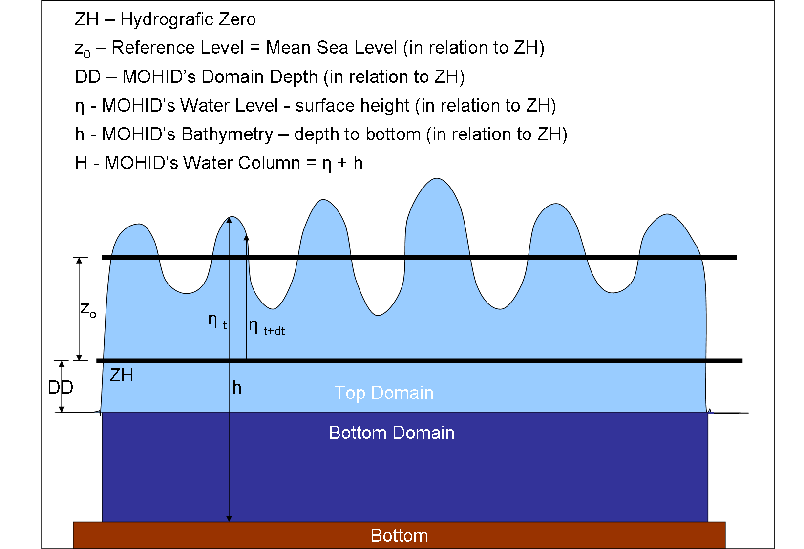
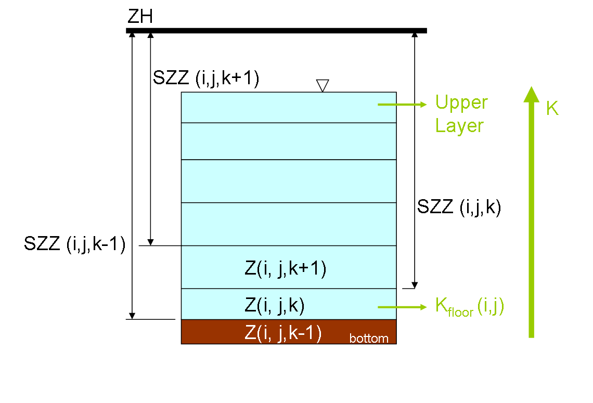
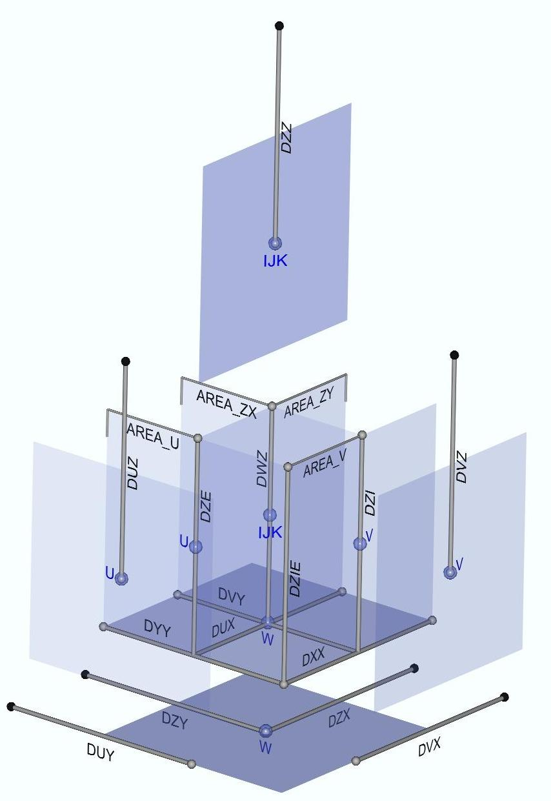
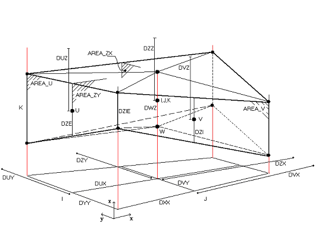
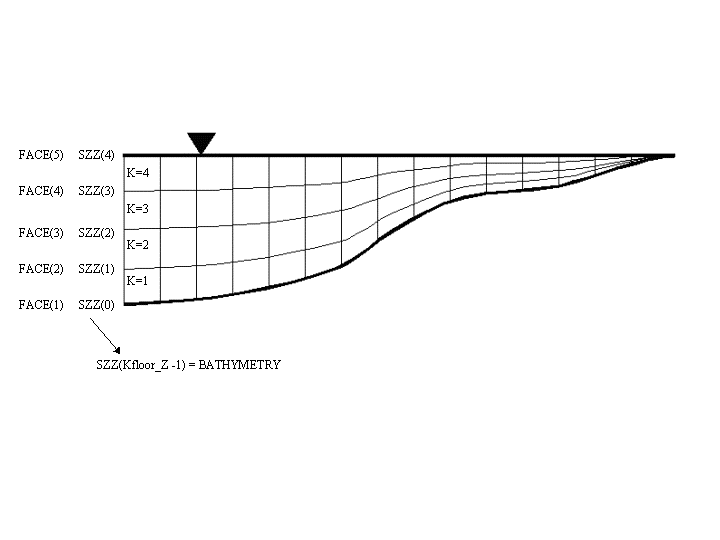

# Module Geometry

## Overview

Module Geometry handles the vertical discretization in MOHID. It was designed to divide the water column (in MOHID Water) or the soil compartment (in MOHID Land) in different vertical coordinates: Sigma, Cartesian, Fixed Spacing, Harmonic, etc. A subdivision of the vertical domain into different sub-domains using different vertical coordinate systems is also possible.

The Module Geometry manages the initialization and the temporal evolution of the grid. The grid must evolve because of surface level evolution, but can also evolve to minimize vertical advective exchanges between cells and thus to minimize numerical diffusion. The vertical exchange between cells will result into a grid that is locally parallel to the velocity.

The Cartesian coordinates are adequate when the flow is horizontal. This is the case when the baroclinic pressure is important as happens in systems with very low free surface gradient or in deep systems where even small density gradients can result into important baroclinic pressure gradients when the density gradient is integrated along depth.

Sigma coordinates are convenient when the pressure gradient is barotropic. In this case the pressure force is the same over the whole water column and vertical velocity gradients are due mostly to bottom friction. In these cases the velocity tends to be parallel to the sigma lines.

In reality the flow is never horizontal or along the sigma lines, because the pressure is never purely barotropic or baroclinic, but also due to inertia forces. As a consequence the best grid is that which is able to react as a function of the local vertical velocity. This is the “lagrangian coordinate”. The Lagrangian coordinate must thus be able to manage grid initiated as Cartesian or as Sigma, but must also be able to manage situations when the level changes dramatically in time, as is the case of artificial reservoirs.

The concept of vertical domain was created to combine different coordinates, being common to use a Cartesian domain in the lower part of deep systems and a Sigma domain on the top to simulate the continental shelf or very coastal zones.

The Module Geometry was developed into steps following concepts’ evolution. Initially the aim was only to permit Cartesian or Sigma coordinates (i.e. easy the use of the finite-volume concept), then it evolved to allow small vertical deformation of the grid along the lagrangian concept described above and finally it evolved to allow large reservoir free surface changes (the so called Harmonic grid). In this last case layer could shrink between a minimum and a maximum thickness. This coordinate was used on a top domain to include the region within the range of free surface level change.

## Geometry

Figure 1 represents the heights used to describe the vertical geometry in the model. The Hydrographic zero (ZH) is the most important. The free surface elevation ($\eta$, positive upwards) is the distance between the free surface and ZH. The depth (h, positive downwards) is the distance between the hydrographic zero and the bottom (h in hydrography is usually called the reduced depth ). Z0 is the mean sea level. The tidal wave oscillation is center on this level. ZH is a characteristic of a port (or region) and is always below the minimum surface elevation. As a consequence $\eta$ is always positive. h is negative above ZH and consequently every intertidal area as a negative h. The water column height is H=(h+ $\eta$) and it minimum value is zero, in the intertidal areas.



MOHID Water heights and levels for 2 domains

In the model vertical distances between computational points have names with like D?Z where “?” is a letter that identifies the points where properties are computed. Vertical velocities (w) are computed on the horizontal faces (upper and lower cell faces). The distance between them is designated DWZ. The distance between the center of the cells is designated by DZZ. These variables are 3D arrays.

In the model the first layer is the bottom layer. Because the number of layers is variable there is a 2D matrix used to specify the kfloor (i,j) which value is the number of the bottom cell. The distance between the top face of a layer and the hydrographic zero is SZZ (Figure 3). The maximum value of SZZ is h, at the bottom and the minimum value is the symmetric of the free surface elevation (-$\eta$).The last SZZ value computed in a water column corresponds to the cell face laying on the bottom (i.e. Kfloor -1). SZZ is used in the code to compute layers thickness, vertical faces areas and cell volumes.



MOHID SZZ definition

### Distances

Distances are obtained from SZZ.



MOHID syntax for distances

### Public routines

ModuleHorizontalGrid

GetHorizontalGrid(HorizontalGridID, XX\_IE, YY\_IE, XX\_Z, YY\_Z,XX\_U, YY\_U, XX\_V, YY\_V, XX\_Cross, YY\_Cross, DXX, DYY, DZX, DZY, DUX, DUY, DVX, DVY, XX, YY, XX2D\_Z, YY2D\_Z, STAT)

ModuleGeometry

GetGeometryDistances(GeometryID, SZZ, DZZ, DWZ, DUZ, DVZ, DZI, DZE,ZCellCenter, ActualTime, STAT)

### Areas and Volumes

Areas and volumes are obtained from distances.



Single T-cell control volume

## Vertical coordinate system

### Sigma

Sigma domains adapt to bathymetry and change with the water column. Thicknesses are defined in percentage of water column.

Sigma coordinates are convenient when the pressure gradient is barotropic. In this case the pressure force is the same over the whole water column and vertical velocity gradients are due mostly to bottom friction. In these cases the velocity tends to be parallel to the sigma lines.



Vertical sigma mesh

### Cartesian

Cartesian is a fixed domain that builds layers from Hydrographic Zero or Domain Depth to bottom layer with fixed depth at each layer. In the end of the process, if cartesian is the upper domain, the top layer face is allowed to equalized to surface level.

Cartesian coordinates are adequate when the flow is horizontal. This is the case when the baroclinic pressure is important as happens in systems with very low free surface gradient or in deep systems where even small density gradients can result into important baroclinic pressure gradients when the density gradient is integrated along depth.

### Fixspacing

The Fixed Spacing coordinate allows the user to study flows close to the bottom.

### Harmonic

**Harmonic Coordinate is going to be discontinued**

The Harmonic coordinate works like the Cartesian coordinate, just that the horizontal faces close to the surface expand and collapse depending on the variation of the surface elevation. This coordinate was implemented in the geometry module to simulate reservoirs.

### Fixsediment

### SigmaTop

### Cartesiantop

Cartesiantop is equal to cartesian but builds layers from top (topography) to bottom. Instead of having a reference level to all cells to build layers as cartesian, in CartesianTop layers are built in every collumn from topography (that can change from cell to cell). This type of coodinates are used for [Mohid Land](../land/mohid-land.md). The top is the topography and the bottom is the non-porousmedia (rock). This means that in lower depth soils there will be less layers than in higher depth soils.

## General options

### Lagrangian Process

The Lagrangian process moves the layers faces with the vertical flow velocity. It can be called to change geometry in Sigma and Cartesian coordinates. The layer displacement is limited by a minimum and a maximum cell thickness (shrinking or expansion). These values are defined by the user as a percentage of the initial cell thickness (i.e. of the values provided in the input file to define the geometry).

#### Construction Phase

In the case that a Sigma or Cartesian domain uses Lagrangian approach to compute layer displacement, than a new keyword has to be included in geometry block:

```
LAGRANGIAN : 1
```

The other keywords specific to Lagrangian approach is:

```
MINEVOLVELAYERTHICKNESS : X
```

This keyword represents the percentage of layer thickness (defined in geometry input file) that a layer may compress or expand from the defined layer distribution given by the user.

In case of Cartesian domain a layer will be allowed to change thickness within:

```
[m] = [m] * [-]
MinLayerThickness(k) = DefinedThickness(k) * (1 – MINEVOLVELAYERTHICKNESS)
MaxLayerThickness(k) = DefinedThickness(k) * (1 + MINEVOLVELAYERTHICKNESS)
```

In case of Sigma domain a layer will be allowed to change thickness within:

```
[m] = [-] *[m] *[-]
MinLayerThickness(k) = DefinedPercentage(k) * DomainThickness(i,j) * (1 – MINEVOLVELAYERTHICKNESS)
MaxLayerThickness(k) = DefinedPercentage(k)  *  DomainThickness(i,j) * (1 + MINEVOLVELAYERTHICKNESS)
```

Another keyword that was maintained is:

```
DISPLACEMENT_LIMIT : X
```

That represents the maximum displacement in meters that the layer face (or SZZ) may be displaced. This is an extra limit to add to the minimum and maximum thickness as shown above. This limit should not have the most impact on results so the default value is 1000m (it will not limit movement).

#### Modification Phase

In case of Lagrangian evolution the grid is deformed at each time step.

First a new estimation of SZZ is computed. Surface and bottom faces SZZ's are fixed. Starting at the top layer, the displacement of each face is estimated using the last vertical velocity computed (displacement 

$$
m
$$

 = vertical velocity

$$
m/s
$$

 \* time step 

$$
s
$$

).

At each layer, the estimation of SZZ based on vertical velocity is tested to check if they are within the maximum deformation allowed for the above and below cells of that face. In case the test fails, SZZ displacement is corrected to the minimum of the deformations allowed.

At the end, is tested if the bottom layer (the last face to be processed is the bottom layer top face) was estimated with a thickness lower than the minimum.

To avoid very thin layers at the bottom that can create model instabilities, two options are evaluated, testing if the water column height is lower than the sum of the layers minimum thichnesses:

1. if yes, all layers are at its maximum compression and can not go thinner, so the process puts all the layers with an average thickness (water column / number of layers)
2. if not, then minimum thickness is set to bottom layer and the process goes from bottom to top setting the minimum thickness where this condition is not met. Until it reaches a cell that has enough thickness (greater than its minimum).

The above processes are not dependent on vertical velocity (trying to avoid thickness lower than user assigned) and ultimately can lead to stability problems. If that happens try to use more loose compression and expansion parameters (increase MINEVOLVELAYERTHICKNESS) and the process itself will be able to evolve to lower thicknesses.

Using the final values of SZZ all the geometric properties are computed (distances, areas and volumes) and the vertical fluxes between cells are corrected to account for grid deformation (in ModuleHydrodynamic).

## Bathymetry consistency diagnostic

Once the vertical discretization is imposed and the bathymetry is chosen, the bottom layer can yield stability problems when using shaved cells. You can have very thin bottom cell next to a very wide bottom cell. To diagnose the existence of such problematic cells, a [geometry diagnostic](../tools/geometry-diagnostic.md) tool was developed.

## Input data file

### Keywords

```
WINDOW                        : 0/1               [0]         !1 Avoid check bottom depth and geometry consistency

IMPERMEABILITY                : 0/1               -           !Consider impermeable cell faces
IMPER_COEF_U                  : real             [1]          !
IMPER_COEFX_U                 : real             [0]          !
IMPER_COEF_V                  : real             [1]          !
IMPER_COEFX_V                 : real             [0]          !

<begindomain>
  ID                          : int               -           !Domain ID
  TYPE                        : char              -           !Type of vertical coordinate of the domain
                                                              !Multiple options: FIXSPACING, SIGMA,
                                                              !LAGRANGIAN, CARTESIAN, HARMONIC, FIXSEDIMENT, CARTESIANTOP.
  LAYERS                      : int               -           !Number of layers
  EQUIDISTANT                 : real             [0]          !Equidistant layers spacing in meters
  LAYERTHICKNESS              : real vector       -           !If not equidistant specifies layers thickness
                                                              !starting from bottom layer (e.g. 50. 20. 10. 5.)
  TOLERANCEDEPTH              : real            [0.05]        !Just for SIGMA,ISOPYCNIC, LAGRANGIAN coordinates
  TOTALTHICKNESS              : real              -           !Total domain thickness
                                                              !(Just for FIXSPACING, FIXSEDIMENT, SOIL_TOPLAYER)
  EMPTY_TOP_LAYERS            : int              [0]          !Number of empty layers counting from top
  DOMAINDEPTH                 : real
  LAGRANGIAN                  : 0/1              [0]          !Use lagrangian approach for distorting grometry?
                                                              !Layers are displaced with vertical velocity
  MINEVOLVELAYERTHICKNESS     : real            [0.5]         !Allowed distortion in percentage of initial thickness
                                                              !(if LAGRANGIAN : 1)
  DISPLACEMENT_LIMIT          : real           [1000]         !Maximum displacement in meters (if LAGRANGIAN : 1)
<enddomain>
```

### Examples

#### SIGMA

```
!General options
MINIMUMDEPTH              : 0.1
FACESOPTION               : 2

!Sigma Domain
<begindomain>
ID                        : 1
TYPE                      : SIGMA
LAYERS                    : 5
LAYERTHICKNESS            : 0.2 0.2 0.2 0.2 0.2
DOMAINDEPTH               : -99.00
TOLERANCEDEPTH            : 0.0500
<enddomain>
```

#### CARTESIAN

```
!General options
MINIMUMDEPTH              : 0.1
FACESOPTION               : 2

!Cartesian Domain
<begindomain>
ID                        : 1
TYPE                      : CARTESIAN
LAYERS                    : 8
LAYERTHICKNESS            : 0.5 0.5 0.5 0.5 0.5 0.5 0.5 0.5
DOMAINDEPTH               : -99.00
MININITIALLAYERTHICKNESS  : 0.2
<enddomain>
```

#### Domains Definition with Lagrangian Method

The Lagrangian method was changed in May 2013 but old Lagrangian domains will work without any keyword changes because MOHID will adapt and the domain will be changed from Lagrangian to Sigma or Cartesian depending on INITIALIZATION\_METHOD keyword and will have Lagrangian process active. The user will just be warned that the Lagrangian domain is deprecated and tell about the new keyword to use in future projects. The new definition is as follows:

##### Sigma Domain with Lagrangian method active

```
!General options
MINIMUMDEPTH              : 0.1
FACESOPTION               : 2

<begindomain>
ID                        : 1
TYPE                      : SIGMA
LAYERS                    : 5
LAYERTHICKNESS            : 0.2 0.2 0.2 0.2 0.2
DOMAINDEPTH               : -99.00
TOLERANCEDEPTH            : 0.0500
LAGRANGIAN                : 1
MINEVOLVELAYERTHICKNESS   : 0.5
<enddomain>
```

##### Cartesian Domain with Lagrangian method active

```
!General options
MINIMUMDEPTH              : 0.1
FACESOPTION               : 2

<begindomain>
ID                        : 1
TYPE                      : CARTESIAN
LAYERS                    : 8
LAYERTHICKNESS            : 0.5 0.5 0.5 0.5 0.5 0.5 0.5 0.5
DOMAINDEPTH               : -99.00
MININITIALLAYERTHICKNESS  : 0.2
LAGRANGIAN                : 1
MINEVOLVELAYERTHICKNESS   : 0.5
<enddomain>
```

##### Sigma Domain on Top of Cartesian both with Lagrangian method

```
!General options
MINIMUMDEPTH              : 0.1
FACESOPTION               : 2

<begindomain>
ID                        : 1
TYPE                      : CARTESIAN
LAYERS                    : 4
LAYERTHICKNESS            : 0.5 0.5 0.5 0.5
DOMAINDEPTH               : 2.0
MININITIALLAYERTHICKNESS  : 0.2
LAGRANGIAN                : 1
MINEVOLVELAYERTHICKNESS   : 0.5
<enddomain>

<begindomain>
ID                        : 2
TYPE                      : SIGMA
LAYERS                    : 4
LAYERTHICKNESS            : 0.25 0.25 0.25 0.25
DOMAINDEPTH               : -99.00
TOLERANCEDEPTH            : 0.0500
LAGRANGIAN                : 1
MINEVOLVELAYERTHICKNESS   : 0.5
<enddomain>
```
