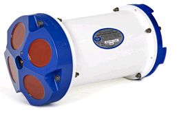

# Adcp

The Workhorse Sentinel ADCP from RD Instruments. The four red eyes at upper end-cap are the acoustic beams sensors.

At [Maretec](http://www.mohid.com), we are the proud users of an Acoustic Doppler Current Profiler ([ADCP](adcp.md)); whose model is the Workhorse Sentinel at 600kHz from [RD Instruments](http://www.rdinstruments.com/sen.html).

Summing up, an **Acoustic Doppler Current Profiler**, like is stated in its name, profiles the water column currents. It is a device, composed of four [acoustic **beams**](http://en.wikipedia.org/wiki/Beam_theory) and a [**pressure sensor**](http://en.wikipedia.org/wiki/Pressure_sensor), that sends acoustic signals (like a [sonar](http://en.wikipedia.org/wiki/sonar)) called **[pings](http://en.wiktionary.org/wiki/ping)**. These pings will be [scattered](http://en.wiktionary.org/wiki/scatter) by [(re)-suspended particulate matter](http://en.wikipedia.org/wiki/Particulate) in the water column. Furthermore, the moving particulates will add a [frequency shift](http://en.wikipedia.org/wiki/Doppler_shift) to the scattered pings (called a [Doppler shift](http://en.wikipedia.org/wiki/Doppler_shift)). The [backscattered](http://en.wikipedia.org/wiki/Backscatter) doppler shifted pings will then be retrieved and measured by the ADCP's beam sensors. By analyzing all four beams measurements, a simple [triangulation](http://en.wikipedia.org/wiki/Triangulation) of the [doppler shifts](http://en.wikipedia.org/wiki/Doppler_shift) allows to detect the tridimensional position and velocity of the suspended particules relatively to the beam's [frame of reference](http://en.wikipedia.org/wiki/Inertial_frame_of_reference). In fact, the backscattered pings are integrated in a [statistical **ensemble**](http://en.wikipedia.org/wiki/Statistical_ensemble) (between 50 and 150 pings typically) for each sub-layer of the water-column (called **bins**) and a statistical velocity is given for that particular bin. Because the particulate matter "goes along with the flow", this statistical velocity is considered to be the depth-averaged flow velocity of that bin.

Now, our ADCP was upgraded with **bottom tracking**, which means that he can measure the sea-floor velocity relative to the beam sensor's frame of reference. Hence, by means of [galilean transformations](http://en.wikipedia.org/wiki/Galilean_transformation) of reference frames, the flow along the water column relative to the bottom sea-floor is also measured.

ADCPs are very versatile and some may even, when moored at the bottom floor, looking upwards, calculate the waves height, direction and turbulence.

Some final notes would add that the pressure sensor allows the ADCP to know the water depth of its beams sensors, and its [compass](http://en.wikipedia.org/wiki/Compass) and other sensors allows it to know its orientation ([**roll**, **pitch**, yaw](http://en.wikipedia.org/wiki/Flight_dynamics), **tilt** ...) relatively to the [magnetic north](http://en.wikipedia.org/wiki/Magnetic_north) and relatively to the [vertical direction](http://en.wikipedia.org/wiki/Vertical_direction).

## Calibration

The essencial calibration to perform to the ADCP is to its compass. Indeed the ADCP's compass accuracy is affected by the magnetic deviation caused by its surrounding (such as a ship's hull or every other ferromagnetic material). For each new configuration deployment (**side-mounted**, **moored**, **bottom-tracking**) a new calibration must be performed. Also, after every battery replacement, a new compass calibration is required. (Each battery pack carries its own magnetic signature that affects the ADCP's compass). The calibration procedure is described in the manuals.

## Documentation

- The laboratory manual is available [here](http://intranet.mohid.com/campanhas/Manual%20Instrumentação/Manual_Laboratorio_ADCP.doc),
- The RDI manuals are available at **\\\\kepler\\DataCenter\\Software\\ADCP\_RDI\\docs**.

## Software

- The Workhorse Sentinel software is available at **\\\\kepler\\DataCenter\\Software\\ADCP\_RDI**.

## External References

- [RD Instruments](http://www.rdinstruments.com/sen.html),
- [Maretec MOHID homepage](http://www.mohid.com).
