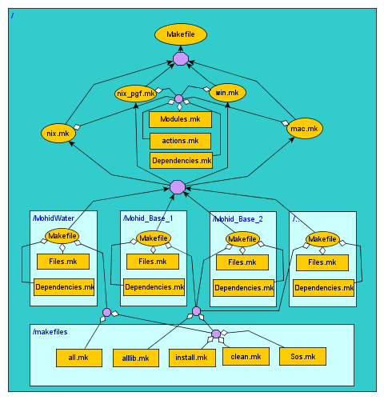

# Mohid Makefile

Following the makefile [cross-platform, cross-compiler project methodology](makefile-cccp.md), we finally developped a sound [makefile](makefile.md) project for [MOHID](../../overview/mohid.md).



**MOHID makefile project DAG tree**:Orange ellipsoids are makefiles; orange rectangles are makefile code snippets; Diamond arrows are inclusions; Quiver arrows are recursive makes; Large rectangles are project folders; purple octagons are junction nodes. *Sketch made using [yED](http://www.yworks.com/en/products_yed_about.htm)*

## Features

### Global environment variables

There is one thing that allow this project to be easily cross-platformed:

1. The use of global environment variables. They are all defined in the respective platform makefile: *Win.mk*, *Nix.mk*, etc... Every new addition of a module, of a fortran file, or of an action must be followed by an update of all the respective platform makefiles (*Win.mk*, *Nix.mk*, etc...)

### Platform/Compiler expandible

The project makefile's DAG meta-tree shows currently 4 platforms/compilers available: windows *Win.mk*, linux *Nix.mk*, linux with [Portland Group Fortran](http://www.pgroup.com/) *Nix\_pgf.mk* and macintosh *Mac.mk*.

- To add a new compiler and/or a new architecture, one needs to change the main *Makefile* and create a new *Arch\_Fcomp.mk* file.

### Action extensible

An *action* is one given process to apply to the whole project: it could be to *build* the project, to *clean* the project, to *install* the binaries of the project to a safe place, to *Get* the files of the project from [SourceOffSite](../../archive/linux/sos.md) etc ... The [makefile](makefile.md) code for the *actions* of the MOHID project is located in the files contained by the *makefiles* folder (at the bottom of the image).

- To add a new action, one needs to edit the *Makefiles/Makefiles.mk* file and the *Makefiles/Makemodules.mk*.

### Module extensible

The MOHID project has a modular nature. In this makefile project, each module is subject to the same overall actions and each module is contained in a light-blue folder in the image (*MohidWater*, *Mohid\_Base\_1*, *Mohid\_Base\_2* and *...*).

- To add a new file to an existing module: one must edit the *Makefile* file within the module's folder.
- To add a new module: one must create a new folder, name it after the module, copy the module's files, create the corresponding *Makefile* file. Finally, one must edit the *Nix.mk* file from the *root* folder.

## Makefile project tree

```
mohid/Solutions/Linux> tree
.
|-- Editme.mk
|-- Editme_template.mk
|-- Makefile
|-- Makefiles
|   |-- Makefile
|   |-- Makefiles.mk
|   `-- Makemodules.mk
|-- MohidWater
|   `-- Makefile
|-- Mohid_Base_1
|   `-- Makefile
|-- Mohid_Base_2
|   `-- Makefile
|-- Nix.mk
`-- README
```

## User's guide

Get the latest version of the code at [http://mohid.codeplex.com](http://mohid.codeplex.com).

### Linux

- Build

```
>make Nix
```

Please edit the *nix\_template.mk* first and save it as *nix.mk*

- Clean

```
>make Nix.clean
```

Please edit the *../makefiles/Sos\_template.mk* file first and save it as *../makefiles/Sos.mk*.

- Install

```
>make Nix.install
```

This will copy the binaries to a specific location on the harddisk. You can change the location by editing the *Nix.mk* file.

### Windows

Use GNUmake! Attention: Rename *gmake.exe* to *make.exe*.

- Build

```
>make win
```

- Clean

```
>make win.clean
```

## Administrator's guide

### How do I add a new module file in MohidWater?

Suppose your new module filename is *MohidWater/ModuleNew.F90*, and it depends only on *ModuleGlobalData*, *ModuleWaterproperties.mod* and *ModuleHydrodynamic.F90*. Edit the *Makefile* file in the *Linux/MohidWater* folder and...

- ... look for the FILES variables section:

```
> vim Solutions/Linux/MohidWater/Makefile
FILES = \
      ModuleNew.$(S) \
      ModuleAssimilation.$(S) \
      ModuleConsolidation.$(S) \
      ModuleFreeVerticalMovement.$(S) \
      ModuleJet.$(S) \
      ...
```

- ... look for the Dependencies section at the end:

```
 ModuleNew.${O} : ModuleWaterProperties.${O} \
                    ModuleHydrodynamic.${O}
ModuleGauge.${O} : ModuleToga.${O}
ModuleSand.${O} : ModuleWaves.${O}
      ...
```

NOTE: Only the local dependencies of *MohidWater* are required. The external dependencies of *MohidBase1* or *MohidBase2* are not required.

- That's it! You can now build the Linux solution!

### How do I add a new module folder?

1. Create a new folder (ex: *MohidLand*),
2. Copy a regular folder *Makefile* into the new folder,
3. Edit the *Makefile*:
    1.  Edit the FILES variable
    2.  Edit the dependencies
    3.  Assign to variables TARGET and SRCDIR appropriate global variables names
4. Edit the *Nix.mk* file:
    1.  Create the global variables to be assigned to TARGET and SRCDIR (make sure the variable to be assigned as TARGET ends in $(SUFFPROG) if it's an executable or $(SUFFLIB) if it's a library).
    2.  Edit the MODULES variable
    3.  Add the module dependency

## References

1. The [makefile](makefile-cccp.md) methodology.
2. The [GNU make manual](http://www.gnu.org/software/make/manual/make.html).
3. The graph editor [yED](http://www.yworks.com/en/index.html).
