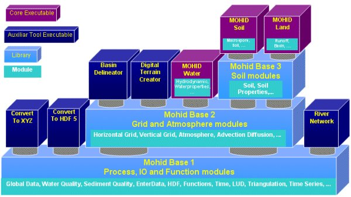

# Programming

Fortran style, program structure, scripting and utilities.

## Pages

- [1stWorkshopMohidCode](1stworkshopmohidcode.md) — Welcome to the 1st Workshop in programming for MOHID. Except maybe for the first topic, all presentations have a hands-on approach and expect the part…
- [Basic OpenMP syntax](basic-openmp-syntax.md) — In this page is provided an introduction with the basic concepts in OpenMP programming. The OpenMP language reference manual (http://www.openmp.org) s…
- [Changing the code](changing-the-code.md) — Mohid's source code is stored in a data base running under MS Source Safe 6.0. If you are about to change code from MOHID always:
- [Code alignment](code-alignment.md) — Source code must be as much as possible well aligned, in order to maintain an easy readability for all developers. Here is a guideline to align Mohid…
- [Code declarations](code-declarations.md) — 1) When declaring the USE statement, at the beginning of a module, be sure that all the declarations are really used, as it optimize the compiling spe…
- [Constructor](constructor.md) — The constructor method consists in the following set of procedures performed when a new object is created (class instantiation):
- [Creating a new module](creating-a-new-module.md) — In order to create a new module and include it in Mohid Framework, one should always use Module Shell as the starting file. Exceptions can me made if…
- [Creating a new subroutine](creating-a-new-subroutine.md) — In order to create a new subroutine in a module, be sure to maintain the alignment rules as well as declare it at the top of the MODULE.
- [DoLoops performance in Fortran](doloops-performance-in-fortran.md) — What is the best performance that Fortran can give when computing do-loops over large matrices? A single triple-do-loop test-case was implemented with…
- [Editbin](editbin.md)
- [Formatted output](formatted-output.md) — When printing a string in Matlab, C or C++, you usually print it in Formatted output. This is useful when you need to define a custom precision for fl…
- [Fortran](fortran.md)
- [Fortran crash course](fortran-crash-course.md) — Following the 1st workshop in Mohid programming, it became apparent that a crash course in fortran 95 for beginners in programming is required. To all…
- [Fortran implementation of the Actor Model using MPI](fortran-implementation-of-the-actor-model-using-mpi.md) — A very simple ping-pong program is shown here. There are 2 programs, ping and pong, that shoot messages among them, starting each with a random number…
- [Google ajax api](google-ajax-api.md) — Here's a sample usage of the Google ajax api. This api is best combined with jQuery.
- [Kml2Mohid](kml2mohid.md) — Open a command-line window and type:
- [Mohid OpenMP](mohid-openmp.md) — This wiki entry is about the project to parallelize Mohid with OpenMP directives.
- [Mohid Programming](mohid-programming.md) — MOHID is programmed in ANSI FORTRAN 95 using an object oriented approach and hierarchical structure which enables consisting of several modules to dev…
- [MovAverageRuby](movaverageruby.md)
- [Object Collector](object-collector.md) — The Object Collector is a derived type array, placed in class GlobalData, where, in each array position, information is stored about the corresponding…
- [Object oriented programming](object-oriented-programming.md) — Scientific software developers often use FORTRAN as it is the most disseminated programming language among the scientific community. Its execution spe…
- [Object oriented programming in MOHID](object-oriented-programming-in-mohid.md) — A standard Mohid class is defined as a derived type, which has, in addition to its specific information, two required structures: InstanceID and Next.…
- [Object oriented programming via FORTRAN95](object-oriented-programming-via-fortran95.md) — FORTRAN 95 is the follow up standards of FORTRAN 90 programming language, with little differences, when compared to the upgrade from FORTRAN 77. FORTR…
- [Parallel processing](parallel-processing.md) — The historical need in numerical models to reduce computational time became a priority to the Mohid development team as an operational hydrodynamic an…
- [Programming guidelines](programming-guidelines.md) — In a software project like Mohid, the number of programmers is both large and variable, turning source code management a primarily task. This effort m…
- [Programming in Fortran issues](programming-in-fortran-issues.md) — This section is dedicated to information about Fortran programming issues which can be useful to programmers of MOHID.
- [Rails](rails.md) — Rails or Ruby on Rails is a web-development framework in ruby that uses the model-view-controller (MVC) pattern.
- [Reactive Programming](reactive-programming.md) — According to Wikipedia[
- [Ruby examples](ruby-examples.md)
- [Selector](selector.md)
- [Stacksize](stacksize.md) — Setting the stacksize reserve with the ifort compiler can be critical to run MOHIDWater without any stack exception or other stack overflow.
- [Supported architectures](supported-architectures.md) — Currently the Mohid system is windows oriented, with all the GUI tools developed using the .NET framework. The numerical model's source code uses stan…
- [Vba](vba.md)
- [Visual Studio Configuration](visual-studio-configuration.md) — In Visual Studio, a configuration contains all the compiler and linker settings pre-saved, in order to build a solution (compile + link). It also may…
- [Visual Studion Configuration](visual-studion-configuration.md) — In Visual Studio, a configuration contains all the compiler and linker settings pre-saved, in order to build a solution (compile + link). It also may…

## Short entries

### Destructor

**Destructor** methods are used to remove an object from the modules linked objects lists. Like the Modifier and the Selector methods, the destructor methods receive the instance ID by argument from the client. After successfully locating the object, the memory used by the object is deallocated and the object is removed from the module linked objects list.

### Modifier

**Modifier** methods are used to modify the state variables of an object. When they are called, the correct instance of the module is located in the linked list through the instance ID, which is received from the client object by argument.

### Mohid Framework

### Object oriented approach

[Object oriented programming](object-oriented-programming.md)

[Object oriented programming via FORTRAN95](object-oriented-programming-via-fortran95.md)

[Object oriented programming in MOHID](object-oriented-programming-in-mohid.md)

### Sprintf

**Sprintf** allows to print in C, C++ or Matlab [formatted output](formatted-output.md).

#### External References

- [printf C++ reference](http://www.cplusplus.com/reference/clibrary/cstdio/printf.html)
