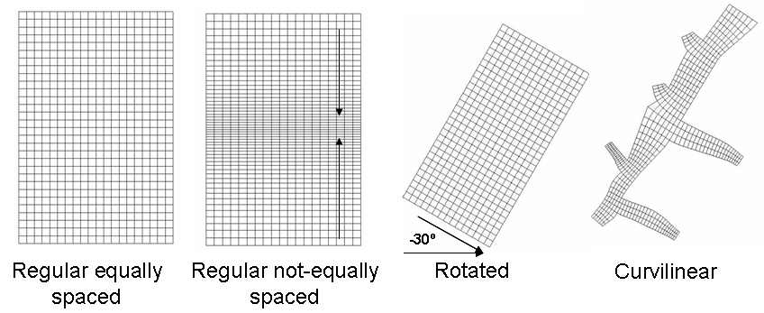

# Grid

## Overview

A grid in Mohid is stored in an ASCII text file and is directly handled by [Module HorizontalGrid](../../water/modules/README.md#module-horizontalgrid#module-horizontalgrid). The organization of this file is divided into a header section, and a grid spacing section.

Mohid supports orthogonal horizontal grids, which can be rectangular or curvilinear. Grid files can be created manually or automatically via [MOHID GIS](../../tools/gui/mohid-gis.md) or via the [GenerateGrid](../../tools/generategrid.md) tool. The default extension for Grid files in [MohidGIS](../../tools/gui/mohid-gis.md) is **\*.grd**.



**Types of grids supported by MOHID**

Note that in MOHID the **i** index refers to the YY axis and the **j** index to the XX axis. For example grid cell (5, 2) is the fifth grid cell in the YY axis and the second in the XX axis.

## Header Section

The header section contains information related to the grid global definitions, such as the number of cells, the type of coordinate used, the origin coordinates of the grid, etc. Below are shown the [keywords](../keywords/keywords.md) supported in the header section of a Grid file.

> -   **ILB\_IUB** - Two integer numbers defining the **minimum** and **maximum** **I** values along the Y-axis of the grid.
> -   **JLB\_JUB** - Two integer numbers defining the **minimum** and **maximum** **J** values along the X-axis of the grid.
> -   **COORD\_TIP** - A flag which indicates the used [coordinates type](../../reference/README.md#coordinates-type#coordinates-type).
> -   **ORIGIN** - Two real values, which indicate the origin of the lower left corner of the grid (**X Y**).
> -   **ZONE** - Integer values defining the UTM Zone where the bathymetry is located.
> -   **GRID\_ANGLE** - Counter-clock mesh rotation relative to the north. The base point is the origin of the grid.
> -   **LATITUDE** - Average latitude value used to compute Coriolis frequency and [solar radiation](../../water/modules/atmosphere.md) when metric coordinates cannot be converted to WGS84 geographic coordinates.
> -   **LONGITUDE** - Average longitude value used to compute Coriolis frequency and [solar radiation](../../water/modules/atmosphere.md) when metric coordinates cannot be converted to WGS84 geographic coordinates.
> -   **CONSTANT\_SPACING\_X** - Boolean defining if the spacing in the X axis is constant
> -   **CONSTANT\_SPACING\_Y** - Boolean defining if the spacing in the Y axis is constant
> -   **DX** - Constant spacing distance in XX axis
> -   **DY** - Constant spacing distance in YY axis

## Grid Spacing Section

The grid spacing section contains information about the grid spacing in the XX and YY axis, if the spacing is not constant, namely through defining the grid cells corners coordinates.

### Rectangular grids

The information is stored in [blocks](../keywords/blocks.md), one for each direction. The data is stored inside a block defined by the following keywords: **<BeginXX>** and **<EndXX>** for the XX axis and **<BeginYY>** and **<EndYY>** for the YY axis. Note that these block definition tags are case sensitive. Each value must be stored in a single line.

Note that if, for example, a grid has 100x100 grid cells, there should be 101 XX values and 101 YY values.

The values are read from left to right corner in the XX axis and from bottom to top in the YY axis. The first value is always zero in both directions, being the following values cumulative.

### Curvilinear grids

When defining a curvilinear grid, the information is stored in only one [block](../keywords/blocks.md) defined by the following keywords: **<CornersXY>** and **<\\CornersXY>** . This block contains two columns with the XX and YY coordinates of each grid cell corner. Each set of XX and YY values must be stored in a single line.

The values are read from left to right corner in the XX axis and from bottom to top in the YY axis. The first value is always zero in both directions, being the following values cumulative.

## Sample Grid File

```
ILB_IUB         :  1   52
JLB_JUB         :  1   19
ORIGIN          : -9.0 39.0
GRID_ANGLE      :  0.0
COORD_TIP       : 5
<BeginXX>
 0.0000000
 0.1052632
 0.2105263
 0.3157895
 0.4210526
 0.5263158
 0.6315790
 0.7368422
 0.8421053
 0.9473685
  1.052632
  1.157895
  1.263158
  1.368421
  1.473684
  1.578947
  1.684210
  1.789473
  1.894737
  2.000000
<EndXX>
<BeginYY>
 0.0000000
 0.0996386
 0.1945154
 0.2848571
 0.3708795
 0.4527884
 0.5307797
 0.6050400
 0.6757467
 0.7430694
 0.8071689
 0.8681989
 0.9263055
 0.9816279
  1.034299
  1.084444
  1.132185
  1.177634
  1.220903
  1.262094
  1.301306
  1.338633
  1.374166
  1.407990
  1.440186
  1.470831
  1.500000
  1.529169
  1.559814
  1.592010
  1.625834
  1.661367
  1.698694
  1.737906
  1.779097
  1.822366
  1.867815
  1.915556
  1.965701
  2.018372
  2.073694
  2.131801
  2.192831
  2.256931
  2.324253
  2.394960
  2.469220
  2.547212
  2.629121
  2.715143
  2.805485
  2.900361
  3.000000
<EndYY>
```

## How to generate regular grid under MOHID GIS

To create a regular grid under MOHID GIS, you can follow these steps:

1\. Open MOHID GIS

2\. Open the menu Data Items--> new data item--> simple grid. Click on "Browse" to save the file Grid.grd in your computer.

3\. You will see that now in MOHID GIS there is a item named as Grid.grd. Right click on that item and choose "Properties".

4\. A window appears where you can define the grid size, the grid step, the origin and the type of coordinates to be used. When you are done, click OK.

5\. Right click again on the Grid.grd item in MOHID GIS and choose "zoom selected items". In this way, you will see the grid in the MOHID GIS view.

6\. To save your edits, go on the menu Data Items-->save all.

If you are not satisfied with the grid and you want to modify it, under MOHID GIS, right click again on the item Grid.grd and choose "properties". Change the size , the number of cells, the origin, etc. and then click again on OK. To save your edits, open the menu Data items-->save all

## See Also

- [Generate Grid Tool](../../tools/generategrid.md)
