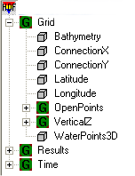
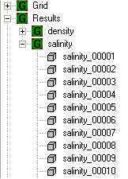
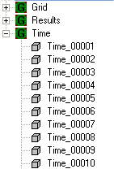

# HDF file

## Overview

MOHID uses [HDF5](../../tools/hdf5.md) as the file format to store matricial data. These files are used to input data to the model. The model also writes its outputs in this format. Typically, the HDF5 file is organized in **groups** and **datasets**. Groups are comparable to folders where the datasets are stored. Datasets refer to the data itself. In MOHID these files are handled (read and write) by [Module HDF5](../../base/module-hdf5.md).

## Standard organization of a MOHID HDF5 file

MOHID HDF5 files have a typical organization in terms of nomenclature of the groups and in terms of which datasets go into which group. There are normally 3 main groups: **Grid**, **Results** and **Time**, which will be described below.

### Grid group

The Grid group stores information about the grid and it is required to have the data sets shown in figure below.

**View of a hdf5 file grid group**

### Results group

The Results group stores the results. The fields stored in the file must correspond to the modeled domain, that is, they must correspond to the same horizontal and vertical grid. The name of the fields must be recognized by MOHID (see list of supported names)

**View of a hdf5 file grid group**

### Time group

The Time group stores the dates of each result dataset. Time data set must contain as many instants as the field data sets. If the file is being used as an input for the model then time data set must also contain dates for a period of the same or greater duration of the simulation.

**View of a hdf5 file grid group**

## HDF5 file as atmospheric forcing for MOHID models

One of the ways to provide the atmospheric properties forcing for MOHID models is to get the data from an HDF5 file.

To accomplish its mission this file has to have the data organized in a specific format. Two groups must be present:

- Results: with data for the atmospheric properties referenced with the [**properties names**](../../reference/properties-names.md) registered in MOHID [**Module GlobalData**](../../base/module-globaldata.md) (so that these names can be recognized by MOHID models);

- Time: time instants of the data.

No Grid group is required because the MOHID model always assumes that the forcing data are in the same grid as the model domain.

If one wants to use atmospheric data from a specific atmospheric model or atmospheric data source as forcing for MOHID models the data must be first converted to MOHID HDF5 file. [**ConvertToHDF5**](../../tools/converttohdf5.md) tool can be used to convert data from some formats and specific modules for converting data from other data sources can also be added to this tool with some extra programming.

Once in MOHID HDF5 file the atmospheric data must be interpolated from the original grid to the model domain grid. For this use the ConvertToHDF5 tool with [**action INTERPOLATE GRIDS**](../../tools/converttohdf5.md).

## See also

[Module FillMatrix](../../base/module-fillmatrix.md)
