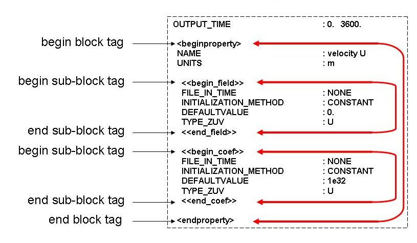
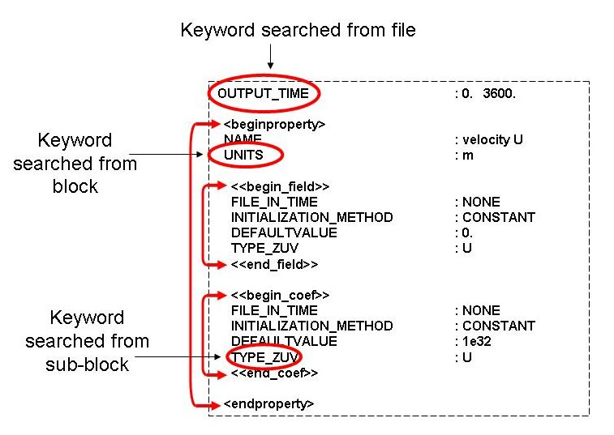

# Blocks

## Overview

Another way of defining options in a MOHID input data file is, as referred above, by using information blocks. These blocks are normally used so that advanced options can be defined through the combination of groups of keywords.

## Block definition

**Structure of a block**

Each block of information is delimited by a ***begin block tag*** and an ***end block tag***, each written in a different line. The ***begin block*** and ***end block*** tags are normally written between the following symbols **<** and **\>** (e.g. <beginproperty> and “<endproperty>”).

## Reading procedure

**Reading procedure of a block**

The reading procedure is similar to the [keywords](keywords.md), but this time the 2 tags must be successfully found in order to define a block, identifying the line numbers where the block begins and ends. This allows a regular [keyword](keywords.md) search algorithm to work only between the 2 tags. A block can also be defined inside another block, therefore creating a hierarchical structure, in where up to three levels are allowed.

## Related links

- [MOHID keyword Database](keyword-list.md)
- [Keywords](keywords.md)
- [New\_Keyword](new-keyword.md)
- [Module EnterData](../../base/module-enterdata.md)
