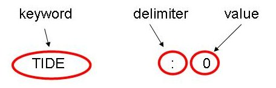

# Keywords

ASCII input data files in Mohid are organized in keywords and information [blocks](blocks.md). Each keyword is defined in a different text line with a maximum of 256 characters. The keyword is always defined on the left of the colon delimiter (“:”) and to the right it is always defined the value of the keyword.

Between the keyword and the delimiter and between the delimiter and the value, blank spaces are allowed. Keywords can define integer numbers; real numbers; boolean values; character strings; one-dimensional arrays of integer or real numbers; dates;

Boolean values are used in variables which can have a TRUE or FALSE value. To minimize input data errors, boolean values in MOHID are always defined by integer numbers: 0 (zero), meaning FALSE, or 1 (one), meaning TRUE.

Dates in MOHID are defined by a 1D array with fixed dimension (6 values). The order of the values is year, month, day, hour, minute and second. The six values are separated by blank spaces.

<table class="wikitable" style="text-align:center"><tbody><tr><th>DENSITY_METHOD</th><td>2</td><td>Integer</td><td>Method to compute water density</td></tr><tr><th>DT</th><td>30</td><td>Real</td><td>Model time step (in seconds)</td></tr><tr><th>TIDE</th><td>1</td><td>Boolean</td><td>Activates/Deactivates tide calculation</td></tr><tr><th>NAME</th><td>temperature</td><td>Character string</td><td>Name of a water property</td></tr><tr><th>BOXES_VALUES</th><td>3.4 4.5 2.1 6.2</td><td>1D array real</td><td>Values defined for an array defined by 4 boxes</td></tr><tr><th>START</th><td>2006 1 1 0 0 0</td><td>Date</td><td>Initial date of the simulation (see <a href="Mohid-Time-format" class="mw-redirect">Mohid Time format</a>)</td></tr></tbody></table>

The detection algorithm of a keyword and its correspondent value is made by scanning all the lines from top to bottom of the file. When a match occurs the file is not scanned anymore. This means that if a keyword is present twice in the file, only the first match is accounted. A keyword can be searched from the entire file, or it can be searched from a defined part of the file, e.g. from a [block](blocks.md). This allows the hierarchical ordering of the file, increasing the complexity of information provided in it.

**WARNING**: Comment lines can NOT have ":" character. For example if ":" character appears in the end of the sentence results in an error, because Module EnterData is expecting to read a value after the ":" character.

## Related links

- [MOHID Keyword Database](keyword-list.md)
- [New\_Keyword](new-keyword.md)
