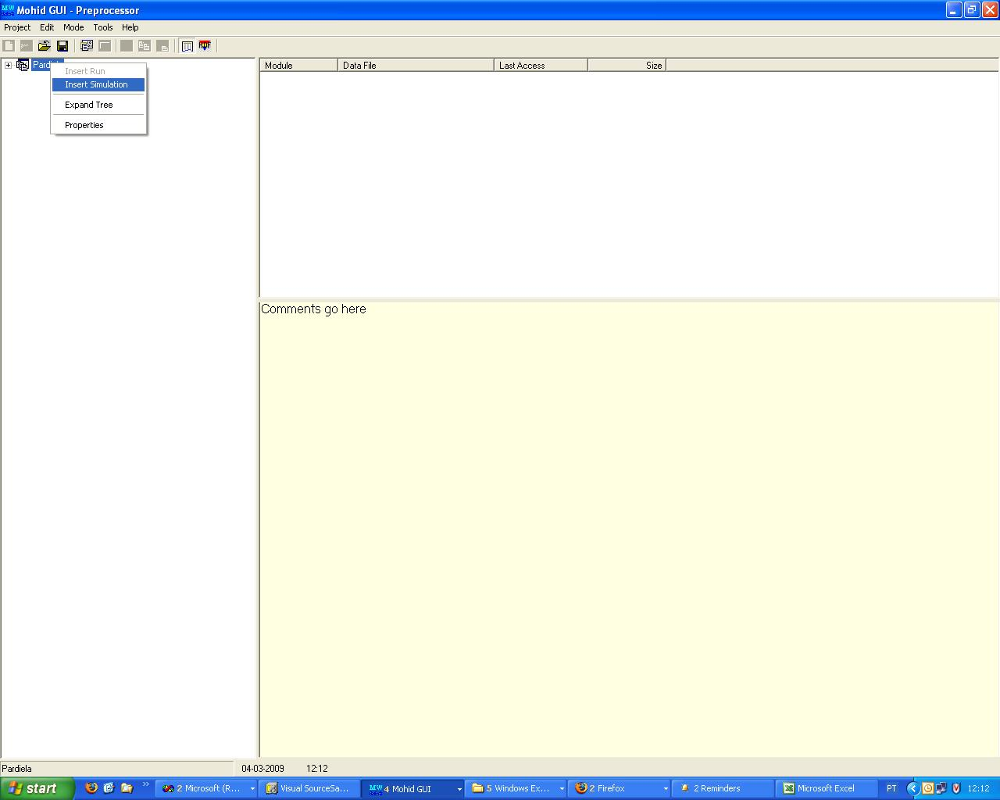
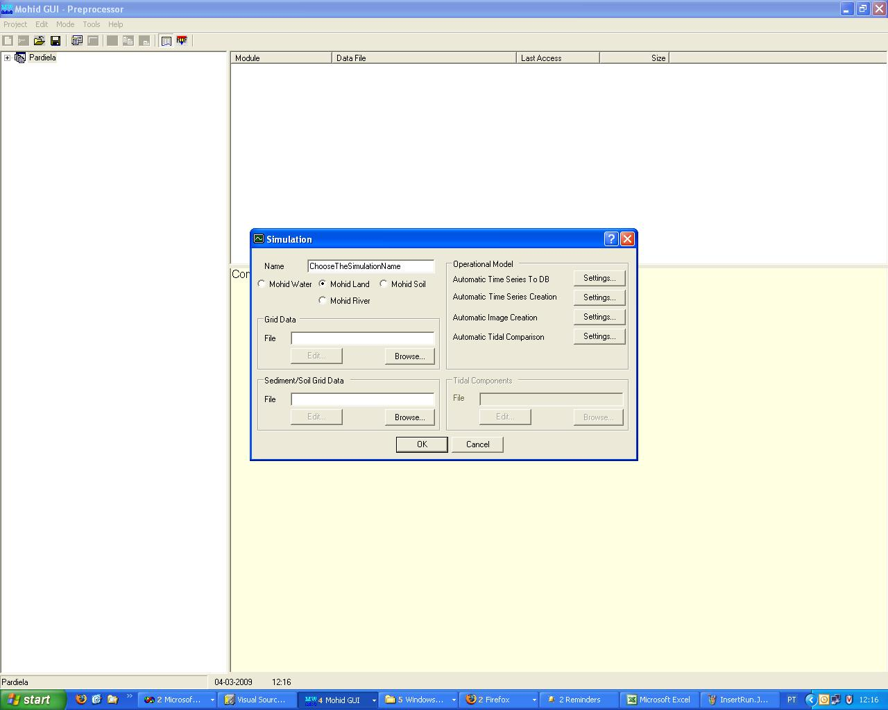
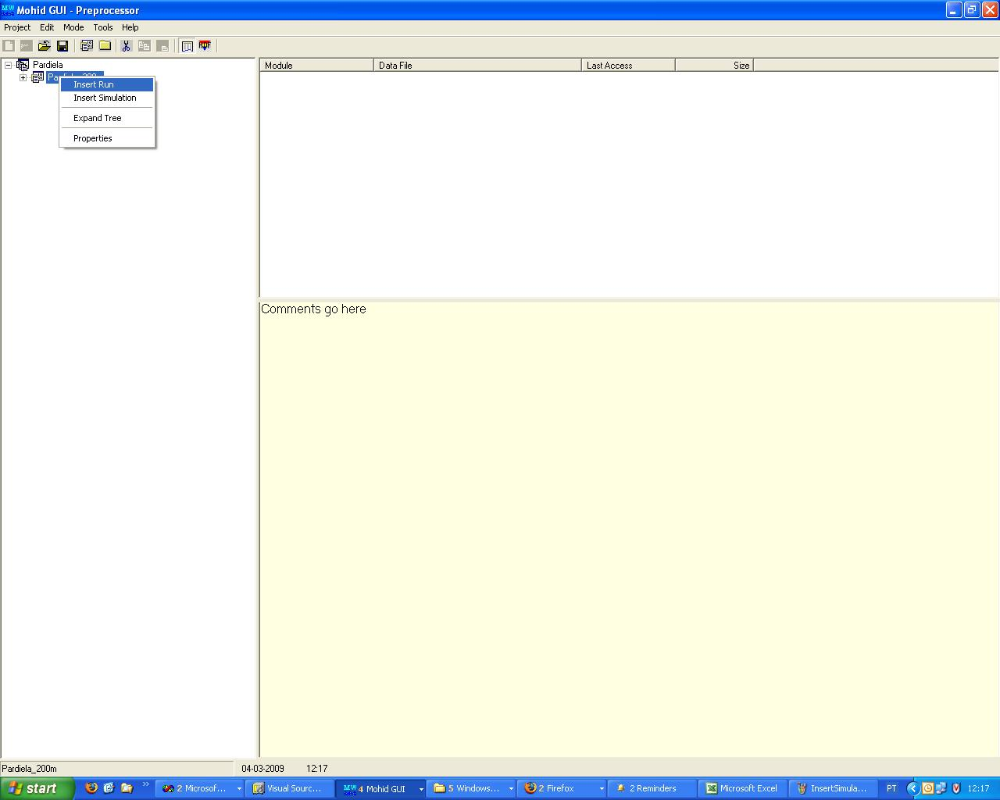
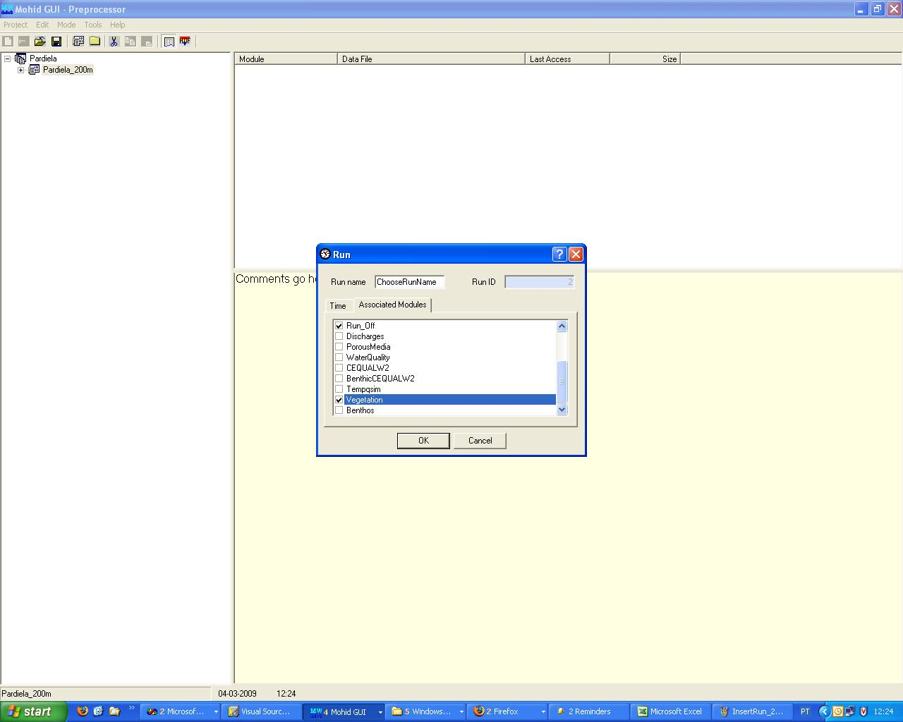

# How to create a MOHID Land Project Step-by-Step

## MOHID Old Interface - MOHID GUI, MOHID GIS and MOHID Time Serie Editor

### Creating a new GUI Project

1. Run MOHID GUI (usually you can find it in the StartMenu->Programs->MOHID)
2. Choose Menu **Project** and then **New**
3. Name the project, the filename and give the project folder (usually in ../Aplica/MohidLand/

$$
ApplicationName
$$

/
4. Insert a new simulation right clicking the project icon in the left, as shown in the Figure 1. The simulation aggregates model runs with the same topography.
5. Define the simulation name (that you can easilly identify) and define MOHID Land radio button defined in Figure 2
6. Insert a new run right clicking the simulation icon in the left, as shown in the Figure 3. The run is each model simulation.
7. Define the run name (that you can easilly identify) and couple modules that you need and are not checked (e.g. vegetation) as seen in Figure 4.

- How to create a new simulation and runs
- 

    Figure 1: How to insert new simulation

- 

    Figure 2: How to insert new simulation, settings

- 

    Figure 3: How to insert a new run

- 

    Figure 4: How to insert a new run, coupled modules

### Topography

#### Create a topography grid data

To create a topography file you will need:

1. Topography data. See [Convert data from NASA Topography](../tools/converttoxyz.md).
2. grid. See [Grid](../io/formats/grid.md) and [GenerateGrid](../tools/generategrid.md) pages.
3. Create the grid data with the topography being interpolated to the grid. See [MOHID GIS Terrain Creator](../tools/gui/mohid-gis.md) or [Digital Terrain Creator Tool](../tools/digital-terrain-creator.md) or can use one already created as reference.
4. Remove depressions from the topography using [MOHID GIS Remove Depressions](../tools/gui/mohid-gis.md).

#### Define Topography in GUI

The topography is defined for the simulation and is the same for all runs. As so, is defined in the simulation window.

1. Click on the simulation name once to select it.
2. Right click on the simulation name to show the menu
3. Select <Properties>
4. In the property window in grid data, browse for your topography grid data.

### Model data file

Here you can:

- edit simulation start and simulation end:

```
START                         : 2002 10 1 0 0 0
END                           : 2004 10 1 0 0 0
```

- edit model timestep:

```
DT                            : 100.
```

- use variable timestep to account for rain periods with higher gradients:

```
VARIABLEDT                    : 1
```

- define maximum time step, if using variable timestep:

```
MAXDT                         : 3600.0
```

### Atmosphere data file

Here you give atmosphere properties to force the model using the block:

```
<beginproperty>
NAME                    : precipitation
UNITS                   : mm
DESCRIPTION             : precipitation
...
<endproperty>
```

Properties may be entered as constant values, time series or HDF. Check [Module Atmosphere](../water/modules/atmosphere.md) for property info and [Module FillMatrix](../base/module-fillmatrix.md) for property keywords (e.g. evolution in time and space).

If you want to:

- Create property timeseries files, follow [Time Series](../io/formats/time-series.md)
- Create property HDF5 files from meteorological data (e.g. MM5), follow [ConvertToHDF5](../tools/converttohdf5.md)
- Create property HDF5 files from station time series data (precipitation, humidity, temperature, etc.), follow [FillMatrix](../tools/fillmatrix.md)

**Remarks**

If you want to account for the exact amount of precipitation using a time serie or hdf file as input, then in property **precipitation** block choose:

```
NO_INTERPOLATION        : 1
```

In this way the precipitation in any time step is the one from the next available instant and so on, not being interpolated between timeserie or hdf instants.

- Please follow [Module Atmosphere](../water/modules/atmosphere.md) for more details on processes and data file keywords.

### Geometry data file

Here you can define your vetical coordinate. Use [**CARTESIANTOP**](../base/module-geometry.md) as default. Define number of layers and their thickness.

```
<begindomain>
ID                      : 1
TYPE                    : CARTESIANTOP
LAYERS                  : 13
LAYERTHICKNESS          : 7 6 5 4 3 2 2 1 0.5 0.3 0.2 0.1 0.1
MIN_BOTTOM_THICKNESS    : 0.1
<enddomain>
```

Also define minimum layer depth:

```
MINIMUMDEPTH            : 0.1
```

### Basin\_Geometry data file

Here you define the delineation of your watershed inside the model grid.

```
DELINEATE_BASIN               : 1
OUTLET_I                      : 24
OUTLET_J                      : 79
TRESHOLD_AREA                 : 100000
```

This keywords allow to delineate the basin, define where will be the outlet (i,j) and define minimum area to start considering a river node.

If the simulation is not a watershed (e.g. 2D vertical or other schematic tests) then delineation is not needed and the only thing to do is define boundary points (flat solution keyword on):

```
DELINEATE_BASIN               : 0
FLAT_SOLUTION                 : 1
TRESHOLD_AREA                 : 100000
```

In the latter case, also define a treshold area bigger than your area if you do not want rivers.

### Basin data file

Basin model manages all other models information and here are defined which models will be used (as an example):

```
ATMOSPHERE             : 1
EVAPOTRANSPIRATION     : 1
VEGETATION             : 1
POROUS_MEDIA           : 1
POROUS_MEDIA_PROPERTIES: 0
RUN_OFF                : 1
DRAINAGE_NET           : 1
```

If evapotranspiration is to be used potential evapotranspiration can be: i) computed from Penman-Montheith method or ii) defined from file or constant value (as for [Module FillMatrix](../base/module-fillmatrix.md) standards). The example below shows the case where potential evapotranspirtation will be computed from Penman-Motheith method because no constant value or file is given.

```
<beginproperty>
NAME                    : reference evapotranspiration
UNITS                   : m/s
DESCRIPTION             : fao evapotranspiration
DEFAULTVALUE            : 0.0
REMAIN_CONSTANT         : 0
<endproperty>
```

**Remarks**

If the user chooses not to include vegetation with the keyword:

```
VEGETATION : 0
```

then transpiration is not computed. However, the user may want to still evaporate water from soil surface. To do so, evapotranspiration must be enabled:

```
EVAPOTRANSPIRATION : 1
```

and reference evapotranspiration property must be defined. Then, in this case, the reference evapotranspiration will be in the form of potential evaporation.

In the other end, if the user chooses to include vegetation with the keyword:

```
VEGETATION : 1
```

The user may want to compute: i) a global potential evapotranspiration or ii) separate potential transpiration (in plants along the root depth) and potential evaporation (on soil surface) based on leaf area index. This option is defined with the keyword:

```
EVAPOTRANSPIRATION_METHOD: 1/2 (1-Global Evapotranspiration; 2-Transpiration and Evaporation)
```

The default value is 1 (if the keyword is not entered).

### Drainage\_Network data file

- A drainage network file containing nodes and cross sections is needed. See [How to create a drainage network](../water/modules/drainagenetwork.md).

- Please follow [Module Drainage Network](../water/modules/drainagenetwork.md) for more details on processes and data file keywords.

### Run\_Off data file

- Manning coefficients must be provided. See [How to generate Manning coefficients](modules/runoff.md).
- Please follow [Module Runoff](modules/runoff.md) for more details on processes and data file keywords.

### PorousMedia data file

This data should be gathered for porous media:

- Soil Map and soils hydraulic caracteristics
- Soil Bottom Altitude
- Water Table Altitude
- Surface Impermeability

See [How to Generate Porous Media Data](modules/porousmedia.md)

- Please follow [Module Porous Media](modules/porousmedia.md) for more details on processes and data file keywords.

### PorousMediaProperties data file

- Please follow [Module Porous Media Properties](modules/porousmediaproperties.md) for more details on processes and data file keywords.

### Vegetation data file

- A vegetation grid with ID's from each vegetation type must be provided. See [How to generate the vegetation grid](modules/vegetation.md).
- Please follow [Module Vegetation](modules/vegetation.md) for more details on processes and data file keywords.

### Output

#### Define HDF output

Define the output time for the HDF files in each module data file:

```
OUTPUT_TIME               : 0 86400
```

The output will be done in modules basin, runoff, drainage network, porous media for standard properties; for modules vegetation and atmosphere the output will be done for properties with the following keyword connected:

```
OUTPUT_HDF : 1
```

#### Define time series output

To create time serie outputs create a .dat file and one block **<BeginTimeSerie>** **<EndTimeSerie>** for each location with the name and grid index to output:

```
DT_OUTPUT_TIME                :  3600
MAX_BUFFER_SIZE               :  10000

<BeginTimeSerie>
NAME                          : Outlet
LOCALIZATION_I                :  24
LOCALIZATION_J                :  79
LOCALIZATION_K                :  13
<EndTimeSerie>

<BeginTimeSerie>
NAME                          : Ponte Zambujal
LOCALIZATION_I                :  72
LOCALIZATION_J                :  65
LOCALIZATION_K                :  13
<EndTimeSerie>
```

Then in each data file that you want time serie output (basin, runoff, drainage network, porous media, vegetation, atmosphere), point to the created file with the keyword:

```
TIME_SERIE_LOCATION    : ..\GeneralData\TimeSeries\GenericTimeSeries.dat
```

The output will be done in modules basin, runoff, drainage network, porous media for standard properties; for modules vegetation and atmosphere the output will be done for properties with the following keyword connected:

```
TIME_SERIE : 1
```

Check also in [How to define time series outputs in MOHID](../tools/gui/how-to-create-mohid-timeseries-outputs.md) for other details.

## MOHID New Interface - MOHID Studio

Check Mohid Studio Manual inside Studio

## Troubleshooting

Frequent Issues

1. If Porous Media taking too long to run: Check that you are using last executable. Geometry changes improved model perfomance.
2. If Porous Media or Drainage Network is taking too long to run and if your project is in Geographic Coordinates, check GEO\_CONVERSATION\_FACTOR in drainage network data file: it is the metric to degrees relation at your latitude.
