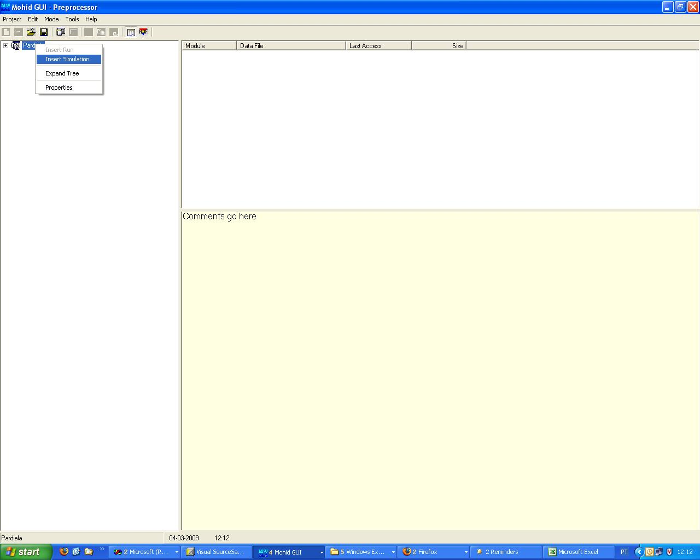
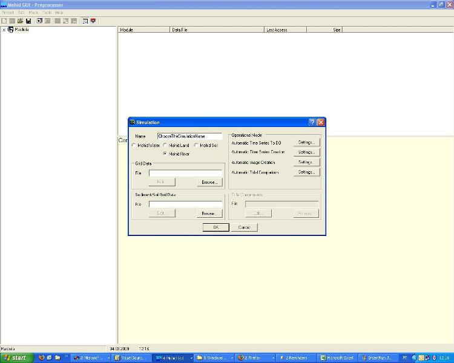
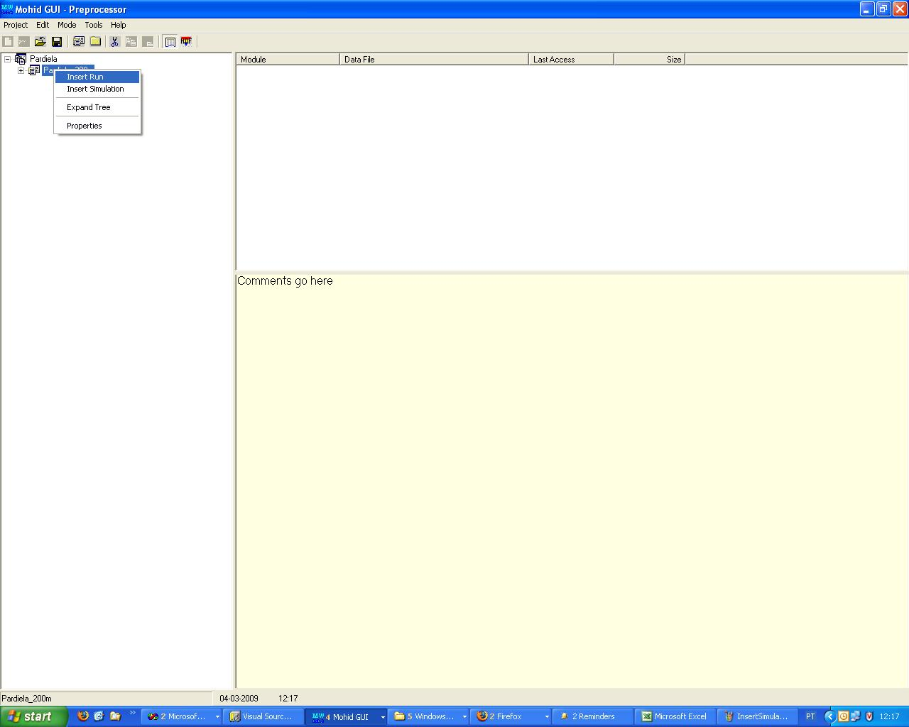
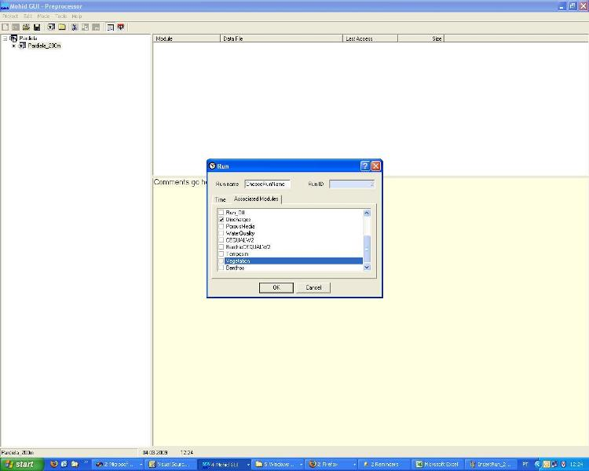

# How to create a MOHID River Project Step-by-Step

## Creating a new GUI Project

1. Run MOHID GUI (usually you can find it in the StartMenu->Programs->MOHID)
2. Choose Menu **Project** and then **New**
3. Name the project, the filename and give the project folder (usually in ../Aplica/MohidLand/

$$
ApplicationName
$$

/
4. Insert a new simulation right clicking the project icon in the left, as shown in the Figure 1.
5. Define the simulation name (that you can easilly identify) and define MOHID River Network radio button defined in Figure 2
6. Insert a new run right clicking the simulation icon in the left, as shown in the Figure 3. The run is each model simulation.
7. Define the run name (that you can easilly identify) and couple modules that you need and are not checked (e.g. discharges) as seen in Figure 4.

- How to create a new simulation and runs
- 

    Figure 1: How to insert new simulation

- 

    Figure 2: How to insert new simulation, settings

- 

    Figure 3: How to insert a new run

- 

    Figure 4: How to insert a new run, coupled modules

You will have a drainage network file and a model file. As you're using Mohid River Network (MRN) as a stand alone program you will need to define discharges to the river and you'll have to define them in a discharge file.

## Model data file

Here you can:

- edit simulation start and simulation end:

```
START                         : 2002 10 1 0 0 0
END                           : 2004 10 1 0 0 0
```

- edit model timestep:

```
DT                            : 100.
```

- use variable timestep to account for rain periods with higher gradients:

```
VARIABLEDT                    : 1
```

- define maximum time step, if using variable timestep:

```
MAXDT                         : 3600.0
```

## Drainage\_Network data file

- A drainage network file containing nodes and cross sections is needed. See [How to create a drainage network](../water/modules/drainagenetwork.md).

- Please follow [Module Drainage Network](../water/modules/drainagenetwork.md) for more details on processes and data file keywords.

## Discharge data file

Define the discharges in to the river. See [Create a discharge with Mohid River Network](../water/modules/discharges.md)

## Output

### Define HDF output

Define the output time for the HDF files in Drainage Network module data file:

```
OUTPUT_TIME               : 0 86400
```

Each property defined in Drainage Network file (if any) will be outputed to a .srn file.

### Define time series output

To create time serie outputs create a .dat file and one block **<BeginNodeTimeSerie>** **<EndNodeTimeSerie>** for each node location:

```
DT_OUTPUT_TIME                :  3600
MAX_BUFFER_SIZE               :  10000

<BeginNodeTimeSerie>
100
210
211
1
161
<EndNodeTimeSerie>
```

Then in drainage network data file point to the created file with the keyword:

```
TIME_SERIE_LOCATION    : ..\GeneralData\TimeSeries\GenericTimeSeries.dat
```
