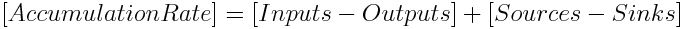
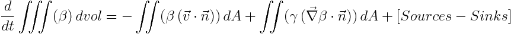
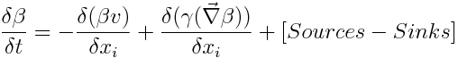
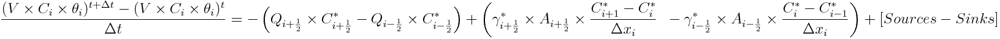

# Module PorousMediaProperties

## Overview

This is the module in Mohid Land that handles porous media properties, meaning that controls transport (dependent on fluxes computed in porous media) and transformation processes (sediment quality and PREEQC modules that concern to biological and chemical processes in soil respectively). Standard units for Module PorousMediaProperties are mg/L in dissolved properties and mg/kgsoil for adsorbed properties.

## Main Processes

### Property Transport

In a mass conservation approach the variation of the mass of a property (or water volume) in a volume may change (accumulation in time (rate)) if material enters or exits the volume (trough the faces of the volume) or if there are sources or sinks for the property (degradation, chemical reactions, etc.) inside that volume.

So, the property transport equation in text form:



This "equation" may be written in integral form meaning that the accumulation terms are summed in infinitesimal volumes and the fluxes through the faces of the volume are summed in infinitesimal areas. These fluxes through the faces enter with the velocity (transport from other volumes) and because there is diffusion (the property has different concentrations in different volumes and spreads). So the inputs and outputs will create two terms, the first the advection (driven trough velocity) and the second the diffusion (driven trough property gradient).

The property transport equation in integral form:



where:

```
Beta is property concentration (M/L^3)
v is velocity (L/T)
Gamma is diffusivity (L^2/T)
dvol and dA are notation from volume integral and surface integral
dt is infinitesimal variation of time
```

In a finite volume approach, the control volume (or cell) has a defined volume and all the properties are homogeneous inside the control volume (and referred to the cell center) and velocities are homogeneous in the faces of the volume (and referred to the face). So the latter equation may be simplified because property, velocity, and diffusivity are homogeneous inside control volume or in the faces so they may exit the integral and the various flux directions (3 directions through 6 faces have to be analyzed).

The property transport equation in "infinitesimal volume" form::



where:

```
Beta is property concentration (M/L^3)
v is velocity (L/T)
Gamma is diffusivity (L^2/T)
Deltaxi is cell spatial step in direction i (m)
dt is infinitesimal variation of time
```

So to get to the final form we only need to discretize to a finite volume, to its faces and to the different flux directions and to a finite timestep.

The property transport equation in finite volume and one direction:



where:

```
V is cell volume (m3)
C is cell property concentration (g/m3)
theta is cell water content (m3H2O/m3cell)
Deltat is time step (s)
Q is flow in cell face (m3/s)
Gamma is diffusivity in cell face (m2/s)
- is t in case of explicit model and t+deltat in case of implicit
```

Time discretization of property transport in Module PorousMediaProperties can be explicit or implicit. If a user chooses to use implicit formulation, fluxes between porous media cells are implicit computed and also Runoff or Drainage Network interactions where sinks in soil occur. Runoff and Drainage network interactions acting as a source to soil and sources or sinks from vegetation (uptake or organic matter generation) are always computed explicitly. Vegetation uptakes cannot be simulated implicitly because this uptake may be disconnected from evapotranspiration flux (SWAT formulation).

Spatial discretization (horizontally and vertically) of property transport in Module PorousMediaProperties can be chosen from several options as in ModuleWaterProperties for each property (e.g. Upwind order 1 to 3, CentralDifferences, LeapFrog..) In order to boost the computation, PorousMediaProperties has the option of choosing the same discretization for all the properties (see keywords).

Diffusivity in soil is defined by tortuosity and dispersion (associated to erratic motion in pores)

$\gamma _{face}=\left (Diff_{face}\times \zeta (\theta _{face}^{*})  \right )+\left (\frac{v_{face}}{\theta _{face}^{*}}\times \lambda _{face}  \right )$

where:

```
Gammaface is diffusivity in cell face (m2/s)
Diffface is molecular diffusivity in cell face (m2/s)
zeta is Tortuosity (-)
tethaface is water content at cell face (m3H20/m3cell)
vface is velocity at the cell face (m/s)
lambdaface is dispersivity (m)
- is t in case of explicit model and t+deltat in case of implicit
```

Water content at face can be obtained by several methods chosen by the user: average of adjacent cells, minimum, maximum.

Tortuosity is defined as:

$\zeta (\theta _{face}^{*})=\frac{(\theta _{face}^{*})^{\frac{7}{3}}}{(\phi _{face})^{2}}$

where:

```
thetaface is water content at cell face (m3H20/m3cell)
phiface is porosity at cell face (m3pores/m3cell
- is t in case of explicit model and t+deltat in case of implicit
```

### Property Transformation

#### Biological activity - Sediment Quality Module

[Sediment Quality](../../water/modules/sedimentquality.md) module simulates biological processes by bacteria. Heterotrophic bacteria perform mineralization of organic matter (organic matter to inorganic material), Autotrophic bacteria perform nitrification (ammonia to nitrate) and Anaerobic bacteria denitrification (nitrate to nitrogen gas). Also, immobilization of inorganic species is done if bacteria have nutrient needs to maintain ratios.

#### Chemical reactions - PREEQC Module

PREEQC module handles chemical equilibrium between species in soil, giving the new equilibrium at each computation.

#### Partition

Partition between particulated and dissolved species is done using a user ratio.

## Boundary Conditions

In PorousMedia there is the option to define the boundary condition in different components. It can be imposed an aquifer level at the soil lateral "walls" and/or free flux in the bottom.

In the case of lateral boundary flux if water enters the domain from outside the properties values in the boundary need to be defined. For the bottom boundary condition is assumed "free-flow" or "null gradient" and water only exits soil so the properties in boundary do not need to be defined.

### Computation

#### Lateral Boundary

Boundary propertie values are computed in one of two ways: i) impose a property value at boundary; ii) Null gradient where outside concentration is the same as inside. The boundary flow from Module Porous Media and the imposed concentration in boundary are used to define transport coefficients for advection-diffusion. In advection diffusion solving (if the user chooses implicit), the fluxes entering the domain are solved explicitly and fluxes exiting are computed implicitly.

#### Bottom Boundary

Bottom fluxes do not need for a boundary property definition (water exiting domain) and in the advection-diffusion solving (if the user chooses implicit) the fluxes are computed implicitly.

### Keywords

#### Lateral Boundary

The keyword in property block in PorousMediaProperties\_X.dat that allows to define the boundary condition method is:

```
<beginproperty>
...
BOUNDARY_CONDITION        : 2    !1-Imposed Value; 2-Null Gradient
...
<endproperty>
```

In case of using imposed value than the imposed concentration has to be defined:

```
<beginproperty>
...
DEFAULTBOUNDARY           : 1.
...
<endproperty>
```

#### Bottom Boundary

For bottom boundary is no need for property definition

## Discharges

In PorousMediaProperties the discharges may be positive or negative (PorousMediaProperties uses discharge flow and concentration) and are dealt with ModuleDischarges.

In Porous Media Properties, it was also introduced the option to use properties discharged. If one property is not discharged than the assumption is that if a positive discharge exists that property concentration is zero.

### Computation

The discharges are initialized in Construct phase reading its locations and checking if inside boundaries.

In Modification phase, the discharges are explicit and computed before transport (they were not included in transport scheme).

### Keywords

For positive discharges the discharge concentration is read from Discharges\_X.dat and the following keyword needs to exist in the PorousMedia Properties\_X.dat inside the property block of the discharged property:

```
DISCHARGES : 1
```

## Other Features

## Outputs

Output is done in terms of timeseries, HDF, and boxes following the MOHID standards.

## References

## Data File

## Units

```
Units in porous media properties
  Transported properties (soluble)  : g/m3 (or mg/L)                     (needs to convert concentrations to SedimentQuality and
                                                                          PREEQC at entrance and exit)
  Adsorbed properties (non soluble) : mg/kgsoil                          (needs to convert concentrations to PREEQC )
  Solid Phases (non soluble)        : mg/kgsoil                          (used in PhreeqC to make equilibrium with soil solution)
  Gas Phases (non soluble)          : mol (mass); atm (partial pressure) (used in PhreeqC to make equilibrium with soil solution)
  Gas Phases (assumed soluble)      : mg/L                               (used in SedimentQuality - N2, CH4 and CO2)

  Soil Dry Density                  : kg/m3
  H+ and Ionic Strenght             : mol/L                              (used in SedimentQuality)
  Microorganisms Population         : #org/kgsoil                        (used in SedimentQuality)
```

### Keywords

```
ADVDIFF_EXPLICIT              : 0/1                [1]        !REMARK: Horizontal diffusion is always explicit
                                                              !(1 - adv and diff are explicit in all directions; 0 - adv and diff
                                                              !are implicit in vertical, horizontal adv may be explicit or impl)
  ADVDIFF_ADVECTION_H_IMP_EXP : 0/1                [1]        !(read if ADVDIFF_EXPLICIT : 0; 0 - horiz adv implicit;
                                                                1 - horiz adv explicit)
NEW_FORMULATION               : 0/1                [0]        !if 1 then spatial methods will be the same for all properties

    ADVDIFF_METHOD_H          : integer      [UpwindOrder1]   !Spatial methods for horizontal advection
                                                              !UpwindOrder1 = 1, UpwindOrder2 = 2, UpwindOrder3 = 3, P2_TVD = 4,
                                                               CentralDif = 5, LeapFrog = 6
    ADVDIFF_METHOD_V          : integer      [UpwindOrder1]   !Spatial methods for vertical advection
                                                              !UpwindOrder1 = 1, UpwindOrder2 = 2, UpwindOrder3 = 3, P2_TVD = 4,
                                                               CentralDif = 5, LeapFrog = 6!
<beginproperty>
  ADVECTION_DIFFUSION         : 0/1               [0]         !Property advection - diffusion
      ADVDIFF_METHOD_H        : integer      [UpwindOrder1]   !Spatial methods for horizontal advection
                                                              !UpwindOrder1 = 1, UpwindOrder2 = 2, UpwindOrder3 = 3, P2_TVD = 4,
                                                               CentralDif = 5, LeapFrog = 6
      ADVDIFF_METHOD_V        : integer      [UpwindOrder1]   !Spatial methods for vertical advection
                                                              !UpwindOrder1 = 1, UpwindOrder2 = 2, UpwindOrder3 = 3, P2_TVD = 4,
                                                               CentralDif = 5, LeapFrog = 6
      ADVDIFF_TVD_LIMIT_H     : integer        [Superbee]     !Horizontal advection non-linear stability conditions
                                                               MinMod = 1, VanLeer = 2, Muscl = 3, Superbee = 4, PDM = 5
      ADVDIFF_TVD_LIMIT_V     : integer        [Superbee]     !Vertical advection non-linear stability conditions
                                                              !MinMod = 1, VanLeer = 2, Muscl = 3, Superbee = 4, PDM = 5
      ADVDIFF_VOLUME_RELATION_MAX : real          5.          !The relation between adjacent volumes above which
                                                              !the advection is upwind

  SOIL_CHEMISTRY              : 0/1               [0]         !Use PREEQC model to change property (source/sink model)
  SOIL_QUALITY                : 0/1               [0]         !Use SedimentQuality model to change property (source/sink model)
  PARTITION                   : 0/1               [0]         !Compute partition between dissolved-particulate phases
      PARTITION_COUPLE        : char               +          !Name of the property (oposite phase) to compute partition
      PARTITION_FRACTION      : real               -          !Percentage of mass of a property in a determined phase
      PARTITION_RATE          : real            [1 s-1]       !Kinetic rate of partition to reach equilibrium
<endproperty>
```

### Sample

```
OUTPUT_TIME               : 0 3600
TIME_SERIE_LOCATION       : ..\General Data\TimeSeries\TimeSeriesLocation3D_2m.dat

!Advectin diffusion options
ADVDIFF_EXPLICIT          : 1
!Horizontal diffusion is always explicit
!(1 - adv and diff are explicit in all directions; 0 - adv and diff
!are implicit in vertical. horizontal adv may be explicit or impl)

ADVDIFF_ADVECTION_H_IMP_EXP :  1
!(read if ADVDIFF_EXPLICIT : 0; 0 - horiz adv implicit;
! 1 - horiz adv explicit)

NEW_FORMULATION           : 1   !1 - do not use moduleadvectiondiffusion (removed advection computation); 0 - old formulation
ADVDIFF_METHOD_H          : 1   !UpwindOrder1 = 1. UpwindOrder2 = 2. UpwindOrder3 = 3. P2_TVD = 4.
!CentralDif = 5. LeapFrog = 6
ADVDIFF_METHOD_V          : 1   !UpwindOrder1 = 1. UpwindOrder2 = 2. UpwindOrder3 = 3. P2_TVD = 4.
!CentralDif = 5. LeapFrog = 6

!dispersion
<begin_dispersion_long>
NAME                      : dispersion long
INITIALIZATION_METHOD     : CONSTANT
DEFAULTVALUE              : 0.0
REMAIN_CONSTANT           : 1
<end_dispersion_long>

<begin_dispersion_trans>
NAME                      : dispersion trans
INITIALIZATION_METHOD     : CONSTANT
DEFAULTVALUE              : 0.0
REMAIN_CONSTANT           : 1
<end_dispersion_trans>

!example of rates for use with sediment quality
BOXFLUXES                 : ..\General Data\Boxes\Boxes.dat

<beginSQrate>
NAME                      : ammonia ammonia
DESCRIPTION               : nitrification (-); ammonia imombilization (+)
FIRSTPROP                 : ammonia
SECONDPROP                : ammonia
MODEL                     : SedimentQuality
<endSQrate>
```

### Properties needed to run with sediment quality

- properties simulated: ammonia, nitrate, particulated refractory organic nitrogen, particulate organic nitrogen, nitrogen gas, heterotrophic microorganism nitrogen, autotrophic microorganism nitrogen, anaerobic microorganism nitrogen, urea

particulate labile organic carbon, particulated refractory organic carbon, heterotrophic microorganism carbon, anaerobic microorganism carbon, carbon dioxide

inorganic phosphorus, particulated inorganic phosphorus, particulated refractory organic phosphorus, particulate organic phosphorus, heterotrophic microorganism phosphorus, autotrophic microorganism phosphorus, anaerobic microorganism phosphorus, heterotrophic microorganism population, autotrophic microorganism population, anaerobic microorganism population

- properties defined by user (sediment quality does not change them): temperature, salinity, pH, ionic strength, phosphorus adsortion index, soil dry density

- properties that can be defined by user or computed: oxygen. oxygen is computed based on temperature and salinity.

```
ATTENTION: When using soil quality modules DTINTERVAL here in each property should be the same as 0D model DT.
```

```
<beginproperty>
NAME                      : ammonia
UNITS                     : mgN/L
DESCRIPTION               : ammonia
PARTICULATE               : 0
OLD                       : 0
MIN_VALUE                 : 1E-15
FILE_IN_TIME              : NONE
INITIALIZATION_METHOD     : CONSTANT
DEFAULTVALUE              : 10.
ADVECTION_DIFFUSION       : 1
ADVDIFF_MOLECULAR_DIFF_COEF :  0.0
DTINTERVAL                : 86400.
SOIL_QUALITY              : 1
SOIL_CHEMISTRY            : 0
TIME_SERIE                : 1
OUTPUT_HDF                : 1
BOX_TIME_SERIE            : 1
<endproperty>

<beginproperty>
NAME                       : nitrate
UNITS                      : mgN/l
DESCRIPTION                : nitrate
ADVECTION_DIFFUSION        : 1
DEFAULTVALUE               : 10.0
ADVDIFF_MOLECULAR_DIFF_COEF : 0.0
ADVDIFF_METHOD_H           : 1   !UpwindOrder1 = 1, UpwindOrder2 = 2, UpwindOrder3 = 3, P2_TVD = 4,
                                !CentralDif = 5, LeapFrog = 6
ADVDIFF_METHOD_V           : 1   !UpwindOrder1 = 1, UpwindOrder2 = 2, UpwindOrder3 = 3, P2_TVD = 4,
                                !CentralDif = 5, LeapFrog = 6
OUTPUT_HDF                 : 1
TIME_SERIE                 : 1
<endproperty>

<beginproperty>
NAME                       : inorganic phosphorus
UNITS                      : mgP/l
DESCRIPTION                : inorganic phosphorus
ADVECTION_DIFFUSION        : 1
DEFAULTVALUE               : 1.0
ADVDIFF_MOLECULAR_DIFF_COEF : 0.0
ADVDIFF_METHOD_H           : 1   !UpwindOrder1 = 1, UpwindOrder2 = 2, UpwindOrder3 = 3, P2_TVD = 4,
                                !CentralDif = 5, LeapFrog = 6
ADVDIFF_METHOD_V           : 1   !UpwindOrder1 = 1, UpwindOrder2 = 2, UpwindOrder3 = 3, P2_TVD = 4,
                                !CentralDif = 5, LeapFrog = 6
OUTPUT_HDF                 : 1
TIME_SERIE                 : 1
<endproperty>

<beginproperty>
NAME	    		: soil dry density
UNITS	    		: kg/m3cell
DESCRIPTION 		: soil dry density
PARTICULATE 		: 0
OLD	    		: 0
MIN_VALUE   		: 0
FILE_IN_TIME 		: NONE
INITIALIZATION_METHOD 	: CONSTANT
DEFAULTVALUE     	: 1490.
ADVECTION_DIFFUSION 	: 0
SOIL_QUALITY            : 0
SOIL_CHEMISTRY          : 0
TIME_SERIE              : 1
OUTPUT_HDF              : 1
<endproperty>
```
