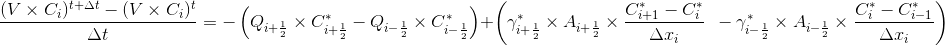

# Module RunoffProperties

## Overview

This is the module in Mohid Land that handles runoff properties, meaning that controls its transport (dependent on fluxes computed in module Runoff). In this module property transformation is not computed since runoff routing is usually a fast process and there is not time for microbiological activity or chemical equilibrium. This is also the module that handles erosion/deposition to compute sediment and particulate properties sources and sinks (from surface soil to runoff water and vice-versa). Standard units for Module RunoffProperties are mg/L for dissolved and particulated properties in the water column and kg/m2 when deposited in surface soil.

## Main Processes

### Property Transport

Time discretization of property transport in Module RunoffProperties can be explicit or implicit. If user chooses to use implicit formulation, fluxes between runoff cells are implicit computed and also Drainage Network interaction where sinks in runoff occur. Runoff interaction acting as source to runoff and sinks from vegetation (particulate organic material easily eroded from manure) are always computed explicitly.

Spatial discretization (horizontally and vertically) of property transport in Module RunoffProperties can be chosen from several options as in ModuleWaterProperties for each property (e.g. Upwind order 1 to 3, CentralDifferences, LeapFrog..) In order to boost the computation, RunoffProperties has the option of choosing all the same discretization for all the properties (see keywords).

The property transport equation:



Transport Equation

where:

```
V is cell water volume (m3) - water column (m) * cell area (m2)
C is cell property concentration (g/m3)
Deltat is time step (s)
Q is flow in cell face (m3/s)
Gamma is diffusivity in cell face (m2/s)
Deltaxi is cell spatial step in direction i (m)
- is t in case of explicit model and t+deltat in case of implicit
```

Diffusivity in runoff is defined by molecular diffusivity and dispersion (associated to erratic motion)

$\gamma _{face}= Diff_{face} +\left (v_{face}\times \lambda _{face}  \right )$

where:

```
Gammaface is diffusivity in cell face (m2/s)
Diffface is molecular diffusivity in cell face (m2/s)
vface is velocity at the cell face (m/s)
lambdaface is dispersivity (m)
```

### Erosion/Deposition

Erosion and deposition are function of the shear stress at the soil surface, meaning that higher velocities will tend to erode material and lower velocities will tend to deposit. Sediment bed is simulated as a "fluff layer" representing the easy eroded material in soil.

**The property erosion equation:**

$E_{s}=E\times P_{enr}\times \left ( \frac{\tau _{b}}{\tau_{ce}} -1\right ) \; if \; \tau_{b} \; > \; \tau_{c}$

$E_{s}=0 \; if \; \tau_{b} \; <= \; \tau_{c}$

where:

```
Es is the flux of eroded property (kg.m-2.s-1)
E is erosion factor (kg.m-2.s-1)
Penr is property enrichment ratio to cohesive sediment that exists in sediment bed (kg.m-2Property / kg.m-2sediment)
taub is shear stress at the sediment bed (Pa)
tauce is the critical (minimum) shear stress for erosion to occur (Pa)
```

Erosion of properties occurs dependently on the enrichemt ratio of the property in sediment since the erosion rate (E) is dependent on sediment type and cohesion. It is assumed that erosion is a transfer process between sediment in bed to the water column where properties are adsorbed to.

**And the property deposition equation:**

$D_{s}=C\times W_{s}\times 1E-3\times \left (1 - \frac{\tau _{b}}{\tau_{cd}} \right ) \; if \; \tau_{b} \; < \; \tau_{cd}$

$D_{s}=0 \; if \; \tau_{b} \; >= \; \tau_{cd}$

where:

```
Ds is the flux of deposited property (kg.m-2.s-1)
C is property concentration (g/m3)
Ws is property deposition velocity (m/s)
1E-3 is the conversion from grams to kilograms
taub is shear stress at the sediment bed (Pa)
taucd is the critical (maximum) shear stress for deposition to occur (Pa)

taucd has to be lower than tauce
```

Deposition of properties occurs independently on the proportion of the property in sediment. Each property may have a different deposition rate and the process will be proportional to the property concentration since higher concentration will promote flocculation and deposition.

**Bottom Shear Stress**

Bottom shear stress is the effective shear at the soil surface promoted by water transport in runoff

$\tau _{b}=\frac{\rho \times g\times n^{2}\times v^{2}}{h^{\frac{1}{3}}}$

where:

```
taub is bottom shear stress (Pa or kg.m-1.s-2)
rho is water density (kg.m-3)
g is gravity acceleration (m.s-2)
n is manning coefficient (s.m(-1/3))
v is velocity at the center of cell (m.s-1)
h is water column (m)
```

### Partition

Partition between particulated and dissolved species is done using a user ratio.

## Boundary Conditions

In Runoff there is the option to define the boundary condition as an imposed level or time series. If water enters domain from outside the properties values in the boundary need to be defined.

### Computation

Boundary properties values are computed in one of two ways: i) impose a property value at boundary; ii) Null gradient where outside concentration is the same as inside. The boundary flow from ModuleRunoff and the imposed concentration in boundary are used to define compute new concentrations explicitly.

### Keywords

The keyword in property block in RunoffProperties\_X.dat that allows to define the boundary condition method is:

```
<beginproperty>
...
BOUNDARY_CONDITION        : 2    !1-Imposed Value; 2-Null Gradient
...
<endproperty>
```

In case of using imposed value than the imposed concentration has to be defined:

```
<beginproperty>
...
DEFAULTBOUNDARY           : 1.
...
<endproperty>
```

## Discharges

In RunoffProperties the discharges may be positive or negative (RunoffProperties uses discharge flow and concentrarion) and are dealt with ModuleDischarges

If one property is not discharged than the assumption is that if a positive discharge exists that property concentration is zero.

### Computation

The discharges are initialized in Construct phase reading its locations and checking if inside boundaries.

In Modification phase the discharges are explicit and computed before transport (they were not included in transport scheme).

### Keywords

For positive discharges the discharge concentration is read from Discharges\_X.dat and the following keyword needs to exist in the Runoff Properties\_X.dat inside the property block of the discharged property:

```
DISCHARGES : 1
```

## Other Features

## Outputs

Output is done in terms of timeseries and HDF following the MOHID standards.

## References

## Data File

### Keywords

```
Units in runoff properties
  Transported properties (soluble)             : g/m3 (or mg/l)
  Adsorbed properties (non soluble)            : ug/kgsoil
  Bottom layer Properties (bottom transition)  : kg/m2

ADVDIFF_EXPLICIT              : 0/1               [1]        !REMARK: Horizontal diffusion is always explicit
                                                              (1 - horiz adv is explicit; 0 - horiz adv is implicit
NEW_FORMULATION               : 0/1                [0]        !if 1 then spatial methods will be the same for all properties
     ADVDIFF_METHOD_H         : integer      [UpwindOrder1]   !Spatial methods for horizontal advection
                                                              !UpwindOrder1 = 1, UpwindOrder2 = 2, UpwindOrder3 = 3, P2_TVD = 4,
                                                               CentralDif = 5, LeapFrog = 6    !
<beginproperty>
  PARTICULATE                 : 0/1               [0]         !Property physical state: 0 - Dissolved ; 1 - Particulate
    EROSION                   : 0/1               [0]         !Compute erosion (source/sink term) - only read if PARTICULATE : 1
    DEPOSITION                : 0/1               [0]         !Compute deposition (source/sink) - only read if PARTICULATE : 1
      WS_TYPE                 : integer           [1]         !1 -constant;2 -concentration function - only read if DEPOSITION : 1
        WS_VALUE              : real                          !Fall velocity value - only read if WS_TYPE : 1
  ADVECTION_DIFFUSION         : 0/1               [0]         !Property advection - diffusion
      ADVDIFF_METHOD_H        : integer      [UpwindOrder1]   !Spatial methods for horizontal advection
                                                              !UpwindOrder1 = 1, UpwindOrder2 = 2, UpwindOrder3 = 3, P2_TVD = 4,
                                                               CentralDif = 5, LeapFrog = 6
      ADVDIFF_TVD_LIMIT_H     : integer        [Superbee]     !Horizontal advection non-linear stability conditions
                                                               MinMod = 1, VanLeer = 2, Muscl = 3, Superbee = 4, PDM = 5
      ADVDIFF_VOLUME_RELATION_MAX : real          5.          !The relation between adjacent volumes above which
                                                              !the advection is upwind
  PARTITION                   : 0/1               [0]         !Compute partition between dissolved-particulate phases
      PARTITION_COUPLE        : char               +          !Name of the property (oposite phase) to compute partition
      PARTITION_FRACTION      : real               -          !Percentage of mass of a property in a determined phase
      PARTITION_RATE          : real            [1 s-1]       !Kinetic rate of partition to reach equilibrium
      USE_SED_REF_CONC        : 0/1               [0]         !Use cohesive sediment concentration as a reference
          SED_REF_CONC        : real              [1]         !Reference cohesive sediment concentration to partition
<endproperty>
```

### Sample

```
OUTPUT_TIME               : 0 3600
TIME_SERIE_LOCATION       : ..\General Data\TimeSeries\TimeSeriesLocation2D_2.dat
!
!Advection diffusion options
ADVDIFF_EXPLICIT          : 0
!(1 - adv explicit; 0 - adv implicit; diff always explicit)

NEW_FORMULATION           : 1   !1 - do not use moduleadvectiondiffusion (removed advection computation); 0 - old formulation
ADVDIFF_METHOD_H          : 1   !UpwindOrder1 = 1. UpwindOrder2 = 2. UpwindOrder3 = 3. P2_TVD = 4.
!CentralDif = 5. LeapFrog = 6

!Dispersion
<begin_dispersion_trans>
NAME                      : dispersion trans
INITIALIZATION_METHOD     : CONSTANT
DEFAULTVALUE              : 0.0
REMAIN_CONSTANT           : 1
<end_dispersion_trans>

!!!!!!!!!!BEGIN SHEAR EROSION/DEPOSITION PARAMETERS!!!!!!!!!!!

HMIN_CHEZY                : 0.0001  !0.0005   !m

<begin_critical_shear_erosion>
NAME                      : critical shear for erosion
INITIALIZATION_METHOD     : CONSTANT
DEFAULTVALUE              : 0.2  !Pa = N/m2
REMAIN_CONSTANT           : 1
<end_critical_shear_erosion>

<begin_critical_shear_deposition>
NAME                      : critical shear for deposition
INITIALIZATION_METHOD     : CONSTANT
DEFAULTVALUE              : 0.1  !Pa = N/m2
REMAIN_CONSTANT           : 1
<end_critical_shear_deposition>

<begin_erosion_coefficient>
NAME                      : erosion coefficient for shear
INITIALIZATION_METHOD     : CONSTANT
DEFAULTVALUE              : 5.0E-6  !5.0E-4     !kg m-2 s-1
REMAIN_CONSTANT           : 1
<end_erosion_coefficient>

!!!!!!!!!!END SHEAR EROSION/DEPOSITION PARAMETERS!!!!!!!!!!!

!!!!!!!!!!BEGIN SPLASH EROSION PARAMETERS!!!!!!!!!!!

SPLASH_HCRITIC_COMPUTE     : 1
SPLASH_HCRITIC             : 0.1   !m water column height where exponent decay is about 40% of maximum value
SPLASH_EROSIVERAIN_METHOD  : 2     ! 1-constant erosive rain ; 2-use real rain for erosive rain
 SPLASH_EROSIVERAIN_VALUE : 30.   ! mm/h for erosive rain (read if SPLASH_EROSIVERAIN_METHOD : 1)

<begin_soil_detach>
NAME                      : erosion coefficient for rain splash
INITIALIZATION_METHOD     : CONSTANT
DEFAULTVALUE              : 0.1         !g/J
REMAIN_CONSTANT           : 1
<end_soil_detach>

!!!!!!!!!!END SPLASH EROSION PARAMETERS!!!!!!!!!!!

!
!Property declaration
<beginproperty>
NAME                      : nitrate
UNITS                     : mgN/l
ADVECTION_DIFFUSION       : 1
DESCRIPTION               : nitrate
DEFAULTVALUE              : 1.0
ADVDIFF_MOLECULAR_DIFF_COEF :  0.0
TIME_SERIE                : 1
OUTPUT_HDF                : 1
<endproperty>

Properties needed to run erosion/depositio: cohesive sediment and each other particulate have to be marked as particulate and erosion deposition parameters defined.

<beginproperty>
 NAME                    : cohesive sediment
 UNITS                   : mg/l
 DESCRIPTION             : Calcium in soil solution
 PARTICULATE             : 1
 ADVECTION_DIFFUSION     : 1
 EROSION                 : 1
 DEPOSITION              : 1
   WS_TYPE               : 1              !1 - constant; 2 - Concentration function
     WS_VALUE            : 1E-10 !1E-4    !m/s (read if WS_TYPE : 1)
 SPLASH_EROSION          : 0
 DEFAULTVALUE            : 2.8e-3         !mg/l
 BOTTOM_CONC             : 1.0            !kg/m2
 ADVDIFF_MOLECULAR_DIFF_COEF  : 0.0       ! 1.15741E-8
 TIME_SERIE              : 1
 OUTPUT_HDF              : 1
<endproperty>
```
