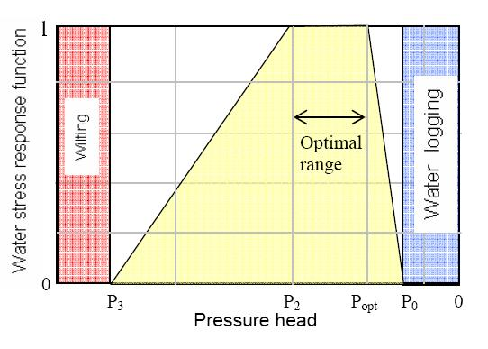

# Module Vegetation

## Overview

Vegetation Model handles information about vegetation cover and interacts with atmosphere and soil properties. Vegetation dynamics can be handled by the model in two different manners: i) reading from file (time serie, hdf, grid); ii) using a vegetation growth model. The first option is the previous formulation where LAI and root depth properties are provided by the user and water uptake is simulated. The second option uses a SWAT based vegetation growth model and plant biomass, LAI, nutrient content and nutrient uptake are explicitly simulated.

SWAT vegetation growth model uses the concepts from EPIC crop model (Izaurralde et al., 2006) of radiation-use efficiency by which a fraction of daily photosynthetically active radiation is intercepted by the plant canopy and converted into plant biomass. Gains in plant biomass are affected by vapor pressure deficits and atmospheric CO2 concentration. Stress indices for water, temperature, nitrogen, phosphorus and aeration are calculated using the value of the most severe of these stresses to reduce potential plant growth and crop yield. Nutrient uptake is done based on plant target (optimal content) and availability in soil.

## Concepts

### Property

Vegetation model was redesigned to be structured in properties instead of vegetation types. The advantage of this structure is that in the input file the number of properties is fixed (no matter the complexity of the vegetation cover) and input can be preprocessed for the entire grid (see How to pre-process vegetation). In the previous structure, applications with several vegetation covers could rapidly increase input file lines and input errors. Moreover, as they are not graphed in time serie or hdf the visual inspection could take longer.

See the list of allowed [properties names](../../reference/properties-names.md)

### Agricultural Practices

Vegetation module was also restructured in a way that what user gives for each cell what is the agricultural practice present (constant, variable in space, variable in space and time (rotations) and a file where the agricultural practices are defined as a recipe where the user can add or delete ingredients or actions. In this way, the user may manage its agricultural practices adding an unlimited number of fertilization or pesticide applications, change planting, and harvest dates, change the crop used or create new adapted agricultural practices for a general land use or go to the detail for each specific farm management actions. For more details see the examples at the end.

## Main processes

### If Vegetation is not used

If the user chooses not to include vegetation in basin data file with the keyword:

```
VEGETATION : 0
```

then transpiration is not computed.

However, the user may want to still evaporate water from the soil surface. To do so, evapotranspiration must be enabled in basin data file:

```
EVAPOTRANSPIRATION : 1
```

and reference evapotranspiration defined (property standard). In this case, all the reference evapotranspiration will be in the form of potential evaporation.

### If Vegetation is readed from file

If the user chooses to include vegetation in basin file with the keyword:

```
VEGETATION : 1
```

then transpiration is computed. If the user chooses the option to simulate vegetation giving properties evolution from file (hdf5, grid), than leaf area index, root depth, specific leaf storage and crop coefficient properties must be given. This option correspond to the old formulation and, yet, only water uptake is simulated.

#### Active Processes

If vegetation is read from file then water uptake and nutrient uptake may be modelled. Nutrient uptake can only be modelled if water uptake is.

```
WATER_STRESS              : 0/1     !Connects/disconnects water uptake
NITROGEN_STRESS           : 0/1     !Connects/disconnects nitrogen uptake
PHOSPHORUS_STRESS         : 0/1     !Connects/disconnects phosphorus uptake
```

#### Water Uptake

This process corresponds to plant transpiration taking water from soil. Evapotranspiration must be enabled in basin data file:

```
EVAPOTRANSPIRATION : 1
```

The user may want to compute a global potential evapotranspiration or separate potential transpiration (in plants along the root depth) and potential evaporation (on soil surface) based on leaf area index. This option is defined in basin data file with the keyword:

```
EVAPOTRANSPIRATION_METHOD: 1/2 (1-Global Evapotranspiration; 2-Transpiration and Evaporation)
```

To use the read from file approach use the keyword in vegetation data file:

```
WATER_UPTAKE_METHOD : 1  (1- according to root profile; 2-SWAT based (exponential and tresholds)
```

Which means that the method for transpiration is the one from the formulation previous to the vegetation growth model.

Potential water uptake (potential evapotranspiration/transpiration) is distributed in depth (for each layer) according to root distribution with keyword in vegetation data file:

```
ROOT_PROFILE : 1/2 (1-Triangular; 2-Constant)
```

Water Uptake (actual uptake) computation takes in potential uptake and limits it to plant and soil constraints. Plant constraints can be done with two options: i) with Feddes formulation or ii) with van Genuchten curve with the keyword in vegetation data file:

```
WATER_UPTAKE_STRESS_METHOD: 1/2 (1-Feddes; 2-van Genuchten)
```

- Feddes formulation has plant tresholds. This means that plant has soil pressure heads tresholds where uptake is optimum and soil heads (under field capacity and below wilting point) where no uptake occurs. Between optimum and no transpiration linear interpolation is done:

```
Tp = Factor * PotentialTranspiration
```

where Tp is Effective transpiration in layer, Factor is the stress factor achieved for the layer and PotentialTranspiration is the PotentialTranspiration computed for the layer.



Plant tresholds for water stress in Feddes model

- van Genuchten formulation is an empirical curve also dependent on pressure head:

```
Insert Equation for van Genuchten
```

Water uptake is then limited to available water in soil (above residual content). Additionally water uptake can be limited with soil velocity with the following keyword in vegetation data file:

```
LIMIT_TRANSP_WATER_VEL : 1
```

Soil pressure heads tresholds must be provided for each vegetation type in the vegetation file (example below):

```
!Arable Land - Trigo
<beginvegetationtype>
ID                        : 1
NAME                      : Agriculture
FEDDES_H1                 : -0.1
FEDDES_H2                 : -0.25
FEDDES_H3                 : -2.0
FEDDES_H4                 : -80.0
<endvegetationtype>

!Forest
<beginvegetationtype>
ID                        : 2
NAME                      : Forest
FEDDES_H1                 : -0.1
FEDDES_H2                 : -0.25
FEDDES_H3                 : -6.0
FEDDES_H4                 : -30.0
<endvegetationtype>
```

#### Nutrient Uptake

Nutrient uptake may be done only using the formulation where the uptake mass is obtained from flow \* concentration in layer.

#### Properties

Also Properties **leaf area index**, **root depth**, **specific leaf storage** and **crop coefficent** must be provided (from file or constant values). This must comply with fillmatrix standards under the **<beginproperty>** and **<endpropery>** blocks.

**leaf area index**

Constant value, time serie, grid or HDF. To create one grid/hdf from various timeseries for different vegetation types see [FillMatrix](../../tools/fillmatrix.md).

**potential leaf area index**

Constant value, time serie, grid or HDF. To create one grid/hdf from various timeseries for different vegetation types see [FillMatrix](../../tools/fillmatrix.md).

**root depth**

Constant value, time serie, grid or HDF. To create one grid/hdf from various timeseries for different vegetation types see [FillMatrix](../../tools/fillmatrix.md).

**specific leaf storage**

Usually used constant value but applies the same as previous properties.

**crop coefficient**

Usually used constant value but applies the same as previous properties.

### If Vegetation is explicitly simulated - Growth Model

If the user chooses to include vegetation in basin file with the keyword:

```
VEGETATION : 1
```

then transpiration is computed. If the user chooses the option to simulate explicitly vegetation, than plant biomass, root biomass, LAI, canopy height and nutrient content, are simulated.

#### Active Processes

If vegetation growth model is active then more options may be modelled.

```
WATER_STRESS              : 0/1     !Connects/disconnects water limitation on plant growth
NITROGEN_STRESS           : 0/1     !Connects/disconnects nitrogen limitation on plant growth
PHOSPHORUS_STRESS         : 0/1     !Connects/disconnects phosphorus limitation on plant growth
TEMPERATURE_STRESS        : 0/1     !Connects/disconnects temperature limitation on plant growth
ADJUST_RUE_FOR_CO2        : 0/1     !Connects/disconnects CO2 limitation on plant growth
ADJUST_RUE_FOR_VPD        : 0/1     !Connects/disconnects Vapour Pressure Deficit limitation on plant growth

GRAZING                   : 0/1     !Connects/disconnects grazing
MANAGEMENT                : 0/1     !Connects/disconnects management
DORMANCY                  : 0/1     !Connects/disconnects dormancy
FERTILIZATION             : 0/1     !Connects/disconnects fertilization
```

#### Water Uptake

This process corresponds to plant transpiration taking water from soil. Evapotranspiration must be enabled in basin data file:

```
EVAPOTRANSPIRATION : 1
```

The user may want to compute a global potential evapotranspiration or separate potential transpiration (in plants along the root depth) and potential evaporation (on soil surface) based on leaf area index. This option is defined in basin data file with the keyword:

```
EVAPOTRANSPIRATION_METHOD: 1/2 (1-Global Evapotranspiration; 2-Transpiration and Evaporation)
```

To use the vegetation growth model approach use the keyword in vegetation data file:

```
WATER_UPTAKE_METHOD : 2 (1- TP according to root profile; 2-SWAT based (TP exponential and tresholds))
```

Which means that the method for transpiration is the one from the vegetation growth model formulation.

Potential water uptake (potential evapotranspiration/transpiration) is distributed in depth according to a exponential distribution:

```
Insert potential water uptake distribution equation
```

Water Uptake (actual uptake) computation takes in potential uptake and limits it to soil constraints. consisting in water content in soil:

```
Insert low water content reduction
```

```
Insert high water content reduction (to do)
```

#### Nutrient Uptake

Nutrient uptake may be done in two ways, either using the SWAT formulation where it is disconnected from water uptake or using a new formulation that the uptake mass is obtained from flow \* concentration in layer.

```
NUTRIENT_UPTAKE_METHOD    : 1/2    !1- uptake is conc * water uptake; 2- SWAT based (independent of water uptake)
```

Also, nutrient stress may be computed either using SWAT formulation (relation to optimal and effective plant content) or using a new formulation where is the ratio between effective and optimal uptake (following water stress).

```
NUTRIENT_STRESS_METHOD    : 1/2      !1- effective/optimal; 2- SWAT based
```

Optimal nutrient uptake is computed from plant optimal content and effective content

```
Equation for optimal nutrient content
```

Then, optimal nutrient uptake is distributed in depth similar to that of water

```
Equation for optimal uptake distribution with depth
```

Soil constraints are then taken into account because uptake is only allowed if enough mass exists in layer

```
Effective Uptake = min (Optimal Uptake, Available content in soil)
```

#### Properties

**total plant biomass**

Inside the property block choose:

```
EVOLUTION : 2 (property will be simulated with vegetation growth model)
```

Property evolution equation:

```
NewPlantBiomass = OldPlantBiomass + BiomassGrowth - BiomassGrazed - BiomassRemovedInHarvest
                  - BiomassRemovedInDormancy
```

**total plant nitrogen**

Inside the property block choose:

```
EVOLUTION : 2 (property will be simulated with vegetation growth model)
```

Property evolution equation:

```
NewPlantNitrogen = OldPlantNitrogen + NitrogenUptake - NitrogenGrazed - NitrogenRemovedInHarvest
                   - NitrogenRemovedInDormancy
```

**total plant phosphorus**

Inside the property block choose:

```
EVOLUTION : 2 (property will be simulated with vegetation growth model)
```

Property evolution equation:

```
NewPlantPhosphorus = OldPlantPhosphorus + PhosphorusUptake - PhosphorusGrazed
                     - PhosphorusRemovedInHarvest - PhosphorusRemovedInDormancy
```

**root biomass**

Inside the property block choose:

```
EVOLUTION : 2 (property will be simulated with vegetation growth model)
```

Property evolution equations:

```
RootBiomass = RootFraction * PlantBiomass
```

```
RootFraction = 0.4 - 0.2 * HUAccumulated
```

**root depth**

Inside the property block choose:

```
EVOLUTION : 2 (property will be simulated with vegetation growth model)
```

Property evolution equations: for annuals, legumes

```
RootDepth = 2.5 * HUAccumulated * MaxRootDepth
```

for trees, perennials

```
RootDepth = MaxRootDepth
```

**leaf area index**

Inside the property block choose:

```
EVOLUTION : 2 (property will be simulated with vegetation growth model)
```

Property evolution equations: before senescence

```
NewLAI = OldLAI + LAIGrowth - LAIGrazed - LAIRemovedInHarvest
```

after senescence

```
NewLAI = LastLAIBeforeSenescence * LAIDecline - LAIGrazed - LAIRemovedInHarvest
```

**potential leaf area index**

This property is not simulated by the model so it has to be read. Constant value, time serie, grid or HDF. To create one grid/hdf from various timeseries for different vegetation types see [FillMatrix](../../tools/fillmatrix.md).

**canopy height**

Inside the property block choose:

```
EVOLUTION : 2 (property will be simulated with vegetation growth model)
```

Property evolution equation:

```
CanopyHeight = MaxCanopyHeight * SQRT(MaxLAIfraction)
```

**specific leaf storage**

This property is not simulated by the model so it has to be read. Usually is a constant value but it can be defined also as timeserie, grid or HDF. To create one grid/hdf from various timeseries for different vegetation types see [FillMatrix](../../tools/fillmatrix.md).

Inside the property block choose:

```
EVOLUTION : 1 (property will be read by the model)
```

**crop coefficient**

This property is not simulated by the model so it has to be read. Usually is a constant value but it can be defined also as timeserie, grid or HDF. To create one grid/hdf from various timeseries for different vegetation types see [FillMatrix](../../tools/fillmatrix.md).

Inside the property block choose:

```
EVOLUTION : 1 (property will be read by the model)
```

## Other Features

### How to generate the vegetation grid

A constant value, timeserie, vegetation grid or vegetation hdf may be given.

In the case of grid: One possible option is to extract info from land use shape file. In this case can use MOHID GIS going to menu 

$$
Tools
$$

->

$$
Shape to Grid Data
$$

 and provide: i) the grid (model grid), ii) the land use shape file and iii) the corespondence between land use codes and vegetation ID. In vegetation data file define the just created grid:

```
<begin_AgriculturalPractices>
INITIALIZATION_METHOD     : ASCII_FILE
FILENAME                  : ..\General Data\Other\Vegetation\Vegetation.dat
DEFAULTVALUE              : 0
REMAIN_CONSTANT           : 0
<end_AgriculturalPractices>
```

In the case of HDF: To create and HDF with the agriculture practices ID's that will appear in the cells the [FillMatrix](../../tools/fillmatrix.md) tool is used where the agricultural practices that have rotation are defined by timserie in stations block and the agricultural practices that do not have are defined by a constant value. Also in the block the created HDF fiedl has to be given so that model knows in what HDF field look for the ID's.

```
 <begin_AgriculturalPractices>
FILE_IN_TIME              : HDF
FILENAME                  : ..\General Data\Other\Vegetation\Rotation\AgricPractID.hdf5
HDF_FIELD_NAME            : AgricPractID
DEFAULTVALUE              : 0
REMAIN_CONSTANT           : 0
<end_AgriculturalPractices>
```

### Define vegetation properties

Vegetation properties may be read or simulated according to the below.

These vegetation properties have to be given (not simulated):

- specific leaf storage
- crop coefficient

This vegetation properties may be given or simulated:

- leaf area index
- root depth

This vegetation properties may be simulated:

- total plant biomass
- total plant nitrogen
- total plant phosphorus
- root biomass
- canopy height

Properties are defined accordingly with [Module FillMatrix](../../base/module-fillmatrix.md) standards in the block:

```
<beginproperty>
NAME                      : root depth
UNITS                     : m
DESCRIPTION               : plant root depth
EVOLUTION                 : 1
OLD                       : 0
FILE_IN_TIME              : NONE
INITIALIZATION_METHOD     : CONSTANT
DEFAULTVALUE              : 0.2
REMAIN_CONSTANT           : 1
OUTPUT_HDF                : 0
TIME_SERIE                : 1
BOX_TIME_SERIE            : 0
<endproperty>
```

EVOLUTION keyword value: 1 means that is not simulated but read. In other end EVOLUTION keyword value: 2 means that the property is simulated.

#### Simulation Options

If you decide not to use vegetation growth model (and instead, the old formulation) then the only needed properties (values must be provided) are:

- specific leaf storage
- crop coefficient
- leaf area index
- root depth

In the other end, if you decide to use vegetation growth model these properties may be used (model simulates them)

- leaf area index
- root depth
- total plant biomass
- total plant nitrogen (if simulating nitrogen)
- total plant phosphorus (if simulating phosphorus)
- root biomass
- canopy height

```
and only:
```

- specific leaf storage
- crop coefficient

need to have values defined for the simulation. All other properties will be simulated.

### How to pre-process vegetation properties

Fill Matrix was updated to fill grids without interpolation. Instead of space stations (X,Y coordinate) the user has to provide a vegetation grid with ID's and the values assigned to each ID (time serie or single value). Fill Matrix reads ID in the grid and searches for the value to fill the cell. If cells are not filled error message is sent. See [FillMatrix](../../tools/fillmatrix.md) for more details

### Fertilization

Fertilization can be defined in any calendar day, specify a duration or use autofertilization (see keywords). All the events can use fertilizers from a user fertilizer database.

### Grazing

Grazing can be defined in any calendar day and specify a duration (see keywords) and the biomass is taken from the plant and a percentage related to not eaten material is placed on soil first layer as organic material (just as plant root along root depth when plant dies)

It was introduced also the manure option that the user can specify a fraction of the effective grazed biomass (the fraction effectively ate by the animal) that is going to be converted to manure biomass. This will occur on the same day as grazing and in the same cell. If this is not enough for describing manure reality the user has the option to introduce fertilization events (continuous or single events) to mimic the effect.

From the manure biomass, the user can also specify a nitrogen and phosphorus fraction (if the C:N:P ratios are known). If the user does not specify them, the nitrogen and phosphorus ratios in the plant are used (as the animal digestion did not change ratios).

To separate between urea and organic nitrogen from manure nitrogen, an additional parameter can be specified (urea fraction in manure nitrogen). By default, this parameters is zero so all the manure nitrogen is organic nitrogen that will be placed on soil first layer. Phosphorus manure is only treated as organic.

The keywords for grazing and manure that were added are:

```
GRAZING_BIOMASS                   : 70.       !grazed biomass (kg/ha.day)
GRAZING_FRACTION_TO_MANURE        : 0.0       !fraction of grazed biomass that goes to manure in same cell and day (0-1)
GRAZING_MANURE_NFRACTION          : -99       !fraction of manure biomass that is N (0-1). If not > 0 will be the
                                               plant N fraction (animal digestion did not changed ratio)
GRAZING_MANURE_NUREAFRACTION      : 0.0       !fraction of manure N that is Urea (0-1). The remainder will be organic N
GRAZING_MANURE_PFRACTION          : -99       !fraction of manure biomass that is P (0-1). If not > 0 will be the
                                               plant P fraction (animal digestion did not change ratio)
```

Check the keywords section to see where they apply.

## Outputs

### Time series

To write time series results define keyword:

```
TIME_SERIE           : 1
```

in each property that you wish to write results.

total\_plant\_biomass - plant total biomass in kg/ha

root\_biomass - plant root biomass in kg/ha

root\_depth - plant root depth (m)

leaf\_area\_index - area of active photosyntetic leafs per surface area (-)

canopy\_height - plant height (m)

specific\_leaf\_storage - leaf capacity to storage water (m3 water per m2 leaf or m)

crop\_coefficient - coefficient to account in reference evapotranspiration for crop differences from reference conditions (-)

Water\_Uptake\_m3/s - water uptake for all the plant

WaterStressFactor - water stress factor that the plant feels (zero being maximum stress and one being no stress)

HU\_Accumulated - fraction of maturity heat units accumulated in the plant since begin of growth cycle

Potential\_HU - number of heat units that atmosphere is presenting since the beggining of the year

TemperatureStressFactor - temperature stress factor that the plant feels (zero being maximum stress and one being no stress)

### Box integration

### Maps (HDF5 format)

To write 3D results use the keyword [OUTPUT\_TIME](../../io/keywords/output-time.md) and define keyword:

```
OUTPUT_HDF           : 1
```

in each property that you wish to write results.

### Statistics

Under each property assign the following keywords:

```
<beginproperty>
...
STATISTICS               : 1
STATISTICS_FILE          : .. location of the statistics configuration file
...
<endproperty>
```

Configuration of the statistics file is described in [Module Statistics](../../water/modules/statistics.md)

## References

Izaurralde, R.C.; Williams, J.R. ; McGill, W.B.; Rosenberg, N.J.; Quiroga Jakas, M.C. (2006) - Simulating soil C dynamics with EPIC: Model description and testing against long‐term data. Ecol. Model. 192(3‐4): 362‐384.

## Data Files

### Keywords

```
DATAFILE
         [Keyword]                 [Format]  [Units]  [Default]  [Short Description]
VEGETATION_ID_FILE               : string      -        [-]     !Vegetation distribution grid path

VEGETATION_DT                    : real        s      [86400.]  !Vegetation DT
INTEGRATION_DT                   : real        s      [ModelDT] !DT to integrate external variables until vegetation is
                                                                ! is called (vegetation DT)

PARAMETERS_FILE                  : string      -         -      !agricultural practices definition
GROWTH_DATABASE                  : string      -         -      !Growth parameters for each vegetation type - readed in case
                                                                  of vegetation growth simulation
PESTICIDE_DATABASE               : string      -         -      !Readed if growth simulation and PESTICIDE : 1
FERTILIZER_DATABASE              : string      -         -      !Readed if growth simulation and if FERTILIZATION : 1

WATER_STRESS                     : 0/1         -        [1]     !Connects/disconnects water limitation on plant growth?
NITROGEN_STRESS                  : 0/1         -        [1]     !Connects/disconnects nitrogen limitation on plant growth?
PHOSPHORUS_STRESS                : 0/1         -        [1]     !Connects/disconnects phosphorus limitation on plant growth?
TEMPERATURE_STRESS               : 0/1         -        [1]     !Connects/disconnects temperature limitation on plant growth?
ADJUST_RUE_FOR_CO2               : 0/1         -        [1]     !Connects/disconnects CO2 limitation on plant growth?
ADJUST_RUE_FOR_VPD               : 0/1         -        [1]     !Connects/disconnects Vapour Pressure Deficit limitation on
                                                                 plant growth?

GRAZING                          : 0/1         -        [0]     !Connects/disconnects grazing
MANAGEMENT                       : 0/1         -        [0]     !Connects/disconnects management
DORMANCY                         : 0/1         -        [0]     !Connects/disconnects dormancy
FERTILIZATION                    : 0/1         -        [0]     !Connects/disconnects fertilization
NUTRIENT_FLUXES_WITH_SOIL        : 0/1         -        [1]     !Connects/disconnects nutrient fluxes with soil

WATER_UPTAKE_METHOD              : integer     -        [1]     !1- according to root profile; 2-SWAT based (exponential
                                                                 and tresholds)
  LIMIT_TRANSP_WATER_VEL         : 0/1         -        [0]     !Read if TRANSPIRATION_METHOD == 1.
  ROOT_PROFILE                   : integer     -        [1]     !Read if TRANSPIRATION_METHOD == 1:
                                                                  !1-Triangular; 2-Constant; 3-Exponential(SWAT like)
  WATER_UPTAKE_STRESS_METHOD     : integer     -        [1]     !Read if TRANSPIRATION_METHOD == 1: 1-Feddes; 2-VanGenuchten

NUTRIENT_UPTAKE_METHOD           : integer     -        [2]     !1- uptake is: conc * water uptake; 2- SWAT based
                                                                 (independent of water uptake)
NUTRIENT_STRESS_METHOD           : integer     -        [2]     !1- effective/optimal; 2- SWAT based

CHANGE_LAI_SENESCENCE            : 0/1         -        [0]     !Changes made to swat code because showed error with
CHANGE_CANOPY_HEIGHT             : 0/1         -        [0]       grazing

ATMOSPHERE_OUTPUT                : 0/1         -        [0]     !Output averaged atmosphere properties during dt
FLUXES_TO_SOIL_OUTPUT            : 0/1         -        [0]     !Output fluxes to soil

ATMOSPHERE_CO2                   : real       ppm      [330.]   !Atmosphere CO2 concetrations - should be atmosphere property
WATER_UPTAKE_COMPENSATION_FACTOR : real        -        [0.]    !Factor for uptake compensation from lower layers if computed
                                                                  !layer demand is not met
                                                                  !If zero there will exist no compensation. If 1. total demand
                                                                  !no met may come from lower layers

<beginproperty>
 See module fillmatrix
EVOLUTION                        : integer     -         1      !Property evolution: 1-Read from file
                                                                !2-vegetation growth model
<endproperty>

------------------------------------------------------------------------------------------------------------
PARAMETERS_FILE - always used
Arable Land - Trigo
<beginagriculturalpractice>
AGRIC_PRACT_ID            : 2                !agriculture practice ID
NAME                      : Agriculture

VEGETATION_ID             : 2                !crop ID used in this practice that has correspondence
                                               to SWAT crop growth database (see growth database)

<begintimingparameters>
!Active if growth model used
PLANTING_JULIANDAY                : -99.      !julian day when planting will occur
PLANTING_HUBASE                   : 0.15      !Percentage of POTENTIAL YEARLY HU when planting will occur
MATURITY_HU                       : 1700.     !Total PLANT ACCUMULATED HU when reaching maturity
<endtimingparameters>

<beginharvestkillparameters>
!active if growth model used and in data file HARVEST_KILL : 1
HARVESTKILL_JULIANDAY             : -99.      !julian day when harvestkill operation occur
HARVESTKILL_PLANTHU               : 1.2       !Percentage of PLANT ACCUMULATED HU when harvestkill operation occur
HARVEST_JULIANDAY                 : -99.      !julian day when harvest operation occur
HARVEST_PLANTHU                   : -99.      !Percentage of PLANT ACCUMULATED HU when harvest operation occur
HARVEST_EFFICIENCY                : 1.0       !Efficiency for harvest operation (residue if lower than 1)
KILL_JULIANDAY                    : -99.      !julian day when harvestkill operation occur
KILL_PLANTHU                      : -99.      !Percentage of PLANT ACCUMULATED HU when kill operation occur
<endharvestkillparameters>

<begingrazeparameters>
!Graze active if growth model used and in data file GRAZING : 1
GRAZING_START_JULIANDAY           : -99.      !julian day when grazing will occur
GRAZING_START_PLANTHU             : 0.5       !Percentage of POTENTIAL YEARLY HU when grazing will occur
GRAZING_DAYS                      : 10        !Days of grazing (continuous)
MINIMUM_BIOMASS_FOR_GRAZING       : 10.       !minimum biomass (kg/ha) for grazing
GRAZING_BIOMASS                   : 70.       !grazed biomass (kh/ha.day)
GRAZING_FRACTION_TO_MANURE        : 0.0       !fraction of grazed biomass that goes to manure in same cell and day (0-1)
GRAZING_MANURE_NFRACTION          : -99       !fraction of manure biomass that is N (0-1). If not > 0 will be the
                                               plant N fraction (animal digestion did not changed ratio)
GRAZING_MANURE_NUREAFRACTION      : 0.0       !fraction of manure N that is Urea (0-1). The remainder will be organic N
GRAZING_MANURE_PFRACTION          : -99       !fraction of manure biomass that is P (0-1). If not > 0 will be the
                                               plant P fraction (animal digestion did not changed ratio)
TRAMPLING_BIOMASS                 : 30.       !biomass not eaten but removed from plant and moved to soil, related
                                               to grazing efficiency kg/ha.day)
<endgrazeparameters>

<beginfertilizationparameters>
!Autofertilization - active if growth model used and in data file FERTILIZATION : 1 and (in data file NITROGEN : 1 and NITROGEN_TRESHOLD > 0)
                                            or (PHOSPHORUS : 1 and PHOSPHORUS_TRESHOLD > 0)
!There can only be one process active: autofertilization or scheduled fertilization. need to remove one of two kind of blocks
<<beginautofertilization>>
FERTILIZER_ID                     : 1      !Fertilizer used in autofertilization (see fertilizer database)
NITROGEN_TRESHOLD                 : 0.93   !Percentage of stress below which autofertilization starts
NITROGEN_APPLICATION_MAX          : 50.    !Maximum amount of fertilizer in one application (kg/ha)
NITROGEN_ANNUAL_MAX               : 300.   !Maximum amount of fertilizer in one year (kg/ha)
EXPLICIT_PHOSPHORUS               : 1      !1- explicit add phosphorus if needed; 0-add phosphorus if nitrogen needed (SWAT method)
PHOSPHORUS_TRESHOLD               : 0.93   !only read if EXPLICIT_PHOSPHORUS : 1
PHOSPHORUS_APPLICATION_MAX        : 10.    !only read if EXPLICIT_PHOSPHORUS : 1
PHOSPHORUS_ANNUAL_MAX             : 60.    !only read if EXPLICIT_PHOSPHORUS : 1
N_STRESS_TYPE                     : 1      !1-NTarget ; 2-Annual Max approach
<<endautofertilization>>

!Scheduled fertilization - active if growth model used and in data file FERTILIZATION : 1 and (in data file NITROGEN : 1)
                                            or (PHOSPHORUS : 1)
!There can only be one process active: autofertilization or scheduled fertilization. need to remove one of two kind of blocks
 <<beginfertilizerapp>>
 FERTILIZER_ID                     : 2     !PFertilizer used in this application (see pesticide database)
 FERTILIZER_APPLICATION_JDAY       : 150.  !julian day when pesticide application will occur
 FERTILIZER_APPLICATION_HU         : -99.  !Percentage of POTENTIAL YEARLY HU when pesticide application will occur
 FERTILIZER_CONT_ON                : 1     !1 - If this is a continuous fertilizer application; 0 or absent if not
 FERTILIZER_CONT_DAYS              : 10    !how many days of continuous application (read if FERTILIZER_CONT_ON : 1)
 FERTILIZER_APPLICATION_KG_HA      : 10.   !Amount of fertilizer applied (kg/ha)
 <<endfertilizerapp>>

<endfertilizationparameters>

<beginpesticideparameters>
!Active if growth model used and in data file PESTICIDE : 1

 <<beginpesticideapp>>
 PESTICIDE_ID                : 1           !Pesticide used in this application (see pesticide database)
 PESTICIDE_APPLICATION_JDAY  : -99.        !julian day when pesticide application will occur
 PESTICIDE_APPLICATION_HU    : 0.10        !Percentage of POTENTIAL YEARLY HU when pesticide application will occur
 PESTICIDE_APPLICATION_KG_HA : 1.          !Amount of pesticide applied (kg/ha)
 PESTICIDE_CONT_ON           : 1           !1 - If this is a continuous pesticide application; 0 or absent if not
 PESTICIDE_CONT_DAYS         : 10.         !how many days of continuous application (read if PESTICIDE_CONT_ON : 1)
 <<endpesticideapp>>

<endpesticideparameters>

<endagriculturalpractice>

--------------------------------------------------------------------------------------------------------
 GROWTH_DATABASE - used if using growth model
  <begingrowthdatabase>
   VEGETATION_ID                     : 1
   NAME                              : Forest
   PLANT_TYPE                        : 5
   OPTIMAL_NITROGENFRACTION_N1       : 0.0663
   OPTIMAL_NITROGENFRACTION_N2       : 0.0255
   OPTIMAL_NITROGENFRACTION_N3       : 0.0148
   OPTIMAL_PHOSPHORUSFRACTION_P1     : 0.0053
   OPTIMAL_PHOSPHORUSFRACTION_P2     : 0.0020
   OPTIMAL_PHOSPHORUSFRACTION_P3     : 0.0012
   BASE_TEMPERATURE                  : 0.
   OPTIMAL_TEMPERATURE               : 18.0
   RADIATION_EXTINCTION_COEF         : 0.65
   BIOMASS_ENERGY_RATIO              : 30.0
   CO2_HIGH                          : 660.0
   BIOMASS_ENERGY_RATIO_HIGH         : 39.0
   RUE_DECLINE_RATE                  : 6.0
   LAI_MAX                           : 4.0
   OPTIMAL_LAIMAXFRACTION_1          : 0.05
   OPTIMAL_LAIMAXFRACTION_2          : 0.95
   GROWFRACTION_1                    : 0.05
   GROWFRACTION_2                    : 0.45
   GROWFRACTION_LAIDECLINE           : 0.50
   ROOT_DEPTH_MAX                    : 1.30
   CANOPY_HEIGHT_MAX                 : 0.9
   OPTIMAL_HARVEST_INDEX             : 0.4
   MINIMUM_HARVEST_INDEX             : 0.2
   YELD_NITROGENFRACTION             : 0.0250
   YELD_PHOSPHORUSFRACTION           : 0.0022
   TREE_YEARSTOMATURITY              : -99.
   TREE_MAXIMUMBIOMASS               : -99.
   BIOMASS_FRAC_REMOVED_DORMANCY     : 0.30
   LAI_MIN_DORMANCY                  : 0.75
  <endgrowthdatabase>

---------------------------------------------------------------------------------------------------
PESTICIDE_DATABASE - used if using growth model and PESTICIDE :1
<beginPesticide>
PESTICIDE_ID : 1
PESTICIDE_NAME : generic dissolved pesticide 1
<endPesticide>

<beginPesticide>
PESTICIDE_ID : 1
PESTICIDE_NAME : generic particulate pesticide 1
<endPesticide>

---------------------------------------------------------------------------------------------------
Fertilizer_DATABASE - used if using growth model and FERTILIZER :1
<beginFertilizer>
FERTILIZER_ID                     : 1
FERTILIZER_NAME                   : 28-10-10
MINERAL_N_FRACTION_IN_FERTILIZER  : 0.28
ORGANIC_N_FRACTION_IN_FERTILIZER  : 0.0
AMMONIA_FRACTION_IN_MINERAL_N     : 0.0
MINERAL_P_FRACTION_IN_FERTILIZER  : 0.044
ORGANIC_P_FRACTION_IN_FERTILIZER  : 0.0
FERTILIZER_FRACTION_IN_SURFACE    : 0.2
<endFertilizer>

<beginFertilizer>
FERTILIZER_ID                     : 2
FERTILIZER_NAME                   : Organic Manure
MINERAL_N_FRACTION_IN_FERTILIZER  : 0.0   !proportion from fertilizer amount
ORGANIC_N_FRACTION_IN_FERTILIZER  : 0.8
AMMONIA_FRACTION_IN_MINERAL_N     : 0.0   !proportion from mineral N
MINERAL_P_FRACTION_IN_FERTILIZER  : 0.0
ORGANIC_P_FRACTION_IN_FERTILIZER  : 0.2
FERTILIZER_FRACTION_IN_SURFACE    : 0.2
ORGANIC_FRACTION_PARTICULATE      : 0.5   !proportion of organic (N or P) that is particulate
<endFertilizer>

---------------------------------------------------------------------------------------------------
FEDDES_DATABASE - Used if not using growth model
<beginfeddesdatabase>
VEGETATION_ID             : 2                !crop ID used in this practice that has correspondence
                                               to SWAT crop growth database (see growth database)

FEDDES_H1                 : -0.1             !higher head for transpiration (saturation and oxygen loss)
FEDDES_H2                 : -0.25            !1st optimal head for transpiration
FEDDES_H3                 : -2.0             !2nd optimal head for transpiration
FEDDES_H4                 : -80.0            !lower head  for transpiration (wilting)
<endfeddesdatabase>
```

### Sample

#### Data file If vegetation is read from file

```
!LandUse/Agricultural Practices definition
<begin_AgriculturalPractices>
INITIALIZATION_METHOD     : ASCII_FILE
FILENAME                  : ..\General Data\Other\Vegetation\Vegetation.dat
DEFAULTVALUE              : 0
REMAIN_CONSTANT           : 0
<end_AgriculturalPractices>

!Databases needed
!General parameters for each vegetation type - always read
PARAMETERS_FILE           : ..\General Data\Other\Vegetation\VegetationParameters.dat

!Feddes water uptake stress
FEDDES_DATABASE           : ..\General Data\Other\Vegetation\FeddesDatabase.dat

WATER_STRESS              : 1
NITROGEN_STRESS           : 0
PHOSPHORUS_STRESS         : 0

WATER_UPTAKE_METHOD        : 1     !1- TP according to root profile
ROOT_PROFILE               : 1     !1- triangular; 2- Constant; 3-Exponential (only read if WATER_UPTAKE_METHOD : 1)
WATER_UPTAKE_STRESS_METHOD : 1     !1-Feddes; 2- VanGenuchten (only read if WATER_UPTAKE_METHOD : 1)

TIME_SERIE_LOCATION       : ..\General Data\TimeSeriesLocation.dat

OUTPUT_TIME               : 0. 86400.

<beginproperty>
NAME                      : root depth
UNITS                     : m
DESCRIPTION               : plant root depth
EVOLUTION                 : 1
OLD                       : 0
FILE_IN_TIME              : HDF
FILENAME                  : ..\General Data\Vegetation\RootDepth.hdf5
DEFAULTVALUE              : 0.0
REMAIN_CONSTANT           : 0
OUTPUT_HDF                : 1
TIME_SERIE                : 1
BOX_TIME_SERIE            : 0
<endproperty>

<beginproperty>
NAME                      : leaf area index
UNITS                     : m2/m2
DESCRIPTION               : plant leaf area index
EVOLUTION                 : 1
OLD                       : 0
FILE_IN_TIME              : HDF
FILENAME                  : ..\General Data\\Vegetation\LAI.hdf5
DEFAULTVALUE              : 0.
REMAIN_CONSTANT           : 0
OUTPUT_HDF                : 1
TIME_SERIE                : 1
BOX_TIME_SERIE            : 0
<endproperty>

<beginproperty>
NAME                      : specific leaf storage
UNITS                     : m3/m2
DESCRIPTION               : plant specific leaf storage
EVOLUTION                 : 1
OLD                       : 0
FILE_IN_TIME              : HDF
FILENAME                  : ..\General Data\Vegetation\SpecificLeafStorage.hdf5
DEFAULTVALUE              : 0.0001
REMAIN_CONSTANT           : 0
OUTPUT_HDF                : 0
TIME_SERIE                : 1
BOX_TIME_SERIE            : 0
<endproperty>

<beginproperty>
NAME                      : crop coefficient
UNITS                     : -
DESCRIPTION               : plant transpiration coefficient
EVOLUTION                 : 1
OLD                       : 0
FILE_IN_TIME              : HDF
FILENAME                  : ..\General Data\Vegetation\CropCoefficient.hdf5
DEFAULTVALUE              : 1.
REMAIN_CONSTANT           : 0
OUTPUT_HDF                : 0
TIME_SERIE                : 1
BOX_TIME_SERIE            : 0
<endproperty>
```

#### Data file If vegetation growth model is used

```
!LandUse/Agricultural Practices definition
<begin_AgriculturalPractices>
!Constant - one agric practice that is the same in space and time (Disabled. Presented as example)
!INITIALIZATION_METHOD     : CONSTANT

!ASCII Grid - agric practices have spatial variation but not in time (Disabled. Presented as example)
!INITIALIZATION_METHOD     : ASCII_FILE
!FILENAME                  : ..\General Data\Other\Vegetation\Vegetation.dat

!!Timserie - one agric practice (no spatial variation) that changes in time - rotations (Disabled. Presented as example)
!!FILE_IN_TIME              : TIMESERIE
!!FILENAME                  : ..\..\GeneralData\Vegetation\Vegetation_Rotation.dat
!!DATA_COLUMN               : 2
!!USE_ORIGINAL_VALUES       : 1

!!!HDF - agric practices with spatial and time variations - rotations (Enabled)
FILE_IN_TIME              : HDF
FILENAME                  : ..\General Data\Other\Vegetation\Rotation\AgricPractID.hdf5
HDF_FIELD_NAME            : AgricPractID

DEFAULTVALUE              : 0
REMAIN_CONSTANT           : 0
<end_AgriculturalPractices>

!Databases needed
!General parameters for each vegetation type - always readed
PARAMETERS_FILE           : ..\General Data\Other\Vegetation\VegetationParameters.dat

!Readed if WATER_UPTAKE_METHOD : 1 - based on feddes suction head minimum, maximum and optimum
FEDDES_DATABASE           : ..\General Data\Other\Vegetation\FeddesDatabase.dat

!Growth parameters for each vegetation type - readed in case of vegetation growth simulation
GROWTH_DATABASE           : ..\General Data\Other\Vegetation\GrowthDatabase.dat

!Readed if growth simulation and PESTICIDE : 1
PESTICIDE_DATABASE        : ..\General Data\Other\Vegetation\PesticideDatabase.dat

!Readed if growth simulation and if FERTILIZATION : 1
FERTILIZER_DATABASE       : ..\General Data\Other\Vegetation\FertilizerDatabase.dat

VEGETATION_DT             : 86400.
INTEGRATION_DT            : 3600.     !hourly meteorology data

!Connect/disconnect Plant Stresses
WATER_STRESS              : 1     !Connect/Disconnect water stress
NITROGEN_STRESS           : 0     !Connect/Disconnect nitrogen stress
PHOSPHORUS_STRESS         : 0     !Connect/Disconnect phosphorus stress
TEMPERATURE_STRESS        : 1     !Connect/Disconnect temperature stress   - may be active with growth model
ADJUST_RUE_FOR_CO2        : 0     !Connect/Disconnect CO2 stress           - may be active with growth model
ADJUST_RUE_FOR_VPD        : 1     !Connect/Disconnect Rel. Humidity stress - may be active with growth model

!Connect/disconnect Plant Processes - active in growth model
HARVEST_KILL              : 1     !Connect/Disconnect management (planting, harvest, kill)
DORMANCY                  : 1     !Connect/Disconnect dormancy (active in plants that go dormant)
FERTILIZATION             : 0     !Connect/Disconnect fertilization (see fertilization parameters)
PESTICIDE                 : 1     !Connect/Disconnect pesticide application (see pesticide parameters)
GRAZING                   : 0     !Connect/Disconnect animal grazing (see grazing parameters)

!Computation Methods
WATER_UPTAKE_METHOD        : 2     !1- TP according to root profile; 2-SWAT based (TP exponential and tresholds)
ROOT_PROFILE               : 1     !1- triangular; 2- Constant; 3-Exponential (only read if WATER_UPTAKE_METHOD : 1)
WATER_UPTAKE_STRESS_METHOD : 1     !1-Feddes; 2- VanGenuchten (only read if WATER_UPTAKE_METHOD : 1)
LIMIT_TRANSP_WATER_VEL     : 0     !0 - do not limit transpiration; 1 - Limit transpiration with unsaturated conductivity

NUTRIENT_UPTAKE_METHOD    : 1      !1- uptake is conc * water uptake; 2- SWAT based (independent of water uptake)
NUTRIENT_STRESS_METHOD    : 1      !1- effective/optimal; 2- SWAT based

!Outputs
TIME_SERIE_LOCATION       : ..\General Data\TimeSeriesLocation.dat
OUTPUT_TIME               : 0. 86400.
ATMOSPHERE_OUTPUT         : 0           !output of integrated input from potential transpiration and atmosphere properties
                                          (integration is  done because vegetationdt can be different from modeldt)
FLUXES_TO_SOIL_OUTPUT     : 1           !output of fluxes to soil (fertilization, biomass residue)

!Potential total HU (yearly HU) -  SUMi=1to12(average monthly temperature in month i * days in month i)
<begin_TotalPotentialHU>
INITIALIZATION_METHOD     : CONSTANT
DEFAULTVALUE              : 5475.
REMAIN_CONSTANT           : 1
<end_TotalPotentialHU>

!Property declaration
<beginproperty>
NAME                      : total plant biomass
UNITS                     : kg/ha
DESCRIPTION               : plant biomass
EVOLUTION                 : 2
OLD                       : 0
!DEFAULTVALUE              : 1000.
DEFAULTVALUE              : 0.
REMAIN_CONSTANT           : 0
OUTPUT_HDF                : 1
TIME_SERIE                : 1
BOX_TIME_SERIE            : 0
<endproperty>

!<beginproperty>
NAME                      : total plant nitrogen
UNITS                     : kg/ha
DESCRIPTION               : plant nitrogen content
EVOLUTION                 : 2
OLD                       : 0
!DEFAULTVALUE              : 50.
DEFAULTVALUE              : 0.
REMAIN_CONSTANT           : 0
OUTPUT_HDF                : 1
TIME_SERIE                : 1
BOX_TIME_SERIE            : 0
!<endproperty>

!<beginproperty>
NAME                      : total plant phosphorus
UNITS                     : kg/ha
DESCRIPTION               : plant phosphorus content
EVOLUTION                 : 2
OLD                       : 0
FILE_IN_TIME              : NONE
INITIALIZATION_METHOD     : CONSTANT
!DEFAULTVALUE              : 1.
DEFAULTVALUE              : 0.
REMAIN_CONSTANT           : 0
OUTPUT_HDF                : 1
TIME_SERIE                : 1
BOX_TIME_SERIE            : 0
!<endproperty>

<beginproperty>
NAME                      : root biomass
UNITS                     : kg/ha
DESCRIPTION               : plant root biomass
EVOLUTION                 : 2
OLD                       : 0
FILE_IN_TIME              : NONE
INITIALIZATION_METHOD     : CONSTANT
!DEFAULTVALUE              : 200.
DEFAULTVALUE              : 0.
REMAIN_CONSTANT           : 0
OUTPUT_HDF                : 1
TIME_SERIE                : 1
BOX_TIME_SERIE            : 0
<endproperty>

<beginproperty>
NAME                      : root depth
UNITS                     : m
DESCRIPTION               : plant root depth
EVOLUTION                 : 2
OLD                       : 0
FILE_IN_TIME              : NONE
INITIALIZATION_METHOD     : CONSTANT
!DEFAULTVALUE              : 1.
DEFAULTVALUE              : 0.0
REMAIN_CONSTANT           : 0
OUTPUT_HDF                : 1
TIME_SERIE                : 1
BOX_TIME_SERIE            : 0
<endproperty>

<beginproperty>
NAME                      : leaf area index
UNITS                     : m2/m2
DESCRIPTION               : plant leaf area index
EVOLUTION                 : 2
OLD                       : 0
FILE_IN_TIME              : NONE
!FILE_IN_TIME              : TIMESERIE
!FILENAME                  : ..\..\GeneralData\LAI-2001-2007-RZWQM.dat
!DATA_COLUMN               : 2
DEFAULTVALUE              : 0.
REMAIN_CONSTANT           : 0
OUTPUT_HDF                : 1
TIME_SERIE                : 1
BOX_TIME_SERIE            : 0
<endproperty>

<beginproperty>
NAME                      : canopy height
UNITS                     : m
DESCRIPTION               : plant canopy height
EVOLUTION                 : 2
OLD                       : 0
FILE_IN_TIME              : NONE
INITIALIZATION_METHOD     : CONSTANT
DEFAULTVALUE              : 0.
REMAIN_CONSTANT           : 0
OUTPUT_HDF                : 1
TIME_SERIE                : 1
BOX_TIME_SERIE            : 0
<endproperty>

<beginproperty>
NAME                      : specific leaf storage
UNITS                     : m3/m2
DESCRIPTION               : plant specific leaf storage
EVOLUTION                 : 1
OLD                       : 0
FILE_IN_TIME              : NONE
INITIALIZATION_METHOD     : CONSTANT
DEFAULTVALUE              : 0.0001
REMAIN_CONSTANT           : 1
OUTPUT_HDF                : 0
TIME_SERIE                : 1
BOX_TIME_SERIE            : 0
<endproperty>

<beginproperty>
NAME                      : crop coefficient
UNITS                     : -
DESCRIPTION               : plant transpiration coefficient
EVOLUTION                 : 1
OLD                       : 0
FILE_IN_TIME              : NONE
INITIALIZATION_METHOD     : CONSTANT
DEFAULTVALUE              : 1.
REMAIN_CONSTANT           : 1
OUTPUT_HDF                : 0
TIME_SERIE                : 1
BOX_TIME_SERIE            : 0
<endproperty>
```

##### Vegetation Parameters Example

```
!Irrigation
<beginagriculturalpractice>
AGRIC_PRACT_ID            : 2                !agriculture practice ID
NAME                      : AGRR

VEGETATION_ID             : 2                !crop ID used in this practice that has correspondence to SWAT crop growth database (see growth database)

<begintimingparameters>
PLANTING_JULIANDAY                : -99.      !julian day when planting will occur
PLANTING_HUBASE                   : 0.15      !Percentage of POTENTIAL YEARLY HU when planting will occur
MATURITY_HU                       : 1700.     !Total PLANT ACCUMULATED HU when reaching maturity
<endtimingparameters>

<beginharvestkillparameters>
!active if in data file HARVEST_KILL : 1
HARVESTKILL_JULIANDAY             : -99.      !julian day when harvestkill operation occur
HARVESTKILL_PLANTHU               : 1.2       !Percentage of PLANT ACCUMULATED HU when harvestkill operation occur
HARVEST_JULIANDAY                 : -99.      !julian day when harvest operation occur
HARVEST_PLANTHU                   : -99.      !Percentage of PLANT ACCUMULATED HU when harvest operation occur
HARVEST_EFFICIENCY                : 1.0       !Efficiency for harvest operation (residue if lower than 1)
KILL_JULIANDAY                    : -99.      !julian day when harvestkill operation occur
KILL_PLANTHU                      : -99.      !Percentage of PLANT ACCUMULATED HU when kill operation occur
<endharvestkillparameters>

<endagriculturalpractice>

!Cold season annual
<beginagriculturalpractice>
AGRIC_PRACT_ID            : 3                !agriculture practice ID
NAME                      : AGRC

VEGETATION_ID             : 3                !crop ID used in this practice that has correspondence to SWAT crop growth database (see growth database)

<begintimingparameters>
PLANTING_JULIANDAY                : -99.      !julian day when planting will occur
PLANTING_HUBASE                   : 0.15      !Percentage of POTENTIAL YEARLY HU when planting will occur
MATURITY_HU                       : 1700.     !Total PLANT ACCUMULATED HU when reaching maturity
<endtimingparameters>

<beginharvestkillparameters>
!active if in data file HARVEST_KILL : 1
HARVESTKILL_JULIANDAY             : -99.      !julian day when harvestkill operation occur
HARVESTKILL_PLANTHU               : 1.2       !Percentage of PLANT ACCUMULATED HU when harvestkill operation occur
HARVEST_JULIANDAY                 : -99.      !julian day when harvest operation occur
HARVEST_PLANTHU                   : -99.      !Percentage of PLANT ACCUMULATED HU when harvest operation occur
HARVEST_EFFICIENCY                : 1.0       !Efficiency for harvest operation (residue if lower than 1)
KILL_JULIANDAY                    : -99.      !julian day when harvestkill operation occur
KILL_PLANTHU                      : -99.      !Percentage of PLANT ACCUMULATED HU when kill operation occur
<endharvestkillparameters>

<endagriculturalpractice>

!Orchard/Olive/Vineyards
<beginagriculturalpractice>
AGRIC_PRACT_ID            : 4

VEGETATION_ID             : 4
NAME                      : ORCD

<begintimingparameters>
PLANTING_JULIANDAY                : -99.
PLANTING_HUBASE                   : 0.15
MATURITY_HU                       : 1700.
<endtimingparameters>

<endagriculturalpractice>

!Forest decidious
<beginagriculturalpractice>
AGRIC_PRACT_ID            : 7

VEGETATION_ID             : 7
NAME                      : FRSD

<begintimingparameters>
PLANTING_JULIANDAY                : -99.
PLANTING_HUBASE                   : 0.15
MATURITY_HU                       : 1700.
<endtimingparameters>

<endagriculturalpractice>

!Pine
<beginagriculturalpractice>
AGRIC_PRACT_ID            : 94

VEGETATION_ID             : 94
NAME                      : PINE

<begintimingparameters>
PLANTING_JULIANDAY                : -99.
PLANTING_HUBASE                   : 0.15
MATURITY_HU                       : 1700.
<endtimingparameters>

<endagriculturalpractice>

!OAK
<beginagriculturalpractice>
AGRIC_PRACT_ID            : 95

VEGETATION_ID             : 95
NAME                      : OAK

<begintimingparameters>
PLANTING_JULIANDAY                : -99.
PLANTING_HUBASE                   : 0.15
MATURITY_HU                       : 1700.
<endtimingparameters>

<endagriculturalpractice>

!No Vegetation
<beginagriculturalpractice>
AGRIC_PRACT_ID            : 0

VEGETATION_ID             : 0
NAME                      : NoVeg

<begintimingparameters>
PLANTING_JULIANDAY                : -99.
PLANTING_HUBASE                   : 2.00    !will not start
MATURITY_HU                       : 1700.
<endtimingparameters>

<endagriculturalpractice>
```

##### Growth Database Example

```
<begingrowthdatabase>
VEGETATION_ID                     : 0
PLANT_TYPE                        : 0
NAME                              : NoVeg
BIOMASS_ENERGY_RATIO              : 0.0
OPTIMAL_HARVEST_INDEX             : 0.00
LAI_MAX                           : 0.0
GROWFRACTION_1                    : 0.00
OPTIMAL_LAIMAXFRACTION_1          : 0.00
GROWFRACTION_2                    : 0.00
OPTIMAL_LAIMAXFRACTION_2          : 0.00
GROWFRACTION_LAIDECLINE           : 0.00
CANOPY_HEIGHT_MAX                 : 0.0
ROOT_DEPTH_MAX                    : 0.00
OPTIMAL_TEMPERATURE               : 00.0
BASE_TEMPERATURE                  : 0.
YELD_NITROGENFRACTION             : 0.0000
YELD_PHOSPHORUSFRACTION           : 0.0000
OPTIMAL_NITROGENFRACTION_N1       : 0.0000
OPTIMAL_NITROGENFRACTION_N2       : 0.0000
OPTIMAL_NITROGENFRACTION_N3       : 0.0000
OPTIMAL_PHOSPHORUSFRACTION_P1     : 0.0000
OPTIMAL_PHOSPHORUSFRACTION_P2     : 0.0000
OPTIMAL_PHOSPHORUSFRACTION_P3     : 0.0000
MINIMUM_HARVEST_INDEX             : 0.000

RUE_DECLINE_RATE                  : 0.0
CO2_HIGH                          : 000.0
BIOMASS_ENERGY_RATIO_HIGH         : 00.0

LAI_MIN_DORMANCY                  : 0.00
BIOMASS_FRAC_REMOVED_DORMANCY     : 0.00

RADIATION_EXTINCTION_COEF         : 0.00
<endgrowthdatabase>

<begingrowthdatabase>
VEGETATION_ID                     : 2
PLANT_TYPE                        : 4
NAME                              : AGRR
BIOMASS_ENERGY_RATIO              : 39.0
OPTIMAL_HARVEST_INDEX             : 0.50
LAI_MAX                           : 3.0
GROWFRACTION_1                    : 0.15
OPTIMAL_LAIMAXFRACTION_1          : 0.05
GROWFRACTION_2                    : 0.50
OPTIMAL_LAIMAXFRACTION_2          : 0.95
GROWFRACTION_LAIDECLINE           : 0.70
CANOPY_HEIGHT_MAX                 : 2.5
ROOT_DEPTH_MAX                    : 2.00
OPTIMAL_TEMPERATURE               : 25.0
BASE_TEMPERATURE                  : 8.
YELD_NITROGENFRACTION             : 0.0140
YELD_PHOSPHORUSFRACTION           : 0.0016
OPTIMAL_NITROGENFRACTION_N1       : 0.0470
OPTIMAL_NITROGENFRACTION_N2       : 0.0177
OPTIMAL_NITROGENFRACTION_N3       : 0.0138
OPTIMAL_PHOSPHORUSFRACTION_P1     : 0.0048
OPTIMAL_PHOSPHORUSFRACTION_P2     : 0.0018
OPTIMAL_PHOSPHORUSFRACTION_P3     : 0.0014
MINIMUM_HARVEST_INDEX             : 0.300

RUE_DECLINE_RATE                  : 7.2
CO2_HIGH                          : 660.0
BIOMASS_ENERGY_RATIO_HIGH         : 45.0

LAI_MIN_DORMANCY                  : 0.00
BIOMASS_FRAC_REMOVED_DORMANCY     : 0.00

RADIATION_EXTINCTION_COEF         : 0.65
<endgrowthdatabase>

<begingrowthdatabase>
VEGETATION_ID                     : 3
PLANT_TYPE                        : 5
NAME                              : AGRC
BIOMASS_ENERGY_RATIO              : 30.0
OPTIMAL_HARVEST_INDEX             : 0.40
LAI_MAX                           : 4.0
GROWFRACTION_1                    : 0.05
OPTIMAL_LAIMAXFRACTION_1          : 0.05
GROWFRACTION_2                    : 0.45
OPTIMAL_LAIMAXFRACTION_2          : 0.95
GROWFRACTION_LAIDECLINE           : 0.50
CANOPY_HEIGHT_MAX                 : 0.9
ROOT_DEPTH_MAX                    : 1.30
OPTIMAL_TEMPERATURE               : 18.0
BASE_TEMPERATURE                  : 0.
YELD_NITROGENFRACTION             : 0.0250
YELD_PHOSPHORUSFRACTION           : 0.0022
OPTIMAL_NITROGENFRACTION_N1       : 0.0663
OPTIMAL_NITROGENFRACTION_N2       : 0.0255
OPTIMAL_NITROGENFRACTION_N3       : 0.0148
OPTIMAL_PHOSPHORUSFRACTION_P1     : 0.0053
OPTIMAL_PHOSPHORUSFRACTION_P2     : 0.0020
OPTIMAL_PHOSPHORUSFRACTION_P3     : 0.0012
MINIMUM_HARVEST_INDEX             : 0.200

RUE_DECLINE_RATE                  : 6.0
CO2_HIGH                          : 660.0
BIOMASS_ENERGY_RATIO_HIGH         : 39.0

LAI_MIN_DORMANCY                  : 0.00
BIOMASS_FRAC_REMOVED_DORMANCY     : 0.00

RADIATION_EXTINCTION_COEF         : 0.65
<endgrowthdatabase>

<begingrowthdatabase>
VEGETATION_ID                     : 4
PLANT_TYPE                        : 7
NAME                              : ORCD
BIOMASS_ENERGY_RATIO              : 15.0
OPTIMAL_HARVEST_INDEX             : 0.10
LAI_MAX                           : 4.0
GROWFRACTION_1                    : 0.10
OPTIMAL_LAIMAXFRACTION_1          : 0.15
GROWFRACTION_2                    : 0.50
OPTIMAL_LAIMAXFRACTION_2          : 0.75
GROWFRACTION_LAIDECLINE           : 0.99
CANOPY_HEIGHT_MAX                 : 3.5
ROOT_DEPTH_MAX                    : 2.00
OPTIMAL_TEMPERATURE               : 20.0
BASE_TEMPERATURE                  : 7.
YELD_NITROGENFRACTION             : 0.0019
YELD_PHOSPHORUSFRACTION           : 0.0004
OPTIMAL_NITROGENFRACTION_N1       : 0.0060
OPTIMAL_NITROGENFRACTION_N2       : 0.0020
OPTIMAL_NITROGENFRACTION_N3       : 0.0015
OPTIMAL_PHOSPHORUSFRACTION_P1     : 0.0007
OPTIMAL_PHOSPHORUSFRACTION_P2     : 0.0004
OPTIMAL_PHOSPHORUSFRACTION_P3     : 0.0003
MINIMUM_HARVEST_INDEX             : 0.050

RUE_DECLINE_RATE                  : 3.0
CO2_HIGH                          : 660.0
BIOMASS_ENERGY_RATIO_HIGH         : 20.0

LAI_MIN_DORMANCY                  : 0.75
BIOMASS_FRAC_REMOVED_DORMANCY     : 0.30

TREE_YEARSTOMATURITY              : -99.
TREE_MAXIMUMBIOMASS               : -99.
RADIATION_EXTINCTION_COEF         : 0.65
<endgrowthdatabase>

<begingrowthdatabase>
VEGETATION_ID                     : 7
PLANT_TYPE                        : 7
NAME                              : FRSD
BIOMASS_ENERGY_RATIO              : 15.0
OPTIMAL_HARVEST_INDEX             : 0.76
LAI_MAX                           : 5.0
GROWFRACTION_1                    : 0.05
OPTIMAL_LAIMAXFRACTION_1          : 0.05
GROWFRACTION_2                    : 0.40
OPTIMAL_LAIMAXFRACTION_2          : 0.95
GROWFRACTION_LAIDECLINE           : 0.99
CANOPY_HEIGHT_MAX                 : 6.0
ROOT_DEPTH_MAX                    : 3.50
OPTIMAL_TEMPERATURE               : 30.0
BASE_TEMPERATURE                  : 10.
YELD_NITROGENFRACTION             : 0.0015
YELD_PHOSPHORUSFRACTION           : 0.0003
OPTIMAL_NITROGENFRACTION_N1       : 0.0060
OPTIMAL_NITROGENFRACTION_N2       : 0.0020
OPTIMAL_NITROGENFRACTION_N3       : 0.0015
OPTIMAL_PHOSPHORUSFRACTION_P1     : 0.0007
OPTIMAL_PHOSPHORUSFRACTION_P2     : 0.0004
OPTIMAL_PHOSPHORUSFRACTION_P3     : 0.0003
MINIMUM_HARVEST_INDEX             : 0.010

RUE_DECLINE_RATE                  : 8.0
CO2_HIGH                          : 660.0
BIOMASS_ENERGY_RATIO_HIGH         : 16.0

LAI_MIN_DORMANCY                  : 0.75
BIOMASS_FRAC_REMOVED_DORMANCY     : 0.30

TREE_YEARSTOMATURITY              : -99.
TREE_MAXIMUMBIOMASS               : -99.
RADIATION_EXTINCTION_COEF         : 0.65
<endgrowthdatabase>

<begingrowthdatabase>
VEGETATION_ID                     : 94
PLANT_TYPE                        : 7
NAME                              : PINE
BIOMASS_ENERGY_RATIO              : 15.0
OPTIMAL_HARVEST_INDEX             : 0.76
LAI_MAX                           : 5.0
GROWFRACTION_1                    : 0.15
OPTIMAL_LAIMAXFRACTION_1          : 0.70
GROWFRACTION_2                    : 0.25
OPTIMAL_LAIMAXFRACTION_2          : 0.99
GROWFRACTION_LAIDECLINE           : 0.99
CANOPY_HEIGHT_MAX                 : 10.0
ROOT_DEPTH_MAX                    : 3.50
OPTIMAL_TEMPERATURE               : 30.0
BASE_TEMPERATURE                  : 0.
YELD_NITROGENFRACTION             : 0.0015
YELD_PHOSPHORUSFRACTION           : 0.0003
OPTIMAL_NITROGENFRACTION_N1       : 0.0060
OPTIMAL_NITROGENFRACTION_N2       : 0.0020
OPTIMAL_NITROGENFRACTION_N3       : 0.0015
OPTIMAL_PHOSPHORUSFRACTION_P1     : 0.0007
OPTIMAL_PHOSPHORUSFRACTION_P2     : 0.0004
OPTIMAL_PHOSPHORUSFRACTION_P3     : 0.0003
MINIMUM_HARVEST_INDEX             : 0.600

RUE_DECLINE_RATE                  : 8.0
CO2_HIGH                          : 660.0
BIOMASS_ENERGY_RATIO_HIGH         : 16.0

LAI_MIN_DORMANCY                  : 0.75
BIOMASS_FRAC_REMOVED_DORMANCY     : 0.30

TREE_YEARSTOMATURITY              : -99.
TREE_MAXIMUMBIOMASS               : -99.
RADIATION_EXTINCTION_COEF         : 0.65
<endgrowthdatabase>

<begingrowthdatabase>
VEGETATION_ID                     : 95
PLANT_TYPE                        : 7
NAME                              : OAK
BIOMASS_ENERGY_RATIO              : 15.0
OPTIMAL_HARVEST_INDEX             : 0.76
LAI_MAX                           : 5.0
GROWFRACTION_1                    : 0.05
OPTIMAL_LAIMAXFRACTION_1          : 0.05
GROWFRACTION_2                    : 0.40
OPTIMAL_LAIMAXFRACTION_2          : 0.95
GROWFRACTION_LAIDECLINE           : 0.99
CANOPY_HEIGHT_MAX                 : 6.0
ROOT_DEPTH_MAX                    : 3.50
OPTIMAL_TEMPERATURE               : 30.0
BASE_TEMPERATURE                  : 10.
YELD_NITROGENFRACTION             : 0.0015
YELD_PHOSPHORUSFRACTION           : 0.0003
OPTIMAL_NITROGENFRACTION_N1       : 0.0060
OPTIMAL_NITROGENFRACTION_N2       : 0.0020
OPTIMAL_NITROGENFRACTION_N3       : 0.0015
OPTIMAL_PHOSPHORUSFRACTION_P1     : 0.0007
OPTIMAL_PHOSPHORUSFRACTION_P2     : 0.0004
OPTIMAL_PHOSPHORUSFRACTION_P3     : 0.0003
MINIMUM_HARVEST_INDEX             : 0.010

RUE_DECLINE_RATE                  : 8.0
CO2_HIGH                          : 660.0
BIOMASS_ENERGY_RATIO_HIGH         : 16.0

LAI_MIN_DORMANCY                  : 0.75
BIOMASS_FRAC_REMOVED_DORMANCY     : 0.30

TREE_YEARSTOMATURITY              : -99.
TREE_MAXIMUMBIOMASS               : -99.
RADIATION_EXTINCTION_COEF         : 0.65
<endgrowthdatabase>
```

##### Feddes Database Example

```
<beginfeddesdatabase>
VEGETATION_ID             : 2                !crop ID used in this practice that has correspondence to SWAT crop growth database (see growth database)
FEDDES_H1                 : 0.00             !higher head for transpiration (saturation and oxygen loss)
FEDDES_H2                 : -0.01            !1st optimal head for transpiration
FEDDES_H3                 : -7.0             !2nd optimal head for transpiration
FEDDES_H4                 : -30.0            !lower head  for transpiration (wilting)
<endfeddesdatabase>

<beginfeddesdatabase>
VEGETATION_ID             : 3                !crop ID used in this practice that has correspondence to SWAT crop growth database (see growth database)
FEDDES_H1                 : 0.00             !higher head for transpiration (saturation and oxygen loss)
FEDDES_H2                 : -0.01            !1st optimal head for transpiration
FEDDES_H3                 : -7.0             !2nd optimal head for transpiration
FEDDES_H4                 : -30.0            !lower head  for transpiration (wilting)
<endfeddesdatabase>

<beginfeddesdatabase>
VEGETATION_ID             : 4
FEDDES_H1                 : -0.1
FEDDES_H2                 : -0.25
FEDDES_H3                 : -6.0
FEDDES_H4                 : -30.0
<endfeddesdatabase>

<beginfeddesdatabase>
VEGETATION_ID             : 7
FEDDES_H1                 : -0.1
FEDDES_H2                 : -0.25
FEDDES_H3                 : -6.0
FEDDES_H4                 : -30.0
<endfeddesdatabase>

<beginfeddesdatabase>
VEGETATION_ID             : 94
FEDDES_H1                 : -0.1
FEDDES_H2                 : -0.25
FEDDES_H3                 : -6.0
FEDDES_H4                 : -30.0
<endfeddesdatabase>

<beginfeddesdatabase>
VEGETATION_ID             : 95
FEDDES_H1                 : -0.1
FEDDES_H2                 : -0.25
FEDDES_H3                 : -6.0
FEDDES_H4                 : -30.0
<endfeddesdatabase>

<beginfeddesdatabase>
VEGETATION_ID             : 0
FEDDES_H1                 : -0.1
FEDDES_H2                 : -0.25
FEDDES_H3                 : -6.0
FEDDES_H4                 : -30.0
<endfeddesdatabase>
```

##### Fertilizer Database Example

```
<beginFertilizer>
FERTILIZER_ID                     : 1
FERTILIZER_NAME                   : 28-10-10
MINERAL_N_FRACTION_IN_FERTILIZER  : 0.28
ORGANIC_N_FRACTION_IN_FERTILIZER  : 0.0
AMMONIA_FRACTION_IN_MINERAL_N     : 0.0
MINERAL_P_FRACTION_IN_FERTILIZER  : 0.044
ORGANIC_P_FRACTION_IN_FERTILIZER  : 0.0
FERTILIZER_FRACTION_IN_SURFACE    : 0.2
<endFertilizer>

<beginFertilizer>
FERTILIZER_ID                     : 2
FERTILIZER_NAME                   : Organic Manure
MINERAL_N_FRACTION_IN_FERTILIZER  : 0.0   !proportion from fertilizer amount
ORGANIC_N_FRACTION_IN_FERTILIZER  : 0.8
AMMONIA_FRACTION_IN_MINERAL_N     : 0.0   !proportion from mineral N
MINERAL_P_FRACTION_IN_FERTILIZER  : 0.0
ORGANIC_P_FRACTION_IN_FERTILIZER  : 0.2
FERTILIZER_FRACTION_IN_SURFACE    : 0.2
ORGANIC_FRACTION_PARTICULATE      : 0.5   !proportion of organic (N or P) that is particulate
<endFertilizer>
```
