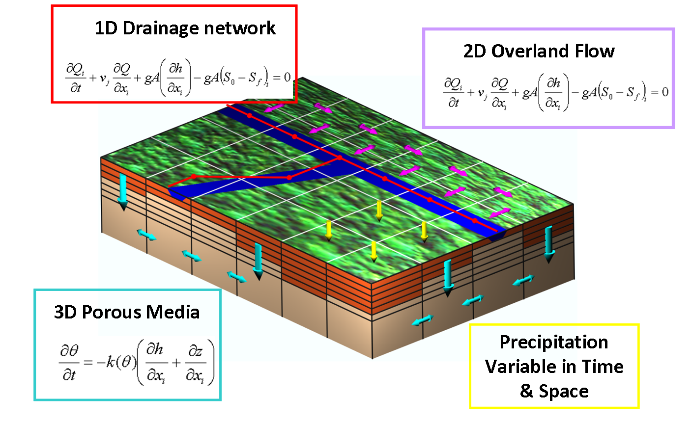

# Mohid Land

MOHID Land is the newest core executable of the [MOHID Water Modelling System](../overview/README.md#mohid-water-modelling-system#mohid-water-modelling-system). This program is designed to simulate hydrographic basin and aquifers. Main equations are described in a simple way in: [equations description](../reference/equations-in-mohid-land.md).

## MOHID Land's main features

MOHID Land is a physically-based, spatially distributed, continuous, variable time step model for the water and property cycles in inland waters and main mediums and equations are presented in next image:

Mohid Land mediums and equations

To follow the description of MOHID Land equations and derivation go to [Equations in Mohid Land](../reference/equations-in-mohid-land.md)

### Main Processes

The main processes solved are:

- 3D Porous Media solving Richard's Equations
- 1D Drainage Network solving Kinematic Wave, DiffusionWave or complete St. Venant equations (dynamic wave)
- 2D Overland Flow (solving Diffusion Wave)
- [Evapotranspiration](../reference/evapotranspiration.md) using Penman Motheith and water availability in soil
- Plant growth and agricultural practices (planting, harvest, kill, fertilization, pesticide application, etc.) including dormancy and SWAT crop database
- Porous Media interaction with Runoff in [Infiltration](../reference/README.md#infiltration#infiltration) using continuity (Richard's equation with Head gradient)
- Porous Media and Runoff interaction with Drainage Network using continuity (surface gradient between Runoff and Drainage Network. Richard's equation with level gradient between Porous Media and Drainage Network)
- Drainage Network and Reservoir interaction to account river flow impact due to manmande hydraulic infraestructures
- Property transport in all mediums and transformation in soil and river (water quality models can be coupled)
- Biological and chemical reactions in soil as mineralization, nitrification, denitrification, immobilization, chemical equilibrium, property decay, and processes in river as primary production, nutrient assimilation, property decay, etc.
- Linkage to [MOHID Water](../water/mohid-water.md) by [Module Discharges](../water/modules/discharges.md)

### Dynamical time step adaptation

MOHID Land uses an adaptive time-stepping method in its main hydrodynamic cycle. Within an iterative cycle, if the water volume — of reach or overland flow or porous media — varies more than a user defined percentage during two consecutive time steps, the model automatically decreases the time step. Thereafter the model recalculates the current solution with a smaller time step for the affected process (reach or overland flow or porous media). This process is repeated until the volume variation is less than the user defined value mentioned above. The time step dynamically increases again when the model verifies that flow is “stable”. For example within the module "Drainage Network" the time step may be reduced to very short intervals during flush events. This procedure avoids the occurrence of negative volumes and optimizes the time it takes to make a certain simulation, without compromising model stability. Time steps of the processes — computed in the different sub-models — can be chosen differently, adding more to the optimization of the computational cost.

### Interpolated Rain

You can produce spatialy interpolated rain using [FillMatrix](../tools/fillmatrix.md) tool, using as input two or more precipitation stations.

## MOHID Land Structure, Description and Source Code

MOHID Land model is programmed in Fortan95 using a OOP (object-oriented programming) philoshophy and code is organized in Modules (or classes) that handle specific processes in specific mediums. Also and interface Module exists to handle the exchange info between classes.

### MOHID Land Modules

Some modules developed are related with specific processes which occur inside a watershed and on a specific medium, creating thus a modular structure. For user first approach and advanced use, processes solved, equations, input data files examples are presented below for each MOHID Land module:

- [Module PorousMedia](modules/porousmedia.md) which calculates infiltration, unsaturated and saturated water movement
- [Module PorousMediaProperties](modules/porousmediaproperties.md) which calculates property transport and transformation in soil.
- [Module SedimentQuality](../water/modules/sedimentquality.md) which calculates property transformation in soil driven by microorganisms (mineralization, nitrification, denitrification, etc.).
- Module PREEQC which calculates property transformation in soil through chemical equilibrium.
- [Module Runoff](modules/runoff.md) which calculates overland runoff;
- [Module RunoffProperties](modules/runoffproperties.md) which calculates property transport in runoff.
- [Module DrainageNetwork](../water/modules/drainagenetwork.md) which handles water and property routing and property transformation inside rivers.
- [Module Vegetation](modules/vegetation.md) which handles vegetation growth and agricultural practices.
- Module Irrigation which calculates and applies water in the soil according to the limits we defined
- [Module Reservoirs](../water/modules/reservoirs.md) which handles weir and reservoir behavior in changing river flow (Drainage Network interaction) and concentrations.
- [Module Basin](modules/basin.md) which handles information between modules and computes interface forcing fluxes between atmosphere and soil (e.g. throughfall, potential evapotranspiration, etc.).

MOHID Land also uses all the modules for data pre-processing, computation and post-processing that are common to MOHID Water (e.g. data file read, geometry handling, results writing in HDF and timeserie, etc.) See below how you can see module [source code](mohid-land.md).

### MOHID Land Source Code

You can download the latest source code of the model from GitHub ([Mohid Land in GitHub](https://github.com/Mohid-Water-Modelling-System/Mohid#)). Just click on the download link, no need to register. For advanced users you can download the entire solution ready to compile.

Other users can just browse around the code of each module to checkout equations. In the links below you can go directly to the latest version and see code in html:

- [MohidLand](https://github.com/Mohid-Water-Modelling-System/Mohid/blob/master/Software/MOHIDLand/MohidLand.F90) is the main program of Mohid Land
- [ModuleBasin](https://github.com/Mohid-Water-Modelling-System/Mohid/blob/master/Software/MOHIDLand/ModuleBasin.F90) is the top level of Porous Media, RunOff, Infiltration, River Flow and Vegetation
- [ModulePorousMedia](https://github.com/Mohid-Water-Modelling-System/Mohid/blob/master/Software/MOHIDLand/ModulePorousMedia.F90) Simulates water flow in variable saturated and unsaturated porous media
- [ModulePorousMediaProperties](https://github.com/Mohid-Water-Modelling-System/Mohid/blob/master/Software/MOHIDLand/ModulePorousMediaProperties.F90) Deals with all property transport and transformation in Porous Media.
- [ModuleSedimentQuality](https://github.com/Mohid-Water-Modelling-System/Mohid/blob/master/Software/MOHIDLand/ModuleSedimentQuality.F90) Zero-dimensional model for primary production, nitrogen and carbon cycle in the Porous Media (Soil and Aquifer)
- [ModulePhreeqC](https://github.com/Mohid-Water-Modelling-System/Mohid/blob/master/Software/MOHIDBase1/ModulePhreeqC.F90) Zero-dimensional model for chemistry equilibrium of solution, pure phases, gas phase, solid phase, exchangers and surfaces in Porous Media (Soil and Aquifer)
- [ModuleRunOff](https://github.com/Mohid-Water-Modelling-System/Mohid/blob/master/Software/MOHIDLand/ModuleRunOff.F90) Module which calculates the surface RunOff
- [ModuleRunOffProperties](https://github.com/Mohid-Water-Modelling-System/Mohid/blob/master/Software/ModuleRunOffProperties.F90) Deals with all property transport in Runoff
- [ModuleVegetation](https://github.com/Mohid-Water-Modelling-System/Mohid/blob/master/Software/MOHIDLand/ModuleVegetation.F90) Module to simulate plant development and agricultural practices
- [ModuleDrainageNetwork](https://github.com/Mohid-Water-Modelling-System/Mohid/blob/master/Software/MOHIDBase1/ModuleDrainageNetwork.F90) Module which simulates a 1D Drainage Network system
- [ModuleReservoirs](https://github.com/Mohid-Water-Modelling-System/Mohid/blob/master/Software/MOHIDLand/ModuleReservoirs.F90) Module which simulates Reservoirs interaction with Drainage Network
- [MOHID RiverNetwork](https://github.com/Mohid-Water-Modelling-System/Mohid/blob/master/Software/MOHIDRiver/RiverNetwork.F90) Program that alows to run river using SWAT-Mohid discharges
- [ModuleCEQUALW2](https://github.com/Mohid-Water-Modelling-System/Mohid/blob/master/Software/MOHIDBase1/ModuleCEQUALW2.F90) U.S. Army Corps of Engineers zero-dimensional model for primary production that can be run to simulate water quality in the river
- [ModuleTriangulation](https://github.com/Mohid-Water-Modelling-System/Mohid/blob/master/Software/MOHIDBase1/ModuleTriangulation.F90) This is one of the modules for interpolation. This is useful to obtain distributed rain in space based on point time series.
- etc

## MOHID Land Interfaces

You can download interfaces to prepare inputs and to analyse model results. Presently available two options:

- a completely free interface from Mohid Website (www.mohid.com).
- MOHID Studio is a new interface can be downloaded from [Action Modulers](http://www.actionmodulers.pt/products/mstudio/products-mohidstudio2015.shtml). A full professional version and a free version (with some limitations) exist. The full version is available for free for academic purposes (research, master, phD, teaching) for one year.

## How To

[Create a MOHID Land Project Step-by-Step](how-to-create-a-mohid-land-project-step-by-step.md)

[Rough Guide on Hydrology Calibration in MOHID Land](../reference/calibration-validation-in-mohid-land.md)
