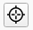
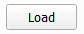
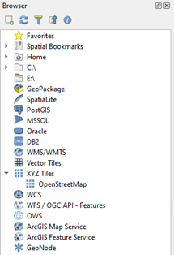
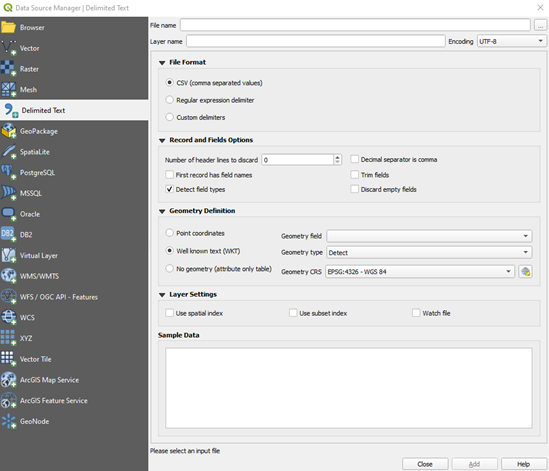
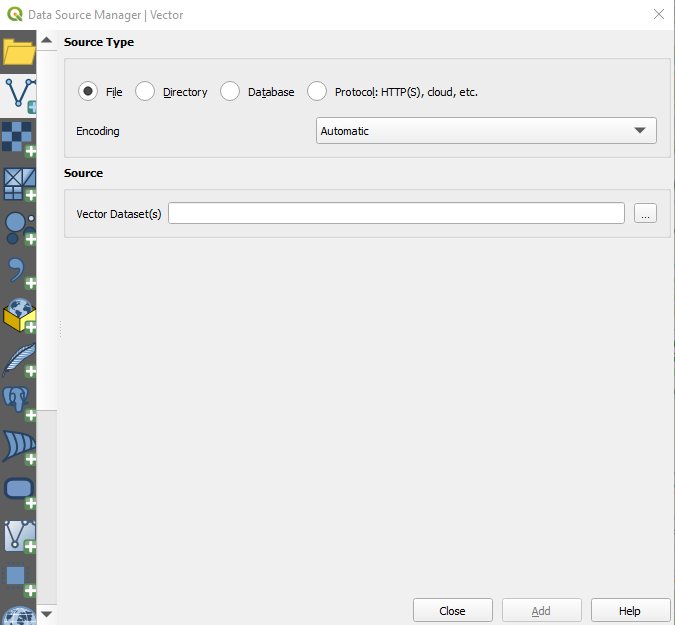
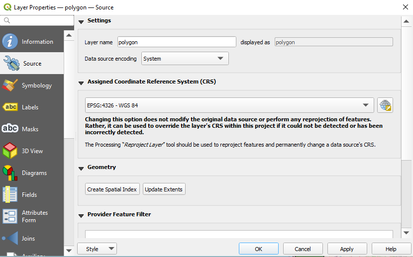
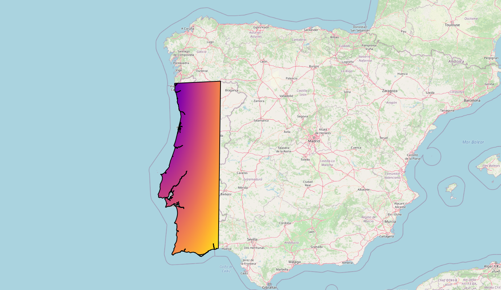

# MOHID QGIS

#### !!!Under Construction!!!

### Quick Introduction

This User Manual focuses on helping professionals replicate any tasks previously done in the MOHID Graphical User Interface using the QGIS platform.

[QGIS](https://qgis.org/en/site/index.html) is a widely used open source Geographic Information System. If you are not familiar with QGIS, you can find the most recent version for your desired work environment on its official [download section](https://qgis.org/en/site/forusers/download.html), you can also find more details about the platform by consulting its [documentation](https://qgis.org/en/docs/index.html). The instructions written in this manual will be using the 3.22 LTR version, so keep in mind that some interface elements may be outdated by the time you’re consulting this manual.

### MOHID plugin installation

```
Current version: v0.5.2
```

This plugin is currently under development. It has been tested with 3.22 standalone version, which support Python 3.9. An alpha version can be downloaded from the git repository [here](https://github.com/Mohid-Water-Modelling-System/mohid_qgis/archive/refs/tags/v0.5.2.zip). Note that this repository is private, hence login and access to the repository are likely required.

In the future, the plugin might be available in QGIS plugin repositories. For the time being, it has to be manually installed.

#### Windows 10

The downloaded zip must be unzipped and the plugin folder *mohid\_qgis* must be copied over to the QGIS plugin directory: *C:\\Users\\{USER}\\AppData\\Roaming\\QGIS\\QGIS3\\profiles\\default\\python\\plugins*, where *{USER}* corresponds to the current Windows user account.

Note: If the *plugins* folder under *python* does not exist, it can be created manually.

Note: *AppData* is usually a hidden folder.

The plugin folder must be named *mohid\_qgis*.

QGIS for Windows ships with its own python installation, this means if a third-party python module is required it has to be installed in the QGIS python environment and not on the system's.

To install python packages follow the following steps:

Find the "OSGeo4W Shell" that should be in the desktop shortcuts, installed during QGIS setup, and execute it. Then run the following instructions on the shell:

```
cd C:\Users\{USER}\AppData\Roaming\QGIS\QGIS3\profiles\default\python\plugins\mohid_qgis
```

where *{USER}* corresponds to the current Windows user account.

```
python -m pip install --upgrade pip
python -m pip install -r requirements.txt
```

QGIS should now be running with the MOHID plugin.

If the plugin is not visible in the navigation bar, it can be activated through the **Plugins** menu, **Plugins > Manage and Install Plugins...**. Find the **MOHID** plugin under **Installed** and check its box.

## For Users

#### Grid tab

At the moment, only regular grids are fully operational, meaning MOHID grids (.grd) can be created and saved, and existing grids can be loaded and edited.

Filling the form should be self-explanatory. In principle, the grid can only be created when all fields are properly filled.

It is worth noting that you can capture the origin with the mouse pointer directly on the map by pressing the button .

**Preview** button creates a temporary layer to visualize the grid.

**Save** button saves the grid to a .grd file

**Load** loads an existing .grd grid into QGIS (only for visualizing for now).

```
Note: Either comma (,) or dot (.) should work as decimal separators.
```

#### Bathymetry tab

In this tab, existing bathymetries will be able to be edited and new bathymetries can be generated.

##### Generating new bathymetries

In the subtab **Input Data**, the files that will generate the bathymetry are selected from the loaded files (loaded via the Load tab). (add screenshots)

(**WIP**) The subtab **Run** will hold options that can be accepted by the DTC and a Generate button, that will begin the process of generating a new bathymetry (.dat).

#### Load tab

In this tab, files can be loaded into QGIS. At the moment, these file formats can be loaded:

- Grid files (.grd)

- XYZ files (.xyz)

- Land polygon files (.xy)

- Bathymetry files (.dat)

Pressing the load button  will open the file browser and filter for the respective file type. The selected files will be converted to shapefiles and loaded into QGIS. Each loaded file will hold its filepath in memory so that it can be provided to the DTC tool.

### Creating a QGIS Project

In order to do whichever task you need in the QGIS environment you’ll need to create a new project or open an already existing one.

You can create a project by opening the **Project > New** Menu. Alternatively, to open an already existing project, simply open **Project > Open** Menu and choose the one you wish to open.

With a project open, you can now add whichever elements you desire. You can start by opening a simple world map by expanding the *XYZ Tiles* group and selecting *OpenStreetMap* in the Browser:



### MOHID Bathymetry

#### Visualizing points in MOHID’s .xyz format:

QGIS can easily display point data represented in the MOHID .xyz format, although it is unable to process the header’s option details. To visualize points represented in this format you’ll need to add a new “Delimited Text Layer”. You can do this by opening the **Layer > Add Layer > Delimited Text Layer** Menu, which will lead you to the following window:



You’ll need to select the *Custom delimiters* option in the **File Format** section and check the *Space* option.

In the **Record and Fields Options** section, select the *number of header lines to discard* according to the size of the .xyz file’s option header. Make sure to check the *Detect field types* option and uncheck the First record has field names and *Decimal separator is comma options*, since the latter are not present in the MOHID .xyz format.

Finally, you’ll need to check the *Point coordinates* option in the **Geometry Definition** section and select *field\_1*, *field\_2* and *field\_3* as the x, y and z fields, respectively. Don’t forget to select the Geometry CRS that matches the one specified in the file’s option header.

You’ll now be able to check the table generated by the given data in the **Sample Data** section and add additional settings in the **Layer Settings** section.

#### Visualizing polygon in MOHID’s .xy format:

The first step to visualize a MOHID’s .xy format polygon in QGIS is to convert the polygon file to Shapefile format. A script for converting MOHID's .xy format to shapefile and to WKT is available in the following repository: [https://github.com/Flatlightning/mohid-conversions](https://github.com/Flatlightning/mohid-conversions)

After downloading the polygonConverter.py script, convert your polygon.xy file to Shapefile format using the folowing command: `python polygonConverter.py -f shp -i polygon.xy`

The script will generate three files: polygon.dbf, polygon.shp and polygon.shx.

The next step is to add the polygon layer over the *OpenStreetMap* layer in QGIS. To add the polygon layer, select the **Layer > Add Layer > Vector Layer** menu, which opens following window:



In the **Vector Dataset(s)** field enter the path to your polygon.dbf file and click **Add**. Then, double click on the newly created polygon layer in the Layers panel to open the **Layer Properties** Menu and select the **Source** tab:



Finally, select the **EPSG:4326 - WGS 84** option on the **Assigned Coordinate Reference System (CRS)** field and click on the **Apply** button.

You should now visualize the polygon over the map, e.g.:



## For Developers

This section is aimed at contributors.

### Plugin structure

For ease of development, the plugin is divided in two main directories, *core* and *plugin*:

```
mohid_qgis/
  core/
  plugin/
```

The *plugin* directory will hold the plugin itself, with the UI elements and everything related to their interface logic.

The *core* directory will hold additional tools such as utilities, algorithms, conversion scripts, etc...

#### User Interface

QGIS uses *.ui* files to represent an UI and a *.py* file to hold the logic of the UI (button actions, etc).

The UI is based on a *QDockWidget* with an empty *QTabWidget*. Individual tabs are added on top. This allows the individual development and isolation of each tab which allows for an organized scaling of the plugin. Each tab will then consist of at least a *.ui* and a *.py* files. The *plugin/tab\_bathymetry* directory holds the bathymetry tab code and can be consulted for reference.

### Add new tab

To add a new tab, one must first create the respective UI interface. The best way of doing this is to use *QT Designer*, which should come with the QGIS installation. This will generate a .ui file that is used by QGIS to render the UI. This can also be done manually by writing every UI element and its attributes into a .ui file. However, this approach is not recommended as it takes more time and is prone to errors.

## Report a bug

If you find a bug, or would like to suggest a new feature, please [open an issue on GitHub](https://github.com/Mohid-Water-Modelling-System/mohid_qgis/issues).
