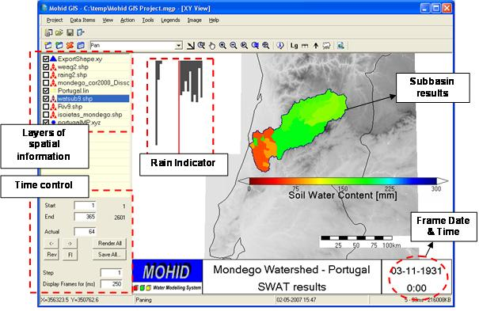
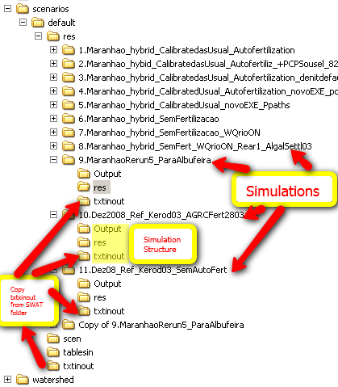
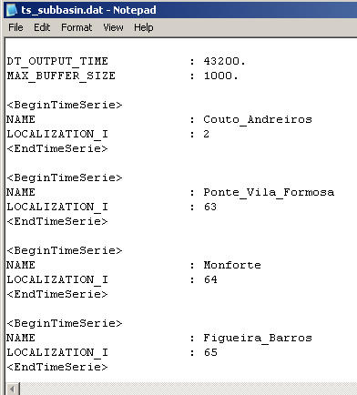
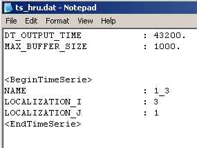

# Mohid SWAT

Two modified versions of the [SWAT model](http://swatmodel.tamu.edu/) were developed, based on the three SWAT releases (SWAT2000, SWAT2005 and SWAT 2012). You can download the package with all the MOHID SWAT releases [HERE](http://maretec.mohid.com/PublicData/products/Software/SWAT%20Package%20V3.rar). The functionalities described herein are equal in both versions. So we refer to this modified versions as SWAT-MOHID. This executable has to main functions: i)To help explore SWAT outputs; ii) To Couple SWAT and [MRN](mohid-river-network.md). You can get the source code from MOHID download area in [www.mohid.com](http://www.mohid.com). SWAT-MOHID uses the following MOHID modules:

- [Module Time](../water/modules/README.md#module-time#module-time)
- [Module TimeSerie](../water/modules/timeserie.md)
- [Module EnterData](../base/module-enterdata.md)
- [Module HDF5](../base/module-hdf5.md)
- [Module GlobalData](../base/module-globaldata.md)

## SWAT Mohid outputs

This modified version mainly produce new outputs of SWAT in MOHID format. The aim of these developments is not to replace the use of SWAT graphical user interfaces for input or output, but to complement it. This also means that the developed outputs do not include all the SWAT variables but instead, they were developed on a need basis either for easier exploring, results analysis, model coupling, etc. This development benefits from many current developments and improvements of MOHID tools made by its users and will continue to benefit in the future.

### Time series output

A first modification was the implementation of time series outputs. The modified SWAT source code enables the user to output time series for two geometric entities found in SWAT: (i) hydrological response units (HRU) and (ii) or sub-basins/reaches. The output of the time series is done with a frequency which is independent of the “normal” SWAT output and the format of the time series is done in MOHID format. This allows for example the use of [Mohid Statistics Analyser](../tools/gui/mohid-statistics-analyser.md) which calculates statistics and obtains graphs of comparison between two time series data. Time series written for selected HRU’s are organized in four categoiries: (i) meteorological information, (ii) plant growth, (iii) nutrient concentration and (iv) erosion. Time series written from selected sub-basins/reaches are nutrient concentration, sediments concentrations and the water flows into the reaches. Time series generated by SWAT-MOHID:

#### Results per sub-basin

- RCH – results from the SWAT river – Flows (m3/s), properties concentrations (mg/l), temperature (ºC) and sediments transported out of reach on day (ton/day)
- DIS – results per sub-basin – contribution of each sub-basin to the reach) – This files were created for coupling SWAT with Mohid River Network. Units are in m^*3*^/s and mg/l

#### Results per HRU

- PLT – results related with plant growth – LAI, Biomass, Growth Stress, etc
- MTO – results related with climatic model variables
- USL – results at HRU level related with erosion
- NIT – results related with the nitrogen cycle in the soil – plant uptake of N, N remove by leaching, etc
- PHS – results related with the phosphorus cycle in the soil

#### Global results

- LDU – average results related per land use of all watershed
- GLB – results related with overall watershed
    -   GlobalWater.glb - results related with the global water
    -   GlobalNutrient.glb – Results related with global sediment budgets
    -   Average\_Basin\_kg\_ha.glb – Results related with global model pathways

### Animated map results (HDF)

MOHID’s HDF class is a class on the top of the Hierarchical Data Format (HDF library). HDF is a general purpose library and file format for storing scientific data, developed and maintained by the United States National Center for Supercomputing Applications. The main functionality of this library is to store matrix data in a structured way. The inclusion of output result files in HDF5 format is currently under development. This allows the visualization of watershed properties (modeled by SWAT) in animated maps using MOHID animation tools like [MOHID GIS](../tools/gui/mohid-gis.md) (Figure 1). These tools allow the production of animated graphic files showing the spatial and time evolution of the modeled properties. The user decides on the time step output. For each output a vector with the values of soil water content of each sub-basin is stored.

Figure 1 SWAT Soil Water content results and visualization in [MOHID GIS](../tools/gui/mohid-gis.md) using the HDF result files produced by SWAT-MOHID

## Coupling SWAT and [MRN](mohid-river-network.md)

### Why couple SWAT and MRN

Common problems for the application of basin models in the temporary catchments are related to:

1. Periods without runoff (which results in numerical problems for most models)
2. Extreme first flush effects with the beginning of the rain period (sub-hourly time steps required in simulations)
3. Quality of the water (sediments, solutes) is frequently poor described in the models and highly variable in time.

In order to respond to such demands a physical based model, the TempQsim STREAM model, was developed (Galvão et al., 2005). This model is currently maintained by MOHID group under the name [MRN](mohid-river-network.md).

### What is [MRN](mohid-river-network.md)

MRN computes water, sediments and properties transport in a river network. The model is written in FORTRAN 95 and follows an object oriented programming philosophy with a finite volume approach. The different processes occurring in the river are programmed in different modules. This model has been calibrated for the Vène watershed (France) with a special focus on the transport of particulates for the first significant flood events (Obermann, 2007). Fluid flow in this model is governed by conservation equations for mass, momentum, energy and any additional constituents and the numerical algorithm is based on the finite volume approach. Following this strategy it is easier to build conservative transport models and coupling between modules is also simpler because it is based on fluxes. Object oriented programming was also used, which facilitates model coupling.

### How does the coupling work

An interface between this model and SWAT was developed in order to simulate agriculture in the catchment using MRN for simulating the river network and the corresponding sediment transport and biochemistry (Chambel-Leitão *et al.*, 2006). SWAT source code was slightly changed so time series of flow/properties are produced for each sub-basin. A “watsub” theme with the location of the outlets of each sub-basin (created by SWAT ESRI ® ArcView extension) is read by [MOHID GIS](../tools/gui/mohid-gis.md) and dynamically construct links between the time series locations of SWAT and discharge nodes of the MRN. MRN runs using surface runoff, lateral flow and groundwater flow from SWAT as input discharges. Property concentrations can be considered constant (user supplied) or can be an output of modified SWAT.

### Learn to setup MRN project

You have to create a MNR project similar to the SWAT project in terms of threshold area needed to form a stream. This way you garantee you are using the same river network. For more details on how to setup a MRN project go to: [How to create a MOHID River Project Step-by-Step](../land/how-to-create-a-mohid-river-project-step-by-step.md)

### Learn to setup a SWAT MOHID Project

#### Step 1

- [Install SWAT interface](../tools/gui/install-swat-interface.md).
- Setup your swat Project.

#### Step 2

Go to SWAT Project folder

There go to **scenarios\\default** (i.e. **C:\\AVSWATX\\mulargia1\\scenarios\\default**)

In the default folder create a folder named **RES**.

In RES folder create a folder for each simulation (name it what better describes it)

For each simulation folder create a folder called **Output**, a folder called **res** and copy scenarios\\default\\txtinout folder into it

Folder structure for simulation

#### Step 3

Get the latest SWAT-MOHID package (**SWAT-MOHID V2**) from [www.mohid.com](http://www.mohid.com) ([downloads](http://www.mohid.com/MembersArea/Downloads.asp)). If you are not registered jet, please do it to download the software. Copy the ascii file named “nomfich.dat” (which is inside the SWAT-MOHID package in the folder **..\\SWAT Package\\txtinout\\**) in to the folder **..\\scenarios\\default\\res\\

$$
SimulationName
$$

\\txtinout** and edit the ascii file to '**ROOT\_SRT : ..\\Output\\**

#### Step 4

Copy the executable SWAT.EXE to the **..\\scenarios\\default\\res\\

$$
SimulationName
$$

\\txtinout** folder (you can find this in **..\\SWAT Package\\txtinout\\**) Use SWAT2000 or SWAT2005 depending on the version of your SWAT project. Do not run SWAT2005 in a SWAT2000 and vice versa

#### Step 5

Copy all the ascii files from **..\\SWAT Package\\res\\** into folder **..\\scenarios\\default\\res\\

$$
SimulationName
$$

\\res**. These files include [outputs.dat](../io/outputs-dat.md), ts\_global.dat, ts\_subbasin.dat, etc…

Edit this ascii file for the subbasins and HRU that you want to output. In most of the cases it would be needed an output file for each branch of the network, if you want to couple with Mohid River Network. If you just want to explore SWAT results, just oyt put in Subbasins and HRU you want to analyse.

In file TS\_SubBasin.dat the keyword LOCALIZATION\_I is the number of the Subbasin to which is desired the output:

In which subbasin (river station) do you want to produce timeserie outputs and which names will be given

The TS\_HRU.dat the keyword LOCALIZATION\_I is the number of HRU (to get this number go to SWAT file ..\\Watershed\\text\\HRULandUseSoilsReport.txt is the numbers on the right) the keyword LOCALIZATION\_J is the number of the Subbasin. This two numbers define the HRU that will return the output:

In which HRU do you want to produce timeserie outputs

#### Step 6

Run the executable you copied to **txtinout**

#### Step 7

Install the latest Mohid package 4.9 available at [Mohid Downloads](http://www.mohid.com/MembersArea/Downloads.asp)

#### Step 8

Vizualize output files from folder **..\\scenarios\\default\\res** using Mohid Time Series Editor

## References

Demissie, G (2010) Integrated Sediment Transport Modeling Using SWAT-MOHID Models in Lake Tana Subbasin, Upper Blue Nile, Ethiopia. MSc UNESCO-IHE. April 2010. 

$$
abstract
$$

 ([

$$
1
$$

](http://www.unesco-ihe.org/About/Academic-departments/Hydroinformatics-and-Knowledge-Management/Master-Programme/Msc-Abstracts/MSc-research-topics-2010/Integrated-Sediment-Transport-Modeling-Using-SWAT-MOHID-Models-in-Lake-Tana-Subbasin-Upper-Blue-Nile-Ethiopia))

Chambel-Leitão P., F. Braunschweig, L. Fernandes, R. Neves, P. Galvão. (2007) Integration of MOHID model and tools with SWAT model, submitted to the Proceedings of the, 4th International SWAT Conference, July 2-6 2007. ([

$$
2
$$

](http://www.google.pt/url?sa=t&source=web&cd=1&ved=0CBcQFjAA&url=http%3A%2F%2Fmaretec.mohid.com%2Fpublicdata%2Fproducts%2Fconferencepapers%2F2007%2520swat-mohid.pdf&ei=UKUkTYjlF4es8gOQvr2TAw&usg=AFQjCNEkNVCYMNJsJ_MO9GHiOMxbcKIyLQ))

Obermann, M (2007). Nutrient dynamics in temporary waters of Mediterranean catchments. PhD thesis. University of Hannover. March 2007. ([

$$
3
$$

](http://www.google.pt/url?sa=t&source=web&cd=1&ved=0CBwQFjAA&url=http%3A%2F%2Fwww.mohid.com%2FPublicData%2Fproducts%2FThesis%2FPhDMatthias%2520Obermann.pdf&ei=x6UkTdvFG4e48gPagKGyAg&usg=AFQjCNH20e3_Jjsz7HbZYx0YIsKpdtGQ_w))

Chambel-Leitao P, Braunschweig F, Obermann M, Trancoso R, Galvao P, Lo Porto, A (2006). Coupling SWAT and TempQsim Mohid River Network. Geophysical Research Abstracts, EGU Meeting, Wien 25-29 April (Austria). ([

$$
4
$$

](http://meetings.copernicus.org/www.cosis.net/abstracts/EGU06/10104/EGU06-J-10104-1.pdf))

## See Also

- [How to Install SWAT](../tools/gui/install-swat-interface.md)

- [How to Run SWAT](../tools/gui/README.md#run-swat-model#run-swat-model)
