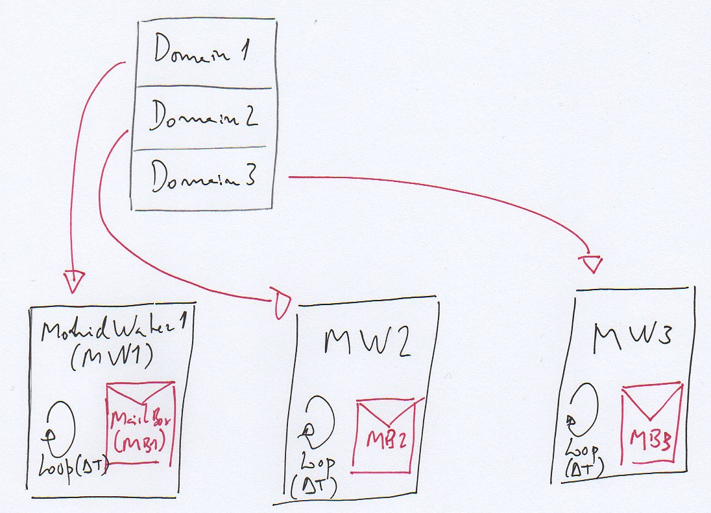
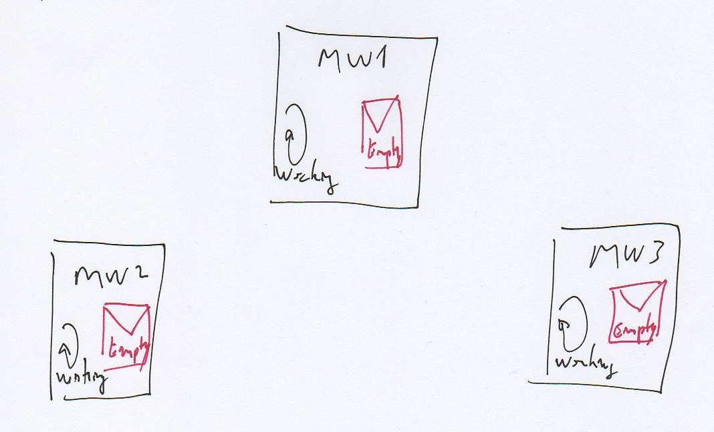
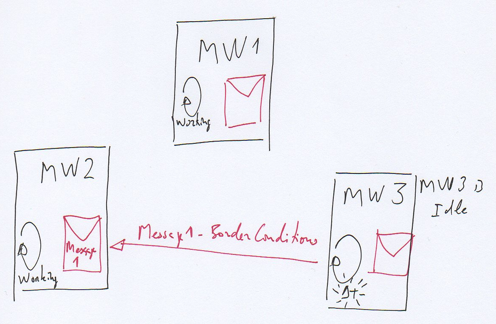
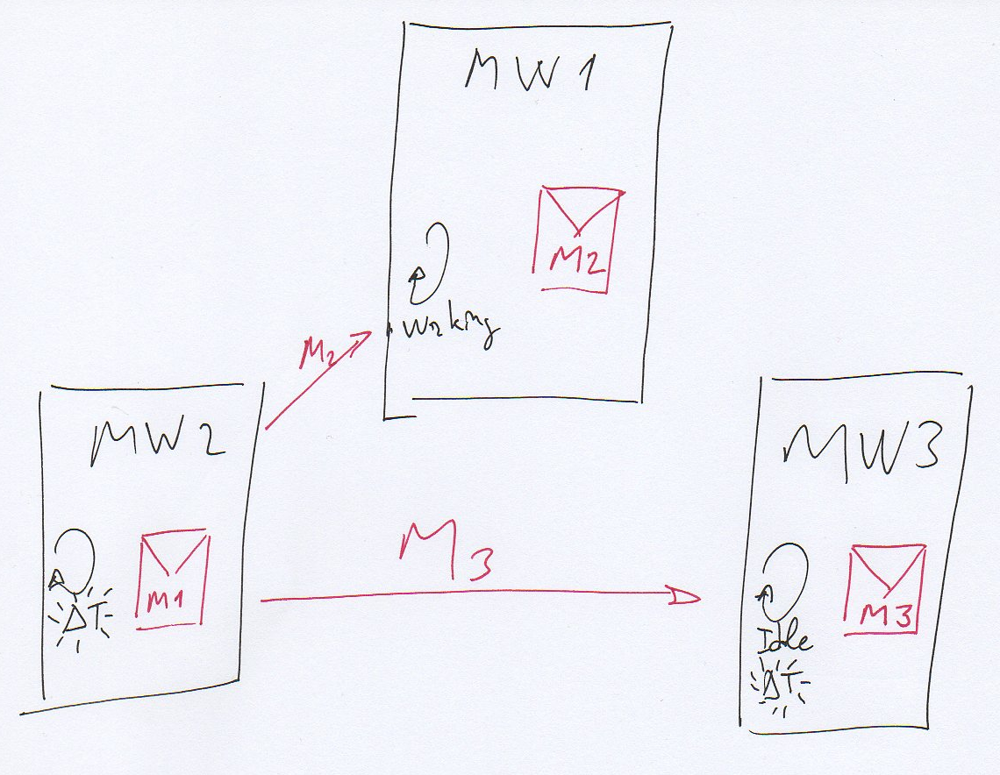
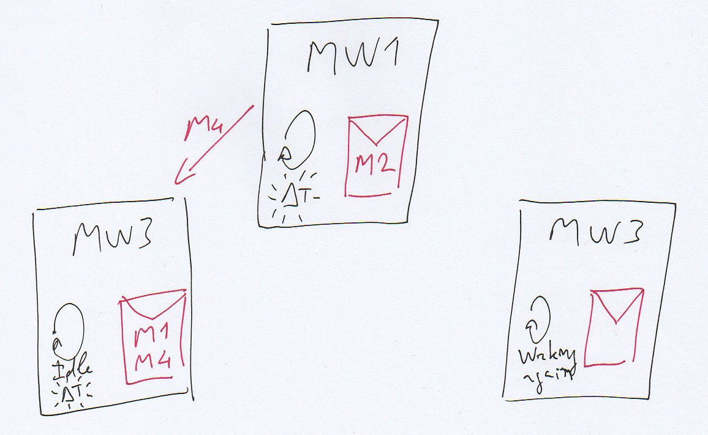

# Actor Model

According to the Wikipedia[

$$
1
$$

](http://en.wikipedia.org/wiki/Actor_model) "the actor model in computer science is a mathematical model of concurrent computation that treats "actors" as the universal primitives of concurrent digital computation: in response to a message that it receives, an actor can make local decisions, create more actors, send more messages, and determine how to respond to the next message received" (changing state). The actor model is a special form of [Reactive Programming](../development/programming/reactive-programming.md).

There are several resources in the Internet explaining the Actor Model and Reactive Programing. Some videos and interesting interviews:

- Hewitt, Meijer and Szyperski: The Actor Model (everything you wanted to know, but were afraid to ask)[

$$
2
$$

](http://channel9.msdn.com/Shows/Going+Deep/Hewitt-Meijer-and-Szyperski-The-Actor-Model-everything-you-wanted-to-know-but-were-afraid-to-ask);
- Francesco Cesarini and Viktor Klang on the Reactive Manifesto[

$$
3
$$

](http://www.infoq.com/interviews/cesarini-klang-reactive-manifesto); and
- Up And Out Scaling Software With Akka - Jonas Bonér[

$$
4
$$

](http://www.youtube.com/watch?v=t4KxWDqGfcs)

To read on-line:

- The Reactive Manifesto[

$$
5
$$

](http://www.reactivemanifesto.org/); and
- Learn You Some Erlang for great good;

The actor model makes it easier to reason about distributed programming. All MPI directives will be packed up in a set of well defined modules. Communication among actors takes place through clear and standard interfaces with well defined behaviors. This software architecture is proven to provide scalability, resilience and responsiveness. There is no central management and no points of synchronism so actors just react to events; this is a simpler way of reasoning about concurrency and parallelism.

According to Carl Hewitts' definition (Carl Hewitt; Peter Bishop; Richard Steiger (1973). A Universal Modular Actor Formalism for Artificial Intelligence. IJCAI) an actor is the fundamental unit of computation that embodies:

- processing (the behavior, the executable code);
- storage (its the state, the stuff on the heap, memory); and
- communication.

When an actor receives a message it reacts:

- sending messages to actors it knows (finite number);
- creating new actors (finite number); and
- designating how it should handle the next message it receives (changing state).

Here a [Fortran implementation of the Actor Model using MPI](../development/programming/fortran-implementation-of-the-actor-model-using-mpi.md) is discussed.

The program to consolidate results from [Domain Decomposition](domain-decomposition.md) runs, [Consolidate Domain Decomposition](consolidate-domain-decomposition.md), is the first using the actor model approach. It is a simple and small program, the perfect test bed before expanding to Mohid.

## Relevance of the Actor Model for the Mohid system

Mohid is a large system with complex memory management. With the commoditization of multi-core machines and access to fast local networks MPI is becoming the de facto way of running Mohid. MPI (Message Passing Interface) is a very powerful, standardized and portable message-passing system.

The way MPI is currently used in Mohid is difficult to implement, hard to understand and complex to maintain. It is essential to use MPI in such a way that it becomes easier to reason about:

- standardizing MPI's implementation in Mohid, embedding it in the programming framework;
- making explicit conventions on MPI usage of Mohid, for instance banning the use of semaphores and barriers;
- there will be a very limited number of modules where MPI directives are allowed; and
- MPI will be used to create explicit APIs (Application Programming Interface) that can be easily expanded and refactored according to Mohid's needs.

## Actor Model in Mohid

Domain in decomposed in 3 subdomains.

Suppose a domain is decomposed in 3 sub-domains according to the first image. Each subdomain is an actor that sends messages to other actors and reacts to messages it receives. Each model has a Main Loop that progresses in time-steps. Each model sends messages with information (for example border conditions) to actors that need it.

(0) All actors are working.

Lets take a look at the system in a moment all actors are computing the next time-step. Is is non-determined which actor will terminate first (even if we know each one work load, it is impossible to know when they will terminate their computations). Even while computing they are checking their mailboxes because there are messages they can react to (for instance if they are asked if their run has ended or not). Messages they can not process stay in the queue. Messages are not processed in the order of arrival.

There is no need for a centralized controller, each actor has a state and reacts to the environment as a living organism. Inconsistencies or partial failures should be resolved in another layer, for instance with the help of supervisors (this is Erlang/OTP strategy).

(1) Actor MW3 is the first actor to terminate its time-step.

Suppose Actor MW3 is the first actor to terminate its time-step. It sends messages to other actors with border conditions. MW3 has no messages in its mailbox so it is idle. Actor MW2 has a message in its mailbox but it can not process it yet so the message stays there.

MW3 will react when a message arrives to its mailbox. When it gathers enough information to start a new time-step it will react triggering some computations. There is no central authority ordering it to start, stay idle, etc.

(2) Actor MW2 terminates time-step.

Now actor MW2 has terminated time-step computations. It now sends 2 different messages to MW1 and MW3 respectively. MW2 is checking its message box's queue but it has not enough information to start a new time-step so it stays idle.

MW1 received a message form MW2 and will react accordingly.

(3) Actor MW1 terminates time-step.

MW1 terminated the time-step. Meanwhile MW3 processed message M3 and is already computing the next time-step.

MW1 sends a message to MW2 and both actors have enough information to proceed (reacting to messages).

(4) All actors are working.

All actors are computing a new time-step.

## Notes on the Actor Model

There are some remarks to be done:

- each message is sent only once;
- the sender does not verify if the message reaches its destination;
- the order of arrival is independent of the order of sending;
- each message is processed separately;
- there is no central point of control; and
- messages in mailbox are not processed in the order of arrival, there is a loop over the queue checking which messages the actor can react upon.
