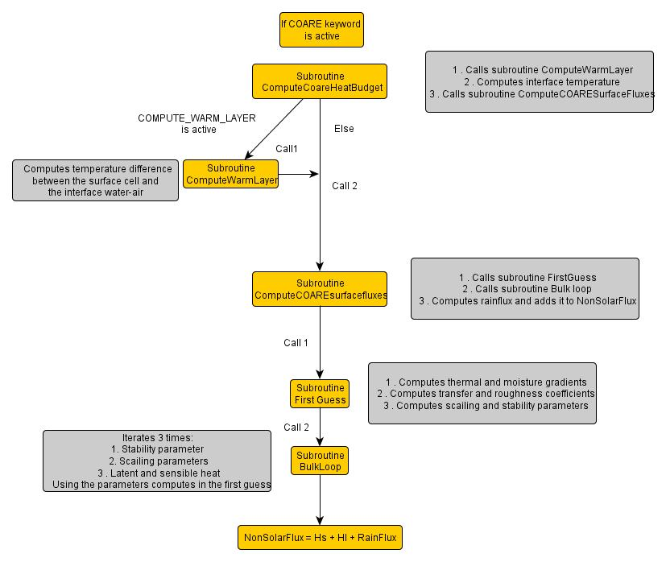

# Coare

## Coare3.0 algorithm

The algorithm first defines most physical constants and coefficients and, after determining the proper conditions, calculates and integrates the diurnal warming of the ocean surface, using fluxes and net longwave radiation from the previous time-step and the solar absorption profile. The fraction of warming above the temperature sensor is added to the measurement, and subroutine ASL is called for the flux and boundary layer calculations. ASL is a descendant of the original LKB code, but almost all operations and parameterizations are changed. After a series of first guesses and operations to characterize the atmospheric surface layer within the framework of Monin-Obhukov similarity theory, the core of the subroutine is an iteration loop. This iterates three times over the fluxes, the roughness parameters (zo, zot, zoq), the M-O stability parameter and profile phi functions, and also calculates gustiness and the cool skin within the loop. Final values are returned to bulk\_flux in COMMON. Finally, bulk\_flux calculates the surface fluxes (Wm-2), skin temperature (sst), heat and momentum fluxes due to rainfall, neutral transfer coefficients, values of state variables at standard height, etc., and saves the fluxes for the next time step warm layer integrals. For more information on the COARE3.0 algorithm see [https://coaps.fsu.edu/COARE/flux\_algor/](https://coaps.fsu.edu/COARE/flux_algor/)

Structure of the code inside MOHID:

This code is ready to receive albedo and PBL height used in this imported algorithm and it is now mandatory to include these properties when using COARE method. Albedo is required in all simulations as it is now a property of the InterfaceWaterAir. This was done to allow the user to use meteorological models or time series with albedo information. As the code and equations are all documented and due to the size of the algorithm, they have not been explained here but can be consulted in [https://coaps.fsu.edu/COARE/flux\_algor/](https://coaps.fsu.edu/COARE/flux_algor/), as well as in the references mentioned below. The most important of these are: (Grachev & Fairall, 1997)(Grachev, Fairall, & Bradley, 2000)(Fairall et al., 1996; Fairall, Bradley, Hare, Grachev, & Edson, 2003; Soloviev & SchlÜssel, 1996) Fairall, C. W., Bradley, E. F., Godfrey, J. S., Wick, G. a., Edson, J. B., & Young, G. S. (1996). Cool-skin and warm-layer effects on sea surface temperature. Journal of Geophysical Research, 101, 1295. doi:10.1029/95JC03190 Fairall, C. W., Bradley, E. F., Hare, J. E., Grachev, a. a., & Edson, J. B. (2003). Bulk parameterization of air-sea fluxes: Updates and verification for the COARE algorithm. Journal of Climate, 16, 571–591. doi:10.1175/1520-0442(2003)016<0571:BPOASF>2.0.CO;2 Grachev, a. a., & Fairall, C. W. (1997). Dependence of the Monin–Obukhov Stability Parameter on the Bulk Richardson Number over the Ocean. Journal of Applied Meteorology, 36, 406–414. doi:10.1175/1520-0450(1997)036<0406:DOTMOS>2.0.CO;2 Grachev, a. a., Fairall, C. W., & Bradley, E. F. (2000). Convective profile constants revisited. Boundary-Layer Meteorology, 94, 495–515. doi:10.1023/A:1002452529672 Soloviev, A. V., & SchlÜssel, P. (1996). Evolution of cool skin and direct air-sea gas transfer coefficient during daytime. Boundary-Layer Meteorology, 77, 45–68. doi:10.1007/BF00121858

## KEYWORDS

In order to use this algorithm the user must include the following keywords in the mohid data file “InterfaceWaterAir.dat”, OUTSIDE the property blocks:

USE\_COARE  : 1/0

COMPUTE\_WARM\_LAYER  : 1/0

COMPUTE\_COOL\_SKIN  : 1/0

Also, the user must add the property “albedo” in this data file. In the data file “Atmosphere” the user must include the property “pbl height”, and the following keywords OUTSIDE the property blocks:

WIND\_MEASUREMENT\_HEIGHT  : X in meters

AIR\_MEASUREMENT\_HEIGHT  : X in meters

These values are dependent on the source of the data, if they were produced by a meteorological model or measured in a meteorological station. Each source will have its description and the user will have to find this information on his own.
