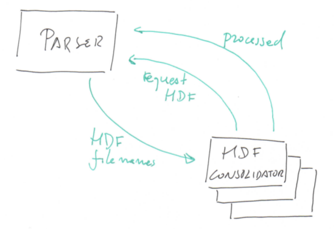

# Consolidate Domain Decomposition

The program Consolidate Domain Decomposition uses the actor model to parallelize file processing tasks. For instance, suppose there are hydrodynamic and water quality files from 2 sub-domains:

- hyd\_submod\_1.hdf and wq\_submod\_1.hdf; and
- hyd\_submod\_2.hdf and wq\_submod\_2.hdf.

The desired consolidated files are hyd.hdf and wq.hdf, resulting form the concatenation of:

- hyd\_submod\_1.hdf and hyd\_submod\_2.hdf to produce hyd.hdf; and
- wq\_submod\_1.hdf and wq\_submod\_2.hdf for the wq.hdf

## Run the program

Both Windows and \*NIX systems run the same way. This application runs from the command line. To run the program go to the directory where the file "Tree.dat" is. Most likely you will run on a single machine, the number of Parsers must be 1, the number of Workers can be any number greater then 1. There should be a balance between the number of available cores and the number of files to join. The application parses the "MPI\_\*\_DecomposedFiles.dat" produced by Mohid. The consolidated files are placed in the same directory where the decomposed files are. The command to run the application is:

- mpiexec.exe -localonly -n 1 DDCParser.exe : -n 2 DDCWorker.exe

## Topology

There are 2 kinds of MPI processes running:

- a Parser; and
- any number of workers.

The Parser identifies result files to be consolidated. It keeps a list of jobs to be done. At the end, when all files are merged, a "poison pill" message will be broadcast notifying workers they must terminate. The list of jobs works like this:

1. a Worker is idle it sends a request to the Parser;
2. the Parser sends the first unfinished job to the worker and moves it from the first to the last position of the list;
3. when a Worker terminates a job sends a processed message to the Parser;
4. the Parser removes the completed job from the list.

This strategy for the jobs list ensures fault tolerance. Suppose a job is sent to a Worker that, for some reason, does not complete it. That job will eventually be send to another Worker. It may occur that a job is executed twice but the program is idempotent so no harm occurs...
