# Equations in Mohid Land

## Mass Conservation Equation or "How Properties can't have black holes"

In a mass conservation approach the variation of the mass of a property (or water volume) in any defined volume may change (accumulation in time (rate)) if material enters or exits the volume (through the faces of the volume) or if there are sources or sinks for the property (degradation, chemical reactions, etc.) inside that volume. If the property is water volume the sources and sinks are inputs or extractions (e.g. discharges or pumping).

So, the property transport equation in text form:

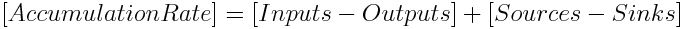

This "equation" may be written in a general integral form meaning that the accumulation terms are summed in infinitesimal volumes and the fluxes trough the faces of the volume are summed in infinitesimal areas. These fluxes through the faces enter with the velocity (transport from other volumes) and because exists molecular diffusion.

The inputs and outputs will create two terms, the first the advection (driven trough velocity) and the second the diffusion (driven trough property gradient).

The property transport equation in integral form:

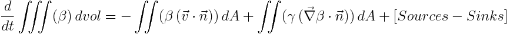

where:

```
Beta is property concentration (M/L^3)
v is velocity (L/T)
Gamma is diffusivity (L^2/T)
dvol and dA are notation from volume integral and surface integral
dt is infinitesimal variation of time
```

In a finite volume approach the control volume (or cell) has a defined and fixed volume and all the properties are homogeneous inside the control volume (and refered to the cell center) and velocities are homogeneous in the faces of the volume (and refered to the face). This way it can be understood that the homogenity of velocity discards the turbulence variations in the scale lower than cell lenght and this processes are taken implicitly in diffusion. So, in diffusion two processes exist: i) one movement caused by the property having different concentrations in different volumes and spreading (molecular diffusion) and ii) an artifical process because velocity has variations not described by mean velocity (turbulence) that spread material and fall into diffusion. So the latter equation may be simplified because property, velocity and diffusivity are homogeneous inside control volume or in the faces so they may exit the integral and the various flux directions (3 directions trough 6 faces have to be analyzed).

The property transport equation in "infinitesimal volume" form::

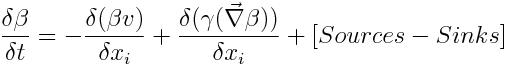

where:

```
Beta is property concentration (M/L^3)
v is velocity (L/T)
Gamma is diffusivity (L^2/T)
Deltaxi is cell spatial step in direction i (m)
dt is infinitesimal variation of time
```

So to get to the final form we only need to discretize to a finite volume, to its faces and to the different flux directions and to a finite timestep.

The property transport equation in finite volume and one direction:

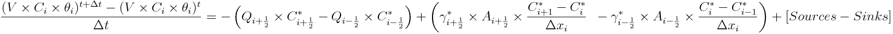

where:

```
V is cell volume (m3)
C is cell property concentration (g/m3)
theta is cell water content (m3H2O/m3cell)
Deltat is time step (s)
Q is flow in cell face (m3/s)
Gamma is diffusivity in cell face (m2/s)
- is t in case of explicit model and t+deltat in case of implicit
```

Time discretization of property transport can be explicit or implicit. In case of explicit computation the NEW volume or property concentration are dependent on neighbours OLD volume or concentrations. In case of implicit computation the NEW volume or property concentration are dependent on NEW volumes or concentrations and all domain has to be taken care (not only the neighbours) and tridiagonal methods and Thomas algorithm is solved.

Spatial discretization (horizontally and vertically) of property transport can be chosen from several options for each property (e.g. Upwind order 1 to 3, CentralDifferences, LeapFrog..) In order to boost the computation, MOHID Land has the option of choosing the same discretization for all the properties (see keywords).

The latter equation described how mass is conserved depending on the inputs, outputs, sources and sinks. But it does not explain how that mass got there in the first place. That is explained by the velocity field that appears in the Mass conservation equation with "v" and needs to be defined.

Also diffusivity includes i) molecular diffusion and ii) other processes not contained in average velocity. For example in soil water moves in pores and because of the erratic movement (and existence of erratic paths and macropores) tortuosity and dispersion are computed to add to molecular diffusion. See PorousMediaProperties, RunoffProperties and DrainageNetwork pages for more details.

## Moment Equation or "How those Properties Move"

A body (or water mass) at rest if there are no forces (or forces cancel themselves) that act on it, than it will remain stopped. Also a body (or water mass) in motion if there are no forces (or forces cancel themselves) that act on it, than it will continue to move with the same velocity. So to have velocity change (even from zero to start the motion) it is needed that the result of forces will be different than zero).

The Newton's 2nd law in "text" form

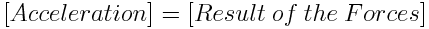

Following the latter equation if the sum of the forces is zero than there will be no acceleration and the body does not change velocity (even if at rest, v = 0).

The same equation but in the best known form, is the Newton's 2nd law:

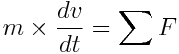

```
where:
m = mass (M)
v = velocity (L/T)
t = time (T)
F = the forces acting in the movement
```

This equation has also the mass of the body (or water), showing that the acceleration as a response to the same result of forces will be higher with lower mass (high mass objects will have higher inertia).

The aceleration term presented above assumes that we are following independent object moving but water behaves as a group of masses that interact together (exchanging momemtum) and so there can have spatial influence on momentum. So, the latter equation (total derivate of velocity in time) may generate two other partial derivates of velocity one in time and other in space (transport of momentum within adjacent water masses).

The Newton's 2nd law and using density:

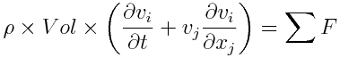

```
where: x_i = spatial direction where velocity is solved
x_j = all the spatial directions (that interact with transmission of momentum)
```

The description of the equation will depend on which medium the water will be flowing since the acting forces will be described differently.

### Surface Water (Runoff and Drainage Network)

The main forces acting in the water body in surface water are:

$\frac {\partial H}{\partial x_i}$ Hidraulic gradient

$f$ frictional resistance of channel walls and/or bed

$\rho g$ gravity force

where:
H: Water column level = Channel/Topography Bottom level (z) + water column height (h) (L)
x\_i: spatial direction (L)
$f = \rho \times g \times Vol \times S_f$
Ro: density (M.L-3)
g: gravity force (L.T-2)
Vol: cell volume (L3)
Sf: slope of the water surface or the linear hydraulic head loss (L/L)

In the surface water there will be the effect of hydraulic level gradient that the system tries to homogenize (trying to uniformize water level) and the hydraulic loss suffered in the soil surface or channell bottom and walls by friction.

Hidraulic gradient implicitly incorporates gravity since water column level has the channel/topography bottom level. Usually it is presented the St. Venant equations with water column gradient $\frac{\partial h}{\partial x_i}$ and the slope $\frac{\partial z}{\partial x_i}$ but the system tries to homogenize both and not only water columns heigts.


$$
Improve the passage from the forces to the below equations since it needs geometry info
$$


So, the sum of the forces acting on surface waters:

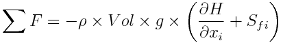

And the complete set for momentum equation (St. Venant Equation in 1D or 2D):

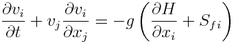

```
where:
v: velocity in the spatial direction (L/T)
t: time
H: Water column level = Channel/Topography Bottom level + water height
x_i: spatial direction where velocity is solved
x_j: all the spatial directions (that interact with transmission of momentum)
g: gravity force (L.T-2)
Sf: slope of the water surface or the linear hydraulic head loss (L/L)
```

And the same equation with flow (multiplied by vertical area):

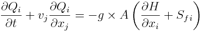

#### 1D descritization (River)

St. Venant equation has to de discretized to space (only one direction) and time resulting in:

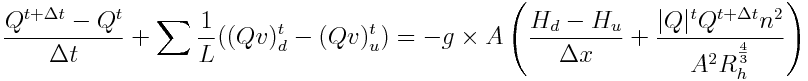

```
where:
t is the old value
t+dt is the new value
u subscript is from upstream
d subscript is from downstream
```

The approach used to compute flow and velocity at upstream and downstream reach faces was to use hard upwind meaning that flow and velocity in that faces (nodes) is defined by the flow direction (in upstream face if flow downstreams than flow and velocity is from upstream reach).

And putting it relative to new flow $Q^{t+\Delta t}$:

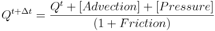

where:

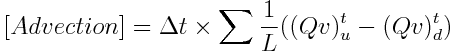

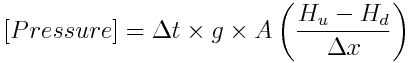

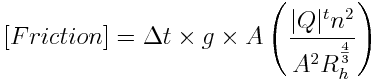


$$
Advection
$$

 and 

$$
Pressure
$$

 units are im L3.T-1 and 

$$
Friction
$$

 is adimensional. The remaining terms are defined above.

#### 2D descritization (Runoff)

St. Venant equation in 2D needs to consider that u and v "cells" have fluxes in x and y direction (see [Grids](grids.md)):

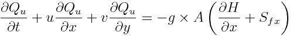

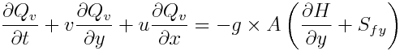

and descritizing to cells and time step:

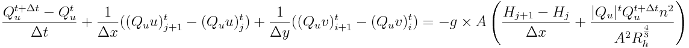

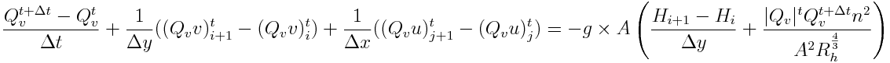

```
where i and i+1 and j and j+1 are u and v cell faces (see Grids)
```

reminding that each u cell has fluxes in x direction (between 2 u's) driven by u flux and fluxes in y direction (between 2 u's) driven by v flux. And the same for v cell.

The approach used to compute flow and velocity at faces was to use hard upwind meaning that flow and velocity in that faces (z cell center) is defined by the flow direction.

#### Simplifications to the complete equations

From St. Venant equations it is frequent to see simpler approaches used where acceleration is not accounted. In areas with slow varying slope and low Froudre number the horizontal velocity gradient is small and inertia forces can be neglected (Abbot and Minns, 1998). However the simplifications are more linked to low computation power or lack of numerical models to solve the full equations.

Without acceleration (zero) the two left terms of St. Venant equation are zero and that means that forces balance eachother: the equation is transformed in the diffuse wave (hydraulic gradient balances friction):

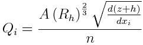

Zero acceleration means that the forces balance themselves and flow will be dependent on water level gradient and manning resistance (the forces acting, hydraulic gradient gravity and friction).

Another approximation used is that if the water level is parallell to the bottom than it can be used slope instead of water level gradient (kinematic wave) simplifying even more the numerical computation.

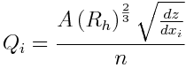

These 3 approaches exist in Mohid Land and the user may choose which to run. Time descritization of the equations are implicit for St. Venant and explicit for diffuse wave and kinematic wave. For a more detailed description of the computations visit the DrainageNetwork page.

#### Simple Explanation of St. Venant Terms

The first acceleration term in St. Venant equation (partial derivate of velocity in time) is called inertia and the second (partial derivate in space) is called advection. Here it can be seen that the influence of the two acceleration terms (inertia and advection) in the computation:

1) inertia will add to the equations that the new velocity in each cell will depend on the old velocity in that cell and of course on the effect of the forces. This means that when acceleration exists, inertia in the model will take into account that even if the forces may be trying to push the water in the opposite direction that it was moving, the last velocity is important. And bigger the last velocity, the lower weight is given to the forces and more weight is given to the last velocity. Basically, bigger the last velocity bigger the tendency for the movement to continue with a similar velocity and minimizing the effect of the resulting forces (inertia). This term is the "But I was going that way" term.

2) advection will add to the equation that the new velocity will depend on the momentum arriving or leaving to the neighbours. This means that if the water is flowing fast downhill, momentum will continue to be transported even if the slope changes to flat areas and the level gradient gets small (would result in low flows downstream and higher water columns if acceleration terms are not computed). Basically with big slope changes, the water will tend to continue the movement in the flow direction mimimizing the effect of the resulting forces (tath may even be pointing in the opposite direction). This term is the "But they are pushing/stoping me in that way" term.

If inertia and advection are not used (or no acceleration) then forces balance themselves and the velocity is solely dependent on the forces and the last velocity or the transport of momentum from the neighbours is not accounted. Meaning that if forces push water from one time step to other in opossite directions water will instantaneously change directions and velocity. Moreover in case of changing slopes abruptly (from high to low), the lack of acceleration terms and because flow lowers downstream (lower surface gradient in flat areas) in order to balance the unreal reduction of flow the water column rises in unrealist way (the lack of momentum advection puts the energy dissipation in friction).

An important application for using inertia and advection is when slope changes abruptly from hilly to flat. 

$$
Put image to describe this
$$


### Porous Media

Similarly for porous media velocity has to be defined. The main forces acting in the water body in porous media are:

$\frac {\partial H}{\partial x_i}$ Hidraulic gradient

$f$ frictional resistance in porous media

$\rho g$ gravity force

where:
H: Hydraulic head = level (z) + suction head (h\_s) (L)
h\_s: suction head (L)
x\_i: spatial direction
g: gravity force (L.T-2)
$f = \rho \times g \times Vol \times \frac {\nu v}{g k}$
v: average velocity (L.T-1)
mu: viscosity (L2.T-1)
k: permeability (L2)

Hidraulic gradient implicitly incorporates gravity since hydraulic head has the cell level.

In the porous media there will be the effect of hydraulic head gradient that the system tries to homogenize and the resistance of the water passage since it is being transported trough a medium, with conductivity (K 

$$
L.T-1
$$

) being that measure (takes into account the permeability of the medium and the viscosity of the water):

$K = \frac{g k}{\nu v}$

The hydraulic head includes the gravity and intersticial forces (suction). The suction affects predominantly water that is around pores and that is retained by them. The gravity affects mainly water that has weeker intersticial forces and is more free to move downwards.

In case of soil the velocites are low and the acceleration in porous media is not relevant (inertia or advection between water masses is low compared to the forces).


$$
Improve the passage from the forces to the below equations since it needs geometry info
$$


The sum of the forces in Porous Media are the same as previous (balance between hydraulic gradient and resistance):

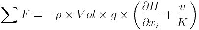

As stated above acceleration is soil is neglectible and so the resultant of forces are zero meaning that exists a balance between the forces, resulting in Darcy Law:

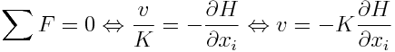

The latter equation descritized to a control volume:

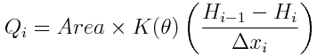

The temporal descritezitation of the equation is explictic since the velocities are computed based on last hydraulic heads and conductivites. For a more detailed description of the computations visit the PorousMedia and PorousMediaProperties pages.
