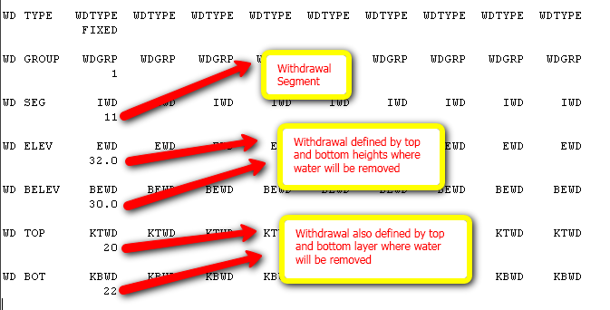

# Eutrofização Albufeiras

## Overview

It is intended to produce a step-by-step procedure to run reservoir model CE-QUAL-W2

## Where to Start?

1. If you need to have first insights on CEQUAL-W2 model, applications already done see \\\\datacenter\\Albufeiras\_Eutrofizacao\\ComoFazer\\0.Bibliografia
2. If you already feel ready to start, initiate with collecting all the data available for your reservoir and watershed in snirh ([http://snirh.pt](http://snirh.pt)). First use the shapes in \\\\datacenter\\Albufeiras\_Eutrofizacao\\Produtos\\ProjectosGIS\\ShapesBase to check which flow and quality stations are in the reservoir and watershed. Then, go to snirh to download the **desired** data from that stations.
3. Follow the steps in \\\\datacenter\\Albufeiras\_Eutrofizacao\\ComoFazer

## Tasks

### 1.Get Input Data

**Water Quantity in the reservoir**

1. Go to [http://snirh.pt](http://snirh.pt)
2. For water quantity in the reservoir click "Albufeiras->Dados de base".
3. Choose your desired station (reservoir name) and click "Seleccionar estações"
4. click "Validar Lista". Check below which parameters to choose to download (holding shift or ctrl while clicking will perform multiple selections)
5. After all desired parameters selected, click "Ver/Guardar Dados"
6. Wait until all data is dowloaded and the click upper right button "Export CSV"
7. Choose a folder and a name for your file (use the recommended folder structure and a name that identifies the type of data)
8. Open and transform your data using "Data->Text to Columns" then save the .csv file into excel .xls.

List of input data needed:

```
Consumo agrícola mensal
Consumo municipal mensal
Descarga de fundo mensal
Descarga de superfície mensal
Volume armazenado mensal (final do mês)
```

```
Cota da Albufeira - recommned to download together with the next to a different file because is daily data (sometimes also hourly)
Volume armazenado (convencional) - recommned  to download together with the previous to a different file because is daily data
```

**Water Quality in the reservoir**

1. Go to [http://snirh.pt](http://snirh.pt)
2. For water quality in the reservoir click "Rios->Dados de base(qualidade)".
3. Choose your desired station (reservoir name) and click "Seleccionar estações"
4. click "Validar Lista". Check below which parameters to choose to download (holding shift or ctrl while clicking will perform multiple selections)
5. After all desired parameters selected, click "Ver/Guardar Dados"
6. Wait until all data is dowloaded and the click upper right button "Export CSV"
7. Choose a folder and a name for your file (use the recommended structure)
8. Open and transform your data using "Data->Text to Columns" then save the .csv file into excel .xls.

List of input data needed:

```
Temperatura da amostra
Transparência
Nitrato Total (em NO3)
Amónia Total  (em NH4)
Nitrito Total (em NO2)
Azoto Orgânico(ou Azoto Kjeldahl)
Azoto Total
Ortofosfato Total
Fósforo Total
Clorofila-a
Fitoplancton ... (Espécies de algas - normalmente não existe esta informação)
Sólidos Suspensos Totais
Oxigénio dissolvido (normalmente aparecem vários)
CBO 5dias
Ferro dissolvido
Ferro total
Ferro particulado
```

**Meteorology** - need to know which station are closer. Use ArcGIS, reservoir and station shapefiles in \\\\Datacenter\\Albufeiras\_Eutrofizacao\\Produtos\\ProjectosGIS\\ShapesBase to check them. See the video using MOHID GIS in [http://screencast.com/t/vOa6esZAjFL](http://screencast.com/t/vOa6esZAjFL)

1. Go to [http://snirh.pt](http://snirh.pt)
2. For meteorology click "Meteorologia->Dados de base".
3. Choose your desired stations and click "Seleccionar estações"
4. click "Validar Lista". Check below which parameters to choose to download (holding shiftor ctrl while clicking will perform multiple selections)
5. After all desired parameters selected, click "Ver/Guardar Dados"
6. Wait until all data is dowloaded and the click upper right button "Export CSV"
7. Choose a folder and a name for your file (use the recommended structure)
8. Open and transform your data using "Data->Text to Columns" then save the .csv file into excel .xls.

List of input data needed:

```
Temperatura do ar média diária
Humidade relativa média diária  - for dew point calculation
Velocidade do vento médio diário
```

```
Direcção do vento horário - recommned to download to a different file because is hourly data
```

**Water Quantity in the incoming rivers** - need to know which station are in the inflowing rivers. Use ArcGIS, reservoir, river and station shapefiles in \\\\Datacenter\\Albufeiras\_Eutrofizacao\\Produtos\\ProjectosGIS\\ShapesBase to check them. See the video using MOHID GIS in [http://screencast.com/t/vOa6esZAjFL](http://screencast.com/t/vOa6esZAjFL)

1. Go to [http://snirh.pt](http://snirh.pt)
2. For water quantity in the river click "Rios->Dados de base(quantidade)".
3. Choose your desired station and click "Seleccionar estações"
4. click "Validar Lista". Check below which parameters to choose to download (holding shift or ctrl while clicking will perform multiple selections)
5. After all desired parameters selected, click "Ver/Guardar Dados"
6. Wait until all data is dowloaded and the click upper right button "Export CSV"
7. Choose a folder and a name for your file (use the recommended structure)
8. Open and transform your data using "Data->Text to Columns" then save the .csv file into excel .xls.

List of input data needed:

```
Caudal médio diário
Nível médio diário (se não existir caudal)
```

**Water Quality in the incoming rivers**\- need to know which station are in the inflowing rivers. Use ArcGIS, reservoir, river and station shapefiles in \\\\Datacenter\\Albufeiras\_Eutrofizacao\\Produtos\\ProjectosGIS\\ShapesBase to check them. See the video using MOHID GIS in [http://screencast.com/t/vOa6esZAjFL](http://screencast.com/t/vOa6esZAjFL)

1. Go to [http://snirh.pt](http://snirh.pt)
2. For water quality in the river click "Rios->Dados de base(qualidade)".
3. Choose your desired station and click "Seleccionar estações"
4. click "Validar Lista". Check below which parameters to choose to download (holding shift or ctrl while clicking will perform multiple selections)
5. After all desired parameters selected, click "Ver/Guardar Dados"
6. Wait until all data is dowloaded and the click upper right button "Export CSV"
7. Choose a folder and a name for your file (use the recommended structure)
8. Open and transform your data using "Data->Text to Columns" then save the .csv file into excel .xls.

List of input data needed:

```
Temperatura da amostra
Nitrato Total (em NO3)
Amónia Total  (em NH4)
Nitrito Total (em NO2)
Azoto Orgânico(ou Azoto Kjeldahl)
Azoto Total
Ortofosfato Total
Fósforo Total
Clorofila-a
Fitoplancton ... (Espécies de algas - normalmente não existe esta informação)
Sólidos Suspensos Totais
Oxigénio dissolvido (normalmente aparecem vários)
CBO 5dias
Ferro dissolvido
Ferro total
```

How to prepare input data for model to run see \\\\datacenter\\Albufeiras\_Eutrofizacao\\ComoFazer\\1.PreparaInputs

### 2.Check Data

**Note** It is important to check input data for a) outliers b) detection limit values c) understanding the reservoir or river dynamic. As so, always perform time serie graphs for each property or/and flow. Also ploting several related properties (e.g. nutrients and chlorofila) or several meteorological stations will help in understanding the data consistency.

### 3.Create Bathymetry

#### Prepare Carta Militar

1. See in which "carta militar" your reservoir is in, opening in MOHID GIS the reservoir shapefiles and the file Portugal\_cartas.img (as Background Image) from \\\\datacenter\\Albufeiras\_Eutrofizacao\\Produtos\\ProjectosGIS\\imagens
2. Go to \\\\Kepler\\DataCenter1\\DataCenter\\DadosBase\\Terra\\Cartas Militares. The folders are named with the range number of the "carta militares". Enter in the directory where your carta is and copy it to your directory.
3. Check if the .jpg file is associated with one .jpgw. If it is, you can proceed to the next step. If not search for assistance.
4. Open your just copied image in MOHID GIS using the steps in [How to Import georeferenced images in MOHID GIS](background-image.md)

#### Use Carta Militar and some drawing to get reservoir geometry

1. Check your NPA ("Nivel de Pleno Armazenamento"), the maximum height ("Cota do coroamento") and the elevation over the natural terrain ("Altura acima do terreno natural") of your reservoir at [http://cnpgb.inag.pt/gr\_barragens/gbportugal/Lista.htm](http://cnpgb.inag.pt/gr_barragens/gbportugal/Lista.htm)
2. If your reservoir appears in the Carta Militar, check if the water surface represented is the NPA by checking if it's the same height around the waterbody than the pointed in the NPA; However, if the reservoir does not appear in the Carta Militar (only the river prior to the costruction), draw the inundated area at NPA (insert polygon in MOHID GIS).
3. Draw lines where top geometry of the reservoir (or NPA) changes to help you define the next steps.

#### Create the reservoir bathymetry

1. To create the bathymetry there are two excel files in \\\\Datacenter\\Albufeiras\_Eutrofizacao\\ComoFazer\\1.PreparaInputs\\2.Batimetria\\Geometria. One is the tool if your reservoir appears in Carta Militar and the other if it wont.
2. Follow specific instructions for the filling of excel file in \\\\Datacenter\\Albufeiras\_Eutrofizacao\\ComoFazer\\1.PreparaInputs\\2.Batimetria\\Geometria\\HowtoUseExcelFiles.txt
3. Open W2i Program in \\\\Datacenter\\Albufeiras\_Eutrofizacao\\ComoFazer\\1.PreparaInputs\\2.Batimetria\\W2i. This program will generate the cequal bathymetry file.
4. Select "New Build" and browse for the excel file that you just did.
5. W2i will produce bathymetry file and other cequal input files.
6. Select now in W2i "View Bat" and browse in the excel folder for the w2\_con.npt file that W2i produced.
7. Check if your bathymetry is like you imagined it!

#### Validate your bathymetry

1. Check total volume of your reservoir (in INAG page above) with obtained with the total volume of your geometry (may compute in the excel bathymetry file or use W2i to get reservoir volume curve ("view bat") and then "Volume = f(Height)" and see volume at the higher "cota" - represents the total volume).
2. For a finer comparison use W2i to get reservoir volume curve (cotas vs volume) in "view bat" and then "Volume = f(Height)" and compare it with water quantity in the reservoir downloaded (first step of this tutorial) - "cota" and "volume armazenado" - check the video Step 3 at the bottom of the page

### 4\. Run CE-QUAL model

#### What is CeQual?

See video link in [http://www.screencast.com/t/9HMApeM21VPs](http://www.screencast.com/t/9HMApeM21VPs) or video file (larger screen) in \\\\Datacenter\\Albufeiras\_Eutrofizacao\\Produtos\\Apresentacoes\\Videos (comofuncionacequal.swf)

##### How does the model work?

The model has a core file "w2\_con.npt" where all information about how many branches, segments, layers, water inputs and uptakes, hydrodynamic and quality parameters, output information, other files needed names... Basically has it all. All other files have their names in w2\_con.npt and model will search for them if needed. When running the executable the model will process all the information in "w2\_con.npt" and the needed information from the other files (meteorology, inflows and outflows) and the evolution with time appears (lines are printed out to screen with julian day of simulation, dt and other info).

##### How do I run the model?

After performing all the steps to prepare the model to run (next chapters), just need to double click on the .bat file present (see next steps) and that is it. The .bat file function is to pause the .exe file if program crashes in order to see error info.

#### First Run

In the first run we are going just to put the model running with less concern to boundary conditions. In order to see the project example that we are going to use go to \\\\Datacenter\\Albufeiras\_Eutrofizacao\\ComoFazer\\2.CorreCe-Qual\\ExemploFeito\_Beliche\\1.SimulacaoZero\\AdaptedToW2con The w2\_con.npt file is there and all the input files associated (.npt)

##### The w2\_con.npt file

To understand w2\_con.npt file follow cequal manual in \\\\datacenter\\Albufeiras\_Eutrofizacao\\ComoFazer\\0.Bibliografia from page 297 and on where all the keywords are explained. Take at least a couple of minutes to understand w2\_con.npt structure and type of parameters. This will be important for next steps.

##### Steps

See video link in [http://www.screencast.com/t/wWYfZPFk9t](http://www.screencast.com/t/wWYfZPFk9t) or video (larger screen) file in \\\\Datacenter\\Albufeiras\_Eutrofizacao\\Produtos\\Apresentacoes\\200908-Albufeiras (comofazerprimeirasimulacao.swf)

1. Create a new folder for the process
2. Copy to the created folder, in this order: i) the manual from \\\\datacenter\\Albufeiras\_Eutrofizacao\\ComoFazer\\0.Bibliografia; ii) the files created for your reservoir by W2i program when producing the bathymetry; Make a backup copy of the w2\_con.npt file naming it for example w2\_con\_old.npt; iii) the w2\_con.npt file, the .exe file, the .bat file, graph.npt, Cin\_Br1.npt, Qin\_Br1.npt and Tin\_Br1.npt from the Beliche project in \\\\Datacenter\\Albufeiras\_Eutrofizacao\\ComoFazer\\2.CorreCe-Qual\\ExemploFeito\_Beliche\\1.SimulacaoZero\\AdaptedToW2con (let it rewrite the files with the same name already present)
3. If you have more than one branch make copies of Qin\_br1.npt, Cin\_br1.npt and Tin\_br1.npt and rename them (e.g. Qin\_br2, Qin\_br3, Tin\_br2, ...)
4. Copy your meteo file for this run from \\\\Datacenter\\Albufeiras\_Eutrofizacao\\ComoFazer\\2.CorreCe-Qual\\meteo\_files. Use for example the one for Alentejo. In this simulation it is not important to have local climatology, that will be important in the next run.
5. Now is time to convert the w2\_con.npt from the Beliche project to your reservoir project. W2\_con.npt file is very strict on where keywords and values are aligned. As so, try to follow the structure already initiated. **IMPORTANT: Always have the cequal manual in hand to search for any keyword that you want to know what it is; after page 297 the control file (w2\_con.npt) is all detailed what parameters mean and how to fill them.**
6. Change w2\_con.npt - Here is the [list of keywords you need to change from the Beliche sample **w2\_con.npt** file](w2-con-sample.md). Insert the values that are suited for your reservoir.
7. Change w2\_con.npt - The above example (Beliche reservoir) has 3 branches. However, w2\_con.npt needs for some parameters one line per branch even if parameters are not defined or left blank (this is mandatory and if you do not do it program will not run). So if you have more than 3 branches add one line with branch number for each branch when appears "Br1" "Br2" "Br3" in w2\_con, or delete all the lines with "Br2" and "Br3" if you have for instance only one branch. Deleting a line does not mean clear its content and left it blank, it means the file needs to have one less line (all the text below will go up). Adding a line means a new line in text (all the text below will go down).
8. Change other files - Remind that the number and order of concentrations species in Cin.npt is controled in "CIN" keyword in w2\_con.npt file. This is a remind task do not need to do anything but it will be important in a real simulation.
9. Change other files - Also remind to give initial and final date inputs (Qin.npt, Cin.npt, Tin.npt or wsc.npt) that comprise the simulation period. This has to be done only on WSC.npt because Qin.npt, Cin.npt and Tin.npt were copied from Beliche.
10. Run the program double clicking in the .bat files and hope there will be no error messages. If error message is something like "input conversion error" and the file name that points is w2\_con.npt it is because you failed to adapt your w2\_con.npt file. Reinspect file and look for "Br1" Br2" "Br3" to have always all your branch numbers. Look for things dependent on geometry as for example remind tat "S DEMAND" keyword requires one value for each segment wich means that you may have to add or delete values in order to have as many values as segments.

#### Running with local boundary conditions

##### Prepare Meteorology data

Use the meteorology data downloaded in step 1 to prepare monthly averaged data (that will be looped in the simulation). The looping meteorology is necessary if data is unavailable for all reservoir runs or has gaps.

It should be prepared average monthly temperatures and dew point. For now use wind velocity, wind direction and cloud cover from the template files Met\_Alentejo or Met\_Norte in \\\\Mohidland\\Albufeiras\_Eutrofizacao\\ComoFazer\\1.PreparaInputs\\1.Dados\\Meteorologia\\meteo\_files. Wind effect on surface water may be dependent on events and not represented by monthly averages (at least for velocity).

How to calculate the Dew point, extracted from Wikipedia, the most simple equation is:

$T_d = T - \frac {(100 - RH)} {5}$

- **Td** = Dew point temperature.
- **T** = Temperature in degrees
- **RH** = Relative humidity.

Fist of all create an worksheet file with the following columns:

```
JDAY = Julian Day
TAIR = Air Temperature (ºC)
TDEW = Dew Temperature (ºC)
WIND = Wind Speed (m/s - Use the original for now)
PHI = Angle (radians - Use the original for now)
CLOUD = Cloud Cover (Use the original as there is not way to calculate it)
```

Create monthly averaged values for air temperature and dew point obtained from the meteorological files download at the beginning of the proccess from [http://snirh.pt](http://snirh.pt).

If want to use wind directions from site that are different from the original and may have important effect, it is going to be necessary to modify the winds from degrees into radians. Use the following formulas for that purpose:

```
u = - sin(WDdeg*pi/180)
v = - cos(WDdeg*pi/180)
then do monthly averages of u and v

Compute the mean angle for each month in radians:
WDrad = 3.*pi/2. - ATAN2(u,v)
if (WDrad > 2*Pi) WDrad = WDrad - 2*Pi

being
u = x-wind component
v = y-wind component
WDdeg = wind direction in degrees (º)
WDrad = wind direction in radians
```

To obtain a input file in the Ce-Qual format it can be used the code located in \\\\datacenter\\Albufeiras\_Eutrofizacao\\ComoFazer\\1.PreparaInputs\\1.Dados\\Load\_CeQualW2\_2\\Debug.

Substitute the name of the meteorological file for the name of your file then run Ce\_Qual.bat and if everything is ok, the model with iterate and will show at the end the message " Normal termination".

##### What will be the simulation period

Simulation period must be at least 10 years to have the effect of internal loads (P from the sediments). We will take all the data on water elevation (or volume) and use them. If this period is still less than 10 years than it can be used a constant water level (outflow = inflow) in order to have the inflows loading the reservoir.


Simulation Period

##### Run SWAT Model for river inputs

It was defined the strategy for river input entering in the reservoir and to take into account flow and concentrations. Data in the river usually do not exist, or when exist the periods where we have both flow and concentrations at the same time is very limited, we will use SWAT as the model for boundary river simulation. The field data when exists will be used for validation.

1. See [How to Install SWAT](../tools/gui/install-swat-interface.md)
2. See [How to run SWAT model](../tools/gui/README.md#run-swat-model#run-swat-model) for your reservoir watershed.

Check the videos in \\\\datacenter\\Albufeiras\_Eutrofizacao\\Produtos\\Apresentacoes\\Videos (SWAT part 1 to 4)

##### Define CEQUAL Inflows/Outflows

###### Water Inflows and Outflow

It has to be defined water flows in the river and water outflow in the reservoir wall. This can be done i) with data or ii) using SWAT as inputs and computing outflow from reservoir volume balance. Usually there is no data or lack of data for the entire simulation period so SWAT is used and validated with data when exists.

To compute water inflow from SWAT and water outflow in the dam, use as template the files in \\\\datacenter\\Albufeiras\_Eutrofizacao\\ComoFazer\\1.PreparaInputs\\4.CalcularDescarga\\CalculaCaudaisPCeQual.xls. These are a brief description of the tabs you will find in the file:

- **VolumeAlbufeira tab:** The monthly values calculated before should be placed here
- **NortBranchSWAT tab:** In this example there are two branches, place here the corresponding outcoming columns of the SWAT model. Check the extents of your data column!!.
- **SouthBranchSWAT tab:** The second branch.
- **CalculaOutflow tab:** In this one is where the calculus are made.
- **TSforCeQUAL tab:** The results expressed with the Ce-Qual model format.
- **RunCaudal tab:** Results comming from the Ce-Qual run.
- **GraphCota tab:** Graph of comparison between observed and Ce-Qual results for validation.

1. It is needed to define the water leaving the reservoir from the wall (and accounting for the lack of precipitation/evaporation). Doing that is accomplished with input flow and reservoir volumes using DVol = Volin - VolOut and VolOut = VolIn - DVol where Dvol is variation in volume of the reservoir in one day (Volfin - Volini), VolIn is volume in the inflow in one day (from all branches from SWAT) and VolOut is the estimated volume exiting the reservoir. If there is no data for daily volume, "cota" can be transformed in volume with "curva de volumes".
2. Convert date to julian days (**remind that julian day 1 is the 1st of January of the beggining year of simulation for all files!!**)
3. Copy the data (date and outflow) without headers to a text file
4. Use the program in \\\\datacenter\\Albufeiras\_Eutrofizacao\\ComoFazer\\1.PreparaInputs\\1.Dados\\Load\_CeQualW2\_2\\Debug (Load\_CeQualW2\_WD.exe) to create the files that you need (the program puts 8 characters to each column).
5. Flow in and out file is done.
6. In w2\_con.npt, make sure that interpolation for flow is OFF.

```
INTERPOL   QINIC
BR1          OFF
BR2          OFF
```

1. In w2\_con.npt, name the inflow files:

```
QIN FILE..................................QINFN.................................
BR1     Qin_Br1.npt
BR2     Qin_Br2.npt
```

1. Modify the year and the Julian Day and final day of the simulation in the W2\_con.npt file

```
TIME CON  TMSTRT   TMEND    YEAR
             32. 6635.00    1990
```

1. In w2\_con.npt, name the outflow files:

```
QWD FILE..................................QWDFN.................................
       Qwd.npt
```

1. It is needed to connect the water withdrawal (flow out) in w2\_con.npt - NWD

```
N/OUTFL     NTR     NST     NIW     NWD     NGT     NSP     NPI     NPU
              0       0       0       1       0       0       0       0
```

1. It is needed to define where (segment, layers) where water will be removed.

    

    Withdrawall Definition

2. **Attention: the water elevation in the beggining of the simulation must be that of the first volume considered in the computation of outflow or the computed flows will produce not realistic heights**. Initial elevation can be changed in bathymetry file (Water surface elevation 

$$
ELWS
$$

 values in the file Bth\_wb1.npt should match the first values of your Cota (m) values).

###### Concentration Inflows

It has to be defined concetrations inflows in the river. This can be done i) with data or ii) using SWAT as inputs and computing outflow from reservoir volume balance. Usually there is no data or lack of data for the entire simulation period so SWAT is used and validated with data when exists.

As we are using monthly flows concentrations used have to be consistent with that flow producing the same loads. There is an excel file to do that, from the SWAT file computes monthly concentrations for each specie that are consistent with mass conservation.

1. It is needed to create the concentrations from SWAT as input files for each branch in CE-QUAL: use the .rch files from SWAT selected in the previous steps as reach inputs to CE-QUAL, open them and copy to excel.
2. Use the template from \\\\datacenter\\Albufeiras\_Eutrofizacao\\ComoFazer\\1.PreparaInputs\\4.CalcularDescarga\\CalculoPropPCeQual\_Br1.xls
3. You will need not to preprocessor SWAT .rch file and all steps are described in first sheet.
4. **Check that O2 concentrations are not bigger than 10 mg/l** if they are (like hundreds or thousands) do not use them (see below).
5. Copy the data in final sheet (date and concentrations) without headers to a text file (one file for each branch)
6. Use the program in \\\\datacenter\\Albufeiras\_Eutrofizacao\\ComoFazer\\1.PreparaInputs\\1.Dados\\Load\_CeQualW2\_2\\Debug (Load\_CeQualW2\_WD.exe) and select option 9, (or 10 if its without oxygen conc.), to create the files that you need (the program puts 8 carachters to every column).
7. Concentration input file is done (remind one for each branch).
8. Check in w2\_con.npt that concentration interpolation (DTRIC) is off so that massa balances get right at the end of the month.

```
INTERPOL   QINIC   DTRIC    HDIC
BR1          OFF     OFF     OFF
BR2          OFF     OFF     OFF
```

1. In w2\_con.npt, make sure that you have the right species ON - the order of the species in the input file must be the same as appears in this block, so adding a new specie in the input file has to be done after checking in this block what order insert and putting it **ON**.

```
CIN CON   CINBRC  CINBRC  CINBRC  CINBRC  CINBRC  CINBRC  CINBRC  CINBRC  CINBRC
TDS          OFF     OFF     OFF
AGE          OFF     OFF     OFF
ECOLI        OFF     OFF     OFF
CONDUCT      OFF     OFF     OFF
ISS1          ON      ON      ON
PO4           ON      ON      ON
NH4           ON      ON      ON
NO3           ON      ON      ON
DSI          OFF     OFF     OFF
PSI          OFF     OFF     OFF
FE           OFF     OFF     OFF
LDOM         OFF     OFF     OFF
RDOM         OFF     OFF     OFF
LPOM          ON      ON      ON
RPOM         OFF     OFF     OFF
Diat          ON      ON      ON
Clor          ON      ON      ON
BGALG         ON      ON      ON
DO            ON      ON      ON    It should be OFF in case of not running with oxygen (SWAT concs bigger than 10 mg/l)
TIC          OFF     OFF     OFF
ALK          OFF     OFF     OFF
ZOO          OFF     OFF     OFF
```

1. In w2\_con.npt, name the inflow concentration files:

```
CIN FILE..................................CINFN.................................
BR1     Cin_Br1.npt
BR2     Cin_Br2.npt
```

###### Temperature Inflows

1. It is needed to create the temperature as input files for each branch in CE-QUAL: in the first SWAT runs WQ in the river is not connected so temperature is not active. So it is going to be used meteorological data for temperature (e.g. use temperature data created for the meteo file - average monthly temperatures).
2. Use the first two collumns (julian day and temperature) from the meteorology file.
3. Temperature input file is done (remind one for each branch)
4. In w2\_con.npt, name the temperature files:

```
TIN FILE..................................TINFN.................................
BR1     Tin_Br1.npt
BR2     Tin_Br2.npt
```

### 5\. Evaluating Results

TSRC = Should be on for getting output timeseries.

NITSR = Number of Timeseries.

TSR LAYE = Layer for each timeseries.

TSR FREQ = Period timeseries in days (shoud be 1).

TSR SEG = Segment for each timeseries.

```
TSR PLOT    TSRC    NTSR   NITSR
              ON       1       5
TSR LAYE    ETSR    ETSR    ETSR    ETSR    ETSR    ETSR    ETSR    ETSR    ETSR
         -40.00  -30.00  -20.00  -10.00   0.000
```

Result timeseries files are .opt

First step is to look only on the water elevation to see if the model is reproducing reality. If not, and if initial water height and flows were well computed than you should see small differences that may grow with time. This are created when an estimated flow was negative (assumed zero) and it must be compensated changing flows.

After water elevation is right than water quality comparison with field data can be done (**remind that CEQUAL input and output units are mgN/l and mgP/l for nutrients**). For that there will be used the three xls files found in \\\\datacenter\\Albufeiras\_Eutrofizacao\\ComoFazer\\3.AnalisaOutputs

- Roxo\_ClhaGeoMean.xls: To calculate the Chl a geometric average for the period april-september. (Tip: use the filter tool to select the data between these two months.)
- Roxo\_EstratificacaoModelovsDados.xls: To compare the temperature variation with depth in case that the study case have available data for different depths. If not it is used to comapre the temperature observations with the model results. The temperature will modify the hydrodynamics and in the WQ results.
- Roxo\_WQModelovsDados.xls: To perform a fast comparison of the Chla, nutrients, suspended solids, oxygen time series between the model and the observations (it is needed to input the INAG data for the nutrients as it is performed for the ROXO. Also there are sheets with monthly average of the observations and the model for a better understanding of the system. (Tip: Use the pivot table tool to calculate the monthly values for each variable).

## FAQ

**Q: What is the software that I need to install?**

A: For Cequal you only will need an .exe file that will be distributed. For the first steps you will need any GIS software that opens shapefiles and georeferenced images ([MohidGIS](../tools/gui/mohid-gis.md), [MapWindow](http://www.mapwindow.org/), ArcGIS, etc.). If any doubt on how to install them call David. [Mozilla Firefox](http://www.firefox.com/) or IE will work fine in [http://snirh.pt](http://snirh.pt)

**Q: Where do I find data?**

A: All the data needed up to now is from [http://snirh.pt](http://snirh.pt). Water flows in the reservoir, water height and volumes are taken from "Albufeiras" network. However, water quality in the reservoir is taken from "Rios->Dados de base (qualidade)"; this may cause confusion because reservoir data is in river network. Water flow and water quality entering in the reservoir from tributaries are taken from "Rios->Dados de base (qualidade)" and "Rios->Dados de base (quantidade)" - remember to check first which stations are inside the reservoir watershed.

**Q: What is the desired period time of the simulation?**

A: The desired period of simulation is around 10-20 years. The best practice is not to filter data (as much of it e.g. water quality has not yet reached 10 years) because all the data may be needed.

**Q: My excel 2003 doesn't open big csv files (with more than 65545 lines. What can I do?**

A: Use excel 2007. Use Data-->TextToColumns to spread your csv data on several columns.

**Q: How to convert excel dates into Julian dates?**

A: Define a year where to start as for example 1990 (e.g. first year of simulation). 1-1-1990 will be your julian day 1, all other days will be in this reference. To convert excel dates to julian dates in this example do Julian date = Excel Date - (1-1-1990) + 1, meaning that you have to subtract all excel dates with the date of your first julian date (1-1-1990 in the example) and add 1 because 1-1-1990 has to be day one and not day zero, and so on.

**Q: O braço dum afluente encaixa na margem errada do braço principal. Como posso indicar para o afluente encaixar na "outra margem"?**

A: Tenta mudar a orientação do segmento do braço principal (o segmento aonde se vai encaixar o braço do afluente). Mudar a orientação do segmento do afluente que encaixa no braço principal não serve de nada. Eis um exemplo: [antes](http://screencast.com/t/8aVSsw8L6pwT) e [depois](http://screencast.com/t/hYzZ5v6G).

**Q: Quais são as palavras-chave no ficheiro w2\_con.npt que dependem do número de segmentos e do número de camadas?**

A: **S DEMAND** depende do número de segmentos.

**Q: Como criar ficheiros .dbf no Office 2007?** A: **Utilizar o Access para fazer as tabelas e exportar com CSV**

## Support Material

- The kick-off internal meeting video is available at \\\\datacenter\\Albufeiras\_Eutrofizacao\\Produtos\\Apresentacoes

- For information about the dam for each reservoir: [http://cnpgb.inag.pt/gr\_barragens/gbportugal/Lista.htm](http://cnpgb.inag.pt/gr_barragens/gbportugal/Lista.htm) or [http://www.ccdr-a.gov.pt/app/relatorios/raa\_2004/](http://www.ccdr-a.gov.pt/app/relatorios/raa_2004/) or [http://snirh.pt/snirh.php?main\_id=1&item=2.1&objlink=&objrede=](http://snirh.pt/snirh.php?main_id=1&item=2.1&objlink=&objrede=)

### Video tutorials

- [Step 0 - identify your Albufeira in MOHID GIS!](http://screencast.com/t/vOa6esZAjFL)
- [Step 3 - Validate your reservoir geometry with reservoir data - "Curva de volumes"](http://www.screencast.com/t/UJFWoHXgOv)
- [Step 4.0 - How model works/runs](http://www.screencast.com/t/9HMApeM21VPs)
- [Step 4.1 - First Model Run](http://www.screencast.com/t/wWYfZPFk9t)
