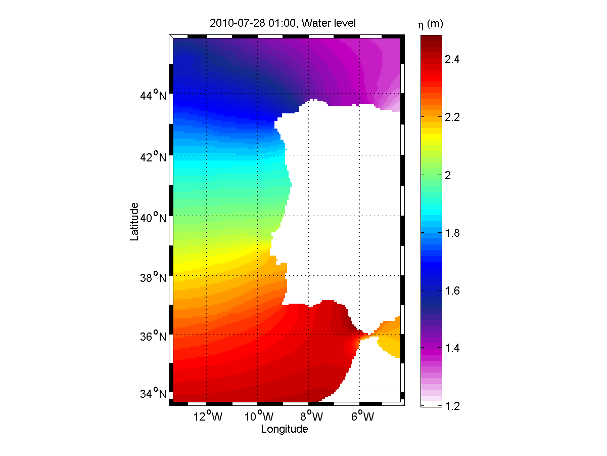
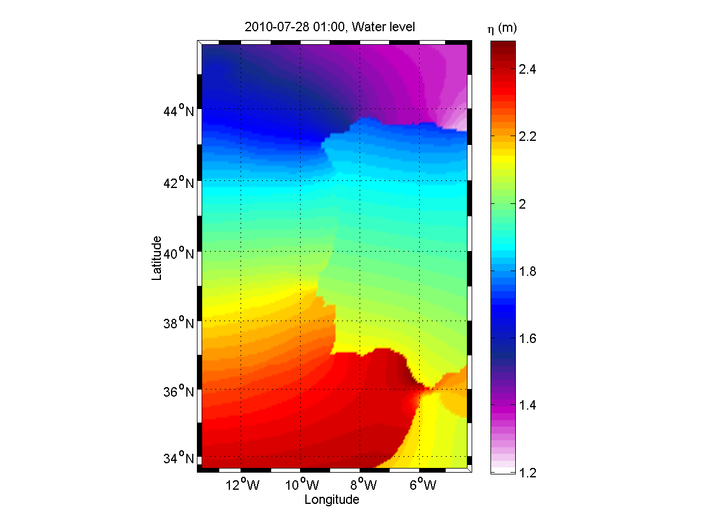
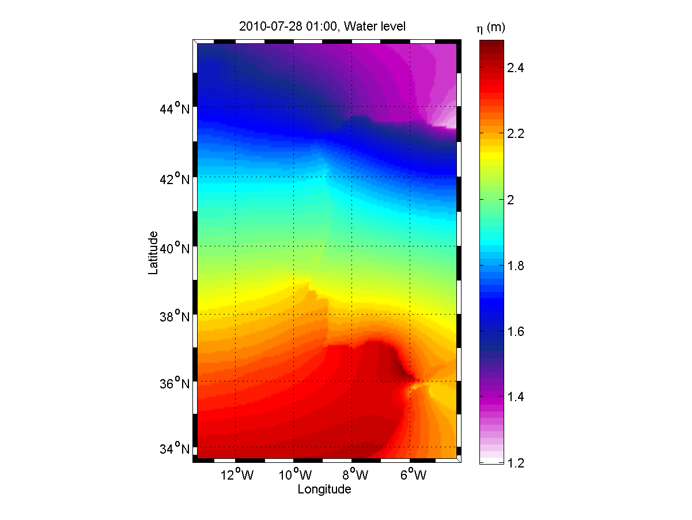
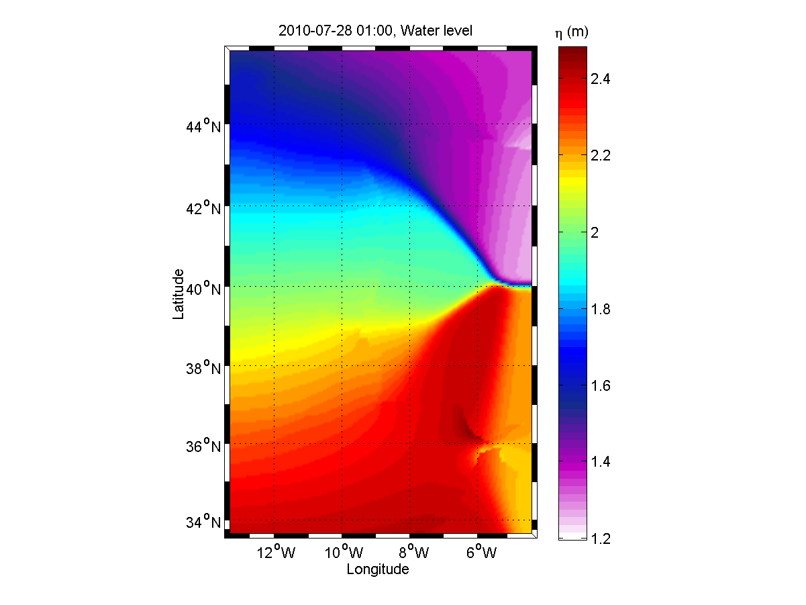

# Extrapolation

Extrapolation is often required when interpolation techniques cannot be used; often when mapping information from one dataset to a grid. Extrapolation methods vary, yielding different results both in quality and in performance. This article proposes a couple of simple extrapolation techniques that use all the available information to extrapolate. The techniques are inspired from the weighted average principle.

## Weighted Average

Suppose that you have a discrete dataset $I$, with coordinates $X$ on a normed space, $d\left(.\,,\,.\right)$, and that you want to map the dataset to another dataset, $O$, with a new set of coordinates $Y$. The operation is performed by constructing mapping coefficients $w$, also called "weights", and by performing a linear combination of the elements of $I$ with the weights, $w$, to compute each element of $O$.

$O_k = \frac{ \sum_i w_{ki} \, I_i }{\sum_i w_{ki}};$

Any method of constructing the weights is valid (as long as $\sum_i w_{ki} \neq 0$ ) and depends on the nature of the mapping. A practical use-case consists in performing an interpolation/extrapolation of the data from $I$ to $O$ and thus the weights $w$ are usually a function of the coordinates $X$ and $Y$ and of the norm of the space. More complex techniques could be used, with $w$ also as a function of $I$ and its derivatives, but these will not be considered in this text.

## Geometric Weighted Average

The geometric weighted average is the most intuitive approach: it calculates the geometric average of a set of values/points pairs at a given point. The idea is that closer points should have a bigger weight than farther points in the weighted average. In this case, the weight is inversely proportional to the distance:

$w_{ki} = \frac{1}{d\left(X_i,\;Y_k\right)}$

## Squared Weighted Average

The same as above, except that the squared norm is used instead of the norm. This gives an even bigger weight to the points that are closer when compared to the geometric average, proportionally to the inverse of the squared distance. Using the euclidean norm, this is the fastest of the three algorithms proposed in this text.

$w_{ki} = \frac{1}{d^2\left(X_i,\;Y_k\right)}$

## Gaussian Weighted Average

A [gaussian](http://en.wikipedia.org/wiki/Gaussian_function) weighted average allows to determine characteristic radius of influence, $\sigma$, where, within that radius, the points of $I$ will have a total weight of 68% in the average relative to the other points of $I$. This radius of influence parameter is useful to parameterize the interpolation/extrapolation. Choices can be made such as choosing a shorter radius when the interpolating dataset shows greater variability or such as choosing a larger radius when the interpolating dataset displays a smoother variability. The isotropic gaussian function is given by:

**w\_{ki} = \\e{\\left(-\\frac{ d^2\\left(X\_i,\\;Y\_k\\right)}{\\sigma^2}\\right)}**

Of course, non-isotropic elliptical gaussian could be used instead, but being more complex, a physical rationale to use them would also be expected. The rationale behind the use of the simple isotropic gaussian is that the user intuitively wants to define a circle of influence of the extrapolating field in the extrapolated points. And this radius is a function of the specific characteristics of the field to extrapolate (smoothness, constrast, periodicity, etc...).

- Extrapolation methods
- 

    No extrapolation

- 

    Geometric extrapolation, $w_{ki} = \frac{1}{d\left(X_i,\;Y_k\right)}$

- 

    Squared extrapolation, $w_{ki} = \frac{1}{d^2\left(X_i,\;Y_k\right)}$

- 

    Gaussian extrapolation with $\sigma=5\%$ of the domain characteristic length (average of the width and height), **w\_{ki} = \\e{\\left(-\\frac{ d^2\\left(X\_i,\\;Y\_k\\right)}{\\sigma^2}\\right)}**

## See also

- [ConvertToHdf5](../tools/converttohdf5.md)

## External references

- [Wikipedia Gaussian Function article](http://en.wikipedia.org/wiki/Gaussian_function)
