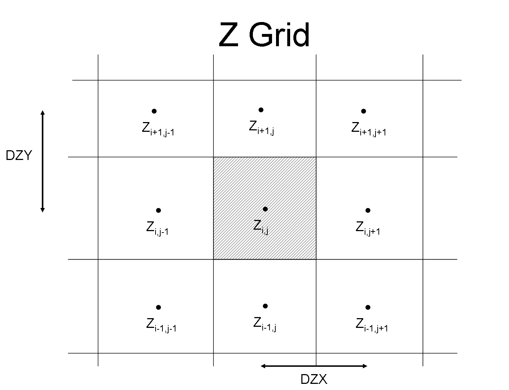
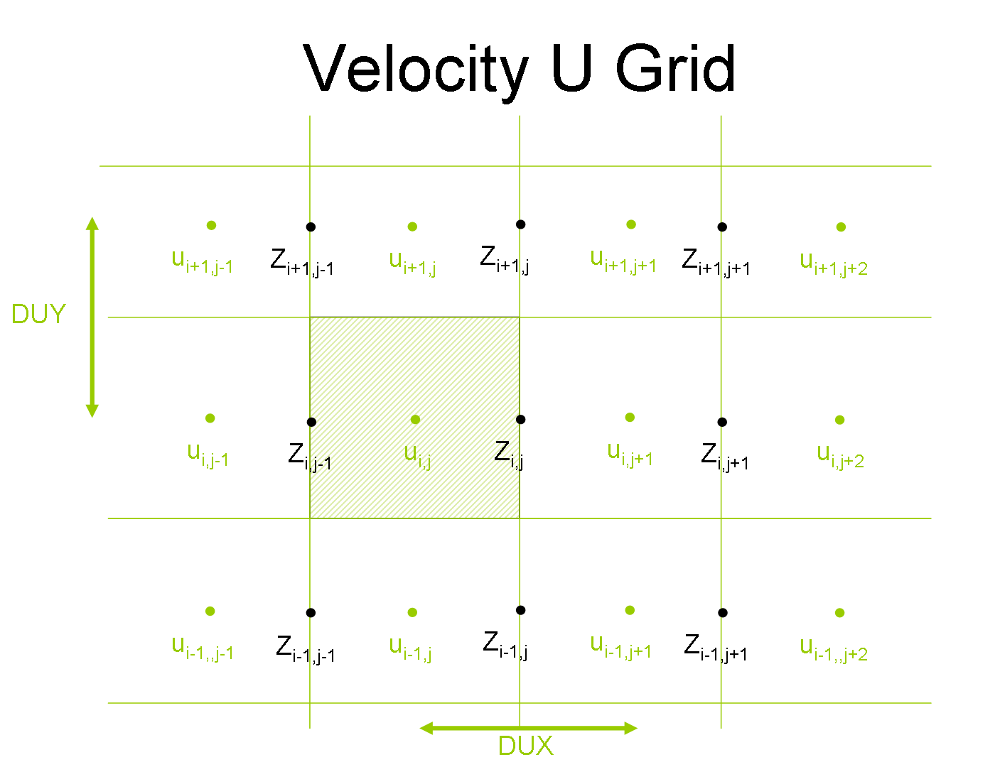
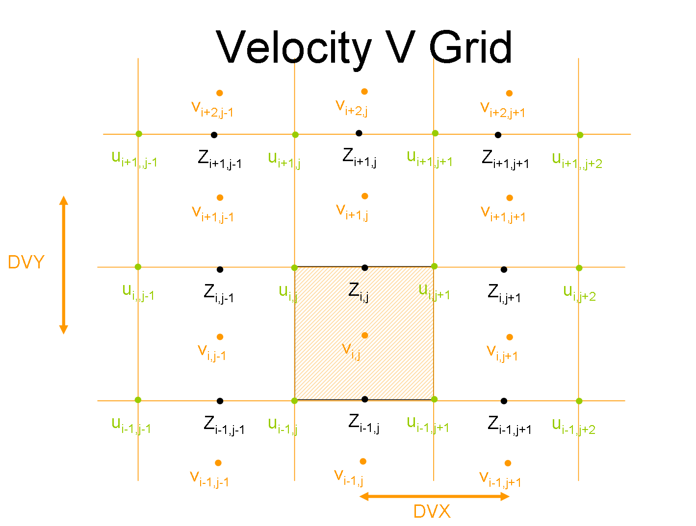
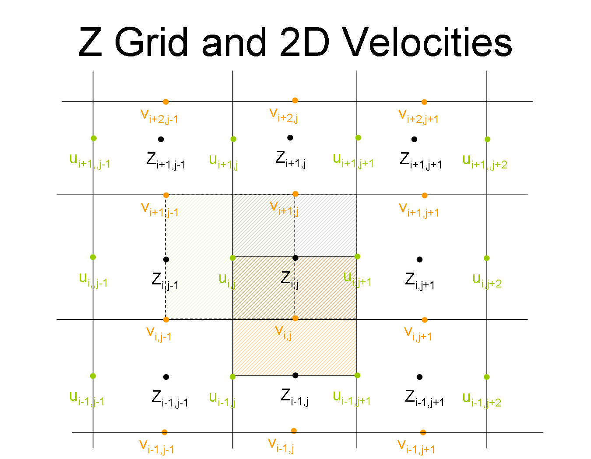

# Grids

!#redirect [Grid](../io/formats/grid.md)

Mohid uses a Arakawa type C grid as described [here](http://journals.ametsoc.org/doi/abs/10.1175/1520-0493%281988%29116%3C2069%3AASISLF%3E2.0.CO%3B2)

Below are represented the different grids in the model, increasing in complexity, from property grids, adding velocity u grids and finally adding also velocity v grids.

Model properties grid has z's (or any property) in center and conceptually are similar to model volumes or cells.

Model velocity u's are at z's grid faces, in x direction. However, in velocity u grid, velocity u's are in center. z's (or properties) lie down in grid faces

Model velocity v's are at z's grid faces, in y direction. However, in velocity v grid, velocity v's are in center. z's (or properties) lie down in grid faces and velocities u in corners. Also can be seen that velocity u's grid has velocity v's in its corners.

And finally Property grid with all the velocities and cells.

