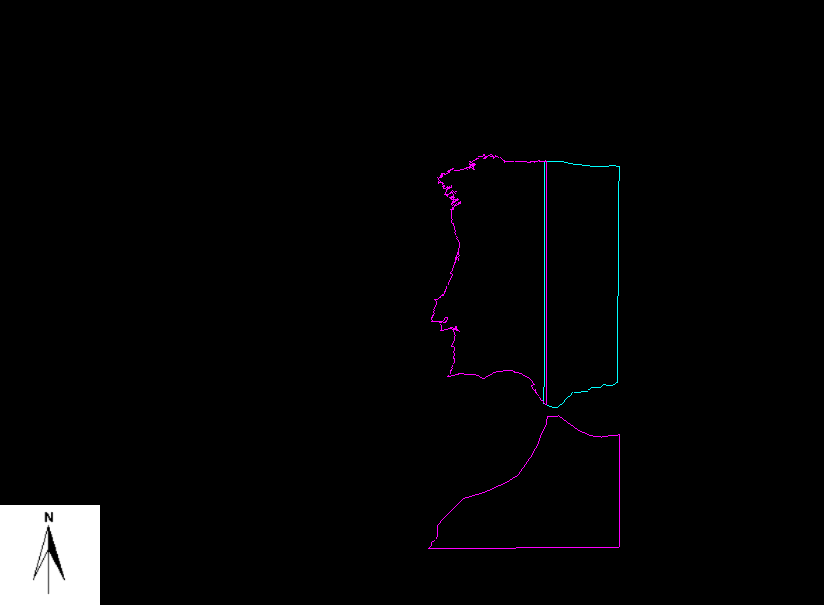

# Op Mer MH Por v1

```
NOTE: this article has been discontinued and is no longer maintained
```



**a**, **b**, **c**, **d** and **M** nested domains, corresponding respectively to **S**, **C**, **N**, **WI** and **M-O**.

Operational model of the Portuguese coast using MOHID forced with Mercator and MM5 from 20060607 to 20070607. The baseline data come from the ETOPO2 bathymetry. The external models data come from Mercator-Océan, from JDD\_MM5 and from [Fes2004](../tools/fes2004.md) or Fes95. There are 2 levels of nested domains:

1. **P** - Western Iberia coastal domain
    1.  **N** - North Portugal domain
    2.  **C** - Estremadura domain (Centre)
    3.  **S** - Algarve domain (South)

And there are 3 external models:

1. **M-O** - the Mercator solution
2. **MM5** - the JDD\_MM5 atmospheric solution
3. **WI** - a barotropic tidal solution using MOHID and the [Fes2004](../tools/fes2004.md) or Fes95 solution

The nested domain have the same baseline information for the bathymetry (from ETOPO2) and the transition is extremely [smooth](../tools/smoothbatimnesting.md). Thus, the first level domain acts as a buffer for the Mercator data to pass to the lower level and inconsistent forcing, rising from inconsistent bathymetries, is avoided.

## **P**

### Borders

#### Surface

- **MM5** winds are interpolated to the **WI** grid.
- Radiation and cloud coverage ???
- Evaporation due to radiation and wind action ???
- Pluviosity ???

#### OBC

- **M-O**s *U*, *V*, *S*, *T* are relaxed with a Flow Relaxation Scheme (FRS) to the **WI** border.
- *$\eta$* from **2D WI** is interpolated to the **WI** border ???
- *$\eta$* is radiated with a Flather radiation condition.
- Sponge layer is used (High viscosity near the open boundaries).

#### Land

- River discharges ???

#### Bottom

- Typical constant rugosity is used.

### Assimilation

- **S** and **T** are assimilated from the **M-O** solution, previously interpolated to the **WI** grid.
- **U** and **V** are assimilated from the **M-O** solution, previously interpolated to the **WI** grid..

Assimilations are performed using a simple relaxation condition: $(\Phi - \Phi^{ext})_{,\,t} = - (\Phi-\Phi^{ext})/\tau$.

### Initialization and Spin-up

- *S* and *T* are interpolated to the **WI** grid from the **M-O** solution.
- *U* and *V* are initialized with geostrophic velocities.
- $\eta$ is initialized to a constant reference level.
- During the warm up sequence (7 days) there is a slow connection of the forces ???
- The operational model runs for 7 days in **analyzed** and **prevision** mode, then calculus continuation is made for the following seven days using the new **M-O** and **MM5** datasets, and so on...

Within a month, the spin-up phase has ended and the system is operational. The system stays operational, provided that the **M-O** and **MM5** solutions keep feeding it.

## **N, C, S**

### Borders

#### Surface

#### OBC

#### Land

#### Bottom

### Initialization

### Assimilation
