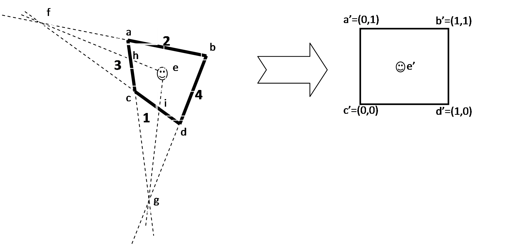

# Relative position of a particle in a cell

A fundamental in the "MOHID system" lagrangian approach is to know the relative position of the tracer in the hydrodynamic cell to speed up the interpolation procedure. This is quite easy for square cells however this not the case for cells of curvilinear grids . In this case was develop a subroutine that is able to compute the generic position of a tracer in a generic cell (see subroutine RelativePosition4VertPolygon in module functions). The algorithm used is described below.

**Relative position of tracer in a generic cell**

$y_1  = a_1  + b_1 x_1  \wedge a_1  = {{x_d y_c  - x_c y_d } \over {x_d  - x_c }} \wedge b_1  = {{y_d  - y{}_c} \over {x_d  - x_c }}$

$y_2  = a_2  + b_2 x_2  \wedge a_2  = {{x_b y_a  - x_a y_b } \over {x_b  - x_a }} \wedge b_2  = {{y_b  - y{}_a} \over {x_b  - x_a }}$

$y_3  = a_3  + b_3 x_3  \wedge a_3  = {{x_a y_c  - x_c y_a } \over {x_a  - x_c }} \wedge b_3  = {{x_a  - x_c } \over {y_a  - y{}_c}}$

$y_4  = a_4  + b_4 x_4  \wedge a_4  = {{x_b y_d  - x_d y_b } \over {x_b  - x_d }} \wedge b_4  = {{x_b  - x_d } \over {y_b  - y{}_d}}$

$y_g  = {{a_3  - a_4 } \over {b_4  - b_3 }} \wedge x_g  = a_3  + b_3 y_g$

if (b1==b2) then
$tg\alpha  = b_2$
else
$x_f  = {{a_1  - a_2 } \over {b_2  - b_1 }} \wedge y_f  = a_1  + b_1 x_f$
$tg\alpha  = {{y_e  - y_f } \over {x_e  - x_f }}$
endif

$y_h  = {{y_e  + \left( {a_3  - x_e } \right)Tg\alpha } \over {1 - b_3 Tg\alpha }} \wedge x_h  = a_3  + b_3 y_h$

if (b3==b4) then
$tg\beta  = b_3$
else
$x_g  = {{a_3  - a_4 } \over {b_4  - b_3 }} \wedge y_g  = a_3  + b_3 x_g$
$tg\beta  = {{y_e  - y_g } \over {x_e  - x_g }}$
endif

$y_i  = {{y_e  + \left( {a_1  - x_e } \right)Tg\beta } \over {1 - b_1 Tg\beta }} \wedge x_i  = a_1  + b_1 y_i$

$seg\_ac = \sqrt {\left( {x_a  - x_c } \right)^2  + \left( {y_a  - y_c } \right)^2 }$

$seg\_dc = \sqrt {\left( {x_d  - x_c } \right)^2  + \left( {y_d  - y_c } \right)^2 }$

$seg\_ic = \sqrt {\left( {x_i  - x_c } \right)^2  + \left( {y_i  - y_c } \right)^2 }$

$seg\_hc = \sqrt {\left( {x_h  - x_c } \right)^2  + \left( {y_h  - y_c } \right)^2 }$

$x_e^'  = {{Seg\_ic} \over {Seg\_dc}}$

$y_e^'  = {{Seg\_hc} \over {Seg\_ac}}$
