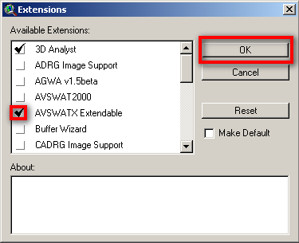
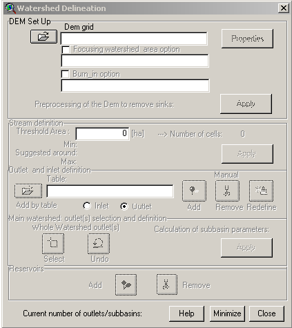
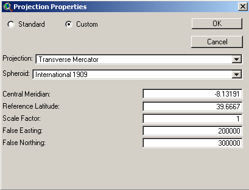
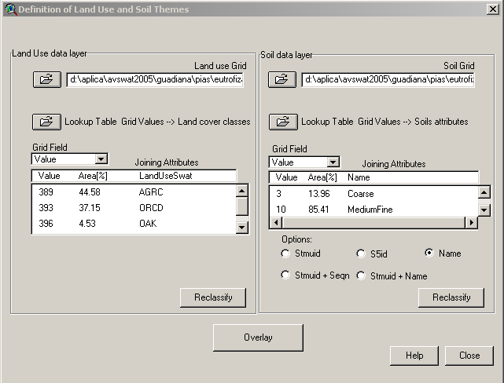
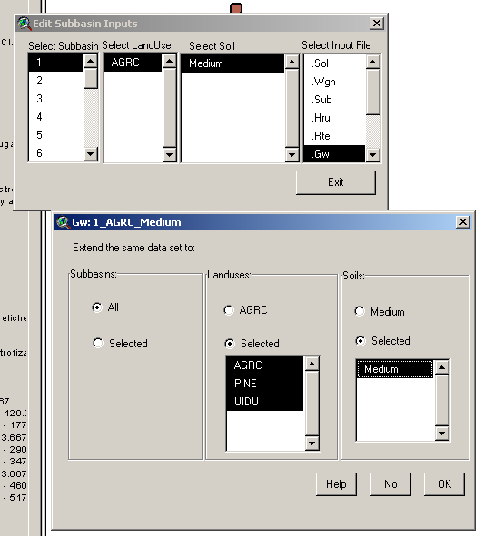
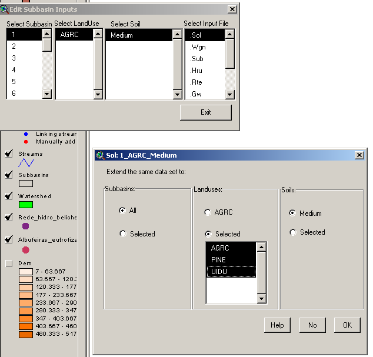
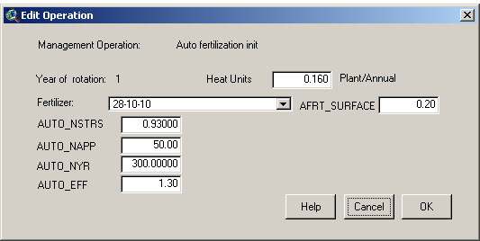
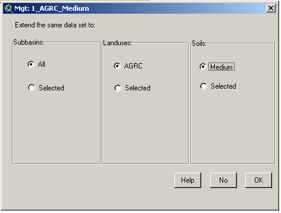

# Run SWAT Model - ArcView Interface

## SWAT Project and first simulation with default parameters

### Create the SWAT Project

1. Run ArcView
2. If a Window appears "Welcome to ArcView GIS" asking to create a new view, click "Cancel"
3. Go to menu "File"->"Extensions"
4. Click on the check box "AVSWATX extendable" and **NEVER click the check box "Make Default"**
5. 

    ArcView SWAT extension

6. Go to Explorer and create a directory for the project (e.g. Aplica\\AVSWAT2005\\Portugal\\Guadiana\\BaciaExemplo\\Cenario\_teste)
7. A new Window appears - SWAT interface. Click on the box "New Project" to create a new project.
8. Choose the name for the project in the directory you created (e.g. Bacia\_crsr)
9. Go back to Explorer and to your project directory (the just created by the project) and copy the "data" file from \\\\Datacenter\\Albufeiras\_Eutrofizacao\\ComoFazer\\1.PreparaInputs\\3.SWAT\\ExemploAplicacao\\data
10. A window appears "SWAT - ArcView: DataSets". Choose the data directory just created and named "data".

### Create the project options text file

Copy from \\\\Datacenter\\Albufeiras\_Eutrofizacao\\ComoFazer\\1.PreparaInputs\\3.SWAT\\ExemploAplicacao\\SimulationProperties\_xxx.txt the text file where you will write all the options that you make in this interface. This file is not used by the model, it is only a memo and will be very useful when you have a lot of old simulations and have to understand what options have you chosen and difference betwen them.

Place the file in the ..\\watershed\\text folder that meanwhile was created by SWAT.

### Watershed Delineation

A window appears "Watershed delineation".

ArcView SWAT watershed delineation

#### In Dem Setup

**Remind to write down relevant information to your memo file. Follow the example file that you copied previously (project options text file)**

1. Click the folder icon to open the DEM (digital elevation model), choose to open from disk and select the DEM in the folder data\\dem.
2. If you do not have yet the DEM go to [Get NASA DEM for SWAT](get-nasa-dem-for-swat.md)
3. Click Properties button
4. Click Projection button
5. Message "Undefined Projection". Click "OK"
6. Message "Do you want to modify your projection?". Click "YES"
7. Click "Custom Projection" button
8. "Projection Properties" window. Select radio buttom "Custom"
9. On "Projection" choose "Transverse Mercator"
10. On "Spheroid" choose "Internation 1909"
11. Write the coordinate settings in the next picture so that the final it should look like this:
12. 

     ArcView SWAT projection

13. Click "OK" twice.
14. Back to "Dem Setup" click "Apply" button
15. Message "Do you want the edge cells to flow inside?" Choose "No"
16. Message "End of processing". Click "OK"

#### In Stream Definition

**Remind to write down relevant information to your memo file. Follow the example file that you copied previously (project options text file)**

1. Choose the treshold area for the consideration of a stream line. The value depends on the number of subsbasins generated. As you only will know the exact number of subbasins after completing the Watershed Delineation step, as a first value put in the recommended. Then, in the end of the Watershed Delineation step you should have around 50-80 subbasins; if you have less you shoul decrease the treshold area, if you have more, you should increase.
2. Click "Apply"
3. When the process is finished, streams will show up in the background

#### Outlet and Inlet Definition

**Remind to write down relevant information to your memo file. Follow the example file that you copied previously (project options text file)**

Outlets are places where the model will produce outputs (flow, concentrations), so you should have an outlet in the reservoir wall and in the river monitoring points from INAG (to validate model results)

Inlets are inputs from point sources (e.g. WWTP or industrial sources). If running with point sources see [SWAT - Add Point Sources Location](swat-add-point-sources-location.md) how to add the location of point sources loads.

1. If there is not already an outlet where you whish to have one, add the outlets leaving the radio button on "Outlet" and clicking on "Add". Choose where to add the point. Hint: Use the reservoir shape to know where to locate the downstream watershed outlet (at the reservoir wall so that all drainage area is considered).
2. After adding all needed outlets, select the outlet which is the watershed outlet (downstream outlet), clicking first on "Select button" and then pointing at the outlet (or selecting an area where that is the only outlet inside).
3. Click "yes" to confirm that you selected one outlet.
4. The model generates the watershed and subbasins, then click "Apply" so the model computes the parameters for each subbasin generated.
5. Message window saying that the computation was completed. Click "OK"

### Land Use and Soil Definition

1. Add to the ArcView the shapes with the soil data (in data/soil) and land use (in data/uso\_solo)
2. Go to Menu "AVSWAT" -> "Land Use and Soil Definition". Note that the previous step (watershed delineation) is in this menu and that the next step is unavailable yet.

#### In "Land Use Data Layer"

1. Click the folder icon to load the land use shape.
2. Choose option: Select shape from watershed view
3. Choose option: Format: shape
4. Select shape: Corine2000
5. Select the field with the land use code: code\_00
6. Message saying that shape was sucessfully clipped and to reclassify. Click "OK"
7. Now we need to translate the land use codes to a land use that SWAT understands. That is done by a table with correspondences. Click "Lookup Table Grid..." button.
8. Select: "User Table"
9. Select: dbf file
10. Browse for the file lucnew\_wwater.dbf in data/uso\_solo
11. Now land uses in swat language appear. Check that all the values in the table have an "Land Use SWAT" code.
12. Click Reclassify

#### In "Soil Data Layer"

First you need to copy from SAMSUNG the file "usersoil.dbf" from "C:\\AVSWATX\\AVSWATDB" to your local folder "C:\\AVSWATX\\AVSWATDB". This file has the soil names (and hydraulic parameters associated) that you will have in the soil map.

1. Load the soil map to the view: Click on the main menu icon "load theme" then select the folder and file *data/solo/solo\_eu\_portugal.shp*. This will load the theme in the theme view in ArcView.
2. Then, in the "Avswatx"--> "Land Use and Soil Definition" --> "Soil Data Layer" panel, click the folder icon to load the soil shape.
3. Choose option: Select shape from watershed view
4. Choose option: Format: shape
5. Select shape: Solo\_eu\_Portugal
6. Select the field with the land use code: sltxcl
7. Message saying that shape was sucessfully clipped and to reclassify. Click "OK"
8. Now we need to translate the land use codes to a land use that SWAT understands. That is done by a table with correspondences. Click "Lookup Table Grid..." button.
9. Select: dbf file
10. Browse for the file soil\_crsr.dbf in data/solo
11. Now soil types in swat language appear. Check that all the values in the table have an "Name" code.
12. Click Reclassify

\_\_\_\_\_

1. Click "Overlay" where model takes out landuse and soil infor for each subbasin.
2. Message saying that process is complete. Click "OK".
3. This is how it should look like the window after all done:

ArcView SWAT Land Use and Soil definition

### Definition of HRU

HRU (Hidrological response unit) is a uniform area with the same land use and soil type. It is over these that the model will make the hydraulic and WQ computations. One sub-basin may have one HRU (and the sub-basin will inherit the major land use and major soil type of the sub-basin) which can be a coarser aproximation, or can have multiple HRU's. HRU's do not have georeferenced information, they area areas inside a subbasin with one land use and one soil type.

This is a text phase where you will try to see if one HRU per sub-basin is enough to describe your complete watershed land use and soil distibutions; if not increase the number of HRU.

1. First try to have only one HRU per sub-basin (select dominant land use and click ok)
2. Click "OK" twice to proceed
3. Check on menu "Reports"->"Show List" the original land use and soil type area percentages inside your watershed in "SWAT model Land Use and Soil Distribution" text. Compare these values with the ones generated with your HRU definition (in this case one HRU to one sub-basin in "SWAT model Land Use and Soil Distribution (after treshold application)". The difference between percentages of land use and/or soil shoul not be as higher than 2-3%. If higher, you need to repeat the HRU definition process to have more HRU's.
4. If needing more HRU, go back to menu "Window"->"Watershed" and then in menu "AVSWAT"->"HRU distribution" select "Multiple Hydrologic Response Units".
5. Two ruler appears one for land use and other to soil. Usullay only land use has high variability comparing to sub-basin sizes (see shapes created by the model) so we only need to move the land use ruler. Try 20% and the click "OK"
6. Click "OK" twice to proceed
7. Do the same checking again comparing percentages from land use and soil maps with your model definition. If still the difference is not inside 2-3% have to get more HRU and repeat process.

**What means 20% and 10% Land Use tresholds for HRU definition? It means that SWAT will produce an HRU if inside the sub-basin there is one land use area bigger than 20% the total sub-basin area, meaning that ignores land uses that have areas less than that percentage. The same rational for 10%.**

### Weather and write default parameters

1. You will need to [Get Rain For SWAT](get-rain-for-swat.md)
2. Create a new (new excel file in office 2003 then save to .dbf) file based on ".\\data\\weather\\LocRain.dbf" and leave the same file name. This file points to the precipitation stations, so substitute (or add if more stations) coordinates and station names. Remind to use a short name for station names and it has to be the same names as the dbf's where precipitation were written in the previous step. Station coordinates may be obtained in SNIRH -->"meteorologia"-->"dados base"-->"Caracteristicas das estações".
3. Copy from SAMSUNG file "userwgn.dbf" from "C:\\AVSWATX\\AVSWATDB" to your local folder "C:\\AVSWATX\\AVSWATDB".
4. Edit the file in ".\\data\\weather\\LocWgn.dbf" with the name and coordinates of the station(s) near to your watershed.

This file points to weather stations that will create climate variables (wind, humidity, etc..) so you should check which is closer to your watershed using the weather stations shapefile in \\\\datacenter\\Albufeiras\_Eutrofizacao\\Produtos\\ProjectosGIS\\ShapesBase\\EM\_WGNSWAT\_PT. Station name is in this shape file and coordinates in the file "C:\\AVSWATX\\AVSWATDB\\userwgn.dbf" searching for station name. Please remind to use a station with **no data fails** in file userwgn.dbf. http://content.screencast.com/users/GRiflet/folders/Jing/media/49b8fe23-0cf1-49ef-8a72-2bb2b93fa851/2009-11-03\_1521.png

1. Go to menu "AVSWAT"->"SWAT View" then menu "Input"->"Weather Stations"
2. "Rainfall data" --> "Raingages" --> "Locations Table" 

$$
browse
$$

 and choose file ".\\data\\weather\\LocRain.dbf"
3. "Weather simulation data" --> "Custom database" --> "Locations table" 

$$
browse
$$

 and choose file ".\\data\\weather\\LocWgn.dbf"
4. Click "Ok".
5. Substitute file ".\\watershed\\tables\\PCP.dbf" all values -99. by adequate values of precipitation (they should not appear as noted in the first step).
6. "input"-->"build all default"-->"yes"-->"continue".
7. First window "no"
8. Second window "no"
9. Third window "yes"
10. Ok

### Run SWAT in the Interface

1. "Simulation"-->"RunSwat"
2. Click on "Bsn" button...http://content.screencast.com/users/GRiflet/folders/Jing/media/ce39e5c4-2fd2-4cd3-8a1e-50f0790e9069/2009-11-03\_1303.png
3. Change the "Potential ET Method" to "Pennman-Monteith method".
4. "Setup SWAT Run"
5. "Run SWAT". http://content.screencast.com/users/GRiflet/folders/Jing/media/0dd9d060-b488-4f9b-acbb-7a8d70e3e04b/2009-11-03\_1543.png http://content.screencast.com/users/GRiflet/folders/Jing/media/1193a02d-4b8f-4e06-8e7d-a27ab5bb9d16/2009-11-03\_1554.png
6. Everything should run fine. Most errors should occur from bad formatting and/or bad data in the dbf input data files. The precipitation file and the LocWgn and LocRain files.
7. You may not wait until the end of SWAT simulation and close the run window. This is because SWAT run in its original form creates giant and confuse outputs so there has been created a MOHID version of SWAT. This version runs the original code of SWAT bur produces output in MOHID language (e.g. timeseries that can be read in Timeserie Editor or be used as discharges in MOHID). See next step to know what to do to have your outputs in MOHID way.

### Using a modified SWAT executable to produce outputs in MOHID format

We are not interested in running in the interface (the previous step was just to see that it runs) because the output files are giant so everytime a change is made in the interface it is needed to run in the folder structure explained in the link below. To obtain outputs in a format that suits our needs see the steps in [Run SWAT with MOHID outputs](../overview/mohid-swat.md).

In the runs that are described next, the process is always these:

1. Change the parameters in the interface.
2. Run the simulations outside the interface with the SWAT modified executable to produce MOHID format outputs. Remind that the txtinout folder that the interface uses where input files are written (in ..\\scenarios\\default\\txtinout) has to be copied to simulation folder and then run so that the changes made are accounted when running the modified executable.

## Run SWAT with common calibrations

The commom calibrations are in groundwater, soil, and management files. The first callibration affects flow and the other two affect water quality.

Just need to change some parameters in the SWAT interface, make a new simulation structure and rerun the model in to that structure so that you will have two simulations (the first, default parameters, and the second with parameters more fitted in to our watershed reality).

### In the Interface, change parameters

In Menu >Edit Input >SubBasins Data..

By default the first HRU is selected (number, land use, soil are presented and selected)

#### Groundwater

Lets change in all HRU's the hydraulic response of soil to feed the river (groundwater or baseflow)

1. Click the .gw
2. Change GW\_DELAY to 3 days
3. Change ALPHA\_BF to 1 days
4. Click OK
5. In >LandUses select radio button to >selected and select all the land uses of your project (old down shift and click to multiple selections)
6. In >Soils select radio button to selected and select all the soils of your project (old down shift and click to multiple selections)

It should look like something like this:

ArcView SWAT GW parameter change

1. Click OK to apply it to all the HRU's

#### Soil Erodibility

Lets change in all HRU's the soil erodibility. **Attention that it has to be applied for each soil type at a time!!** - just follow instructions

Have to find one HRU for each soil type that exists in the watershed. These HRU's will apply its configuration to all other with the same soil type.

Do the next steps for each soil type (and HRU representing that soil type):

1. Click the .sol
2. Change USLE\_K to 0.3 (originally is 0.1)
3. Click OK
4. In >LandUses select radio button to >selected and select all the land uses of your project (old down shift and click to multiple selections)
5. In >Soils do not do anything! It will apply those settings to all land uses with only that soil type.

It should look like something like this:

ArcView SWAT Soil parameter change

1. Click OK to apply it to all the HRU's with that soil
2. Do not forget to select now other HRU with a differente soil type. Do this steps until all soil types are covered.

#### Autofertilization

Lets put the autofertilization in all HRU's. **Attention that it has to be applied for each soil type and each land use at a time!!** - just follow instructions

Autofertilization is disconnected by default we will put the parameters for autofertilization thar are in the manual in the agricultural land uses.

Have to find all the agriculture crops (e.g. AGRC, AGRR, ORCD, RICE...) and select one HRU for each land use (only agricultural) and soil type that exists in the watershed. These HRU's will apply its configuration to all other with the same land use and soil type. Do the next steps for each land use (agricultural) and soil type (and HRU representing that configuration):

1. Click the .mgt
2. Double click >Auto fetilization init
3. Change >fertilizer to 28-10-10 - it is a standard fertilizer (28%N, 10%P, 10%K)
4. Change >AUTO\_NSTRS to 0.93 - it is the treshold of the plant stress to start applying fertilizer
5. Change >AUTO\_NAPP to 50 - it is the maximum amount of fertilizer (N) in one application (kg)
6. Change >AUTO\_NYR to 300 - it is the maximum amount of fertilizer (N) in one year (kg)
7. Change >AUTO\_EFF to 1.3 - it is the fertilization efficiency
8. Change >AFRT\_SURFACE to 0.2 - it is the fraction of fertilizer applied in the first layer of soil

    

    ArcView SWAT MGT parameter change

9. Click OK
10. In >LandUses do not do anything! It will apply those settings to all HRUS with this land use.
11. In >Soils do not do anything! It will apply those settings to all HRUS with that soil type.

It should look like something like this:

ArcView SWAT MGT parameter change

1. Click OK to apply it to all the HRU's with that soil and landuse
2. Do not forget to select now other HRU with a different soil type and same crop. Do this steps until all soil types are covered for the first crop type.
3. Do not forget to select now other HRU with a different land use (e.g. AGRC, AGRR, ORCD, RICE...).

### Run the modified executable outside the interface

Run the simulation outside the interface with SWAT\_MOHID as decribed previously in [Run SWAT with MOHID outputs](../overview/mohid-swat.md). Remind that the txtinout folder that the interface uses where input files are written (in ..\\scenarios\\default\\txtinout) has to be copied to simulation folder and then run so that the changes made are accounted when running the modified executable.

## Run SWAT with Point Sources

If running with point sources:

### In the Interface, change parameters

1. see [SWAT - Add Point Sources Loads](swat-add-point-sources-loads.md) how to add point sources loads.

### Run the modified executable outside the interface

Run the simulation outside the interface with SWAT\_MOHID as decribed previously in [Run SWAT with MOHID outputs](../overview/mohid-swat.md). Remind that the txtinout folder that the interface uses where input files are written (in ..\\scenarios\\default\\txtinout) has to be copied to simulation folder and then run so that the changes made are accounted when running the modified executable.

### SWAT Project with/without point sources

A simulation with point sources (defined flow and concentrations) can be easily transformed in one simulation with no point sources if flow and concentrations are set to zero.

## Run SWAT with Water Quality processes in the river

For now water quality in the river is disconnected
