# Run SWAT Model - MapWindow Interface

### File pre-processing

Before running the MWSWAT it is suggested to perform some modifications in the MWSwat database (mwswat.mdb) located in the subfolder ..\\Plugins\\MWSWAT of the Mapwindow installation directory. In this database, there should be created some Tables that correspond to our modelling site. In our case we would create the following tables, it is important that the keyword in black would be present in the new table created for your site as will serve to the MPSWAT to locate the possible options:

- Divor\_**weather\_sources**: Where will be located the site for meteorologicla information.
- **pcp**Divor:
- Corine2000\_**landuses**:
- crsr\_**soils**:

### Create the SWAT Project

1. Run Mapwindow
2. Go to menu "Plug-ins" and select at least the following ones:
    -   Watershed Delineation
    -   MWSWAT
    -   Shapefile Editor
3. When click on the MWSWAT a new window will arise asking if its a new or existing project click on new and browse for a location for this project file.

### Step 1 Delineate Watershed

1. After it has been created the project in the main steps will appear a button with the Step 1 that consists in delineate watershed.

    

    MPSWAT initial menu

2. It will open a window that would ask for a Base DEM to be processed. In our case it would be used the digital terrain elevation with the correct projection.

    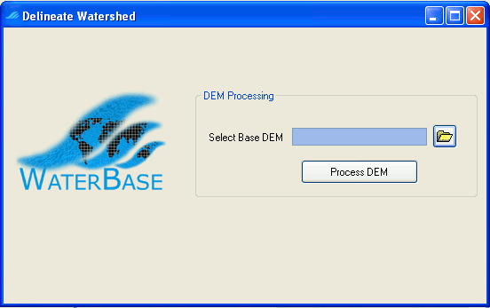

    MPSWAT Delineate Watershed

3. Once selected a new open divided vertically in three section appears, in our case we would only modify the "Network delineation by Threshold method, where the units selected would be sq. km. and the cell size of 0.5. In the below section would be chosen the shapefile with the outlet of the watershed that we want to calculate. After that it can be run independently each section or run all in once pressing the button "run all".

    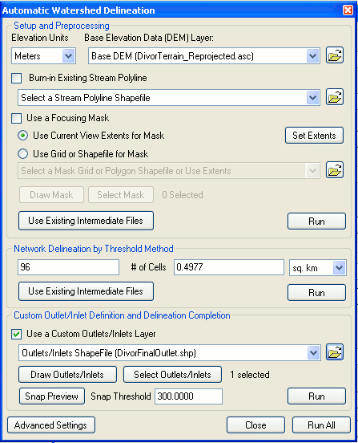

    MPSWAT Automatic Watershed Delineation menu

4. As a result it will be obtained the main subbasins and the main water courses that lead to the outlet point.

    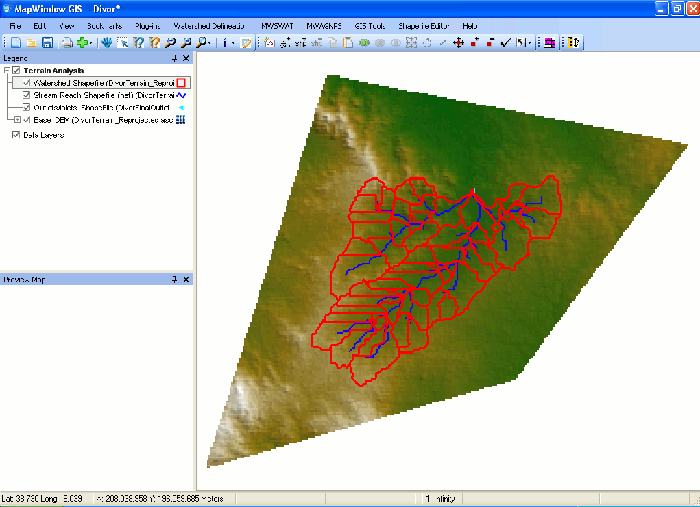

    Resulting window from after Step 1 completion

### Step 2 Create HRUs

1. If the Step 1 have been completed correctly, the Step 2 button will turn up with the message "Create HRUs".

    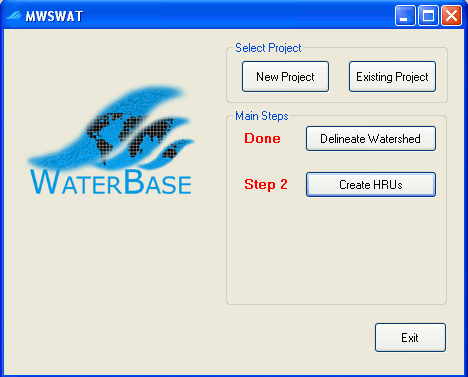

    MPSWAT menu after Step 1 completed

2. Once pressed it would open a new window, where has to be selected our Landuses and soils maps and tables. The Landuse and soil map should have been prepared earlier and the tables loaded in the MWSWAT database. Then press the "Read" button.

    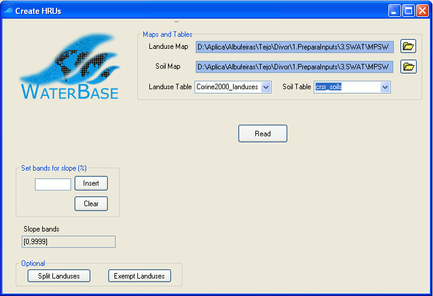

    Create HRUs menu with the chosen maps and tables

3. Once the grids are read, in our case we would select "Multiple HRUs" from the droping single/multiple HRU menu. It would also be selected the percentage option in the menu HRU threshold by Area/Percentage.
4. Once selected the different percentages for landuse, soil and slope the button "Create HRUs" should be pressed. In this particular example the percentages chosen were 20, 20 and 100 but this will vary for different applications.

    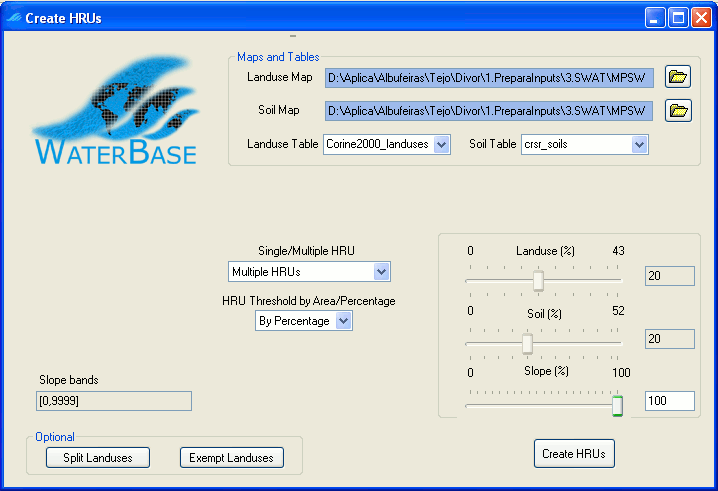

    Create HRUs menu after choosing the diferent percentages for Multiple HRUs

5. If completed succesfully, a window will provide the information about the HRUs created, in my case they were created 85 HRUs in 60 subbasins.
6. Also at this point, some reports were created about the elevation, basin and HRUs that can be opened from the main MWSWAT window.
7. Diferences of 2-3% between the diferent parts of landuse, soil and slope from the basin report (LanduseSoilSlopeRepSwat.txt) and the HRUs report (HruLanduseSoilSlopeRepSwat.txt) are allowed.

### Step 3 Swat Setup and Run

1. If the Step 2 have been totally completed, the Step 3 will be visible and when we click on it a new screen would appear.

    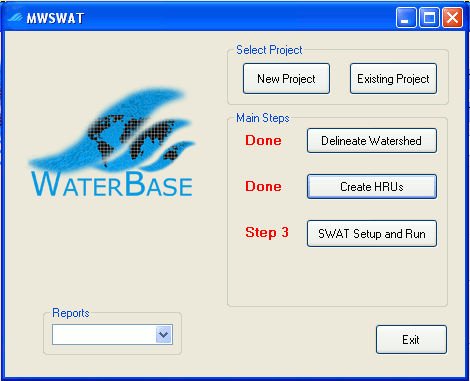

    MPSWAT menu after Step 2 completed

2. It is suggested that before filling anything in this new menu to click on Weather Sources button. We would choose as the **Database tables** as a weather source and from the drop down menu the one for our study case (i.e. Divor\_Weather\_Sources). As the Weather Generator, we would choose the **Table** option and from the menu the one defined in the MWSWAT database (i.e.wgn\_divor). Then clik on **Done**.

    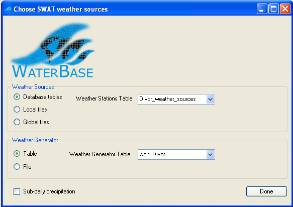

    MPSWAT menu for choosing the Weather data sources

3. By doing in this manner, when we come back to the previous menu it can be observed that the Start and Finish date of the period of simulation have been filled with the initial and final data of our database.
4. Then we should click on the write all files box in the right side of the menu and followed by the **write files** button. If everything run ok another box will appear with the message "SWAT input files written".
5. In this menu you also have the option of running the SWAT model clicking on the **Run SWAT** button that would open a DOS window where the model will run and if it runs ok a window confirming with the message "SWAT run successful".

    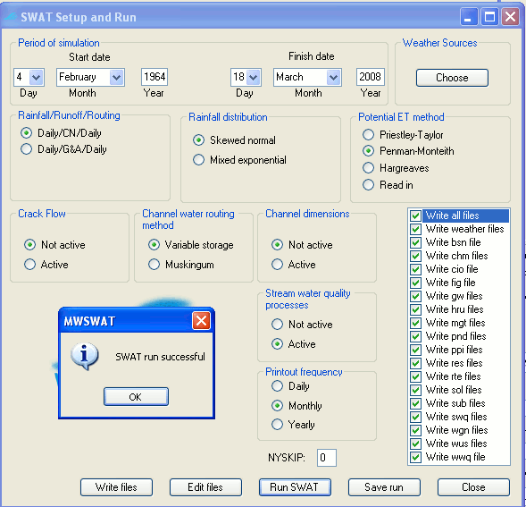

    MPSWAT menu with the dates corrected, the write files corrected and the message of the SWAT succesful run on top.

6. To edit the SWAT input files click on the "Edit files" button that would open the SWAT Editor 2005 (64 Bit users if you have problems at this point please read carefully the [MapWindow Installation Instructions](../tools/gui/install-swat-interface.md).

#### Using a modified SWAT executable to produce outputs in MOHID format

We are not interested in running in the interface (the previous step was just to see that it runs) because the output files are giant so everytime a change is made in the interface it is needed to run in the folder structure explained in the link below. To obtain outputs in a format that suits our needs see the steps in [Run SWAT with MOHID outputs](../overview/mohid-swat.md).

In the next runs, the process is always these:

1. Change the parameters in the interface.
2. Run the simulations outside the interface with the SWAT modified executable to produce MOHID format outputs. Remind that the txtinout folder that the interface uses where input files are written (in ..\\scenarios\\default\\txtinout) has to be copied to simulation folder and then run so that the changes made are accounted when running the modified executable.

### Step 4 Run MWSWAT with common calibrations

The commom calibrations are in groundwater, soil, and management files. The first callibration affects flow and the other two affect water quality. Just need to change some parameters in the SWAT Editor, make a new simulation structure and rerun the model in to that structure so that you will have two simulations (the first, default parameters, and the second with parameters more fitted in to our watershed reality).

To modify the SWAT input files, click on edit files on the last menu from MWSWAT and a new window will turn up.

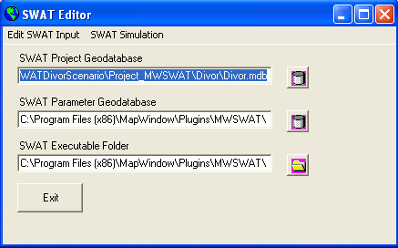

SWAT Editor Main Menu

In the "Edit SWAT Input" menu choose "Subbasin Data". Then in the "Select Input Table To Edit", three modifications will be performed:

1. **Soils (.Sol):** Select any Subbasin, Land Use, Soils and Slope option and click "ok". A new window will open. In this new window will modify the USLE\_K value from 0.1 to 0.3 and will tick the box "Extend edits to all HRUs". Then "Save Edits" and "Exit".

    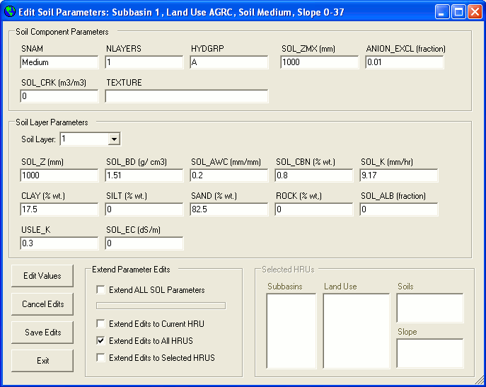

    SWAT Editor for Soil parameters

2. **Groundwater (.Gw):** Select any Subbasin, Land Use, Soils and Slope option and click "ok". A new window will open. In this new window will set the GW\_DELAY (days) and ALPHA\_BF (days) to 3 and 1 respectively and will tick the box "Extend edits to all HRUs". Then "Save Edits" and "Exit".

    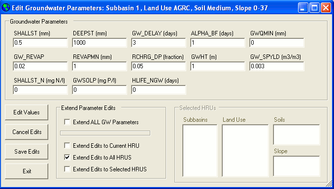

    SWAT Editor for groundwater parameters

3. **Management (.Mgt):**Select any Subbasin, Land Use, Soils and Slope option and click "ok". A new window will open. In the top menu choose the "Operations" tab and click on the "Edit Values" and "Edit Operation" buttons. The following values have to be set in the Auto Fertilization operation

```
AFERT_ID     : 28-10-10
AUTO_NSTRS   : 0.93
AUTO_NAPP    : 50
AUTO_NYR     : 300
AUTO_EFF     : 1.3
AFRT_SURFACE : 0.2
```

Then tick the boxes "Extend Management Options" and "Extend Edits to Selected HRUs". On the menus select All subbasins, the agricultural Land Uses (use the CTRL button for doing so) and all Soils and Slope and clik on "Save Edits"

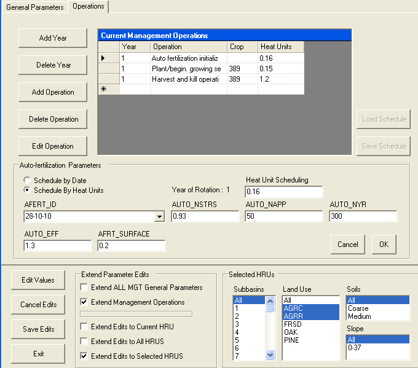

SWAT Editor for management parameters

Then we press the "Cancel" button on the Edit Subbasins input menu and we will be back to the SWAT Editor main menu. On the Edit SWAT Input menu there are two important things to do before exiting:

- **To update databases after performing any change**
- **To re-write SWAT input files**

#### Run the modified executable outside the interface

Run the simulation outside the interface with SWAT\_MOHID as decribed previously in [Run SWAT with MOHID outputs](../overview/mohid-swat.md). Remind that the txtinout folder that the interface uses where input files are written (in ..\\scenarios\\default\\txtinout) has to be copied to simulation folder and then run so that the changes made are accounted when running the modified executable.

### Converting SWAT model results to CE-QUAL model input files

In order to do so follow the instructions on the following [link](eutrofiza-o-albufeiras.md) .
