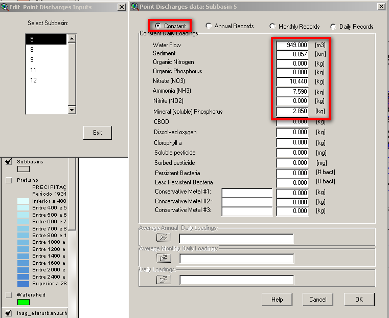

# SWAT - Add Point Sources Loads

## Compute point sources loads

1. Adapt this excel file if needed (\\\\Datacenter\\Albufeiras\_Eutrofizacao\\ComoFazer\\1.PreparaInputs\\5.FontesPontuais\\2\_CalculoCarga\\ETARRoxo.xls)
2. Use equivalent inhabitants (HE) to estimate average WWTP flow (100L/HE.day - Metcalf gives a maximum of 90 L/HE.day for data from 1992; presently for Lisbon the average is around 120L/HE.day. Services, food and hotel areas have bigger values but in average it should be around 100 L/HE.day). Compute daily volume in m3/day for each WWTP.
3. Use D.L. 236/98 (anex XVIII in \\\\Datacenter\\Albufeiras\_Eutrofizacao\\ComoFazer\\0.Bibliografia\\DL236\_98.pdf) to use concentrations limits for discharge: SST - 60 mg/l; Ammonia 8 mgN/l; Nitrato 11 mgN/l; PO4 3 mgP/l (same as Total, assuming all is in dissolved form; WWTP reduces particulate material in deposition and organic in secondary treatment). Compute daily loads for SST in tons/day and other in Kg/day.
4. If your reservoir is in a sensitive area ([http://www.inag.pt/inag2004/port/r\_externas/ue/ag\_res\_urb/aguas\_res\_urb\_zonas.html#lista](http://www.inag.pt/inag2004/port/r_externas/ue/ag_res_urb/aguas_res_urb_zonas.html#lista)) then it has the WWTP directive that lowers the P discharge limit to 2mgP/l for WWTP with more than 10 000 HE (quadro 2 in \\\\Datacenter\\Albufeiras\_Eutrofizacao\\ComoFazer\\0.Bibliografia\\DL\_152\_97\_DirectivaAguasResiduais.pdf). So if your watershed is in a sensitive area and there are WWTP in your watershed that have around 10 000 HE or more then the P discharge will be 2mgP/l instead of 3 mgP/l; nitrogen species maintains.

## Add the point sources loads to the SWAT project

1. When you have the info about subbasins, write down in the excel file with the WWTP computed loads a column with the subbasin where the point source was added
2. Select menu >Edit Input > Point Sources Discharges
3. In the window appear all the subbasins with point sources. Click in every each one of them and define the discharge loads.

    

    Add point source loads in SWAT
