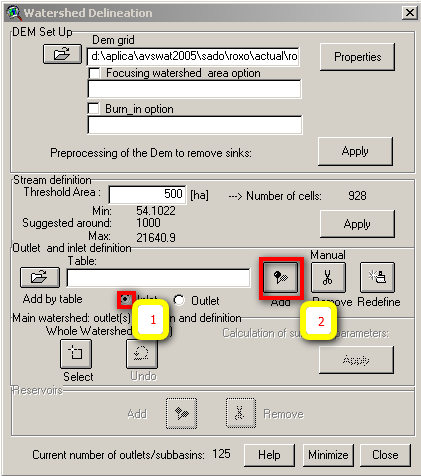
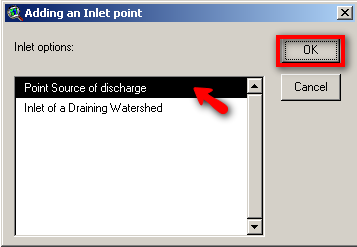

# SWAT - Add Point Sources Location

In order to have the actual scenario for the reservoirs it is needed to account for point sources (WWTP).

### Identify Point Sources in the watershed

WWTP are identified by "freguesias" but not with X and Y coordinates so as a first attempt WWTP will be addresed to the watersheds by the "freguesias" contained..

1. Find out what are the "freguesias" in your watershed with \\\\datacenter\\Albufeiras\_Eutrofizacao\\Produtos\\ProjectosGIS\\ShapesBase\\Conc&Freguesias.
2. Go to \\\\datacenter\\Albufeiras\_Eutrofizacao\\ComoFazer\\1.PreparaInputs\\5.FontesPontuais\\1\_DadosINSAAR and open the excel file and find all the WWTP that are inside those "freguesias". Copy all the contained WWTP to a new excel file.
3. Export in ARCGIS your watershed limits to .kml (it is and add-on in \\\\mohidland\\Albufeiras\_Eutrofizacao\\Produtos\\ProjectosGIS\\Export\_to\_KML)
4. Open the .kml in Google Earth and search for the WWTP names in Google Earth to check if the cities or towns of the WWTP are completely outside the watershed (freguesias that are not all contained in the watershed, the WWTP may discharge outside and need to be eliminated from the list).

### Introduce point sources in SWAT Project

1. Input point sources are pointed as inlets before defining outlets .
2. Add the "freguesias" shape to arcview view in \\\\Datacenter\\Albufeiras\_Eutrofizacao\\Produtos\\ProjectosGIS\\ShapesBase\\Conc&Freguesias\\FG99.shp
3. Select "inlet" radio button and "add" to add the point sources

    

    Add inlet in SWAT

4. Select the location where you want to add the point source (in case that all the info is about "freguesias" place it near the river inside the "freguesia". Select "point source" and "OK"

    

    Add inlet in SWAT

5. After all the inlets are inserted you can insert the outlets desired.
