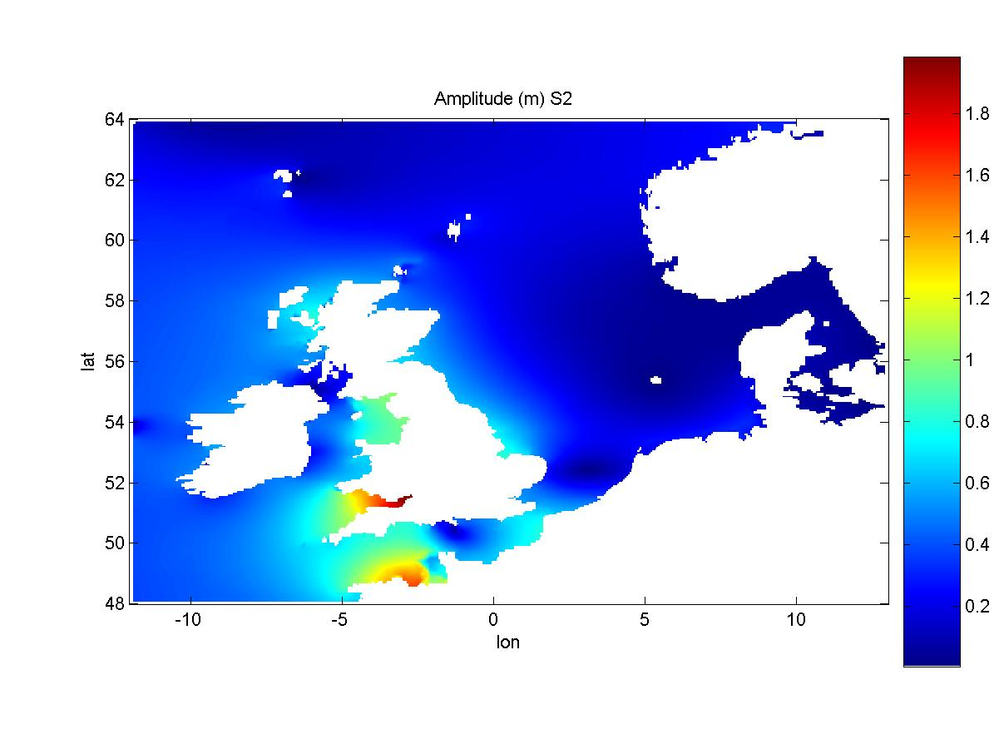
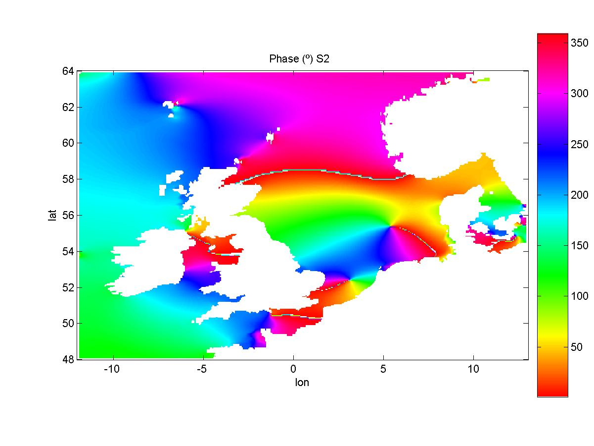

# MatLab TideAnalyser

The [MatLab](../../archive/linux/matlab.md) program **TideAnalyser** analyses a water level matrix timeseries(i.e., a matrix i cells by j cells by t time) and outputs a harmonic analysis matrix.

It is availiable through [SourceSafe](../../building/windows/sourcesafe.md) OtherTools database.



Sample Output from TideAnalyser: S2 Amplitude from MOHID, forced with FES2004



Sample Output from TideAnalyser: S2 Phase from MOHID, forced with FES2004

## Description

The program TideAnalyser reads a MOHID [HDF5](../hdf5.md) and returns harmonic component analysis for the entire netcdf waterlevel matrix, writing jpg files to an output directory.

**Requirements**

It requires a MOHID [HDF5](../hdf5.md) file. If you have a netcdf file, you can change the code easily in a way that there is a variable named 'data' which has dimensions ixjxt.

**Data Input**

If called simply without arguments, it will ask you the data:

- a MOHID [HDF5](../hdf5.md) file with water level data,

- an output directory,

You can specify the input manually by entering them in the following way:

```
 tideanalyser('file')
```

**Output**

The program will write an TA\_data.mat file to the output directory that includes:

- TA\_data.mat: the amplitude and phase matrix which is has dimensions ixjxh, with the harmonic components as h.

And it will write in the output directory:

- JPG/PNG files: containing the amplitude and phase maps for each harmonic analysed.

## Remarks

**Execution time**

The program takes 3hours to analyse a 250\*436\*736 matrix, mainly due to harmonic analysis on each cell using T\_TIDE package.

**T\_TIDE: Tide analysis**

A t\_tide package has to be installed in order to use this script.

The 'T\_TIDE' package from Rich Pawlowicz, can be obtained [here](http://www2.ocgy.ubc.ca/~rich/#T_Tide). It is based on the classic FORTRAN tidal analysis packages written by Mike Foreman [here](http://www.pac.dfo-mpo.gc.ca/sci/osap/projects/tidpack/tidpack_e.htm\)).
