# Mohid GIS

## Overview

Mohid GIS is a [geographical information system](http://en.wikipedia.org/wiki/Gis) specifically designed to support [Mohid Water Modelling System](../../overview/README.md#mohid-water-modelling-system#mohid-water-modelling-system) which handles spatial and temporal variable data required or produces by the MOHID numerical programs. It allows to load and to visualize data stored in different formats:

- **MOHID Data Files** – files which contain geographical information like [points](../../io/formats/xyz-points.md), [lines](../../io/formats/lines.md), [polygons](../../io/formats/polygons.md), [grids](../../reference/grids.md), etc formatted in a proper way. All these files are ASCII files;
- **ESRI Shape Files** – files which are the used by the ESRI ArcView software;
- **MOHID HDF5 Files** – files written in standard [HDF5](../hdf5.md), but with some special data sets which contain spatial and temporal information.

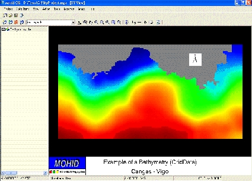

**MOHID GIS interface**

The main window of MOHID GIS (above image '**MOHID GIS interface'**) has one main menu and a client area where the child windows are located. A child window is divided into two areas: (i) a list view docked to the left border of the window and (ii) the display area, which occupies the rest of the window, where the information is displayed.

## Concepts

### Data Items

A data item is set of single data entities. Data items can be off different types:

- [Points](../../io/formats/xyz-points.md) – a set of XYZ points with optional name, stored in MOHID internal data format;
- [Polygons](../../io/formats/polygons.md) – a set of polygons, without holes, stored in MOHID internal data format;
- [Lines](../../io/formats/lines.md) – a set of lines, stored in MOHID internal data format;
- [Grids](../../reference/grids.md) – a file which defines a grid, as used by MOHID numerical programs;
- [Grid Data](../../io/formats/grid-data.md) – a file which defines a grid and the respective center cell values, as used by MOHID numerical programs;
- [Background Image](../../reference/background-image.md) – an ASCII file which indicates the path to an image to be displayed and its geo-reference settings;
- Drainage Network - a file which defines a drainage network, as used by MOHID numerical programs;
- River Cross Sections - a file which defines river cross sections, as used by MOHID numerical programs;
- [Time Series](../../io/formats/time-series.md) – a file which contains a time series, as used by MOHID numerical programs.
- HDF5 File – a file written in HDF5, but with some special data sets which contain spatial and temporal information;
- [ESRI Shapefile](../../reference/esri-shapefile.md) – any valid ESRI Shapefile, containing points, multi points, lines, multi lines, polygons or multi polygons.

The first nine data items are files written in the so called MOHID internal data format, while the HDF 5 files and the ESRI Shapefiles are written in other formats.

### Display List

### View

## Step by Step

### Creating a Project

To create a new project, MOHID GIS must be started by selecting Start -> Programs -> Mohid -> MOHID GIS. **An empty window of MOHID GIS** (image below) will appear.

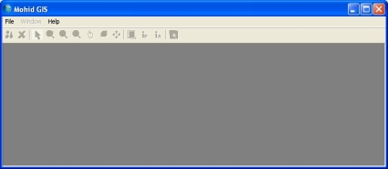

**An empty window of MOHID GIS**

A new project can be created by selecting File -> New -> Project… from MOHID GIS’s main menu. A dialog box will appear where one has to specify location and name of the project file (extension should be \*.mgp). After closing the dialog box, MOHID GIS adds automatically a new XY View to the project and the main menu activates.

### Adding a View

To add further views to the project, one has to select File -> New -> XY View… or File -> New -> 3D View… from MOHID GIS’s main menu.

### Adding Data Items

To add a new data item to a view, one has to activate first the view where the new data item is to be added to. Afterwards, by selecting Data Items -> Add… from MOHID GIS’s main menu a dialog box appears, that enables to specify the type and location of the data item to be added, as shown in image below '**Adding an existing Data Item'**. Multiple data items of the same kind can be added at the same time.

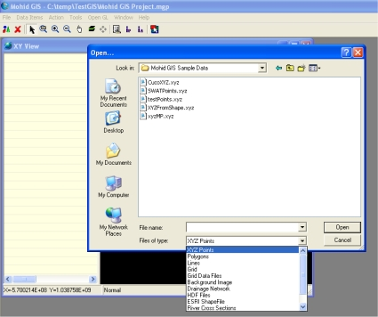

**Adding an existing Data Item**

After adding an existing data item, an icon of the newly added data item will be added at the end of the list view and MOHID GIS’s main might look like seen in image below '**MOHID GIS’s main window with some Data Items'**

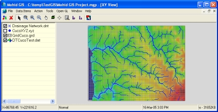

**MOHID GIS’s main window with some Data Items**

### Data Items Appearance

Data Items appear, in XY Views, as layers. The topmost data item in the list view is represented as topmost layer, while the last data item is the lowest layer. It’s possible to change the order of the data items by dragging them up and down with the mouse. It’s also possible to turn individual data items on or off by toggling the check box next to the icons of the data items in the list view.

The way data items are displayed depends on several settings. Settings depend on the type of data items. Settings can be accessed by selecting a data item in the list view and then choosing Data Items -> Properties from MOHID GIS’s main menu (keyboard shortcut is F4 and mouse right-click pop up a shortcut menu). The image below '**Properties of a XYZ data item'** shows the properties of a XYZ Points data item. Common to all data items is information stored in groups “General” and “Color”. The first group shows the path to the data item’s file and information on it’s position and extension in the XY plane of it. The second group allows the user to choose how to “color” data items and if one wants to display a color scale in the display area.

For some data items its necessary to specify a size (e.g. size of points, width of lines). If this size is not supplied in pixels, then it’s necessary to taken into account that values specified depend on which type of coordinates one is using. If one is using metric coordinates, size values will be in meters, if one uses geographic coordinates, size values will be in decimal degrees.

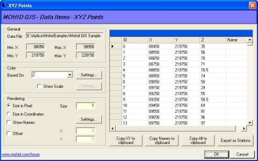

**Properties of a XYZ data item**

Color properties of data items can be accessed through the “Settings…” button in the “Color” group. Colorization is based on one value, the color base value. Available color base values depend on the type of data item (e.g. Z for points, ID for polygons). If there is more then one available color base value it can be chosen from the drop down box labeled “Based On”.

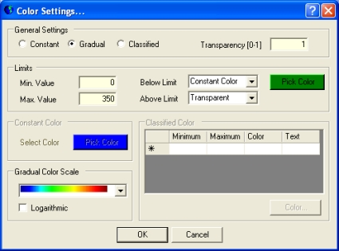

**Color Setting Dialog**

By clicking the “Settings…” button in the “Color Group”, a dialog window like the one shown in the image above '**Color Setting Dialog'** will appear. This dialog box enables the user to colorize data items in different ways:

- constant – all entities of the data items are colored with one single color, since the value of the color base value is within the range specified in the “Limits Group”. If the value is below limit the color specified in the below limit area is applied. If the value exceeds the maximum value, the above limit color is applied;
- gradual – all entities of the data items are colored based on a gradual color scale. Colors are obtained by linear or logarithmic interpolation based on limits in the “Limits Group” and the color base value. For entities with values outside limits the same rules as for constant colorization apply;
- classified – all entities of the data items are colorized based on a user defined classified color ranges. For entities with values outside limits the same rules as for constant colorization apply.

### Create New Data Items

MOHID GIS permits to create some data items from scratch. By selecting Data Items -> New… from MOHID GIS’s main menu, a dialog window like the one shown in the image below ('**Adding a new Data Item'**) appears. Here it’s possible to choose the type of data item to be created and where the respective file will be located.

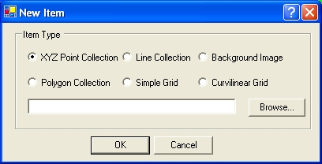

**Adding a new Data Item**

### Removing Data Items

By selecting one or more data items for the list view and selecting Data Items -> Remove from MOHID GIS’s main menu data items will be removed from the view.

### Adding new data to Data Items

It’s possible to add single data entities to existing [XYZ points](../../io/formats/xyz-points.md), [lines](../../io/formats/lines.md) and [polygon](../../io/formats/polygons.md) data items. First one has to select in the list view the data item where to add the entities to. The next step is to select Tools -> Add -> Add Points / Lines / Polygons from MOHID GIS’s main menu.

Points are added with the left mouse button on the display area. To stop adding points, the right mouse button must be pressed.

Lines vertex are added with the left mouse button on the display area. To finish the line, the right mouse button must be pressed.

Polygons vertex are added with the left mouse button on the display. To close the polygon the right mouse button must be pressed.

### Load HDF 5 Data Items

HDF 5 Data Items are a special case of data items, because the user has to perform several steps before viewing them. MOHID GIS expects HDF 5 file to contain spatial and temporal information about the data set which will be loaded. All HDF 5 files produced by MOHID numerical programs contain this information. To display the information contained in a HDF 5 file the following are required:

- Add a HDF 5 file like described in Adding Data Items;
- Select the new added data item from the list view and access its properties (like described in Data Items Appearance). A dialog window like shown in the image below ('**Properties window of a HDF 5 Data Item'**) will appear;

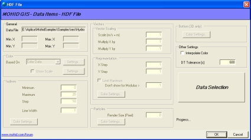

**Properties window of a HDF 5 Data Item**

- Pressing the “Data Selection” button, located on the right hand side of the window, to select data from the HDF 5 file which is to be represented;
- A window like shown in the image below ('**HDF 5 Data Selection Window'**) appears. This window enables the user to select how each kind of information is to be represented and what is the spatial and temporal information associated with the data sets. Information to be selected is divided into required information and optional information. Required information is related to temporal, spatial and mapping reference of data sets and optional information are the data sets themselves. Information is selected by dragging items from the HDF 5 tree view located on the left side of the dialog window to the respective list view on the right side of the dialog window (or using the Action command from the main menu);

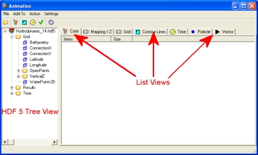

**HDF 5 Data Selection Window**

HDF 5 Data Selection Window|425px|thumb|center|**Properties window of a HDF 5 Data Item**\]\]

- Spatial information about the data sets is required and should either be the data sets Connection X/Y or Latitude / Longitude, depending on coordinates used in MOHID GIS’s display view. Spatial information is added by selecting the Grid list view. After adding spatial information the grid list view should look like the one shown in the image below ('**HDF 5 Data Selection Window after adding spatial information'**);

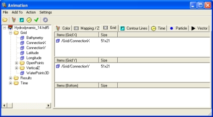

**HDF 5 Data Selection Window after adding spatial information**

- Mapping information tells MOHID GIS if a given grid point is to be represented or not (e.g. water points vs. land points). Mapping information stored in HDF 5 files produced by MOHID numerical programs are: (i) Waterpoints, OpenPoints or BasinPoints. Mapping information is added at the Mapping list view. After adding mapping information the mapping information list view should be similar to the one shown in the image below ('**Data Selection Window after adding mapping information'**);

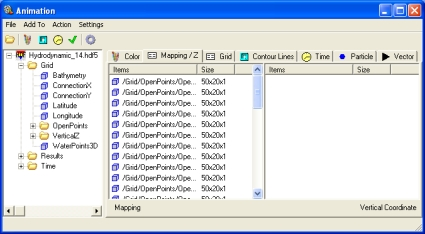

**Data Selection Window after adding mapping information**

- The third required information is the temporal information. Time information is added into the time list view in a similar way spatial and mapping information is added;
- By selecting Settings -> General… one has access to general settings dialog window, which permits to choose several settings (image below ('**Data Selection Window General Settings'**)). Here the user can choose which slice is to be imported from a 3D matrix and how the “Quick Add” button from the menu bar behaves. This button allows adding with a single click all required information (temporal, spatial and mapping).

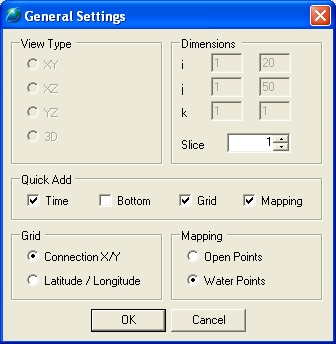

**Data Selection Window General Settings**

- Optional information tells MOHID GIS what is actually to be represented. There are four ways to represents information: (i) color matrix, (ii) contour lines (iii) vector plot, and (iv) lagrangian particles. Information added to (i) and (iii) must be kind of 2D or 3D matrixes (e.g. flow modulus, nitrate concentration, surface water content). Information added to (iii) must have an X and a Y component (e.g. flow velocity, wind velocity). Information added to (iv) is the one produced by the lagrangian module. Optional information has its source usually in the “Results” folder of the HDF 5 Tree View. The image below ('**Data Selection Window after adding vector plot information'**) shows an example of the Data Selection Window after adding Vector Plot information;

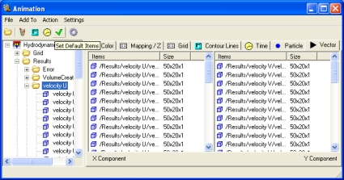

**Data Selection Window after adding vector plot information**

- By choosing Close Return from Data Selections main window all selected data will be loaded and the window will close;
- In the Properties window of the HDF 5 Data Item now it’s possible to set settings related to the representation of the selected data sets. Only settings for which data sets were loaded are enabled. The image below ('**Properties window of a HDF 5 Data Item after Data Selection'**) shows an example of this. Settings for colors are the same as for Grid Data Items, Contour Lines width is given in display view units (not in pixel), vector scaling is also referred to display view units (a scaling of 1000 means that a vector of 1 m/s will be represented by an arrow of 1000 display view units).

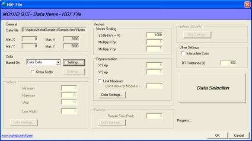

**Properties window of a HDF 5 Data Item after Data Selection**

After loading data from HDF 5 files the user can step through the loaded data sets by animating the display view, using the animator (see **Using the Animator**).

### Zooming & Panning

Several methods are available (in XY Views) to zoom and pan the current image. From MOHID GIS’s mains menu the following options are available:

- Zoom Rectangle – display will zoom to rectangle area selected with the mouse;
- Zoom Checked Items – display will zoom the smallest rectangle which contains all checked items in the list view (this option is also accessible through a pop-up menu in the list view);
- Zoom Selected Items – display will zoom the smallest rectangle which contains all selected items in the list view (this option is also accessible through a pop-up menu in the list view);
- Zoom Extended – display will zoom the smallest rectangle which contains all items in the list view;
- Zoom Out – display area zooms in by 10%, using the center point as reference;
- Zoom In – display area zooms out by 10%, using the center point as reference;
- Pan – pans the image with the mouse;

“Selecting Action -> None” stops any previously selected action. It’s also possible to zoom in / zoom out using the mouse wheel.

### Inquire Information

To inquire information about a given area, the user has the possibility to select Action -> Info -> Info Area / point from MOHID GIS’s main menu. After selecting the desired area a window like shown in the below image ('**Dialog window showing information found in the selected area'**) will show information about the data items in the selected area.

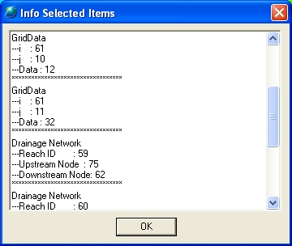

**Dialog window showing information found in the selected area**

### Add Legends

Several types of legends can be added to the display view. These legends are: (i) a legend text at the bottom of the display are, (ii) a north indicator, (iii) a horizontal scale, (iv) a rainfall indicator and (v) color scales for each data item.

A legend text at the bottom of the display area can be added by selecting OpenGL -> Bottom Legend… from MOHID GIS’s main menu. A dialog window like shown in the image below ('**Bottom Legend Text Settings'**) appears. The legend text (two lines) as well as the font size and type, can be chosen. For the legend text to appear in the display area the “Show” checkbox must be checked. There is an option to visualize time. The time shown will depend on the current animation time / index (see **Using the Animators**).

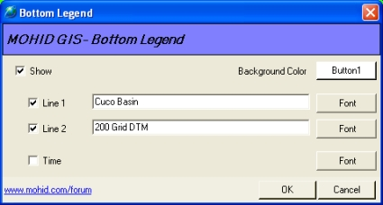

**Bottom Legend Text Settings**

After closing the bottom legend text dialog window, the legend text will be shown at the bottom of the display area (see image below '**Bottom legend in the display view'**).

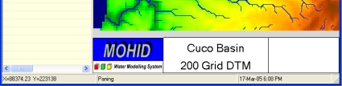

**Bottom legend in the display view**

A north indicator can be added to the display area by selecting OpenGL -> North Indicator… from MOHID GIS’s main menu. A dialog window like shown in the image below ('**North Indicator Settings'**) appears. The location (in pixels) of the lower left corner of the North Indicator like the width and height must be supplied by the user. Two types of North Indicators are available.

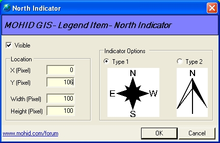

**North Indicator Settings**

A horizontal scale, which indicates a distance, can be added to the display area by selecting OpenGL -> Horizontal Scale… from MOHID GIS’s main menu. A dialog window like shown in the image below ('**Horizontal Scale Settings'**) appears. Like for the North Indicator the user has to specify the location of the scale. Scale units can be meters or kilometers.

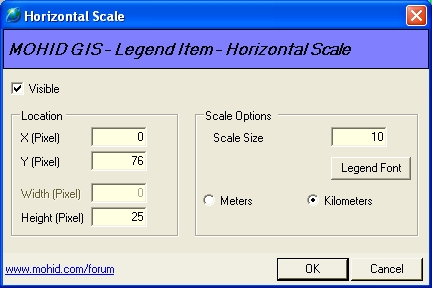

**Horizontal Scale Settings**

### Save Images

It’s always possible to save the current display view as image in several file formats. By choosing Data Items -> Save Image from MOHID GIS’s main menu, a dialog window like shown in the image below ('**Save the current display view to a file'**) appears. In this window the user can choose the file format and destination of the file.

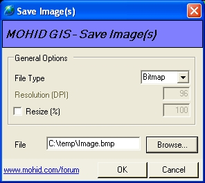

**Save the current display view to a file**

### Using the Animators

Animators allow to animate, the display view, stepping through loaded data sets from HDF 5 files and time series. MOHID GIS incorporates two types of animators: (i) an index based animator and (ii) a time based animator. Index based animations use the indexes of the data sets loaded and time based animations are based on a user defined time span and time step. By choosing View -> Animator -> Index Based Animator from MOHID GIS’s main menu, one has access to the first one (choose Time Based Animator from the same menu to access the second one). The animator appears below the list view in MOHID GIS’s child window, like shown in the image below('**Index based animator below list view'**). Start and end fields indicate the current limits of indexes of all loaded HDF 5 data items, buttons “->” and “<-“ can be used, respectively, to step one image forward and backward, Render All button loop through all indexes and “Save All…” can be used to save all images to a user defined folder. The time based animator works in a very similar way. Animators can be hidden by choosing View-> Animator -> Hide from MOHID GIS’s main menu.

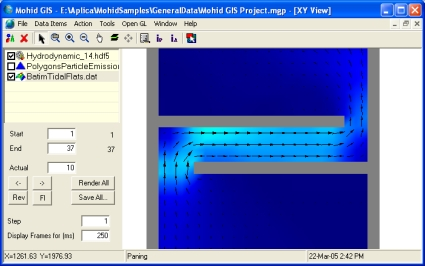

**Index based animator below list view**

## Tools

There are a set of tools available from MOHID GIS’s main menu (Tool submenu). Tools are designed to create input data files for MOHID numerical programs and are described next.

### Create Digital Terrain

By selecting Tools -> Create Digital Terrain from MOHID GIS’s main menu, the user has the possibility to create a Grid Data file to be used as bathymetry input for MOHID Water or as topography input for MOHID Land (or any other Grid Data file which will be needed by the numerical models). A dialog window like shown in Figure 3-37 will appear. This window is an interface to launch the numerical program MOHID Digital Terrain Creator.

On the right side of the window one must specify which grid and sets of XYZ data or to be used to create the digital terrain. Optionally a set of polygons can be specified, defining where “no compute” areas are (e.g. land points for MOHID Water). The grid data destination file must be selected under “Digital Terrain File”. There is a set of options available which control the way MOHID Digital Terrain Creator will behave. These options can be accessed by the Options; Advanced Options and Overlapping tabs (see Figure 3-38). Under the Option tab one can choose the type of interpolation to use.

After setting all options one have to press the “Run…” button on the left side of the window to execute MOHID Digital Terrain Creator. The output of this numerical program is redirected the window located at the upper left corner of the image below ('**Window to create a Digital Terrain'**).

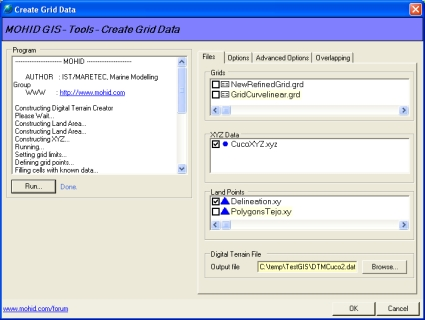

**Window to create a Digital Terrain**

After closing the dialog box the newly created grid data file will be automatically loaded into MOHID GIS’s current view.

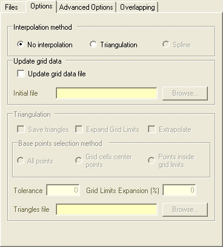

**Options controlling Digital Terrain Creation**

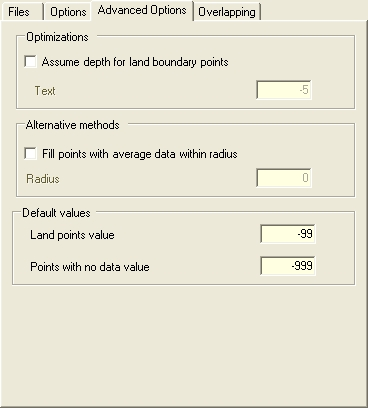

**Options controlling Digital Terrain Creation**

### Remove Depression

To make topography grid data files suitable for MOHID Land they must be “depression free”. By selecting Tools -> Remove Depression... from MOHID GIS’s main menu a dialog like shown in the below image ('**Window to Remove Depressions'**) appears. This window is an interface to launch the numerical program MOHID Basin Delineator.

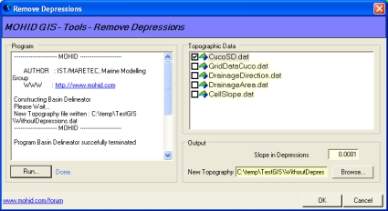

**Window to Remove Depressions**

On the left side of the window one has to select the Grid Data Item from which depressions are to be removed, the minimum slope to consider and the new Grid Data file to be created.

After setting all options one have to press the “Run…” button on the left side of the window to execute MOHID Basin Delineator. The output of this numerical program is redirected the window located at the upper left corner of the image above ('**Window to Remove Depressions'**).

After closing the dialog box the newly created Grid Data file will be automatically loaded into MOHID GIS’s current view.

### Delineate Basins

MOHID Land can receive a Drainage Network and a delineation of a basin. By selecting Tools -> Delineate Basin... from MOHID GIS’s main menu a dialog like shown in the image below ('**Window to Delineate a Basin'**) appears. This window is another interface to launch the numerical program MOHID Basin Delineator.

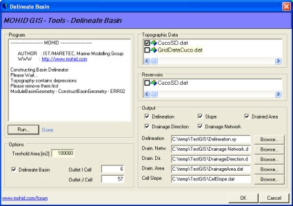

**Window to Delineate a Basin**

From this window one has the possibility to create data items with information about (i) delineation of the basin, (ii) drainage network, (iii) drainage direction, (iv) upstream drained area and (v) cell slope. The first data item is a polygon, the second is a drainage network and the last three are grid data items. The topography used as base data must be specified in the list box on the upper right side of the window. One has the option to specify the localization of reservoirs.

Threshold area is a parameter which is used by MOHID Basin Delineator as minimum drained area from which channels of drainage network starts to exist. If one wants to delineate a basin, the grid cell of the outlet (of the topographic file) must be specified.

After setting all options, press the “Run…” button on the left side of the window to execute MOHID Basin Delineator. The output of this numerical program is redirected the window located at the upper left corner of the above image ('**Window to Delineate a Basin'**).

After closing the dialog box the newly created data items will be automatically loaded into MOHID GIS’s current view.

### Auto Cross Sections

Drainage Network’s cross sections need to be defined in order for MOHID Land (or MOHID River Network) to run. This can automatically be done be selecting Tools -> Auto Cross Sections... from MOHID GIS’s main menu. A dialog like shown in the image below ('**Window to interpolate Cross Sections'**) appears. This window permits to interpolate trapezoidal cross sections in function of the drained upstream area. At the top of the window one has to choose which drainage network is to be processed and below one has to specify a set of predefined cross sections for given drained upstream areas.

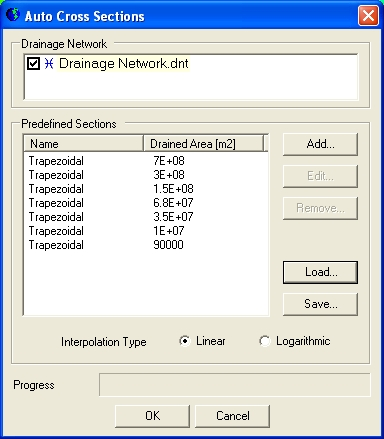

**Window to interpolate Cross Sections**

By clicking the Add… or Edit… button MOHID GIS’s incorporated Cross Sections Editor (image below, '**MOHID GIS’s Cross Section Editor'**) will open. Here there’s the possibility of defining the characteristics of a cross section.

After defining a set of cross sections (at least two covering all drained areas) choose the option to interpolate cross sections for the whole drainage network using linear or logarithmic interpolation.

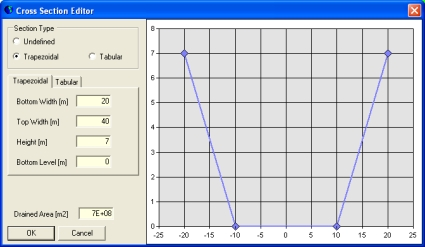

**MOHID GIS’s Cross Section Editor**

### Grid Data Operator

By selecting Tools -> Grid Data Operator from MOHID GIS’s main menu one has access to MOHID GIS incorporated Grid Data Operator. This tool permits to perform basic operation over exiting Grid Data Items (image below '**Grid Data Operator Window'**). Possible operations are: equaling a Grid Data Item to a constant value;

- sum, subtract, multiply or divide a Grid Data Item by a constant value;
- equalize, sum, subtract or multiply Grid Data Item 1 with / by Grid Data Item 2;
- perform a linear interpolation over Grid Data Item 1 using Grid Data Item 2 as “m” value.

Operations can be constrained and just applied in grid points (of Grid Data Item 1) which match constrains specified under “Constrains”.

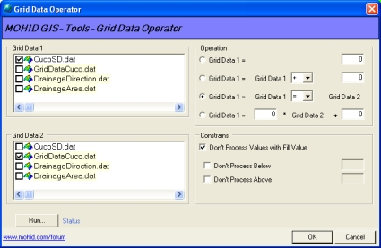

**Grid Data Operator Window**

On the right side of the window one can select the operation to perform, and on the left, which Grid Data Items are used for the operations. The Grid Data Item which will be modified (by pressing the “Run…” button) is always the Grid Data Item 1.

### File Conversion

#### Shape File to Grid Data

By selecting Tools -> Shape to Grid Data… from MOHID GIS’s main menu a dialog window like shown in the below image ('**Converting Polygon Shape File into Grid Data'**) appears. Here one has the possibility to convert Shape Files containing polygons into Grid Data Items. The source Shape File must be select from the list box at the upper left corner of the image below ('**Converting Polygon Shape File into Grid Data'**) and the Grid which will be used from the list box at the lower left corner of the image below ('**Converting Polygon Shape File into Grid Data'**).

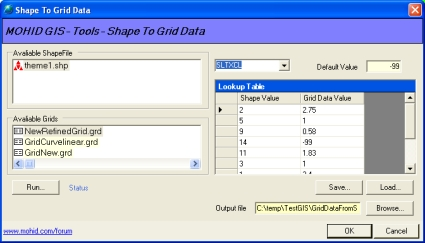

**Converting Polygon Shape File into Grid Data**

On the right side appears a drop down box which contains all numerical columns of the data table which belongs to the selected Shape File. In the Lookup Table one has to specify the values which are to be assigned to the grid cells, depending on the numerical value found in the data table of the Shape File (for example in the image above ('**Converting Polygon Shape File into Grid Data'**) all grid points covered by polygons in the Shape File with Soil Texture Class (SLTXCL) 2 will receive a value of 2.75).

The destination Grid Data File must be specified under “Output File…”. By pressing the “Run…” button the Grid Data file will be created.

#### Shape File To XYZ Points

By selecting Tools -> Shape to Grid Data… from MOHID GIS’s main menu a dialog window like shown in the image below ('**Converting Points Shape File into XYZ Point'**) appears. There is the possibility to convert Shape Files containing points into XYZ Points. The data columns used as Z and text must be selected from the drop down boxes on the right and the destination XYZ file must be specified under “Output File”. By pressing the “Run…” button the XYZ Points file will be created.

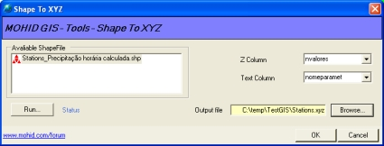

**Converting Points Shape File into XYZ Point**

#### Export To Shape File

By selecting Tools -> Export To Shape File… from MOHID GIS’s main menu a dialog window like shown in the image below ('**Exporting Data Items to Shape Files'**) appears. There is the possibility to convert XYZ Points, Polygons, Drainage Network and Lines data items into Shape Files. The Shape Files will be created in the same folder where the source data items are located.

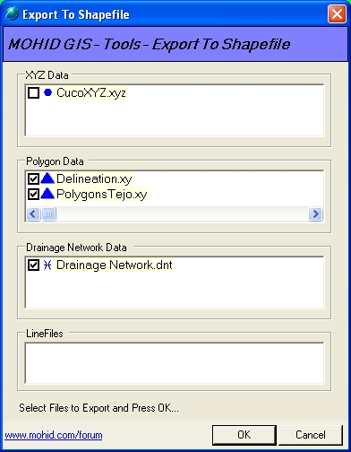

**Exporting Data Items to Shape Files**

#### Export GridData to XYZ points

#### Convert to HDF5

### Create Boxes

MOHID numerical programs use polygons in form of “boxes” to perform initialization or output operations. These boxes can be created from Polygon and Grid Data data items by selecting Tools -> Create Boxes from MOHID GIS’s main menu. A dialog window like shown in the image below ('**Creating Boxes for MOHID numerical programs'**) appears. To proceed, one has to choose one Grid Data data item and one Polygon data item. Under “Boxes File” the destination of the box file to be created is chosen. By clicking OK, the box file will be created and the dialog window closes.

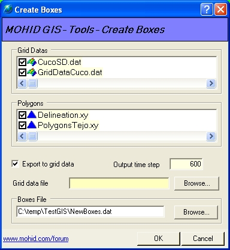

**Creating Boxes for MOHID numerical programs**

### Create Grid Time Series Location

MOHID numerical programs use points to write time series output. By selecting Tools -> Create Grid Time Series Locations from MOHID GIS’s main menu, one has the possibility to create an input data file which indicates MOHID numerical programs where grid based time series are to be written. A dialog window like shown in the iamge below ('**Create Grid Time Series Locations'**) appears. To create a Time Series Location file, one has to choose one Grid Data and one XYZ Points data item from the list boxes. Under “Location file” the destination file is specified. DT Output indicates MOHID numerical programs with which time step time series will be written. By clicking OK, the time series location file will be created and the dialog window closes.

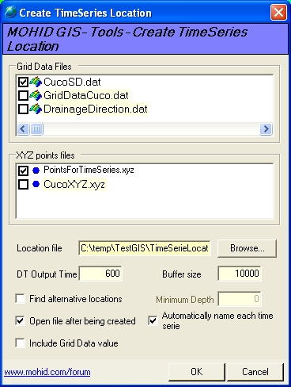

**Create Grid Time Series Locations**

### Create Node Time Series Location

By selecting Tools -> Create Node Time Series Locations from MOHID GIS’s main menu, one has the possibility to create an input data file which indicates MOHID numerical programs where node based time series are to be written. A dialog window like shown in the image below ('**Create Node Time Series Locations'**) appears. To create a Time Series Location file, one has to choose one Drainage Network and one XYZ Points data item from the list boxes. Under “Location file” the destination file is specified. DT Output indicates MOHID numerical programs with which time step time series will be written. By clicking OK, the time series location file will be created and the dialog window closes.

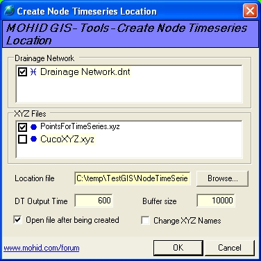

**Create Node Time Series Locations**

## See Also

[Background image for MOHID GIS](../../reference/background-image.md)

## References
