# Mohid GUI

## Introduction

MOHID GUI is a graphical user interface to handle the organization of the input and output files required by the MOHID numerical programs. At the present state, MOHID GUI can act as user interface for the following numerical programs:

> -   [Mohid Water](../../water/mohid-water.md) – numerical program which permits to simulate surface water bodies;
> -   [Mohid Land](../../land/mohid-land.md) – numerical program which permits to simulate basins;
> -   [Mohid River Network](../../overview/mohid-river-network.md) – numerical program which permits to simulate River Networks;
> -   Mohid Soil – numerical program which simulates small scale soil dynamics.

The main window of MOHID GUI is divided into three areas (image below '**MOHID GUI’s main window'**): (i) a tree view docked to the left border of the main window, (ii) a list view located on the upper right side of the main window and (iii) a text box located on the lower right side of the main window.

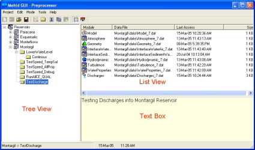

**MOHID GUI’s main window**

## Organization

MOHID GUI organizes simulations by dividing them into four major units: (i) projects, (ii) simulations, (iii) runs and (iv) modules. MOHID GUI can work in two different modes: (i) preprocessing mode and (ii) post processing mode.

### Projects

A project is the topmost unit and groups one or more simulations. Only one project can be open by MOHID GUI at a time. Any project has an associated project directory which must be specified by the user, whenever a new project is created. In the tree view window a project is always represented by the topmost node.

### Simulations

A simulation is an intermediate unit and groups together a set of runs. Simulations contain information which are common to all runs of a given simulation. This information is:

- The type of runs to be executed (MOHID Water, MOHID Land or MOHID River Network);
- The geographical base data (bathymetry for MOHID Water and topography for MOHID Land);
- Tidal information for the open boundary (MOHID Water only).

In case of MOHID Water, simulations can be inserted into other simulations. This allows the user to create nested simulations, which will be understood by MOHID GUI as a user option to run a model with a sub-model. An infinite number of nested simulations can be inserted, only limited by the user’s available computational resources.

### Runs

Each run corresponds to one execution of the selected numerical program and is characterized by a time span for which the run will be executed. A run is also constituted by the modules which are to be used during the run. Runs can be inserted into runs in two ways: (i) as temporal sequence or (ii) parallel to each other.

### Modules

Modules are associated to runs and are listed in the list view in the upper right side of MOHID GUI’s main window. By selecting a given run in the tree view, the corresponding modules will be listed in the list view. If MOHID GUI is in preprocessing mode, by double-clicking an icon in the list view, the input data file of the selected module will open. If MOHID GUI is in post-processing mode, the HDF and time series results files for each module, are listed in the list view. By double-clicking an icon in the list view in post processing mode, MOHID GUI will open either MOHID Post (in the case the selected icon corresponds to an HDF File produced by a given module) or MOHID Time Series Editor (in the case the selected icon corresponds to a time series file produced by the correspondent module).

## Step by Step

### Creating a project

To create a new project, MOHID GUI must be started by selecting **"Start -> Programs -> Mohid -> MOHID GUI"**. An empty window of MOHID GUI will appear (image below '**An empty window of MOHID GUI'**).

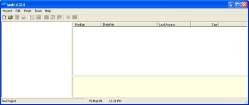

**An empty window of MOHID GUI**

A new project can be created by selecting **"Project -> New..."** from MOHID GUI’s main menu. A small dialog box will appear (image below '**Dialog box to specify Project settings'**) and asks the user to supply information for the project name, the filename of the project (extension should be \*.moh) and the root location for the project.

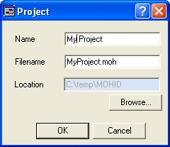

**Dialog box to specify Project settings**

After closing the dialog box, the root node which corresponds to the project node will be inserted into the tree view of MOHID GUI’s main window. By closing the dialog box MOHID GUI will also create three subdirectories in the project directory:

- a directory called "Figures" which can be used to place figures created within the project
- a directory called "GeneralData" which can be used to store generic data (e.g bathymetric information, atmospheric conditions input files, etc.)
- a directory called "Temp" to place temporary files.

### Insert a Simulation

Before inserting a new simulation into a project, the user should have already prepared the necessary data for the simulation (e.g. [bathymetry file](../../io/formats/bathymetry.md) for [MOHID Water](../../water/mohid-water.md) or topography file for [MOHID Land](../../land/mohid-land.md)) using [MOHID GIS](mohid-gis.md) or other sources. It’s recommended to store these files in the directory "GeneralData" mentioned above.

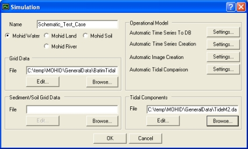

**Dialog box to specify Simulation settings**

To insert a new simulation the root tree node in the tree view must be select (or the simulations where a sub model is to be inserted). After selecting the desired node, a new simulation can be inserted by selecting **"Edit -> Insert Simulation"** from MOHID GUI’s main menu. A dialog box, like the figure above ('**Dialog box to specify Simulation settings'**) will appear. Here the user can specify the properties of the simulation:

- the name of the simulation
- the type of simulation, the path to the grid data file (bathymetric file for MOHID Water or topographic file for MOHID Land) and optionally the path to the file which contains the tidal components (MOHID Water only).

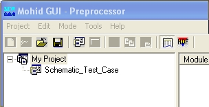

**Tree view after inserting one simulation**

After closing the dialog box, a node for the simulation will be added to the tree view (above image, '**Tree view after inserting one simulation'**). By closing the dialog box MOHID GUI will also create a subdirectory in the project directory, with the same name of the simulation. Inside this directory three further directories will be created:

- a directory called **"data"** where the input data files for the modules will be stored
- a directory called **"exe"** which will be used by numerical model as working directory
- a directory called **"res"** where the results files produced by the numerical models will be stored.

It’s possible to access and change the properties of the simulation by selecting the simulation in the tree view and then select **"Edit -> Properties"** from MOHID GUI’s main menu.

### Insert a Run

To insert a new run, the tree node where the run is to inserted must be selected first. This node can either be a simulation node or a run node, depending of the option if the user wants to insert a first run into a simulation or temporal sequence of a previous existing run. After selecting the desired node, a new run can be inserted by selecting **"Edit -> Insert Run"** from MOHID GUI’s main menu. A dialog like the one in the image below ('**Dialog box to specify Run properties'**) box will appear. Here the user can specify the properties of the run: (i) name of the run, (ii) initial date, (iii) final date, (iv) time step and (v) GMT zone. By selecting the tab **"Associated Modules"**, the user can select the modules to be activated for the selected run. In case of inserting a run a temporal sequence MOHID GUI will set the start date of the newly inserted run automatically to the end date of the previous run and the end date of the new run equal to the its start date plus one day.

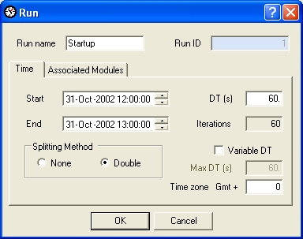

**Dialog box to specify Run properties**

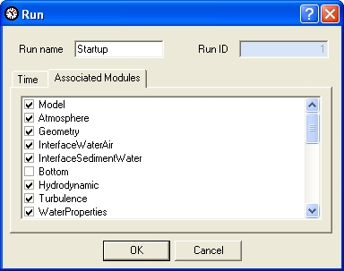

**Dialog box to specify Run properties**

It’s possible to access and change the properties of the run by selecting the run in the tree view and then select **"Edit -> Properties"** from MOHID GUI’s main menu.

Each run will receive automatically an Identification Number(ID). All files which belong to a given run will contain this ID at the end, before the extension of the file. For example, the input file for the hydrodynamic module of the run with ID = 5 will be called "Hydrodynamic\_5.dat".

After selecting a given run, its associated modules will be listed in the list view as presented in the image below ('**Tree view with a set of runs'**).

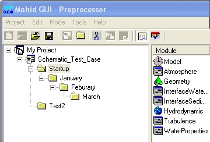

**Tree view with a set of runs**

### Accessing Module Data Files

Like mentioned previously, module data file can be accessed by double-clicking on the icon in the list view. Every time the user selected a different node in the tree view, the list view is actualized, showing the modules associated with the selected run. The list view shows for each module also information about:

- the relative path to the data file
- the time the file was last accessed
- the size of the file.

After double-clicking, the module data files can open in two ways: in a user defined text editor (which, by default, is "Notepad") or using an internal graphical user interface. The first ways guarantees the user really "sees" what is inside the data file. The second way is more user friendly, but provides only a limited access to modules computing options and just for a few modules. Therefore it’s recommended to edit your files using a text editor. The figure below ('**Screen shot of user desktop after opening a module data file'**) shows a screenshot of users desktop after accessing the geometry data file.

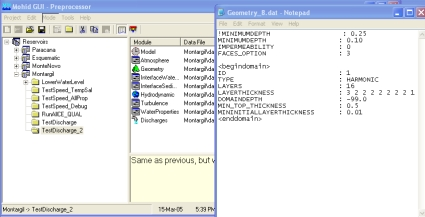

**Screen shot of user desktop after opening a module data file**

All MOHID data files are organized using a proper formatting, which is described in [Mohid Input/Output](../../overview/mohid-input-output.md). A complete list of all [keywords](../../io/keywords/keywords.md) and [blocks](../../io/keywords/blocks.md) which can be specified in a data file can be found [here](http://www.mohid.com/IHS/). At MOHID web site download area a set of sample data files is also available.

To change the way module data files are opened select **"Tools -> Options -> Data Files / Tools"** from MOHID GUI’s main menu.

### Copying data files among runs

MOHID GUI allows to copy module data files between runs, in a very similar way it is done by "Windows Explorer". To copy module data files it’s necessary to first select the source run in the tree and then the desired modules data files in the list view. Using the Ctrl-key permits the user to select multiple files. After selecting the files, the user has to choose **"Edit -> Copy"** from MOHID GUI’s main menu. The next step is to select the desired destination run and select **"Edit -> Paste"** from MOHID GUI’s main menu. Note that keyboard short cut keys for Copy (Control + C) and Paste (Control + V) operations are also available. If the user copies the module data file of the module "Model", the definition of the associated modules to the run is also copied. Please keep in mind this feature and re-edit Run properties to redefine the modules to be used.

### Running the Numerical Programs

After setting up all module data files, it’s possible to launch the numerical programs from MOHID GUI, by selecting **"Tools -> Launch Mohid"** from MOHID GUI’s main menu. A dialog box appears (see figure below **"Dialog box to launch the numerical programs"**). On the left side of the dialog box appears a copy of the tree view which is also found on the left side of MOHID GUI’s main window. By checking the check boxes next to the tree nodes, the user selects the runs that will be executed. Several runs can be chosen at the same time, they will be executed sequentially. Runs from different simulations can be chosen. On the right hand side of the dialog box some options appear that control the way the run is executed. If the user wants to execute numerical programs the option **"Run Mohid"** must be checked. In this case the option **"Create Nomfichs"** should also be checked. Other options are:

- **DTLog** – writes model time step to a file (just relevant if the model runs with a variable time step);
- **OutWatch** – performance internal CPU monitoring while the numerical program runs and writes a log file at the end of the run;
- **Output** – can be either to the DOS screen or be redirected to a file;
- **MPI** – this option can be used if the user wants to run models and sub models distributed over a network;
- **Launch after OK** – this option launches the batch file which will start all chosen runs immediately after closing the dialog box;
- **Batch File** – The name of the Batch File;
- **Priority** – The priority in the system "Task Manager".

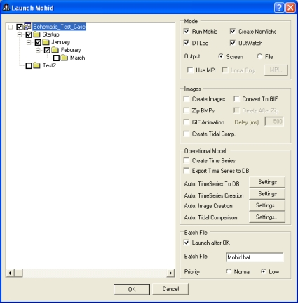

**Dialog box to launch the numerical programs**

If the option **"Launch after OK"** was checked, immediately after closing the dialog box, a DOS window like the one in the image below will appear (image **"MOHID numerical program during constructing phase"**). Several messages will be displayed during the constructing phase of the numerical model, which inform the user about most important compute options.

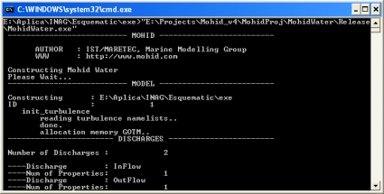

**MOHID numerical program during constructing phase**

When the numerical program passed trough all constructing phase, a message saying "Running MOHID, please wait..." will appear. Approximately 60 seconds after this message, and from this point forward every 60 seconds, a message will appear in the DOS window which will inform the user about (see figure below **"MOHID numerical program during the working cycle"**):

- **Time Instant** – the current time instant which the numerical model is simulating;
- **Elapsed CPU Time** – the processor time the numerical needed for far;
- **Remaining** – the remaining processor time until the end of the run;
- **Coefficient CPU / Model** – the coefficient between the processor time needed so far and the time span simulated so far;
- **Seconds per iteration** – the time spend to complete one working cycle;
- **System time** – the actual system time;
- **End of the run** – the foreseen system time at the end of the run.

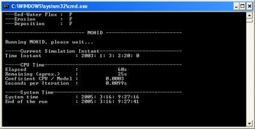

**MOHID numerical program during the working cycle**

During the numerical programs launching process, a set of input and output operations will take place:

- If the option “Create Nomfichs” is activated, for each selected run, a data file in the subdirectory “data” is created. This file contains links which indicate the numerical models where to find module data files and where to place output data files. Each run has its own "Nomfich" placed in the “data” subdirectory (name of each "Nomfich" file will be "Nomfich\_ID.dat", where ID represents the run ID);
- Immediately before starting MOHID numerical program, the batch file will copy the "Nomfich\_ID.dat" file of the run to be executed into the “exe” subdirectory, renaming it to "nomfich.dat”. In this directory MOHID numerical models expect always a "Nomfich.dat" file;
- MOHID GUI creates, for each run to be executed, a subdirectory in the "res" subdirectory. These subdirectories will be called "RunID", where ID is replaced by the ID of the run. Time series produced by MOHID numerical models will be placed in these subdirectories;
- During run execution, in the "exe" subdirectory two files will be created: (i) a file called "ErrorAndMessages.log" which contain warning messages produced by MOHID numerical models and (ii) a file called "UsedKeyWords.dat" which contains a list of all keywords read by the numerical model during the constructor phase.

At the end of the execution of a numerical program, some information related to total processor time is displayed in a console shell like the image below (**"MOHID numerical program after successful execution"**).

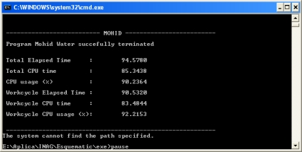

**MOHID numerical program after successful execution**

### Removing Simulations and Runs

To remove simulations or runs, the user has to select the simulation (or run) to remove in the tree view and select **"Edit -> Delete"** from MOHID GUI’s main menu. The selected simulation (or run) and all "child" simulations (or runs) will be removed. A dialog box (image below **"Dialog box to confirm to delete a set of runs"**) will appear where the user has to confirm to remove the selected run(s).

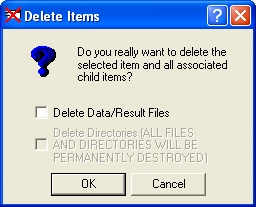

**Dialog box to confirm to delete a set of runs**

### Switching to Post Processing Mode

After successful run execution, it’s possible to switch MOHID GUI from pre processing mode to post processing mode, by selecting **"Mode -> Post Processing"** from MOHID GUI’s main menu (see image below **"MOHID GUI in Post Processor Mode"**). In Post Processing mode the list view of MOHID GUI’s main window will display result files produced by MOHID numerical models. At the top of the list view, HDF files are listed followed by time series produced by the model. By double-clicking on any HDF file, MOHID Post will start and open the selected file. Double-clicking on a second HDF file, will add the file to [MOHID Post](mohid-postprocessor.md). A double-click on any time series will start [Mohid Time Series Editor](mohid-time-series-editor.md).

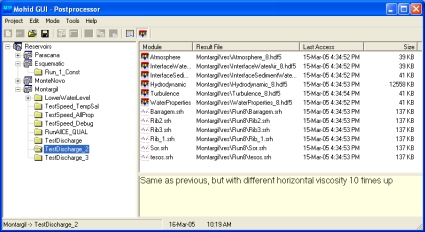

**MOHID GUI in Post Processor Mode**
