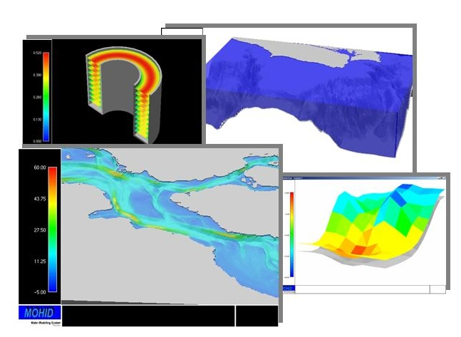
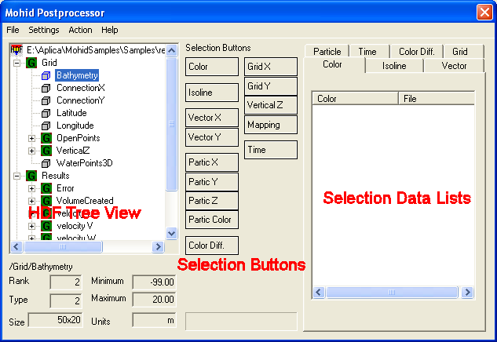

# Mohid PostProcessor

## Overview

**Example of plots made with MOHID PostProcessor**

Mohid Postprocessor is a graphical user interface which displays data stored in HDF5 files as animation on the screen. Mohid Postprocessor is written in FORTRAN and uses OpenGL to display the results. This tool allows you to visualize the temporal evolution and spatial distribution of any property as a continuous animation.

The data can be displayed in several ways like, color maps, isolines, vector plots and particle (for the lagrangian model). The display can be done in different views: XY slice, XZ slice, YZ slice, TZ slice or 3D cube.

Usually Mohid Postprocessor will be launched directly from [Mohid GUI](mohid-gui.md), opening directly the file chosen by the user (see [Switching to Post Processing Mode](mohid-gui.md)).

## Main window

This window is divided into three main areas: (i) HDF Tree View on the left, (ii) Selection Buttons in the middle and (iii) Selection Lists on the right.

**MOHID PostProcessor main window**

### HDF tree

The HDF Tree displays, in a hierarchical way, the contents of an [HDF5 file](../../io/formats/hdf-file.md). The tree consists of a file which has several groups which themselves have several datasets.

### Selection Buttons

The selection buttons allow to transfer selected data items in the HDF Tree to the Selected Data Lists. For instance, to display temperature as color map, select the correspondent HDF item in the HDF Tree and then press the Color button (the first button of the selection buttons). The information will pass to the Selected Data Lists. By selecting a group of data items, all datasets in that group will pass to the Selected Data Lists.

### Selected Data Lists

The Selected Data Lists display the data which is select to be displayed. To remove data from any of the lists, select the data items to remove and choose in the PostProcessor main menu, Action -> Delete.

## Step by Step

### Open a HDF5 file

Open one or more HDF files.

### Selecting Spatial Information

Select the grid over which to represent the data.

### Selecting Information to Display

Select the data to represent.

### Loading the Data

Load the data.

### Image Settings

Adjust the settings of the data.

### OpenGL Window

Display the data.

### Save the Images

Save the images.

## ROI

The ROI selects the region of interest to plot. You can plot maps (XY), sections (XZ and YZ), vertical profile time series (TZ) and in 3D.

When plotting sections or in 3D, the factor in the Z scale depends on the ratio between the size of the horizontal domain and the maximum depth of the water column at the specified section or, if when plotting in 3D, of the entire domain.

Take into account that the size of the horizontal domain depends on whether you load the metric coordinates (ConnectionX and ConnectionY) or the geographical coordinates (Latitude and Longitude). This is because the Post-Processor, when drawing the images, does not regard the units of the distances, but only its value.

For example, if you load ConnectionX and ConnectionY and your domain has 1000x1000km and 1000m of maximum depth, you have an horizontal plane which is 1000 times bigger than the vertical plane. Normally, to better understand the plot a ratio of 1:50 up to 1:100 is recommended, thus you should use a factor for Z of around 10 (1:100) to 20 (1:50).

If you load Latitude and Longitude, and you domain ranges from, e.g. 35º-45ºN and 16º-6ºW, thus a 10ºx10º domain and the same 1000m maximum depth, then your horizontal plane is 100 smaller than the vertical plane, because the ratio is computed based on the coordinates values not regarding the distance units. In this case you should use a Z factor of around 0.01 or 0.005.
