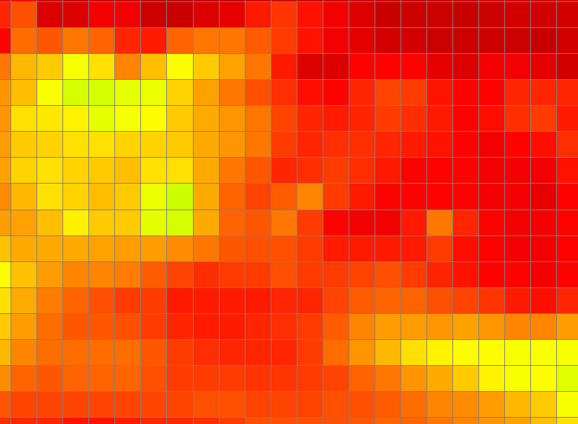

# SmoothBatimNesting



Animation consisting of three frames showing respectively i) the father bathymetry, ii) the son bathym, iii) and the interpolated bathym.

This program creates a new sub-model bathimetry to allow a smooth transition in the boundary between the coarser model and the high resolution model. See also [SmoothBatimCoefs](../reference/smoothbatimcoefs.md).

## Quick start

1. Create the father and son bathymetries (you may use [Mohid GIS](gui/mohid-gis.md)).
2. Create the SmoothCoeficients [griddata file](../io/formats/grid-data.md) (you may use [SmoothBatimCoefs](../reference/smoothbatimcoefs.md)).
3. Create and edit the options *SmoothBatimNesting.dat* file and save it in the same path as the executable.
4. Run the executable.

## Options file

Here's what the options file *SmoothBatimNesting.dat* looks like:

```
FATHER_BATIM                : ..\..\WestIberiaTide\GridData.dat
SON_BATIM                   : ..\GridData_2.dat
SMOOTH_COEF                 : SmoothCoef.dat
NEW_SON_BATIM               : SmoothData.dat
```

## Smoothing algorithm

Let it be $X \in \mathcal{F}\equiv\left\{F,\,S,\,I\right\}$, as an element of the father, the son and the interpolated bathymetries discrete fields. Let it be $I_X : \mathbb{N}^2 \longrightarrow \mathbb{R}^2$ as the respective index mapping function. Let it be $X^{\prime}: \mathbb{R}^2 \longrightarrow \mathbb{R}$, a continuous map, so that $X \equiv X^\prime\circ I_X,\;\forall X \in \mathcal{F}$. Let $r_X \subset \mathbb{R}^2$ define the work domain of $X^\prime \in \mathcal{F}^\prime$. In particular, $X^\prime$ verifies $X^\prime(\overline{r_X})\equiv 0$. The son grid is the same as the interpolated grid, meaning $I_S = I_I$. However, the father field is completely independent from the other fields, meaning that $r_{FS}\equiv\left(r_F \cap r_S\right) \subseteq \mathbb{R}^2$. The smoothing algorithm is a simple linear interpolation of the father and son fields:

$I^\prime = \left(1 - C^\prime\right) F^\prime + C^\prime\,S^\prime$

where the smoothing coefficient is given by $C^\prime: \mathbb{R}^2 \longrightarrow \left[0\;1\right]$. Thus, the smoothing coefficient gridded counterpart $C$ is defined; and its index mapping function $I_C$ is equal to the son's; meaning $I_C = I_S$. Let us define the grid $G \subseteq \mathbb{N}^2$ such that $I_S(G)\subseteq r_S$ and $I_S(G)\rightarrow r_S$. Thus the smoothing coefficient $C$ needs can be defined in $G$. Concretely speaking, $G \mapsto (I_S(G),C(I_S(G)))$ is the smoothing coefficient's [Grid Data](../io/formats/grid-data.md) file described above, thus it leaves to the modeller the choice of the smoothing coefficient field.

### Implementation

Let us define a collection of four-vertices polygons taken from the father grid:

$\begin{matrix} V : & \mathbb{N}^2 \longrightarrow \mathbb{R}^8 \\ & \left(i,\,j\right) \mapsto (I_{F\;i\,j},\,I_{F\;i+1\,j},\,I_{F\;i\,j+1},\,I_{F\;i+1\,j+1})\end{matrix}$

where $D\left(V_{i\,j}\right)\subset \mathbb{R}^2$ is the subdomain defined by the vertices of $V_{i\,j}$. Let us define an auxiliary grid of the son grid given by:

$\forall\; _{ij} \in \mathbb{N}^2,\;\tilde{I}_{S\;i\,j}=\frac{1}{4}\left(I_{S\;i\,j}+I_{S\;i+1\,j}+I_{S\;i\,j+1} +I_{S\;i+1\,j+1}\right)$.

Let us define a new mapping into a subset of $F$'s image:

\\$\forall\;_{i\,j} \in \mathbb{N}^2\quad \exists !\;_{u\,v} \in \mathbb{N}^2\; :\quad \tilde{I}_{S\;i\,j} \in D(V_{u\,v}) \wedge \tilde{F}_{i\,j}=F_{u\,v}$.

Here's the implemented smoothing algorithm:

$I_{i\,j} = \left(1 - C_{i\,j}\right) \tilde{F}_{i\,j} + C_{i\,j}\,S_{i\,j}$.

## Test image


Animation consisting of three frames showing respectively i) the father bathymetry, ii) the son bathym, iii) and the interpolated bathym.
