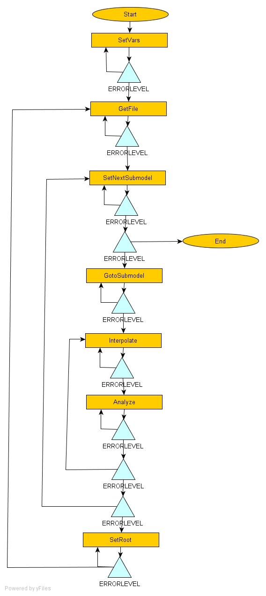

# Automatic Data Interpolation

A model is setup to run every week. However he will OBCs and initial conditions for u, v, S, T and waterlevel. Thus, the external data needs to be interpolated for model's grid, as well as for the submodels.

## Technology used

Perl and shell scripting, using ftp and smtp perl modules. Mohid tools to convert from netcdf to HDF5, and to interpolate. Scheduler or crontab to agend the task weekly.

## Control flow chart

Control Flow Diagram: Yellow boxes are perl programs or shell commands, blue triangles are flow control elements, dark edges show the program flow.
