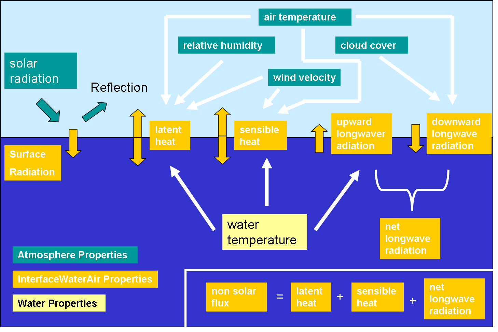

# Coupling Water-Atmosphere User Manual

## Overview

This user manual intends to help MOHID users to construct properties in the atmospheric and interface water-air compartments, in a way that his modeling needs are fulfilled. The document tries to answer to three main processes in what atmosphere takes part: i) wind forcing; ii) heat fluxes between air and water; iii) mass fluxes between air and water.

Momentum fluxes, Oxygen and Carbon fluxes are not yet considered in this user manual.

Heat fluxes between air and water command water warming and cooling processes and thermal stratification formation. Wind can play an important role on surface stress and on mixture depth control, destroying stratification. Thus, when thermal stratification in natural systems occurs, and 3D model is used, both processes should be simulated.

Mass fluxes can be important if level variations due to precipitation and evaporation or water abstraction are important.

## Inputs Required

### Wind Forcing

If one wants to simulate wind stress on water interface and account its role in hydrodynamic circulation some keywords and properties must be added to data files.

#### Hydrodynamic Data File

- **Keyword “WIND”** value has to be equal 1 (one): Ex: **WIND : 1**.

#### InterfaceWaterAir Data File

- **Property “wind stress X”** and **Property “wind stress Y”** must be defined. These properties can be a constant value, entered as timeserie or computed by the model (REMAIN\_CONSTANT : 0).

#### Atmosphere Data File

- If Properties “wind stress X” and “wind stress Y” in InterfaceWaterAir data file are to be computed, then **Property “wind velocity X”** and **Property “wind velocity Y”** must occur in atmosphere data file. These properties can be a constant value, entered as timeserie or computed by the model (REMAIN\_CONSTANT : 0).
- If Property “wind velocity X” and Property “wind velocity Y” are to be computed, this is done with wind modulus and wind angle. Then **Property “wind modulus”** and **Property “wind angle”** must occur in atmosphere data file. These properties can be a constant value or entered as timeserie.

### Heat Fluxes

In MOHID heat fluxes in water column are computed with:

i) a heat source: solar radiation that enters through the water surface (surface radiation - see description in [Module InterfaceWaterAir](modules/interfacewaterair.md)) suffering a decay with depth. Light is extinguished in the water column according to the [light extinction technical manual](../reference/light-extinction.md).

ii) a boundary condition for surface: non solar flux (see description in Module InterfaceWaterAir)

iii) a boundary condition for bottom: no flux, all radiation reaching the bottom is transformed in heat

If one wants to simulate heat fluxes on water interface and account its role in water temperature some keywords and properties must be added to data files. The next image ilustrates heat fluxes in MOHID and atmosphere, interface water-air and water properties that are called to compute them.



Water-Atmosphere heat fluxes and related properties in MOHID

#### WaterProperties Data File

- **Property “temperature”** must be defined because it is the state variable in water column affected by heat fluxes. Inside this property, block **keyword “SURFACE\_FLUXES”** value has to be equal 1 (one) so that water-air fluxes can be considered.

#### InterfaceWaterAir Data File

- **Property “surface radiation”** must be defined in InterfaceWaterAir data file. This property accounts for solar flux trough the water surface and can be a constant value, entered as timeserie or computed by the model (REMAIN\_CONSTANT : 0).
- **Property “non solar flux”** must be defined in InterfaceWaterAir data file. This property accounts for non solar flux (latent heat, sensible heat, etc) trough the water surface and can be a constant value, entered as timeserie or computed by the model (REMAIN\_CONSTANT : 0).
    -   If Property “non solar flux” has to be computed than this is a balance between latent heat, sensible heat and long wave radiation trough the water surface. Thus **Property “latent heat”**, **Property “sensible heat”** and **Property “net long wave radiation”** must be defined in InterfaceWaterAir data file. These properties can be a constant value, entered as timeserie or computed by the model (REMAIN\_CONSTANT : 0).
    -   **Remark**: latent heat and sensible heat depend on water temperature so they should be computed by the model. Net long wave radiation is a balance between downward long wave radiation (emission from the atmosphere) and upward long wave radiation (emission from water) and should be computed by the model.
        -   If Property “net long wave radiation” has to be computed than **Property "downward long wave radiation"** and **Property "upward long wave radiation"** must be defined in InterfaceWaterAir data file. These properties can be a constant value, entered as timeserie or computed by the model (REMAIN\_CONSTANT : 0).
        -   **Remark**: upward long wave radiation depends on water temperature so it should be computed by the model.

#### Atmosphere Data File

- If Property “surface radiation” in InterfaceWaterAir is to be computed by the model, **Property “solar radiation”** must be defined in Atmosphere data file. This property can be a constant value, entered as timeserie or computed by the model (REMAIN\_CONSTANT : 0). If this property is to be computed by the model, in Atmosphere data file **keyword RADIATION\_METHOD** (global variable) must define if it is MOHID method (value 1 - by default) or CE-QUAL based (value 2). See Solar Radiation theory for more details.
    -   If Property “solar radiation” is to be computed also **Property “cloud cover”** is needed in Atmosphere data file. If Cloud Cover is computed, **Keyword CLOUD\_COVER\_METHOD** (global variable) must define if it is computed from sun hours (value 1), from radiation (value 3) or from random values (value 2 - by default).
    -   **Remark**: Solar Radiation is a common property in INAG meteorological stations so, if available, data should be entered in timeserie format instead of computing with the model. Notice that if radiation is computed the model needs cloud cover and if cloud cover is computed (from radiation)it needs radiation.
- If Property “sensible heat” in InterfaceWaterAir is to be computed it is needed air temperature and wind velocity for the formulation . Thus, **Property “air temperature”** and **Property “wind velocity X”** and **Property “wind velocity Y”** must be defined in Atmosphere data file. These properties can be a constant value or entered as timeserie; wind velocity X and wind velocity Y can in addition be computed from Property “wind modulus” and Property “wind angle”, as stated previously (see 2.1.3). These last properties can be a constant value or entered as timeserie.
- If Property “latent heat” in InterfaceWaterAir is to be computed properties needed are the same as in Property “sensible heat” plus humidity. Thus, **also Property “humidity”** has to be added in Atmosphere data file. This property can be a constant value or entered as timeserie.
- If Property “downward long wave radiation” in InterfaceWaterAir is to be computed, then **Property “air temperature”** and **Property “cloud cover”** need to be defined in Atmosphere data file. These properties can be a constant value or entered as timeserie; cloud cover can in addition be computed by the model. If cloud cover is computed, **Keyword CLOUD\_COVER\_METHOD** (global variable) must define if it is computed from sun hours (value 1), from radiation (value 3). Until June 2015 there was the option to compute cloud cover from random values (value 2) but this option was removed.

- **Property cloud cover** if defined with **Keyword CLOUD\_COVER\_METHOD** 3 (from radiation) now has two optional keywords for customization:
    -   **keyword CLOUD\_COVER\_NIGHT** inside property block allows to define the cloud cover value at night (by default if the keyword is not present the value will be 0.595 - the old value that was hardcoded; this value is consistent with "FAO Irrigation and Draianage Paper Report 56" suggested values)
    -   **keyword CLOUD\_COVER\_MIN\_DAY** inside property block allows to define the minimum cloud cover during day (to remove very low values during sunrise that appear from the computation) and the default value if the keyword is not present is 0.3 (from "FAO Irrigation and Draianage Paper Report 56" suggested values).

### Mass Fluxes

Mass fluxes should be computed if level variations due to precipitation, evaporation or water abstraction are important. Surface water flux is defined as the balance between Precipitation, Evaporation and Irrigation.

#### Hydrodynamic Data File

- **Keyword SURFACEWATERFLUX** value has to be 1 (one). Ex: **SURFACEWATERFLUX : 1**.

#### InterfaceWaterAir Data File

- **Property “surface water flux”** must be present in InterfaceWaterAir data file. This property can be a constant value, entered as timeserie or computed by the model.
    -   If Property “surface water flux” is to be computed by the model then the three properties needed for the balance can appear: Precipitation, Irrigation and Evaporation (this is not mandatory, properties that not appear, are not considered). Thus, **Property “evaporation”** can be defined. This property can be a constant value, entered as timeserie or can be computed by the model from latent heat. As so, if Property “evaporation” is to be computed by the model, also **Property “latent heat”** must be defined (see 2.2.2).

#### AtmosphereDataFile

- If Property “surface water flux” in InterfaceWaterAir data file is to be computed by the model then the three properties needed for the balance can appear: Precipitation, Irrigation and Evaporation (this is not mandatory, properties that not appear, are not considered). Thus, **Property “precipitation”** and **Property “irrigation”** can be defined. These two properties can be a constant value or entered as timeserie.

## Example Data Files

### InterfaceWaterAir Data File

```
OUTPUT_TIME             : 0. 86400

<begin_rugosity>
INITIALIZATION_METHOD   : CONSTANT
DEFAULTVALUE            : 0.0025
REMAIN_CONSTANT         : 0
OUTPUT_HDF              : 1
TIME_SERIE              : 0
<end_rugosity>

!!!!!!Since 2016 code, wind stress X and wind stress Y have been unified in one single block:

<beginproperty>
NAME                      : wind stress
UNITS                     : N/m2
DESCRIPTION               : calculated wind stress X and Y
DEFAULTVALUE              : 0.0 0.0
CDWIND                    : 0.0015
REMAIN_CONSTANT           : 0
OUTPUT_HDF                : 0
TIME_SERIE                : 0
<endproperty>

!!!!!!Previous versions of the code use the following formulation for wind stress:

<beginproperty>
NAME                    : wind stress X
UNITS                   : N/m2
DESCRIPTION             : Calculated wind stress X
DEFAULTVALUE            : 0
CDWIND                  : 0.0015
REMAIN_CONSTANT         : 0
TYPE_ZUV                : z
OUTPUT_HDF              : 1
TIME_SERIE              : 0
<endproperty>

<beginproperty>
NAME                    : wind stress Y
UNITS                   : N/m2
DESCRIPTION             : Calculated wind stress Y
DEFAULTVALUE            : 0
CDWIND                  : 0.0015
TYPE_ZUV                : z
REMAIN_CONSTANT         : 0
OUTPUT_HDF              : 1
TIME_SERIE              : 0
<endproperty>

<beginproperty>
NAME                    : latent heat
UNITS                   : W/m^2
DESCRIPTION             : Calculated latent heat
FILE_IN_TIME            : NONE
REMAIN_CONSTANT         : 0
DEFAULTVALUE            : 0.
TIME_SERIE              : 0
OUTPUT_HDF              : 1
<endproperty>

<beginproperty>
NAME                    : sensible heat
UNITS                   : W/m^2
DESCRIPTION             : Calculated sensible heat
FILE_IN_TIME            : NONE
REMAIN_CONSTANT         : 0
DEFAULTVALUE            : 0.
TIME_SERIE              : 0
OUTPUT_HDF              : 1
<endproperty>

<beginproperty>
NAME                    : surface radiation
UNITS                   : W/m^2
DESCRIPTION             : Calculated infrared radiation
ALBEDO                  : 0.05
FILE_IN_TIME            : NONE
REMAIN_CONSTANT         : 0
DEFAULTVALUE            : 0.
TIME_SERIE              : 0
OUTPUT_HDF              : 1
<endproperty>

<beginproperty>
NAME                    : net long wave radiation
UNITS                   : W/m^2
DESCRIPTION             : Calculated net long wave radiation
FILE_IN_TIME            : NONE
REMAIN_CONSTANT         : 0
DEFAULTVALUE            : 0.
TIME_SERIE              : 0
OUTPUT_HDF              : 1
<endproperty>

<beginproperty>
NAME                    : downward long wave radiation
UNITS                   : W/m^2
DESCRIPTION             : downward long wave radiation data
FILE_IN_TIME            : HDF
FILENAME                :  ..\..\GeneralData\Atmosphere\MM5_20070606_Portugal.hdf5
DEFAULTVALUE            : 0.
TIME_SERIE              : 0
OUTPUT_HDF              : 1
<endproperty>

<beginproperty>
NAME                    : upward long wave radiation
UNITS                   : W/m^2
DESCRIPTION             : Calculated upward long wave radiation
FILE_IN_TIME            : NONE
REMAIN_CONSTANT         : 0
DEFAULTVALUE            : 0.
TIME_SERIE              : 0
OUTPUT_HDF              : 1
<endproperty>

<beginproperty>
NAME                    : non solar flux
UNITS                   : W/m^2
DESCRIPTION             : Calculated infrared radiation
FILE_IN_TIME            : NONE
REMAIN_CONSTANT         : 0
DEFAULTVALUE            : 0.
TIME_SERIE              : 0
OUTPUT_HDF              : 1
<endproperty>
```

### Atmosphere Data File

```
RUGOSITY                : 0.0025
OUTPUT_TIME             : 0. 86400

!!!!!!Since 2016 code, wind velocity X and wind velocity Y have been unified in one single block:

<beginproperty>
NAME                    : wind velocity
UNITS                   : m/s
DESCRIPTION             : wind velocity
DEFAULTVALUE            : -1.0 0.0
FILE_IN_TIME            : HDF
FILENAME_X              : ..\..\GeneralData\Atmosphere\MM5_20070606_Portugal.hdf5
FILENAME_Y              : ..\..\GeneralData\Atmosphere\MM5_20070606_Portugal.hdf5
HDF_FIELD_NAME_X        : wind velocity X
HDF_FIELD_NAME_Y        : wind velocity Y
REMAIN_CONSTANT         : 0
TIME_SERIE              : 1
OUTPUT_HDF              : 0
<endproperty>

!!!!!!Previous versions of the code use the following formulation for wind velocity:

<beginproperty>
NAME                    : wind velocity X
UNITS                   : m/s
DESCRIPTION             : wind velocity X
DEFAULTVALUE            : 0.
FILE_IN_TIME            : HDF
FILENAME                : ..\..\GeneralData\Atmosphere\MM5_20070606_Portugal.hdf5
TIME_SERIE              : 0
OUTPUT_HDF              : 1
<endproperty>

<beginproperty>
NAME                    : wind velocity Y
UNITS                   : m/s
DESCRIPTION             : wind velocity Y
DEFAULTVALUE            : 0.
FILE_IN_TIME            : HDF
FILENAME                : ..\..\GeneralData\Atmosphere\MM5_20070606_Portugal.hdf5
OUTPUT_HDF              : 1
<endproperty>

<beginproperty>
NAME                    : solar radiation
UNITS                   : W/m^2
DESCRIPTION             : meteoIST Solar Radiation
FILE_IN_TIME            : HDF
FILENAME                : ..\..\GeneralData\Atmosphere\MM5_20070606_Portugal.hdf5
DEFAULTVALUE            : 0.0
TIME_SERIE              : 0
OUTPUT_HDF              : 1
<endproperty>

<beginproperty>
NAME                    : air temperature
UNITS                   : ºC
DESCRIPTION             : Temperature
DEFAULTVALUE            : 0.
FILE_IN_TIME            : HDF
FILENAME                : ..\..\GeneralData\Atmosphere\MM5_20070606_Portugal.hdf5
TIME_SERIE              : 0
OUTPUT_HDF              : 1
<endproperty>

<beginproperty>
NAME                    : relative humidity
UNITS                   : fraction
DESCRIPTION             : Humidity
DEFAULTVALUE            : 0.
FILE_IN_TIME            : HDF
FILENAME                : ..\..\GeneralData\Atmosphere\MM5_20070606_Portugal.hdf5
TIME_SERIE              : 0
OUTPUT_HDF              : 1
<endproperty>

<beginproperty>
NAME                    : cloud cover
UNITS                   : fraction
DESCRIPTION             : cloud cover from radiation (default)
DEFAULTVALUE            : 0.
CLOUD_COVER_METHOD      : 3
FILE_IN_TIME            : NONE
REMAIN_CONSTANT         : 0
TIME_SERIE              : 0
OUTPUT_HDF              : 0
<endproperty>
```

## Links

- [Light\_extinction](../reference/light-extinction.md)
- [Module\_Atmosphere](modules/atmosphere.md)
- [Module\_InterfaceWaterAir](modules/interfacewaterair.md)
- [ConvertToHDF5](../tools/converttohdf5.md)
- [Meteo](../reference/meteo.md) - Available meteorological data
