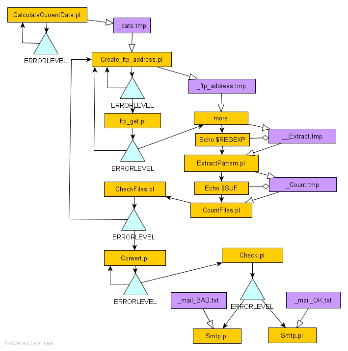

# Mercator Automatic Data Acquisition

This article describes the automatic data acquisition system built to get large-scale circulation model gridded data from Mercator-Océan ftp server. [Another article](automatic-data-interpolation.md) is written to describe the interpolation automated task for a given model.

## Objective

Every week Mercator-Océan releases a set of 63 netcdf gzipped files to their ftp site in a timestamped folder. The goal is to get these files, store them in the local network and perform data manipulation on them.

The catch is that sometimes some files are missing at the ftp site, sometimes the connection breaks down for some reason. Hence the data acquisition system must be "intelligent" to "know" when he has fetched all the files and when he must try again a new ftp connection to fetch the missing files.

## Technological base

Perl and shell scripting, using ftp and smtp perl modules. Mohid tools to convert from netcdf to HDF5, and to interpolate. Scheduler or crontab to agend the task weekly.

## Control flow diagram



Control Flow Diagram: Yellow boxes are perl programs or shell commands, purple boxes are input/output files, blue triangles are flow control elements, dark edges show the program flow, white edges show the input/output from/to files and white losangle edges show appending output to files.

Aside is the control flow diagram and below is the full batch file describing all the operations:

```
REM CalcDate.bat
:CALC
perl CalculateCurrentDate.pl > _date.tmp
IF %ERRORLEVEL% NEQ 0 GOTO CALC
IF ERRORLEVEL 0 GOTO CREATE

REM ftp_get.bat
:CREATE
more < _date.tmp | perl Create_ftp_address.pl > _ftp_address.tmp
IF %ERRORLEVEL% NEQ 0 GOTO CREATE
IF ERRORLEVEL 0 GOTO GET

:GET
more < _ftp_address.tmp | perl ftp_get.pl
IF %ERRORLEVEL% NEQ 0 GOTO CREATE
IF ERRORLEVEL 0 GOTO CHECKFILES

:CHECKFILES
more < _ftp_address.tmp > _Extract.tmp
echo (ist_meteog-mercatorPsy2v2r1v_R\d{8})>> _Extract.tmp

more < _Extract.tmp | perl ExtractPattern.pl  > _Count.tmp
echo .nc.gz>> _Count.tmp

more < _Count.tmp | perl CountFiles.pl | Checkfiles.pl
IF %ERRORLEVEL% NEQ 0 GOTO CREATE
IF ERRORLEVEL 0 GOTO CONVERT

REM convert.bat
:CONVERT
more < _date.tmp | perl Convert.pl
IF %ERRORLEVEL% NEQ 0 GOTO CONVERT
IF ERRORLEVEL 0 GOTO CHECK

REM interpol.bat
REM Still misses ...

REM check.bat
:CHECK
more < _date.tmp | perl check.pl
IF %ERRORLEVEL% NEQ 0 GOTO BAD
IF ERRORLEVEL 0 GOTO GOOD

:BAD
more mail_Bad.txt | perl smtp.pl
GOTO END

:GOOD
more mail_Ok.txt | perl smtp.pl
GOTO END

:END
del *.tmp
```

The command names are pretty self-explaining. The perl files are best described at their [repository](http://www.mohid.com/hydrogroup/codecomments.xml) where the [commented code](../archive/linux/code-comment-method.md) is published. Some care was taken so most of the little perl programs could be re-used generically.

## Comments

### 20061025

This week two new problems rose:

1. 3 intruder files were in the ftp download folder. This makes a number of 66 downloaded instead of 63. Thus the automatic data acquisition system ends up looping endlessly until 63 arrives.
2. The other problem is that when the ftp connection fails, the program re-hooks the ftp and continues to download the next non-existent file. The problem is that a zero bytes files exists and isn't downloaded again.

The solutions are:

1. Give in the ftp address file a regexp pattern for the ftp-get program to match, so it will download only the wanted files.
2. Check, besides the existence of the file, its size also. If zero bytes then download.
