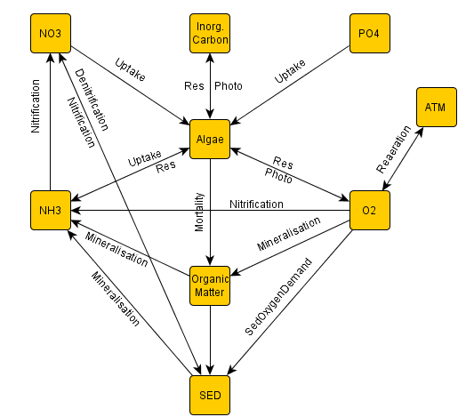

# Module CEQUALW2

Module CEQUALW2 is a module using the CE-QUAL-W2 ecological model formulations. CE-QUAL-W2 is 2D laterally average hydrodynamic and ecological model developed at the U.S. Corps of Engineers and it's normally used to simulate water quality in reservoirs. Its ecological formulations were adapted and re-programmed into MOHID as Module CEQUALW2 which made it possible to run 3D applications with these ecological formulations. This module is able to simulate 22 properties, including temperature, nutrients (nitrogen, phosphorus and silica biogeochemical cycles), oxygen and several species of algae (microalgae). The model does not simulate macroalgae, neither the influence of zooplankton in the primary production.

## Processes

```
Properties
```

```
Temperature
```

Microalgae (algae and epiphytes)



CEQUALW2 processes integrated in the MOHID system

```
Cohesive sediments
Detritus
Oxygen
Carbon dioxide
Ph
Alcalinity
Bicarbonate
Carbonate
BOD
Nitrate
Ammonia
Refractory particulate organic matter
Labile particulate organic matter
Refractory dissolved organic matter
Labile dissolved organic matter
Inorganic phosphorous
Particulate silica
Dissolved silica
Inorganic carbon
```

## Keywords

**CequalW2**

```
Keywords                      :Data Type     Default      Comment
DTSECONDS                     :Real          1200         ! Time step
```

```
<begin_algae>
NAME                          :Char                       !Name of the algae
A_GROWTH                      :Real          2            !DEFAULT: 2 - Maximum algae growth
A_RESPIRATION                 :Real          0.04         !Maximum algae respiration
A_EXCRETION                   :Real          0.04         !Maximum algae excretion
A_MORTALITY                   :Real          0.1          !Maximum algae mortality
A_HALFSAT_P                   :Real          0.003        !Algal half-saturation P [g m^-3]
A_HALFSAT_N                   :Real          0.014        !Algal half-saturation N [g m^-3]
A_HALFSAT_SI                  :Real          0            !Algal half-saturation N [g m^-3]
A_LIGHT_SAT                   :Real          75           !Algal saturating light intensity at maximum phtosynthetic rate [W m^-2]
A_T1                          :Real          5            !Lower temperature for algal growth (ºC)
A_T2                          :Real          25           ! Lower temperature for maximum algal growth (ºC)
A_T3                          :Real          35           ! Upper temperature for maximum algal growth
A_T4                          :Real          40           ! Upper temperature for algal growth
A_K1                          :Real          0.1          !Fraction of algal growth rate at AT1
A_K2                          :Real          0.99         !Fraction of maximum algal growth rate at AT2
A_K3                          :Real          0.99         !Fraction of maximum algal growth rate at AT3
A_K4                          :Real          0.1          !Fraction of algal growth rate at AT4
A_OK1                         :Real          13
A_OK2                         :Real          11           !Algal half-saturation coefficients for oxygen consumption [mgO2/l]
A_OK3                         :Real          2.5
A_OK4                         :Real          7
A_STOICHIOMETRY_P             :Real          0.005        !Algal stoichiometric coefficient for phosphorus
A_STOICHIOMETRY_N             :Real          0.08         !Algal stoichiometric coefficient for nitrogen
A_STOICHIOMETRY_C             :Real          0.45         !Algal stoichiometric coefficient for carbon
A_STOICHIOMETRY_Si            :Real          0.18         !Algal stoichiometric coefficient for silica
A_POM                         :Real          0.8          !Algal stoichiometric coefficient for POM
A_NEQUATIONNUMBER             :Integer       2            !Equation for preference factor (either 1 or 2)
A_AMMONIUM_PREF               :Real          0.001        !half-saturation copreference constant
O2_A_RESPIRATION              :Real          1.1          !Stoichiometry coefficient in respiration
O2_A_GROWTH                   :Real          1.4          !Stoichiometry coefficient in growth
<end_algae>
<begin_om>
LDOM_DECAY                    :Real          0.1          !LDOM decay rate [day^-1]
RDOM_DECAY                    :Real          0.001        !RDOM decay rate [day^-1
LRDOM_DECAY                   :Real          0.01         !Labile to refractory DOM dekay rate [day^-1]
LPOM_DECAY                    :Real          0.08         !LPOM decay rate [day^-1]
RPOM_DECAY                    :Real          0.001        !RPOM decay rate [day^-1]
LRPOM_DECAY                   :Real          0.01         !LRPOM decay rate [day^-1]
OM_STOICHIOMETRY_P            :Real          0.005        !Stoichiometric coef. for phosphorus
OM_STOICHIOMETRY_N            :Real          0.08         !Stoichiometric coef. for nitrogen
OM_STOICHIOMETRY_C            :Real          0.45         !Stoichiometric coef. for carbon
OM_STOICHIOMETRY_SI           :Real          0.18         !Stoichiometric coef. for silica
OM_T1                         :Real          4            !Organic Matter Temperature Rate Multipliers
OM_T2                         :Real          25
OM_K1                         :Real          0.1          !Organic Matter Temperature Rate Multipliers
OM_K2                         :Real          0.99
O2_OM                         :Real          1.4          !O2OM - Oxygen stoichiometry for organic matter decay
<end_om>
```

```
<begin_BOD>
BOD_DECAY                     :Real          0.25         !CBOD Decay Rate [day^-1]
BOD_T_COEF                    :Real          1.0147       !BOD Temperature Rate Multiplier
BOD_RATIO                     :Real          1.85         !Ratio of CBOD5 to ultimate CBOD
BOD_STOICHIOMETRY_P           :Real          0.004        !Phosphorus/CBOD stochiometric ratio
BOD_STOICHIOMETRY_N           :Real          0.06         !Nitrogen/CBOD stochiometric ratio
BOD_STOICHIOMETRY_C           :Real          0.32         !Carbon/CBOD stochiometric ratio
<end_BOD>
```

```
<begin_oxygen>
O2_METHOD                     :Integer       1            !Method to compute oxygen: 1 – Simple with O2_LIM; 2 – Monod curve; 3 – Ecotoxicity curve
O2LIM                         :Real          0.1          !Dissolved oxygen concentration at which anaerobic processes begin [g m^-3]
O2_K1                         :Real          2.5          !Toxicity equation coefficients for oxygen consumption
O2_K2                         :Real          7
<end_oxygen>
```

```
<begin_nitro>
NH4_DECAY                     :Real          0.12         !Ammonium Decay Rate [day^-1]
NH4_T1                        :Real          5            !Minimum Temperature (T1)
NH4_T2                        :Real          25           !upper temperature (T2)
NH4_K1                        :Real          0.1          !Multiplier factor for T1
NH4_K2                        :Real          0.99         !Multiplier factor for T2
NO3_DECAY                     :Real          0.03         !Nitrate Decay Rate [day^-1]
NO3_T1                        :Real          5            !Minimum temperature (T1)
NO3_T2                        :Real          25           !Optimal temperature (T2)
NO3_K1                        :Real          0.1          !Multiplier factor for T1
NO3_K2                        :Real          0.99         !Multiplier factor for T2
O2_NH4                        :Real          4.57         !O2NH4 - Oxygen stoichiometry for nitrification
<end_nitro>
```

```
<begin_epiphyton>
NAME                          :Char                       !Name of the epiphyte
E_GROWTH                      :Real          2            !Maximum epiphyte growth
E_RESPIRATION                 :Real          0.04         !Maximum epiphyte respiration
E_EXCRETION                   :Real          0.04         !Maximum epiphyte excretion
E_MORTALITY                   :Real          0.1          !DEFAULT: 0.15 - Maximum epiphyte mortality
E_HALFSAT_P                   :Real          0.003        ! epiphyte half-saturation P [g m^-3]
E_HALFSAT_N                   :Real          0.014        ! epiphyte half-saturation N [g m^-3]
E_HALFSAT_SI                  :Real          0            ! epiphyte half-saturation N [g m^-3]
E_LIGHT_SAT                   :Real          75           ! epiphyte saturating light intensity at maximum phtosynthetic rate [W m^-2]
E_T1                          :Real          5            !Lower temperature for epiphyte growth (ºC)
E_T2                          :Real          25           ! Lower temperature for maximum epiphyte growth (ºC)
E_T3                          :Real          35           ! Upper temperature for maximum epiphyte growth
E_T4                          :Real          40           ! Upper temperature for epiphyte growth
E_K1                          :Real          0.1          !Fraction of epiphyte growth rate at AT1
E_K2                          :Real          0.99         !Fraction of maximum epiphyte growth rate at AT2
E_K3                          :Real          0.99         !Fraction of maximum epiphyte growth rate at AT3
E_K4                          :Real          0.1          !Fraction of epiphyte growth rate at AT4
E_STOICHIOMETRY_P             :Real          0.005        !epiphyte stoichiometric coefficient for phosphorus
E_STOICHIOMETRY_N             :Real          0.08         !epiphyte stoichiometric coefficient for nitrogen
E_STOICHIOMETRY_C             :Real          0.45         !epiphyte stoichiometric coefficient for carbon
E_STOICHIOMETRY_Si            :Real          0.18         !epiphyte stoichiometric coefficient for silica
E_POM                         :Real          0.8          !epiphyte stoichiometric coefficient for POM
E_NEQUATIONNUMBER             :Integer       2            !Equation for preference factor (either 1 or 2)
E_AMMONIUM_PREF               :Real          0.001        !half-saturation copreference constant
O2_E_RESPIRATION              :Real          1.1          !Stoichiometry coefficient in respiration
O2_E_GROWTH                   :Real          1.4          !Stoichiometry coefficient in growth
< end_epiphyton >
```

```
<begin_phos>
OM_STOICHIOMETRY_P            :Real          0.005        !Stoichiometric coef. for phosphorous
<end_phos>
```

```
<begin_ammonia>
OM_STOICHIOMETRY_N            :Real          0.08         !Stoichiometric coef. for phosphorous
<end_ammonia>
```

```
<begin_silica>
PARTSI_DECAY                  :Real          0.3          !Particulate biogenic silica decay rate [day^-1]
<end_silica>
```

```
<begin_dsi>
OM_STOICHIOMETRY_SI           :Real          0.18         !Stoichiometric coef. for silica
<end_dsi>
```

```
<begin_ic>
OM_STOICHIOMETRY_C            :Real          0.45         !Stoichiometric coef. for carbon
<end_ic>
```

```
BenthicCequalW2
```

```
DTSECONDS                     :Real          1200
<begin_SOD>
PO4R                          :Real          0.001        ! Release of PO4 by SOD rate
NH4R                          :Real          0.001        ! Release of PO4 by SOD rate
SiR                           :Real          0.1          ! Release of Silica by SOD rate
CO2R                          :Real          0.1          ! Release of CO2 by SOD rate
O2Consumption                 :Integer       1            ! Sink of O2 by SOD rate
DefaultO2                     :Integer       1            ! If off, consumes O2 only when there is no Oxygen
SODT1                         :Real          4            ! T1 for temperature rate multiplier
SODT2                         :Real          35           ! T2 for temperature rate multiplier
SODK1                         :Real          0.1          ! K1 for temperature rate multiplier
SODK2                         :Real          0.99         ! K2 for temperature rate multiplier
<end_SOD>
```

```
<begin_det>
DET_DECAY                     :Real          0.1          ! Sediment decay rate, [day^-1]
DET_T1                        :Real          4            ! T1 for temperature rate multiplier
DET_T2                        :Real          30           ! T2 for temperature rate multiplier
DET_K1                        :Real          0.1          ! K1 for temperature rate multiplier
DET_K2                        :Real          0.99         ! K2 for temperature rate multiplier
<end_det>
```
