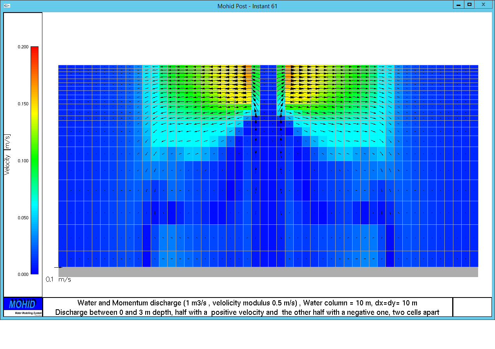
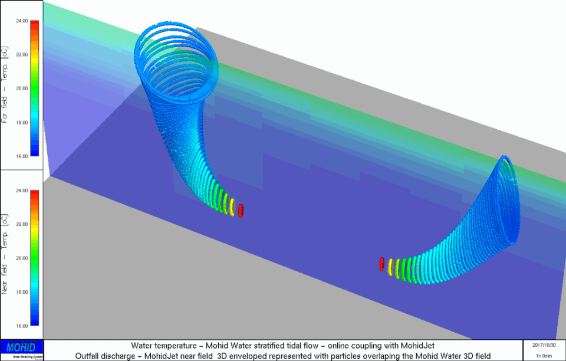

# Module Discharges

## Overview

Module Discharges handles all the point discharges in Mohid Water Modelling System. These discharges can be simple water discharges but can also have properties such as substances concentration (temperature, salinity, nutrients, contaminants, etc) and/or momentum.

## Main features

### ID

### Location

#### Horizontal

A discharge can be made in a point, along a line or in a polygon. The keyword to define the type of horizontal emission is SPATIAL\_EMISSION, the options are: **Point**, **Line** and **Polygon**. The default option is **Point**.

```
SPATIAL_EMISSION : Point
```

A point can be define using the grid coordinates (COORD\_X, COORD\_Y)

```
COORD_X : 8.6
COORD_Y : 42.3
```

or specifing the cell (I\_CELL - line, J\_CELL - column)

```
I_CELL : 23
J_CELL : 43
```

To define a discharge along a line is necessary to specify a file with the [Lines](../../io/formats/lines.md) format. The keyword used is SPATIAL\_FILE.

```
SPATIAL_FILE : Discharge.lin
```

To define a discharge in a box is necessary to specify a file with the [Polygon](../../io/formats/polygons.md) format. The keyword used is SPATIAL\_FILE.

```
SPATIAL_FILE : Discharge.xy
```

#### Vertical

**VERTICAL\_DISCHARGE** - this keyword is used to specify the discharge distribution in the vertical direction:

```
1 – discharge in the bottom cell
2 – discharge in the surface cell
3 – discharge in the cell that intersects the depth defined in the keyword K_DEPTH (no default value). It is a depth relative to the water surface.
4 – discharge in the layer defined in the keyword K_CELL (no default value)
5 – Assumes a uniform distribution along the entire water column
```

Option 4 is the default one.

### Discharge type

The flow associated to hydraulic structures can be very complex of solving explicitly. In the other hand hydraulic structures can have an important impact in the hydrodynamic flow interior, transition and coastal waters. Having this in mind were programmed several types of discharges.

The discharge type is defined by the keyword

```
DISCHARGE_TYPE : 1
```

The discharge can have four possible types:

```
1 - normal (default)
2 - overflow
3 - valve
4 - OpenMI link
```

**normal**: In this case the flow is defined explicitly by the user: constant value or a time series

**overflow**: This discharge type aims to simulate the flow associate to a spillway. The flow in this case is function of the water level in the discharge location. The spillway is a structure used to provide the controlled release of flows from a dam or levee into a downstream area, typically being the river that was dammed. In the UK they may be known as overflow channels

```
Q=\sqrt{2g}\cdot w_{c_{_}}{\cdot }\Delta H^{1.5} \cdot w_{L}

```

```
Q - flow\\
```

```
w_{c_{_}} - weir \ (\ or \ spillway) \ empiric \ coefficient \\
```

```
w_{L_{_}} - weir \ (\ or \ spillway) \ width \\
```

```
\Delta H = SSH - w_{z_{_}}
```

$SSH - Sea \ Surface \ Height$

```
w_{z_{_}} - crest \ height \ or \ sill \ of \ the \ weir
```

Keywords related with the **flow over** type discharge

```
!length of the weir (mandatory)
WEIR_LENGTH :
```

```
!empiric flow coefficient (default = 0.4)
WEIR_COEF : 0.4
```

```
!crest height or sill of the weir (mandatory)
CREST_HEIGTH :
```

**valve**: This discharge aims to simulate the flow associated to a hydraulic valve. The flow in this case is function of the water level difference between two locations. In this type of discharge it is necessary to define for each discharge two locations. The flow between the two locations can be two-way (normal valve) or one-way (or check valve).

```
Q=\sqrt{2g \cdot \Delta H}\cdot v_{c_{_}} \cdot A

```

```
Q - flow\\
```

```
v_{c_{_}} - valve \ empiric \ coefficient \\
```

$\Delta H = SSH_{a} -SSH_{b}$

$SSH_{x} - Sea \ Surface \ Height \ in \ point \ x$

```
A - area \ of \ the \ valve. \ The \ valve \ is \ assumed \ to \ be \ circular
```

```
!valve diameter (mandatory)
VALVE_DIAMETER    :
```

```
!valve empiric coefficient (by default equal to 1
VALVE_COEF        : 1
```

```
!height of the valve center
VALVE_AXIS_HEIGTH :
```

**OpenMI link** : This option is used to link models using the OpenMI standard.

#### Bypass Discharge

The bypass discharge allows the user to transfer instantaneously mass and momentum from a point A to a point B. The "valve discharge" is a bypass discharge. To define properly a "valve discharge" the user must also connect the bypass option. If the user wants to define a two way discharge between point A and B, needs to define two bypass discharges: 1 - from A to B 2 - from B to A

The mass conservation is assured automatically for the discharges: "flow over" and "valve". In the case of the "normal" option to assure mass conservation the discharge concentrations must be equal and flow must be symmetric between the two discharges.

```
!check if the discharge is bypass or not
BYPASS_ON : 0/1
```

```
!location of point B of the bypass discharge
BYPASS_I :
BYPASS_J :
```

```
!Check if the bypass is one or two-way. One-way means there is only a discharge if the flow is only in one of the two possible directions.
BYPASS_ONEWAY : 0/1
```

```
!If the discharge is one-way there are 2 options: 1 (from A to B), 2 (from B to A).
!Option 1 means there is only a discharge if the flow goes from A to B. Option 2 is the inverse of 1.
BYPASS_SIDE : 1/2
```

### Database file

### Properties

### Momentum discharge

The user can define a velocity to the discharge via the follow keyword

DEFAULT\_VELOCITY\_VALUE : vx vy vz

The momentum discharge need to by connected in the hydrodynamic\_x.dat input file via the follow keyword

MOMENTUM\_DISCHARGE  : 1

The follow image shows a symmetry test for a:

1) Water and Momentum discharge (1 m3/s , velocity modulus 0.5 m/s)

2) Water column = 10 m, dx=dy= 10 m

3) Discharge between 0 and 3 m depth

4) half with a positive velocity and the other half with a negative one

5) two cells apart



### MohidJet discharge

The user can define a discharge compute by MohidJet (Buoyant Jet Integral Model) [http://www.mohid.com/PublicData/Products/Manuals/MOHIDJET.pdf](http://www.mohid.com/PublicData/Products/Manuals/MOHIDJET.pdf) Need to define the follow in the discharges\_x.dat input file

!MohidJet

DISCHARGE\_TYPE  : 6

MOHID\_JET\_FILE  : ..\\data\\MohidJet\_West.dat

The momentum discharge need to by connected in the hydrodynamic\_x.dat input file via the follow keyword

WATER\_DISCHARGES  : 1

MOMENTUM\_DISCHARGE  : 1

The follow image shows two MohidJet discharges:

1) via two ports with opposite directions;

2) flow of 0.5 m3/s discharge via a port with a diameter of 0.8 m (1 m/s) place 3 m above the bottom;

3) Water column = 10 m, dx=dy= 10 m

4) tidal flow with a sin variability with a 12 h period and and amplitude of 2 m and 10 cm/s for the water level and velocity.



## User manual

### Sample discharge

#### MOHID WATER

Here's what a configuration file of the **Module Discharges** should look like for a single river run-off. Note that you are previously required to build a time serie .srw with the flow, the temperature and the salinity in order to correctly implement the discharge.

```
<begindischarge>
NAME                    : Loire
DESCRIPTION             : Daily timeserie for the year 2004
I_CELL                  : 144
J_CELL                  : 220
K_CELL                  : 38
DEFAULT_FLOW_VALUE      : 300
DATA_BASE_FILE          : M:\Biscay\GeneralData\Level2\rivers\Loire.srw
FLOW_COLUMN             : 2
TIME_SERIE_COLUMN       : 1
DISCHARGE_UNIFORM       : 1

<<beginproperty>>
NAME                    : temperature
UNITS                   : celcius
DESCRIPTION             : temperature in the tagus river
CONSTANT_CONC           : 0
DEFAULTVALUE            : 19.9
TIME_SERIE_COLUMN       : 3
<<endproperty>>

<<beginproperty>>
NAME                    : salinity
UNITS                   : psu
DESCRIPTION            : salinity in the tagus river
CONSTANT_CONC          : 1
DEFAULTVALUE           : 0.01
<<endproperty>>

<enddischarge>
```

#### MOHID RIVER NETWORK

For Mohid River Network discharges can be made on nodes. As so, you will need to check within the drainage network difinition in which node to discharge. Here's what a configuration file should look like for a single discharge. Note that you are previously required to build a time serie with the flow, and any other property in order to correctly implement the discharge.

Discharges into MOHID River Network can be automatically linked to SWAT model discharges; see description in SWATLink download package in www.mohid.com

Steps after creating the discharge time serie (with time and flow as minimum):

1 - Have to activate module discharges so that Discharges\_X.dat in input data file appears in the simulation (in Simulation Properties add the model if not present)

2 - The block <begindischarge> <enddischarge> has to appear in Discharges\_X.dat and can add the number of discharge properties that you want (or none, if only water discharged).

```
<begindischarge>
NAME                          : NODE_19
DESCRIPTION                   : Not given
NODE_ID                       :  19
DATA_BASE_FILE                : ..\..\GeneralData\Discharge.dat
FLOW_COLUMN                   :  2
<<beginproperty>>
NAME                          : nitrate
UNITS                         : mg N/l
DESCRIPTION                   : nitrate
TIME_SERIE_COLUMN             : 3
<<endproperty>>
...
<enddischarge>
```

To know the node ID of your discharge, do a query on the GIS, on top of the drainage network in the point required. The query result (if pointing to a river section) will say the node ID.

DATA\_BASE\_FILE is the file that was prepared with at least time and flow. If giving also property timeserie (e.g nitrate) also need a column to nitrate in the file. FLOW\_COLUMN is the column with flow and TIME\_SERIE\_COLUMN is the column with the property time serie.

3 - have to activate discharges (DISCHARGES : 1) in DrainageNetwork\_X.dat

4 - run the simulation and compare flow results in HDF or in node timeseries between a simulation with the discharge and without it (the discharge will only appear in the node timeseries results that are downstream of the inputed discharge).

#### MOHID LAND RUNOFF AND POROUS MEDIA

To add a discharge in Porous Media or Runoff the discharge file is similar to MOHID Water.

Just need to know that K\_CELL is 0 (zero) for discharge in Runoff and the layer number for Porous Media.

And correspondingly in PorousMedia\_X.dat and Runoff\_X.dat need to have the keyword

```
DISCHARGES : 1
```

If discharging also properties, in PorousMedia Properties\_X.dat and Runoff Properties\_X.dat in the discharged properties need to add also inside the proeprty block

```
DISCHARGES : 1
```

## References
