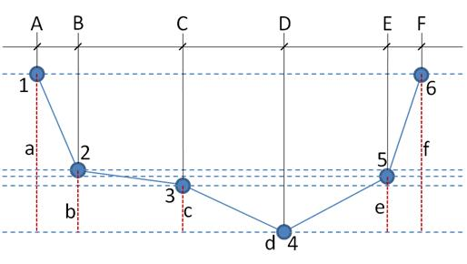

# Module DrainageNetwork

## Overview

This module can be used by two models: [MOHID Land](../../land/mohid-land.md), and [MOHID River Network](../../overview/mohid-river-network.md). Like other modules, it has a specific input file, called **DrainageNetwork\_X.dat**, where X is the simulation number. The following tables describe the keywords that can be used, their data type, and the default values (in case of omission).

### DrainageNetwork\_X.dat Keywords

#### General

```
Keyword                   : Data Type         Default     !Comment
NETWORK_FILE              : char              -           !Path to drainage network file
CHECK_NODES               : 0/1               [1]         !Ckeck nodes consistency
CHECK_REACHES             : 0/1               [1]         !Check reaches consistency
GLOBAL_MANNING            : real              -           !Rugosity in Channels
GEO_CONVERSATION_FACTOR   : real              [1.]        !Lat to Meters rough estimation
```

#### Stabilization

```
Keyword                   : Data Type         Default     !Comment
STABILIZE                 : 0/1               [0]         !Restart time iteration if high volume gradients
STABILIZE_FACTOR          : real              [0.1]       !max gradient in time steps as fraction of old volume
MAX_ITERATIONS            : int               [100]       !Max iterations for stabilized check
DT_FACTOR                 : real              [0.8]       !Factor for DT Prediction
MAX_DT_FLOOD              : real              [10.0]      !Max DT if channel water level exceeds full bank
```

#### Hydrodynamic

```
Keyword                   : Data Type         Default     !Comment
HYDRODYNAMIC_APROX        : int               [1]         !1 - KinematicWave, 2 - DiffusionWave, 3 - DynamicWave
NUMERICAL_SCHEME          : int               [0]         !0 - ExplicitScheme, 1 - ImplicitScheme
MASS_ERR                  : real(8)           [0.001]     !Max error in mass conservation
MIN_WATER_DEPTH           : real              [0.001]     !Min water depth in nodes (For h < MIN_WATER_DEPTH water stops flowing)
INITIAL_WATER_DEPTH       : real              [0.0]       !Initial water depth
MINIMUM_SLOPE             : real              [0.0]       !Minimum Slope for Kinematic Wave
```

#### Downstream Boundary

```
Keyword                   : Data Type         Default     !Comment
DOWNSTREAM_BOUNDARY       : int               [1]         !0 - Dam, 1 - ZDG, 2 - CD, 3 - ImposedWaterDepth, 3 - ImposedVelocity
DEFAULTVALUE              : real              -           !Default value at downstream boundary
FILE_IN_TIME              : char              [NONE]      !If DOWNSTREAM_BOUNDARY = ImposedWaterDepth, this can be NONE or TIMESERIE
FILENAME                  : char              -           !If FILE_IN_TIME = TIMESERIE, this is the name of timeserie file for the downstream boundary
DATA_COLUMN               : int               -           !Number of column with data in FILE_IN_TIME
```

#### Output

Output is given for all nodes in HDF5 format, and also as time series for the specified nodes in TIME\_SERIE\_LOCATION file. These nodes are identified by their IDS (see Network file) and have to be inside the block **<BeginNodeTimeSerie> / <EndNodeTimeSerie>**.

```
Keyword                   : Data Type         Default     !Comment
OUTPUT_TIME               : int int...        [-]         !time interval between outputs for all nodes, in HDF5 format.
TIME_SERIE_LOCATION       : char              -           !Path to time serie file with the specified nodes (can be this file)
MAX_BUFFER_SIZE           : 1000
COMPUTE_RESIDUAL          : 1
DT_OUTPUT_TIME            : 1200
TIME_SERIE_BY_NODES       : 0/1               [0]         !Keyword to see if the user wants the time series to be written by nodes, i.e.,
                                                          !One file per node, with all variables in the headers list
                                                          !if FALSE, its one file per variable with nodes in the headers.
```

channel water depth - height (m) from bottom channel to surface water in the selected nodes.

channel water level - altitude (m) of surface water in the selected nodes.

channel flow - flow (m3/s) in the selected nodes/reaches.

flow to channels - flow (m3/s) from runoff to river in the selected nodes.

GW flow to channels - flow (m3/s) from groundwater to river in the selected nodes.

each property transported will have an output with its concentration (mg/L) in the selected nodes. If property is particulated aslso will have a series named Bottom\_

$$
PropertyName
$$

 (kg/m2).

[Check Mohid Land Heights and Levels to understand the difference between level and height results](http://screencast.com/t/I8We0B4j2uJ)

#### Processes

```
Keyword                   : Data Type         Default     !Comment
MIN_WATER_DEPTH_PROCESS   : real              [0.01]      !Water Quality Process / Surface Fluxes shutdown
DISCHARGES                : 0/1               [0]         !Use module discharges (WWTP, etc)
TRANSMISSION_LOSSES       : 0/1               [0]         !If user wants to use transmission losses
HYDRAULIC_CONDUCTIVITY    : real              -           !Hydraulic Conductivity to calculate transmission losses
REMOVE_OVERTOP            : 0/1               [0]         !Removes Water if channels are overtoped
AERATION_METHOD           : int               [-]         !1 - PoolAndRifle, 2 - ChannelControled_
T90_DECAY_MODEL           : 0                 [1]         !0 - Constant, 1 - Canteras, 2 - Chapra
T90                       : real              [7200.]     !if T90_DECAY_MODEL = Constant
SHADING_FACTOR            : real              [1.]        !0-1 fraction of riparian shading
FRACTION_SEDIMENT         : 0/1               [0]
GLOBAL_TOXICITY           : char              ['SUM']     !Global Toxicity Computation Method : SUM,MAX,RISKRATIO
```

#### Properties

Each property keywords must be inside a block **<beginproperty>/<endproperty>**.

```
Keyword                    : Data Type         Default      !Comment
<beginproperty>
NAME                       : char              [-]          !Property name, must be on of Properties_names
UNITS                      : char              [-]          !usually mg/L (see IS_COEF)
IS_COEF                    : real              [1.e-3]      !Conversion factor to the International System
DESCRIPTION                : char              [-]          !Property description
DEFAULT_VALUE              : real              [0.0]        !Property initial concentration
MIN_VALUE                  : real              [0.0]        !Property minimum concentration
OVERLAND_CONCENTRATION     : real              [0.0]        !Concentration discharged from overland
GROUNDWATER_CONCENTRATION  : real              [0.0]        !Concentration discharged from ground water
DIFFUSEWATER_CONCENTRATION : real              [0.0]
ADVECTION_DIFUSION         : 0/1               [1]          !1 - want to transport property; 0 - no transport
    ADVECTION_SCHEME       : int               [1]          !1 - UpwindOrder1 (currently no more options)
    DIFFUSION_SCHEME       : int               [5]          !5 - CentralDiff  (currently no more options)
    DIFFUSIVITY            : real              [1e-8]       !Molecular diffusivity of property in m2/s
DISCHARGES                 : 0/1               [0]          !1 - property is discharged; 0 - no discharges
TOXICITY                   : 0/1               [0]          !1 - property has an associated toxicity
    TOX_EVOLUTION          : int               [1]          !1 - Saturation, 2 - Linear, 3 - RiskRatio
    EC50                   : real              [0.5]        !If TOX_EVOLUTION = Saturation or RiskRatio,
                                                            !EC50 is the concentration that causes 50% of effect (Tox = 0.5)
                                                            !in fraction of initial concentration units [%]
    SLOPE                  : real              [1.0]        !If TOX_EVOLUTION = Linear
DECAY                      : 0/1               [0]          !1- want to use bacterial decay model. 0 - no use. Must have DISCHARGES = 1 and atmosphere.
SURFACE_FLUXES             : 0/1               [0]          !Property has surface fluxes (e.g. evaporation). Needs atmosphere.
BOTTOM_FLUXES              : 0/1               [0]          !Property has bottom fluxes. Must be particulate.
    BOTTOM_CONC            : real              [0.0]        !Bottom Initial Concentration
    BOTTOM_MIN_CONC        : real              [0.0]        !Bottom Minimum Concentration
    EROSION                : 0/1               [1]          !Compute erosion fluxes
        CRIT_SS_EROSION    : real              [0.2]        !Critical Erosion Shear Stress [Pa]
        EROSION_COEF       : real              [5.0E-4]     !Erosion Coefficient [kg m-2 s-1]
    DEPOSITION             : 0/1               [1]          !Compute deposition fluxes
        CRIT_SS_DEPOSITION : real              [0.1]        !Critical Deposition Shear Stress [Pa]
        CHS                : real              [4.0]        !Hindered settling [kg m-3] - See Module_FreeVerticalMovement.
        WS_TYPE            : int               [1]          !Settling type: WSConstant = 1, SPMFunction = 2
        WS_VALUE           : real              [0.0001]     !Constant settling velocity [m s-1]
        KL                 : real              [0.1]        !See Module_FreeVerticalMovement.
        KL1                : real              [0.1]        !See Module_FreeVerticalMovement.
        ML                 : real              [4.62]       !See Module_FreeVerticalMovement.
        M                  : real              [1.0]        !See Module_FreeVerticalMovement.
WATER_QUALITY              : 0/1               [0]          !1 - use Water Quality Model for property transformation; 0 - no use
BENTHOS                    : 0/1               [0]          !1 - use Benthos Model for property transformation; 0 - no use
CEQUALW2                   : 0/1               [0]          !1 - use CEQUALW2 Model for property transformation; 0 - no use
LIFE                       : 0/1               [0]          !1 - use Life Model for property transformation; 0 - no use
EXTINCTION_PARAMETER       : real              [1.0]        !LIGHT EXTINCTION COEFFICIENT
TIME_SERIE                 : 0/1               [0]          !Output this property in time series files.
OUTPUT_NAME                : char              [NAME]       !Can be NAME or DESCRIPTION.
COMPUTE_LOAD               : 0/1               [0]          !Output concentration (in UNITS) x Flow [m3 s-1]
SUMTOTALCONC               : 0/1               [0] 0        !Checks if user wants to calculate total Concentration (Column + Bottom).
<endproperty>
```

##### Toxicity Model

- The formulation is to associate an eco-toxiciy value to the property (From project ECORIVER 2002).
- Every toxic property must be discharged.
- Its concentration in the river network is set to 0.0.
- Discharge concentration must be equal to 1, because we are measuring the dilution D = 1 - C\_new / C\_ini
- The variable property%toxicity%concentration represents C/c\_ini so it starts by being 1.
- This is not even close to a final version. For more details, or sugestions/corrections, contact MARETEC (Rosa Trancoso).
- EC50 - Concentration that causes 50% of effect (Tox = 0.5)

### Network file

The Network file specified in **NETWORK\_FILE** keyword has two types of blocks:

- **<BeginNode>/ <EndNode>**
- **<BeginReach>/<EndReach>**

#### Keywords

```
<BeginNode>
  ID                      : int               -           !Node ID number
  COORDINATES             : real real         -           !Node coordinates
  GRID_I                  : int               -           !I position of node, if grid
  GRID_J                  : int               -           !J position of node, if grid
  TERRAIN_LEVEL            : real              -           !Bottom level of cross section
  MANNING_CHANNEL         : real         GLOBAL_MANNING   !Node rugosity
  WATER_DEPTH             : real      INITIAL_WATER_DEPTH !Node initial water depth
  CROSS_SECTION_TYPE      : int               [1]         !1 - Trapezoidal, 2 - TrapezoidalFlood, 3 - Tabular
  1 - Trapezoidal, 2 - TrapezoidalFlood
      BOTTOM_WIDTH        : real              -           !Bottom width of cross section
      TOP_WIDTH           : real              -           !Top width of cross section
      HEIGHT              : real              -           !Max height of cross section
  2 - TrapezoidalFlood
      MIDDLE_WIDTH        : real              -           !Middle width of cross section
      MIDDLE_HEIGHT       : real              -           !Middle height of cross section
  3 - Tabular
      N_STATIONS          : integer           -           !number os stations that define the cross section
      STATION             : real real ...     -           !station values
      ELEVATION/LEVEL     : real real ...     -           !elevation values
<EndNode>
<BeginReach>
  ID                      : int               -           !Reach ID Number
  DOWNSTREAM_NODE         : int               -           !Downstream node ID
  UPSTREAM_NODE           : int               -           !Upstream node ID
<EndReach>
```

#### Creating a Network file

- Obtain a drainage network with MOHID GIS in [Delineate Basins](../../tools/gui/mohid-gis.md)
- Alternatively obtain a drainage network with program BasinDelimiter (from SourceSafe) with a **basin.dat** file such as:

```
TOPOGRAPHIC_FILE              : ..\..\GeneralData\DTM\MDT200mSD.dat
TRESHOLD_AREA                 : 100000
DELINEATE_BASIN               : 1
OUTLET_I                      : 1
OUTLET_J                      : 44
WRITE_REACHES                 : 1
REACHES_FILE                  : ..\..\GeneralData\DrainageNetwork\DrainageNetwork.dnt
```

- Define the cross sections for each node (see [MOHID GIS](../../tools/gui/mohid-gis.md)).
    -   **Warning 1**: Remember to select "Save All" in MOHID GIS to update the file.
    -   **Warning 2**: Currently, this program writes a BOTTOM\_LEVEL keyword for each node instead of the keyword TERRAIN\_LEVEL needed by the Drainage Network module. BOTTOM\_LEVEL was replaced by TERRAIN\_LEVEL in the latest version of this module because of the introduction of the tabular (irregular) cross-section type, generalizing the formulation of cross-sections. The pre-processor tool is not yet adapted. Nevertheless, for regular cross-sections, TERRAIN LEVEL = BOTTOM\_LEVEL + HEIGHT. It can be changed manually or with this perl script [

$$
1
$$

](http://docs.google.com/leaf?id=0B_xtWE4qvkq8Y2FhNjk5NTQtZTdhZC00N2I1LWE3Y2YtM2QwYzIyMjhhZDRj&sort=name&layout=list&num=50).

#### Irregular Cross Section

It's possible to create an irregular cross section setting the CROSS\_SECTION\_TYPE to 3 (Tabular). The N\_STATIONS is the number of "points" that will be used. A minimun of 3 points is needed, to make a triangular cross section. The STATION keyword is where you put the horizontal distance of the point to the origin point. The ELEVATION/LEVEL is where you put the vertical distances. The first and the last point must be at the same elevation (same values). The LEVEL is currently the distance from the bottom of the channel to the point.

Observe the irregular cross section image below:



The numbers represent each point, the upper case letters represent the horizontal pointers position and the lower case letters represent the pointers level (red dashed lines).

If the horizontal distances are like this:

A - B = 1.0 m

B - C = 2.5 m

C - D = 2.2 m

D - E = 2.5 m

E - F = 0.8 m

And if the LEVELS are:

a = 3.0 m

b = 1.3 m

c = 1.0 m

d = 0.0 m

e = 1.2 m

f = 3.0 m

The cross section of a node can be represented like this:

```
<BeginNode>
  ...
  CROSS_SECTION_TYPE      : 3
      N_STATIONS          : 6
      STATION             : 0.0 1.0 3.5 5.7 8.2 9.0
      LEVEL               : 3.0 1.3 1.0 0.0 1.2 3.0
<EndNode>
```

Note that the STATION distances are always relative to the origen, so, the distance from point C to A is the sum of the A-B and B-C distances and so on.
