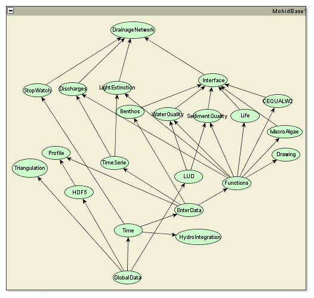
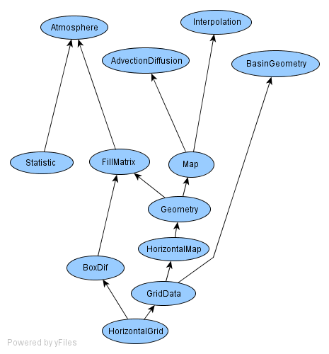
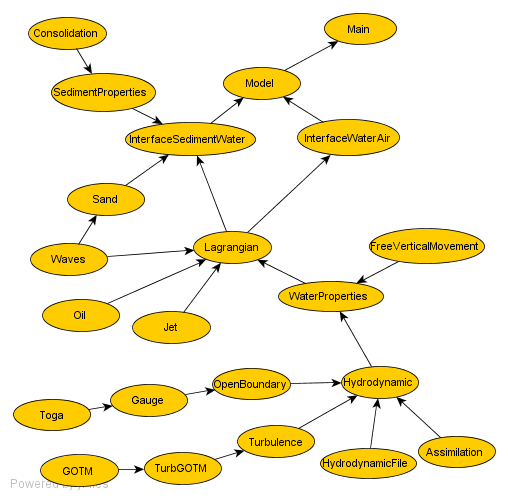

# Modules

## Mohid Base 1

**Mohid Base 1 project DAG tree**: Ellipsoids are source files; Quiver arrows are module's dependencies (**use** ModuleXpto). *Sketch made using [yED](http://www.yworks.com/en/index.html)*

> -   [Module Benthos](benthos.md)
> -   [Module CEQUALW2](cequalw2.md)
> -   [Module Discharges](discharges.md)
> -   [Module DrainageNetwork](drainagenetwork.md)
> -   [Module Drawing](../../base/module-drawing.md)
> -   [Module EnterData](../../base/module-enterdata.md)
> -   [Module Functions](../../base/module-functions.md)
> -   [Module GlobalData](../../base/module-globaldata.md)
> -   [Module HDF5](../../base/module-hdf5.md)
> -   Module HydroIntegration
> -   [Module Interface](../../base/module-interface.md)
> -   [Module Life](life.md)
> -   Module LightExtinction
> -   [Module MacroAlgae](macroalgae.md)
> -   Module LUD
> -   Module Profile
> -   [Module SedimentQuality](sedimentquality.md)
> -   Module StopWatch
> -   [Module Time](README.md#module-time#module-time)
> -   [Module TimeSerie](timeserie.md)
> -   Module Triangulation
> -   [Module WaterQuality](waterquality.md)

## Mohid Base 2

**Mohid Base 2 project DAG tree**: Ellipsoids are source files; Quiver arrows are module's dependencies (**use** ModuleXpto). *Sketch made using [yED](http://www.yworks.com/en/index.html)*

> -   [Module AdvectionDiffusion](README.md#module-advectiondiffusion#module-advectiondiffusion)
> -   [Module Atmosphere](atmosphere.md)
> -   Module BasinGeometry
> -   [Module BoxDif](../../base/module-boxdif.md)
> -   [Module FillMatrix](../../base/module-fillmatrix.md)
> -   [Module Geometry](../../base/module-geometry.md)
> -   [Module GridData](README.md#module-griddata#module-griddata)
> -   [Module HorizontalGrid](README.md#module-horizontalgrid#module-horizontalgrid)
> -   [Module HorizontalMap](../../base/module-horizontalmap.md)
> -   Module Interpolation
> -   [Module Map](../../base/module-map.md)
> -   [Module Statistics](statistics.md)

## Mohid Water

**MohidWater project DAG tree**: Ellipsoids are source files; Quiver arrows are module's dependencies (**use** ModuleXpto). *Sketch made using [yED](http://www.yworks.com/en/index.html)*

> -   [Main](../README.md#main#main)
> -   [Module Assimilation](assimilation.md)
> -   [Module Consolidation](consolidation.md)
> -   [Module FreeVerticalMovement](freeverticalmovement.md)
> -   Module Gauge
> -   [Module GOTM](gotm.md)
> -   [Module Hydrodynamic](hydrodynamic.md)
> -   [Module HydrodynamicFile](hydrodynamicfile.md)
> -   [Module InterfaceSedimentWater](interfacesedimentwater.md)
> -   [Module InterfaceWaterAir](interfacewaterair.md)
> -   [Module Jet](jet.md)
> -   [Module Lagrangian](lagrangian.md)
> -   [Module Model](README.md#module-model#module-model)
> -   [Module Oil](oil.md)
> -   Module OpenBoundary
> -   [Module Sand](sand.md)
> -   [Module SedimentProperties](sedimentproperties.md)
> -   Module Toga
> -   [Module TurbGOTM](README.md#module-turbgotm#module-turbgotm)
> -   [Module Turbulence](turbulence.md)
> -   [Module WaterProperties](waterproperties.md)
> -   [Module Waves](waves.md)

## Mohid Land

- MohidLand
- [Module Basin](../../land/modules/basin.md)
- [Module PorousMedia](../../land/modules/porousmedia.md)
- [Module PorousMediaProperties](../../land/modules/porousmediaproperties.md)
- [Module Runoff](../../land/modules/runoff.md)
- [Module Vegetation](../../land/modules/vegetation.md)
