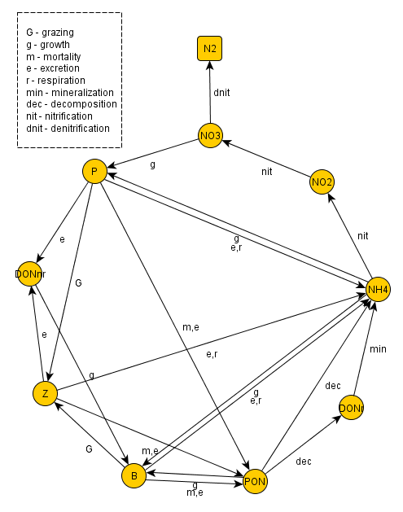
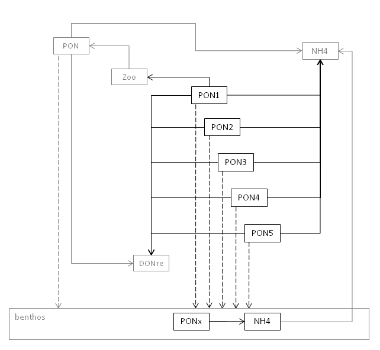

# Module WaterQuality

## Overview



Water Quality diagram that illustrates the document intitled *MOHID WaterQuality Module - Technical Guide - September 2005*.

The ecological model described in Module Water Quality is adapted from EPA (1985) and pertain to the category of ecosystem simulations models i.e. sets of conservation equations describing as adequately as possible the working and the interrelationships of real ecosystem components. The nitrogen, oxygen, phosphorus and silica biogeochemical cycles are included.

Many of the equations are written as dependent on a regulating factor, which contains the functional response of the organism to some environmental parameters such as light, nutrients or temperature. When growth is a function of many resources, there is a large range of functional forms that might express the joint dependence. To control the various possibilities, it is common to think of separate resources as limiting factors reducing some theoretical maximum growth rate - factors that can be determined separately and the combined by a small number of ways.

Each growth limitation factor can range from a value of 0 to 1. A value of 1 means the factor does not limit growth (i.e. is at optimum intensity, nutrients are available in excess, etc) and a value of 0 means the factor is so severely limiting that growth is inhibit entirely. The model uses:

- A minimum formulation only for nutrients limitation, in which the most severely limiting factor alone is assumed to limit growth. This formulation is based on “Liebig’s law of the minimum” which states that the factor in shortest supply will control the growth of algae;
- A multiplicative formulation for the three main limiting factors (light, nutrients and temperature) in which all factors are multiplied together. This approach assumes that several factors in short supply will more severely limit growth than a single factor in short supply. The major criticism of this approach is that the computed growth rates may be excessively low when several factors are limiting. Also, the severity of the reduction increases with the number of limiting nutrients considered in the model, making comparison between models difficult.

## State variables

### Organisms

#### Phytoplankton - flagellates and diatoms

Flagellates and Diatoms are described in terms of carbon concentration (mgC / l). The model assumes three limitations affecting the organisms maximum growth rate, $\mu^{\max }_x$ : Temperature $\psi (E)_x$, light $\psi (E)_x$ and nutrient limitation $\psi (N)_x$, which is computed as the minimum of $\psi (N)_x$, $\psi (P)_x$ (and $\psi (Si)_x$ when simulating diatoms. These two groups of primary producers share the same formulations for the most part of the processes differing just in terms of parameters used by the model. The model is able to consider either one or the two groups of primary producers. The simulation of the primary producers (Flagellates and/or Dioatoms) is developed with the following considerations (Figure 3):

- Organisms consume inorganic nutrients (ammonia and nitrate from the nitrogen cycle and inorganic phosphorus from the phosphorus cycle, and silicate in the case of diatoms) depending on their availability;
- Organisms’ growth is also influenced by the temperature and availability of light as a source of energy for photosynthesis;
- Dissolved oxygen is produced during respiration process consumes oxygen and produces ammonia;
- By excretion phytoplankton produces dissolved organic material (DONr, DONnr, DOPr and DOPnr);
- By mortality phytoplankton increases the dissolved organic material and the particulate organic material (PON and POP) in the system;
- By zooplankton grazing, the concentration of flagellates and diatoms decreases.
- By ciliates grazing, the concentration of flagellates decreases;
- Settling process is modeled in [Module WaterProperties](waterproperties.md) as for any other particulate property in the model.

The rate equation used by the model to compute flagellates and diatoms evolution and the processes formulations are synthetically described in the next tables.

#### Zooplankton - Micro- and Mesozooplankton

Like in primary producers, the two zooplankton groups have similar formulation differing in terms of specific parameters and grazing possibilities. Globally, zooplankton (micro and mesozooplankton) considers:

- Organisms’ growth is influenced by the temperature and prey concentration;
- Respiration process consumes oxygen and produces ammonia;
- Excretion represents a source of dissolved and particulate organic material (DONr, DONnr, DOPr and DOPnr) in the system;
- By mortality, zooplankton increases the particulate organic material (PON and POP);
- Microzooplankton grazing on bacteria and flagellates;
- Mesozooplankton grazing on diatoms and flagellates.

#### Bacteria

In terms of simulating bacteria the model considers:

- The specific uptake rate of bacteria is dependent on resource availability (organic substrate), accordingly to a Michaelis-Menten function, and on temperature;
- For ammonia uptake to take place, DOM or POM concentrations must be higher than the bacteria minimum substrate concentration needed for growth, representing the Carbon limitation for bacteria growth;
- For DOM or/and POM uptake to take place, ammonium concentrations must be higher than the bacteria minimum substrate concentration needed for growth, representing the Nitrogen limitation for bacteria growth;
- Total uptake rate of bacteria is the sum of the specific uptake rate for each one of the nutrient sources (DOMnr, ammonium, and POM);
- Nitrogen uptake is converted in carbon units using the N:C ratio of bacteria;
- Excretion represents a source of dissolved organic material (Non-Refractory Dissolved Organic Nitrogen) in the system;
- By mortality, bacteria increases the particulate organic material (Particulate Organic Nitrogen) and ammonia.
- Microzooplankton grazing on bacteria.

### Nutrients

#### Ammonia

#### Nitrite

#### Nitrate

#### Inorganic phosphorus

#### Dissolved silica

### Organic matter

#### Particulate organic nitrogen

#### Dissolved non-refractory organic nitrogen

#### Dissolved refractory organic nitrogen

#### Particulate organic phosphorus

#### Dissolved non-refractory organic phosphorus

#### Dissolved refractory organic phosphorus

#### Biogenic silica

### Oxygen

### POM pools

The explicit simulation of several POM pools is a special alternative to simulate POM dynamics inside the Water Quality module. This alternative allows the simulation of five Particulate Organic Nitrogen (PON) and five Particulate Organic Phosphorus (POP) pools. This option uses the WaterQuality module structure, using its processes and interacting with its state-variables. This means that the WaterQuality module runs in its basic setup, where PON and POP already exist. The new five PON and POP pools add to this two POM pools. The main features of this option are:

- independent sinking rate for each pool (defined inside the FreeVerticalMovement input file)
- conversion of PONx to ammonium and DONre (refractory DON), and POPx to phosphate and (DOPre), using the same mineralization rate and partitioning coefficients of PON and POP conversion (already setup inside WaterQuality input file)
- sedimentation and ressuspension of the POM pools, with mineralization in the bottom (with PONx conversion to NH4, and POPx conversion to PO4)
- oxygen consumption by POM mineralization
- zooplankton ingestion of PON1 and POP1 (according to a Michaelis-Menten dynamics)

Special attention must be paid to the modeling options. The following list combines all the mandatory elements to run the WQ module with the active POM pools dynamics:

- all five PON or POP pools must be declared inside the WaterProperties input file
- the WaterQuality model must be in use with Zooplankton activated
- oxygen must be simulated

The following scheme summarizes the simulated processes for the POM pools. for simplicity, only the nitrogen pools are represented. Oxygen consumption is considered but not represented in the scheme. The structure and processs from the basic setup of the WaterQuality module are represented in dark gray, whereas the new processes for the POM pools simulation are represented in black. Sinking rate is represented by the dashed arrows. PONx stands for all PON pools. 

## MOHID Input Files

The following examples are for one property. The same must be defined to others. The following keywords are mandatory. Optional keywords are not represented, as well as the remaining structure of the files already used by the WaterQuality module.

### InterfaceSedimentWater

```
<beginproperty>
NAME                  : pon1
UNITS                 : mg/l
DESCRIPTION           : pon1
PARTICULATE           : 1
WATER_FLUXES          : 1
EROSION               : 1
DEPOSITION            : 1
BENTHOS               : 1
<endproperty>
```

### Free Vertical Movement

```
<beginproperty>
NAME                 : pon1
WS_TYPE              : 1
WS_VALUE             : 1e-5    !sedimentation rate (user defined)
DEPOSITION           : 1
<endproperty>
```

### WaterProperties

```
<beginproperty>
NAME                 : pon1
UNITS                : mg/l
DESCRIPTION          : particulate organic nitrogen 1
IS_COEF              : .001
PARTICULATE          : 1
VERTICAL_MOVEMENT    : 1
WATER_QUALITY        : 1
BOTTOM_FLUXES        : 1
<endproperty>
```

### WaterQuality

```
NITROGEN      : 1
PHOSPHOR      : 1        !optional if NITROGEN is activated
PHYTO         : 1
ZOO           : 1
OXYGEN        : 1
POMPOOLS      : 1        !activates POM pools dynamics in the water column

POMINGESTVMAX  : 0.05    ! Zoo maximum ingest rate of POM1 (user defined)
PONINGESTKS    : 0.05    ! Semi-saturation concentration for PON ingestion by Zoo (user defined)
POPINGESTKS    : 0.05    ! Semi-saturation concentration for POP ingestion by Zoo (user defined)
PONCNRATIO     : 0.05    ! CN ratio for PON1 (user defined)
PONCPRATIO     : 0.05    ! CP ratio for POP1 (user defined)
```

### Benthos

```
NITROGEN          : 1
PHOSPHORUS        : 1     !optional if NITROGEN is activated
OXYGEN            : 1
POMPOOLS          : 1     !activates POM pools dynamics in the sediment
```

## Lagrangian Larvae WaterQuality Definitions

In order to run the waterquality module for lagrangian larvae it is mandatory to define the location of the waterquality file with the keyword WQM\_DATA\_FILE. For example:

```
WQM_DATA_FILE         : ..\..\Test\data\WaterQuality_3.dat
```

The parameters to be defined in the waterquality file model fish larvae can be summarised in the following example

```
LARVAE                : 1
AGE                   : 1
EXPLICIT              : 1
DTSECONDS             : 60.

! Larvae Properties

AWG             : 0.1344   ! Awg Growth coefficient dependent of larvae weight
BWG             : 0.0610   ! Bwg Growth coefficient dependent of larvae weight
AWG             : 1.0730   ! Awz Death coefficient dependent of larvae weight
BWG             : 0.3530   ! Bwz Death coefficient dependent of larvae weight
ATG             : 0.0511   ! Atg Growth coefficient dependent of temperature
BTG             : 0.0052   ! Btg Growth coefficient dependent of temperature
ATZ             : 0.0149   ! Atz Death coefficient dependent of temperature
BTZ             : 0.0129   ! Btz Death coefficient dependent of temperature
LSHAPE          : 3.78     ! Larvae Shape Factor
LDENSITY        : 2.95     ! Larvae Density Factor
NPHASES         : 1        ! Number of larvae phases (valid values are 1 and 2)
INIT_AGE        : 5.0      ! Larvae Inital Age (days)
INTER_AGE       : 11.0     ! Larvae Intermediate Age (days)
FINAL_AGE       : 46.0     ! Larvae Final Age (days)
INIT_LENGTH     : 5.0      ! Larvae Inital Length (mm)
INTER_LENGTH    : 10.0     ! Larvae Intermediate Length (mm)
FINAL_LENGTH    : 35.0     ! Larvae Final Length (mm)
FISHFOOD_REF    : 0.5      ! Reference Food Availability (mg/m3)
TEMPERATURE_REF : 15.      ! Reference temperature (ºC)
AFG             : 0.05     ! Afg Growth coefficient dependent of fishfood availability (mg/m3)
```

## References

Bowie G L, Mills W B, Porcella D B, Cambell C L, Pagendorf J R, Rupp G L, Johnson K M, Chan P W, Gherini S A, Chamberlin C E (1985) Rates, Constants and Kinetic Formulations in Surface Water Quality Modelling. U.S. Environmental Protection Agency
