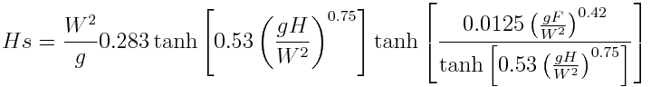
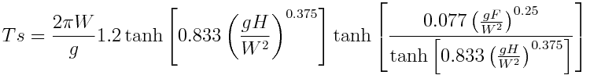
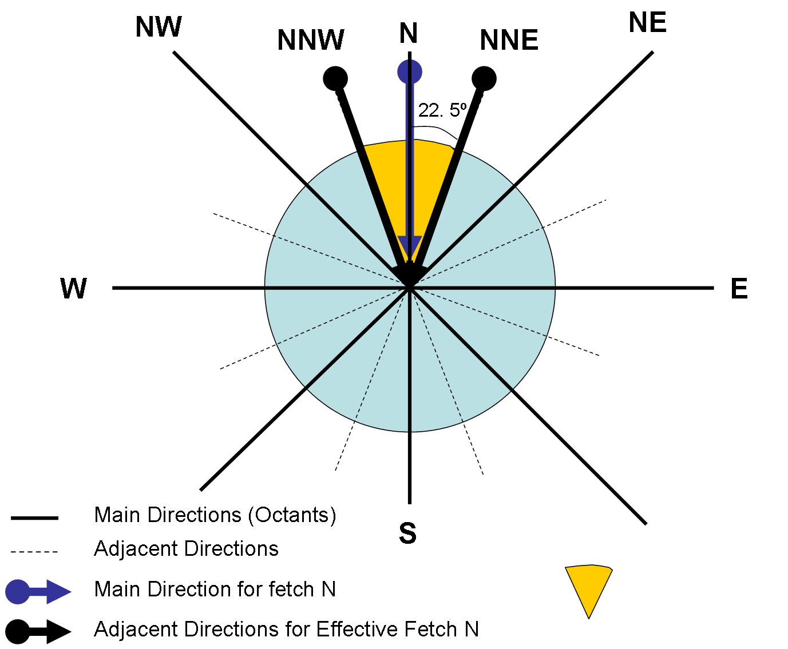
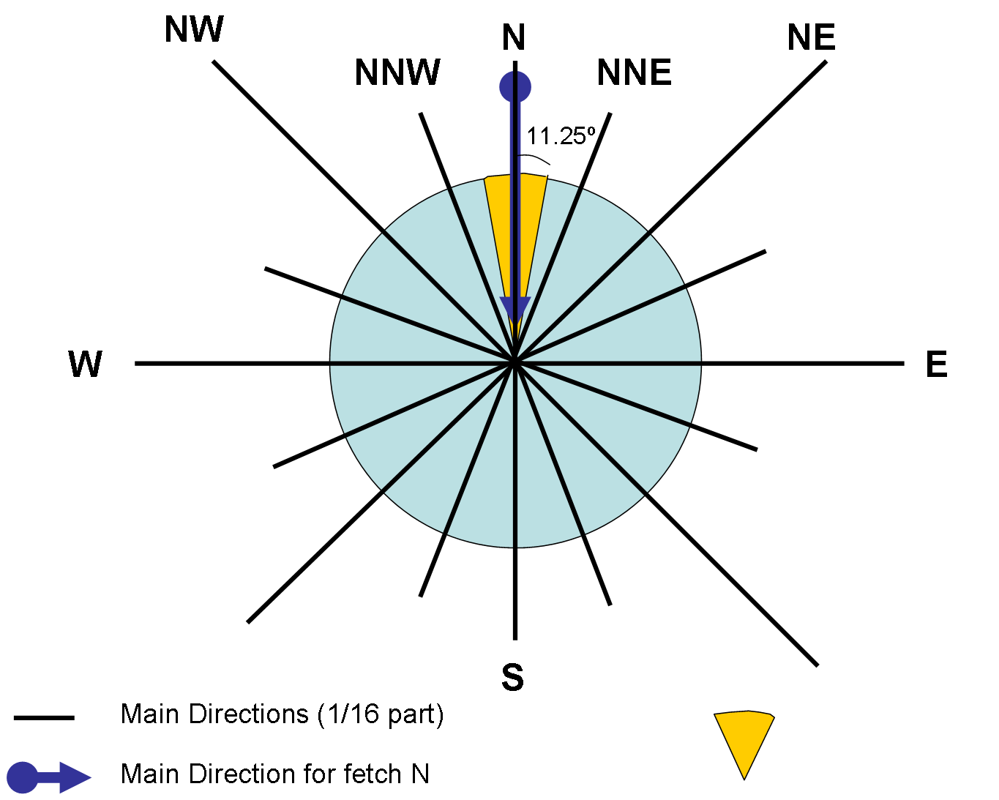
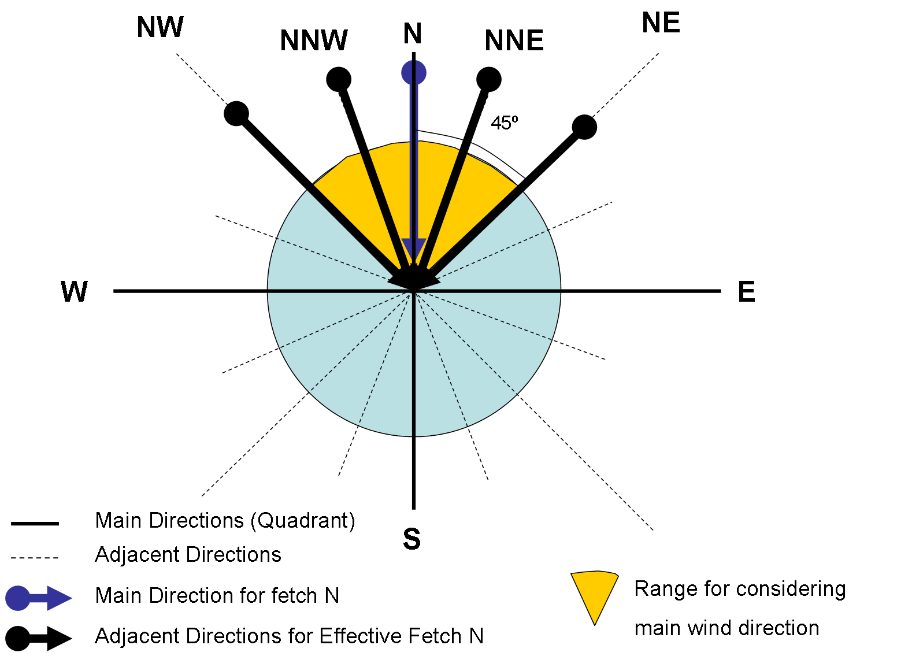
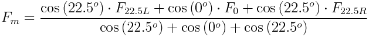

# Module Waves

## Overview

Module Waves is responsible to simulate surface waves in MOHID. It can act as a wave database, reading wave data from files, or it can predict wave parameters through a surface wave generation model which is responsible for computing surface wave properties and its related parameters, therefore communicating directly with the [water-air interface module](interfacewaterair.md), responsible for all the fluxes between the water column and the atmosphere.

The water-air interface module provides wind velocity, direction and shear stresses, receiving from the surface wave module the necessary information to compute water surface rugosity, which can ultimately be used by the turbulence and hydrodynamic module.

As surface waves depend and influence water elevations and currents, the wave module also communicates with the hydrodynamic module, providing it with radiation stresses and receiving water depths.

Also wave parameters as orbital velocity and excursion are used by the [sediment-water interface](interfacesedimentwater.md) module to compute bottom shear stresses, which will be used both in hydrodynamics and in sediment transport, controlling erosion and deposition processes.

Below it is presented the two options for wave generation computation of significant wave height and wave period: i) one approach based only on wind velocity (deep ocean) and ii) one approach for shalow restricted fetch areas dependent on wind velocity and direction (fetch lengths) and depth.

### Deep ocean wave generation model

The surface wave generation model predicts significant wave height and wave period based solely on wind velocity. This approach has applicability mainly in open deep water where wave conditions are not depth and fetch limited.

The Wave Height and Wave Period can be empirically determined as function of wind speed, according to ADIOS model formulations (NOAA, 1994).

$H=\frac{0.243*W^2}g$ equation 1

$T=\frac{8.13*W}g$ equation 2

Where H is Wave Height (m), T is Wave Period (s), W is the wind velocity (m/s) and g the gravity acceleration (m/s^2^).

### Fetch-based wave generation model

The surface wave generation model predicts significant wave height and wave period at the end of generation zone based on [fetch](../../reference/fetch.md), water depth and wind speed and direction. The model is restricted to surface wave generation by local wind and propagation is not considered explicitly. As a consequence, this model can only be applied to areas where wave propagation from the exterior is limited (e.g. ocean swell). Examples of such areas are coastal lagoons, lakes or estuaries with limited wave interaction with the ocean.

In areas where the fetch is not restricted (e.g. open sea), there is a dominant fetch and small changes in wind direction don’t significantly change fetch length or the direction of the generated wave.On the other hand, for wind directions parallel to the shore and mainly for lakes, lagoons or estuaries, a small variation in the wind direction, depending on morphology, may generate significant changes in the wind’s length of action. In this case in order to calculate the effective fetch it is then necessary to take into account the local morphology of the study area considering several directions, each one with a different weight. Thus, for the same wind direction, a point with more obstacles in the near directions has assigned a smaller fetch than a point with more water length in the same directions.

#### Equations

As propagation is not considered, the model does not require any initial conditions and there's no time dependency in the wave parameters evolution. Thus, significant wave height and mean wave period can be computed directly, being only required to provide the necessary input variables: wind speed, water depth and fetch. The equations were adapted from the CE-QUAL-W2 model (Cole, 2003) and were previously developed by Seymour (1977) and Kang et al. (1982).



Equation 3 - Significant wave heigth



Equation 4 - Significant wave period

Where, H~s~ is Significant Wave Height,

T~s~ is Significant Wave Period,

W is the wind velocity modulus (m/s),

H the water depth (m) and

F, the fetch distance (m).

These equations predict wave height and wave period at the end of the generation zone, therefore the duration of the wind action it is not accounted for, because it is admitted that the total development of the waves is achieved (direction uniform during the time for development). The hyperbolic function in eq. 3 and eq. 4 simulates the effects that, for high depths, waves are not influenced by the bottom and is also used to avoid the indefinite increasing of wave height and wave period with increasing depth.

As stated above, in lakes, estuaries, small variations in wind direction may change significantly Fetch distances. In order to take into account that effect effective fetch is computed: The broader equation (eq. 5) for effective fetch (F~e~) was obtained from Rogala (1997) and Howes (1997):

$F_e=\frac{\Sigma F_i\cdot\cos\left(\alpha_i\right)}{\Sigma\cos\left(\alpha_i\right)}$ equation 5

Where F~i~ is the fetch distance (m) in the i direction and

α~i~ = angle (º) between the wind direction and the i direction.

Effective fetch may be seen as taking into account that wind field data is usually averaged meaning that in reality the wind may have changed along a dominant direction and so adjacent directions are used.

For the implementation of the above methods it is needed wind direction and velocity (field data), fetch and depth. The latter will be discussed below.

#### Algorithms

Water depth may be computed from 2 methods:

- instant water column in the cell
- average depth in the wind direction

The first method (DEPTH\_METHOD : 0) uses the water column in every instant to compute wave height and wave period. The second method (DEPTH\_METHOD : 1) computes the average depth in wind direction (computed in construction phase from bathymetry). The latter tries to take into account the effect of depth limitation during the wind work on surface.

The algorithm for fetch computes distances to land (Fetch distances) in 16 cardinal directions for each cell. The distances to land may be computed using a grid based or graphical method. In the graphical method it is still not possible to compute average depths in wind direction.

Fetch distances and average depths in wind direction are computed considering the water points in the simulation domain. This means that if there are areas that during the simulation become uncovered (e.g. forming a temporary tidal flat island), Fetch distances or average depths are not adjusted.

```
REMINDER
Angles in ModuleWaves input and output are in atmosphere or wind referential (0º is wind FROM north, 90º from East, 180º S, 270º W
Angles in ModuleWaves internal computations are in trigonometric referencial (0º is wind FROM west, 90º from south, 180 E, 270º N
```

##### Construction Phase

###### Grid Based Method

The grid based method travels in the grid up to the land points or end of grid and may compute distances and average depth. In each cell, for each direction, in each iteration step the model travels half the cell distance and checks where it stopped (land cell or water cell). If stopped in water cell then sums the distance travelled and optionly takes in account the depth of the cell (bathymetry + Mean Sea Level) to compute the average in the path. When the iteration arrives to land cell stops and saves the distance and optionally average depth in the origin cell direction.

###### Graphical Method

The graphical method computes distances between cells and poligon lines (trigonometric relations) and it is usefull for nested domains where the grid method would stop at son grid. In each cell, for each direction, the land polygons are checked to see wich segment intersects the direction and distances are computed based on cell center and intersection point. In the future so that average depths in wind direction may be computed in nested models it has to be programmed a depth measurement similar to grid method but that may continue in father grid(s).

###### Effective Fetch

The above distances and average depths can be used directly for wave calculus or can be weighted over 3 directions to account for what was stated in the beggining, that with small wind variation may significantly change fetch distances (or average depths in wind direction). In case of weighting (FETCH\_DIRECTIONS : 8) for main octants, distances and depths are computed for 8 cardinal directions (the weighing is done using the left to the main direction, direction and right to the main direction) - Figure 1.



Figure 1 - Example of Fetch components used for North Wind (8 directions)

In case of no weighting (FETCH\_DIRECTIONS : 16) the computed distances (and optionally average depths) explained above are used without weighting - Figure 2.



Figure 2 - Example of Fetch components used for North Wind (16 directions)

To understand the concept, if there was the option for 4 fetch directions (quadrants) then the weighing would be done using the 2 left to the main direction, direction and 2 right to the main direction) - Figure 3.



Figure 3 - Example of Fetch components used for North Wind (4 directions) - this option is not used, it is shown for illustrating the concept

So, for the fetch directions weighting, 3 distances (eq. 6) can be used (the cardinal direction, the angle 22.5º to the right and the angle 2.5º to the left). This is called the effective modified fetch (Fm):



Equation 6 - Effective Fetch with 8 cardinal directions

Where, F~22L~ are the distances to land in the directions 22.5º left of the wind direction (m);

F~22R~ are the distances to land in the directions 22.5º right of the wind direction (m);

and F~0~ is distance to land along wind direction (m).

The weight given to each distance is based on the cosine function, taking a unitary weight for the wind direction and decreasing weights to angles away from this direction.

##### Run Phase

The above calculus (fetch distances or optionally averag depths) are only made once (construction phase) and the result is stored in memory during the entire simulation. During the simulation period, in each time step and in each and every cell, depending on wind direction, the fetch distance and optionaly the average depth (both in along wind direction) are selected from the matrixes saved and are used together with wind speed and water depth to calculate the wave height and period. In case of depth computed from local cell depth, than the model uses the water column computed from hydrodynamics.

If using 8 fetch directions than if wind is in a range of 45º around the main octant angle than that fetch value is used that was weighted using the main directions and two adjacent directions (see Figure 1). If using 16 fetch directions than if wind is in a range of 22.5º around the main angle than that fetch value is used that had no weighting (see Figure 2).

#### Wave orbital velocity and excursion

Water height and wave period are used to compute orbital parameters used in ModuleInterfaceSedimentWater for computing the bottom shear stress increment by waves. Linear wave theory is generally applied to determine the near-bed velocities. In case of symmetrical (sinusoidal) small-amplitude waves in relatively deep waters this theory yields good results. When waves approach shallower waters, the waves will be distorted leading to asymmetrical wave profiles and higher order wave theories are necessary to determine the near-bed velocities. In this model only linear wave theory is considered, therefore applying it, the peak value of the orbital excursion (Aδ) and velocity (Uδ) at the edge of the wave boundary layer can be expressed as:

```
Insert equation
```

## User manual

### Main options

In this chapter it is briefly described how to use Module Waves. The different options provided by the module can be defined through an input data file, similarly to other modules in MOHID. In order to couple this module with the rest of the model simulation, it has to be activated in the [Module Model](README.md#module-model#module-model) input data file, by defining the following keyword:

```
WAVES                                     : 1
```

ModuleWaves can be used as a database, reading the solution for the different parameters (radiation stresses, significant wave height, mean wave period and mean wave direction) from a file, or it can be used to compute wave parameters based on external information. Depending on the options chosen, ModuleWaves might be dependent on the activation of other modules, namely the Atmosphere and InterfaceWaterAir modules, which provide wind information. In order to use the wave module so that it influences hydrodynamics (water level and currents), the user must activate the radiation stress options and activate in the Hydrodynamic input data file the following keyword:

```
WAVE_STRESS                           : 1
```

To use Module Waves so that the waves effect contributes to the calculation of bottom shear stress it is necessary to turn on the following keyword and block in InterfaceSedimentWater data file:

```
WAVETENSION                       : 1
```

```
<begin_waverugosity>
INITIALIZATION_METHOD        : CONSTANT
FILE_IN_TIME                 : NONE
DEFAULTVALUE                 : 9e-3
REMAIN_CONSTANT              : 0
<end_waverugosity>
```

This will also enable to consider waves influence on resuspension and deposition of particulate matter in the water-sediment interface.

### Keywords

```
Keyword                   : Data Type         Default     !Comment

RADIATION_TENSION_X       : logical            false        !Connect/Disconnect waves radiation tension in X direction
RADIATION_TENSION_Y       : logical            false        !Connect/Disconnect waves radiation tension in Y direction
WAVE_HEIGHT               : logical             true        !Connect/Disconnect waves height
WAVE_PERIOD               : logical             true        !Connect/Disconnect waves period
WAVE_DIRECTION            : logical             true        !Connect/Disconnect waves direction
WAVEGEN_TYPE              : integer              0          !Method for computing wave generation (wave height and period)
                                                             ! 0 - deep areas (wind velocity dependent);
                                                             ! 1 - shallow "closed" areas (wind velocity and direction, fetch and depth dependent)
DISTANCE_TO_LAND_METHOD   : integer              0          !Method for computing fetch distances to land (read if WAVEGEN_TYPE : 1)
                                                             ! 0 - grid based method (limited in nested domains)
                                                             ! 1 - graphical method using distances to land poligons (need the polygon block)
FETCH_DIRECTIONS          :  8/16                16         !Number of directions to compute fetch (read if WAVEGEN_TYPE : 1)
WAVE_HEIGHT_PARAMETER     :  real                1.         !multipling factor for wave height - calibration  (read if WAVEGEN_TYPE : 1)
WAVE_PERIOD_PARAMETER     :  real                1.         !multipling factor for wave period - calibration  (read if WAVEGEN_TYPE : 1)
DEPTH_METHOD              : integer              0          !Method for computing fetch depth  (read if WAVEGEN_TYPE : 1)
                                                             ! 0 - local cell water column
                                                             ! 1 - average depth in the wind direction
                                                             ! 2 - user defined value (constant for sensibility tests)
MEAN_SEA_LEVEL            : real                 0.         !Mean sea level above bathimetry for DEPTH_METHOD : 2 (average bathymetry + MSL)
DEPTH_VALUE               : real             AllmostZero    !Depth defined by user for DEPTH_METHOD : 3
OUTPUT_FETCH_DISTANCES    : logical            .false.      !Output fetch distances in each direction (grid data) (read if WAVEGEN_TYPE : 1)
OUTPUT_FETCH_DEPTHS       : logical            .false.      !Output fetch depths in each direction (grid data) (read if WAVEGEN_TYPE : 1 )

Poligon block for DISTANCE_TO_LAND_METHOD : 1
<begin_landareafiles>
  Polygon1.xy
  Poligon2.xy
   ...
<end_landareafiles>

<begin_[property]>
 NAME                      : wave height/ wave period / ...

 see Module FillMatrix for more options

<end_[property]>
```

### Input data file

In a simulation, it is possible to choose between the calculation of wave height and wave period as described in deep ocean equations based on wind velocity (simpler) or as fetch and depth dependent. This is made by a keyword named 

$$
WAVEGEN\_TYPE
$$

 (keyword = 0 and the method is the simpler and keyword = 1 stands for the fetch method, by default the value is 0 (zero)).

#### Fetch based

If using the fetch based model, the working scheme of the model is very simple: in the constructing phase of MOHID, the distances to land are calculated for all water cells in the 16 cardinal directions.

The distances to land can be computed with two different methods, distinguishing them with the keyword 

$$
DISTANCE\_TO\_LAND\_METHOD
$$

. If this keyword equals zero, the distances to land are computed along the grid, incrementing half cell size in each cycle step, until land or end of grid is encountered. If the keyword equals one, distances are computed performing tangents to the points and intersecting them with polygons (Land Areas) segments. The first method can not be used with nested models (if grid ends before directions reaches land).

Depth can be computed from local cell water column variable during simulation (DEPTH\_METOD : 0) or with average water depth (DEPTH\_METHOD : 1) in each 16 cardinal directions (bathymetry + Mean Sea Level where MSL is MEAN\_SEA\_LEVEL : xx).

Fetch distances or average depths may be maintained in 16 directions (FETCH\_DISTANCES : 16) or be weighted with 3 directions (FETCH\_DISTANCES : 8) to take account of wind direction variation may impact fetch distance and average water depht.

Fetch distances and average depths are only calculated once in the simulation (in the MOHID construction phase).

#### Wind velocity based example

```
OUTPUT_TIME              : 0 86400

RADIATION_TENSION_X      : 0
RADIATION_TENSION_Y      : 0
WAVE_PERIOD              : 1
WAVE_HEIGHT              : 1
WAVE_DIRECTION           : 1

WAVEGEN_TYPE             : 0

<begin_waveperiod>
INITIALIZATION_METHOD    : CONSTANT
DEFAULTVALUE             : 12.
REMAIN_CONSTANT          : 0
OUTPUT_HDF               : 1
TIME_SERIE               : 1
<end_waveperiod>

<begin_waveheight>
INITIALIZATION_METHOD    : CONSTANT
DEFAULTVALUE             : 0.1
REMAIN_CONSTANT          : 0
OUTPUT_HDF               : 1
TIME_SERIE               : 1
<end_waveheight>

<begin_wavedirection>
INITIALIZATION_METHOD    : CONSTANT
DEFAULTVALUE             : 0.
REMAIN_CONSTANT          : 0
OUTPUT_HDF               : 1
TIME_SERIE               : 1
<end_wavedirection>
```

#### Fetch based example

```
OUTPUT_TIME              : 0 86400

RADIATION_TENSION_X      : 0
RADIATION_TENSION_Y      : 0
WAVE_PERIOD              : 1
WAVE_HEIGHT              : 1
WAVE_DIRECTION           : 1

WAVEGEN_TYPE             : 1

FETCH_DIRECTIONS         : 16
WAVE_HEIGHT_PARAMETER    : 1.
WAVE_PERIOD_PARAMETER    : 1.

DEPTH_METHOD             : 1
MEAN_SEA_LEVEL           : 2.08

OUTPUT_FETCH_DISTANCES   : 1
OUTPUT_FETCH_DEPTHS      : 1

<begin_waveperiod>
INITIALIZATION_METHOD    : CONSTANT
DEFAULTVALUE             : 12.
REMAIN_CONSTANT          : 0
OUTPUT_HDF               : 1
TIME_SERIE               : 1
<end_waveperiod>

<begin_waveheight>
INITIALIZATION_METHOD    : CONSTANT
DEFAULTVALUE             : 0.1
REMAIN_CONSTANT          : 0
OUTPUT_HDF               : 1
TIME_SERIE               : 1
<end_waveheight>

<begin_wavedirection>
INITIALIZATION_METHOD    : CONSTANT
DEFAULTVALUE             : 0.
REMAIN_CONSTANT          : 0
OUTPUT_HDF               : 1
TIME_SERIE               : 1
<end_wavedirection>
```

#### SWAN based example

This example MOHID input data files shows how to read wave forcing from an hdf5, generated from the results of a wave model, one such as [SWAN](../../tools/mohid-swan.md). Go check out the [SWAN](../../tools/mohid-swan.md) wiki to configure and run the [SWAN](../../tools/mohid-swan.md) for your domain...

```
Hydrodynamic_x.dat

WAVE_STRESS             : 1
```

```
InterfaceSedimentWater_x.dat

<begin_waverugosity>
FILE_IN_TIME            : NONE
REMAIN_CONSTANT         : 0
OUTPUT_HDF              : 1
TIME_SERIE              : 0
DEFAULTVALUE            : 0.0025
<end_waverugosity>

WAVETENSION : 1
```

```
Waves_x.dat

WAVE_PERIOD             : 1
WAVE_DIRECTION          : 1
WAVE_HEIGHT             : 1
RADIATION_TENSION_X     : 1
RADIATION_TENSION_Y     : 1

<begin_waveheight>
NAME                    : significant wave height
UNITS                   : m
DESCRIPTION             : wave height variable
INITIALIZATION_METHOD   : HDF
FILE_IN_TIME            : HDF
FILENAME                : Waves.hdf5
DEFAULTVALUE            : 0.0
OUTPUT_HDF              : 1
<end_waveheight>

<begin_wavedirection>
NAME                    : mean wave direction
UNITS                   : º
DESCRIPTION             : mean wave direction
INITIALIZATION_METHOD   : HDF
FILE_IN_TIME            : HDF
FILENAME                : Waves.hdf5
DEFAULTVALUE            : 0.0
OUTPUT_HDF              : 1
<end_wavedirection>

<begin_waveperiod>
NAME                    : mean wave period
UNITS                   : s
DESCRIPTION             : mean wave period WW3
INITIALIZATION_METHOD   : HDF
FILE_IN_TIME            : HDF
FILENAME                : Waves.hdf5
DEFAULTVALUE            : 0.0
OUTPUT_HDF              : 1
<end_waveperiod>

<begin_radiationstress_x>
NAME                    : wave stress X
UNITS                   : Pa
DESCRIPTION             : /wave stress X
INITIALIZATION_METHOD   : HDF
FILE_IN_TIME            : HDF
FILENAME                : Waves.hdf5
DEFAULTVALUE            : 0.0
OUTPUT_HDF              : 1
<end_radiationstress_x>

<begin_radiationstress_y>
NAME                    : wave stress Y
UNITS                   : Pa
DESCRIPTION             : /wave stress Y
INITIALIZATION_METHOD   : HDF
FILE_IN_TIME            : HDF
FILENAME                : Waves.hdf5
DEFAULTVALUE            : 0.0
OUTPUT_HDF              : 1
<end_radiationstress_y>
```

### Outputs

### Time series

### Maps (HDF5 format)

## References

- Braunschweig F, Leitao PC, Fernandes L, Pina P, Neves RJJ. The object oriented design of the integrated Water Modelling System. Developments in Water Science. 2004;55:1079-1090. Available at: [http://dx.doi.org/10.1016/S0167-5648(04)80126-6](http://dx.doi.org/10.1016/S0167-5648\(04\)80126-6).

- Cole, T.M. and S.A. Wells, 2003. CE-QUAL-W2: A two-dimensional, laterally averaged, Hydrodynamic and Water Quality Model, Version 3.2. Instruction Report EL-03-1, US Army Engineering and Research Development Center, Vicksburg, MS.

- Howes, 1997. British Columbia Estuary mapping Systems – Appendix A: Wave Exposure Calculation. Ministry of Sustainable Resource Management, British Columbia U.S.A.

- Kang, S.W., Sheng, J.P. and Lick, W., 1982. Wave Action and Bottom Shear Stress in Lake Eire. Journal of Great Lake Research, 8(3): 482-494.

- NOAA (1994) - ADIOSTM (Automated Data Inquiry for Oil Spills) user’s manual. Seattle: Hazardous Materials Response and Assessment Division, NOAA. Prepared for the U.S. Coast Guard Research and Development Center, Groton Connecticut, 50 pp.

- Rogala, J.T., 1997. Estimating Fetch for Navigation Pools in the Upper Mississippi River Using a Geographic Information System. United States Geological Survey -Project Status Report 97-08 .

- Seymour, R.J., 1977. Estimating Wave Generation in Restricted Fetches. J. ASME WW2, May 1977 pp251-263.
